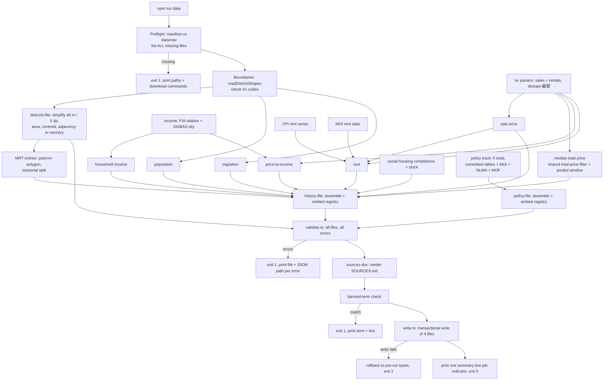
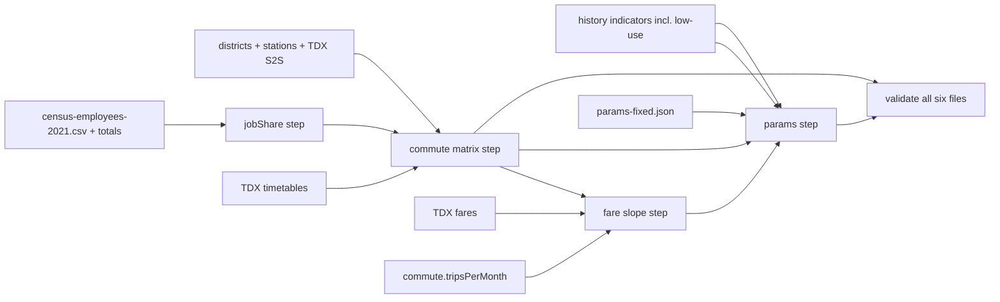

# Design Document: Data Pipeline

## Overview

The data pipeline is one Node command, `npm run data`, that turns the raw open data in `data/raw/` and a small set of committed tables into six outputs:

- `public/data/districts.json`: the 41 districts with city, romanized name, land area, centroid and simplified boundary geometry.
- `public/data/history.json`: the real quarterly baseline, 2015Q1 to 2025Q4, for 13 district indicators and 2 city indicators, with an estimate flag and a method id on every estimated value. It also embeds the source registry and method list it references, so the web app can show provenance without parsing Markdown.
- `public/data/policy-track.json`: the real quarterly track of the 5 player policy tools, 2015Q1 to 2025Q4, 10 series, each value with its source and an estimate flag (and a method id when estimated). It embeds its own source and method registry.
- `public/data/params.json`: the simulation parameter table (81 ids) in the wrapped form the engine reads. Values come from cited research, from our own data, or from documented assumptions (Requirements 20 to 23, section "Data supplement").
- `public/data/commute-matrix.json`: the 41×41 one-way commute-time matrix, one fixed matrix for the 2025Q4 rail network (Requirements 24 and 25).
- `data/SOURCES.md`: a generated document listing every source, every method, the reference-district table, the MRT station notes, the policy-series assumptions, the parameter table with its source types, the commute model and the known data gaps.

The pipeline:

- reads only `data/raw/` and committed repository files, and never imports the HTTP helpers;
- builds and validates all six outputs in memory before writing anything;
- writes all outputs in one transaction that restores the previous files if any write fails;
- produces byte-identical output for identical input, in PowerShell and Git Bash, on any machine.

It reuses the existing code: `scripts/lib/` (CSV parser, district table, ROC time helpers, ZIP and ODS reader, paths), `scripts/geo/` (shapefile reader, shared-border simplifier, TWD97 converter) and the parsers already exported from `scripts/sources/` (`districtTotals`, `readDistrictShapes`, `mergeByName`, `rocSlashDateYear`, `parseIndex`). `scripts/build-boundaries.ts` is folded into the pipeline and retired (see Decision D1).

### Design principles

1. **Pure core, thin I/O shell.** Every parser takes text or bytes and returns records. Every indicator builder takes parsed records and returns value series. Only `raw-reader.ts` and `write.ts` touch the file system. Tests can therefore run on in-memory fixtures with an empty `data/raw/` (Requirement 18.8).
2. **Fail early, fail completely.** A preflight step lists every missing raw file before any parsing starts. Validation collects every error before stopping.
3. **One registry.** Sources, methods and indicator metadata are defined once in TypeScript and used to build the JSON files, the embedded registry and `SOURCES.md`.
4. **Every cell gets a number, except low-use quarters that no published period covers.** Each indicator's method chain always yields a finite number or stops the build with a named error. The two low-use indicators are the one exception: a quarter that no published half-year covers is `null` with `estimated: false` and no method, and nothing is filled in (Requirement 26 criterion 5; Decision D35). A district with no published value in any half-year is all `null` and does not stop the build, up to 5 such districts (Decision D49). The validator also accepts `null` with a reason method (Requirement 4.8), but the pipeline never emits one (Decision D11).

### Research findings that shape the design

- **Raw layouts checked on disk** (2026-11 download): the MOI district rent statistics ODS (`1140123全國行政區租金統計-修正.ods`) holds contract counts and the 25th, 50th and 75th percentile of monthly rent per contract, per district and housing type. It has **no mean**, so Requirement 9.4 uses the median monthly rent, the 50th percentile of the `不分類` (all types) row (Decision D17).
- **District adjacency** computed from the existing simplified boundaries (shared vertices): Pinglin borders only Shiding, Pingxi, Wulai and Shuangxi. All four have fewer than 30 rental records in DATA-CHECK.md item 2b, so Pinglin uses the second rule of Requirement 9.7, a district that borders one of its bordering districts (Decision D7).
- **CPI rent series**: the Taipei DBAS CSV has the columns `統計期`, `基本分類`, `原始值[統計數值]`, `年增率[%]`, `縣市別代碼`; the DGBAS XML has `<Obs>` elements with `Item` `1.房租(指數基期：民國110年=100)`, `TIME_PERIOD` `YYYYMmm` and `TYPE` `原始值`.
- **Population source correction**: ODRP010 and ODRP060 hold births, deaths, marriages and divorces by village, not population (no `people_total`). Population from 2018 comes from ODRP014 (`people_total`, `household_no`, single-age columns and an 11-digit `district_code`), read for the last month of each quarter (10703–11412). The API returns all 32 months, so the data.gov.tw 131138 CSV fallback is not used.
- **MRT annual series** columns: `統計期` (`103年`), `捷運站別`, `進站人次`, `出站人次`.
- **DGBAS 9415** columns: `年`, `臺北市-元`, `新北市-元` (one row per year from 1998).
- **Policy raw files checked on disk** (2026-11 download): the MOI E3010 JSON tables (6_1_3 and 6_3_1) hold a `resultTable` whose header cells are ROC quarters such as `104Q1` (add 1911), city labels `台北市` and `新北市`, and values with thousands separators such as `4,213.00`. MOI dataset 169800 has, for ROC year 112, household-months and subsidy amounts (NT$ thousand) per city. MOF dataset 6742 has a `房屋稅` column and row labels such as `90年/ 新北市(改制後)`.
- **Holding tax rates in law**: the House Tax Act range for other residential buildings was 1.5–3.6 % from 2014-06-06 and 2.0–4.8 % from 2024-07-01. The New Taipei ordinance was enacted on 2016-07-20 and took effect on 2017-07-01, so its rate before that date is not in any legal text found (Requirement 12.10).
- **Node string sort is by UTF-16 code unit, and `localeCompare` depends on the ICU locale.** `scripts/build-boundaries.ts` uses `localeCompare` to sort features; the pipeline replaces it with an explicit code-point comparator.
- **`fs.renameSync` on Windows** replaces an existing destination (Node uses `MoveFileEx` with `MOVEFILE_REPLACE_EXISTING`), but fails if another process holds the file open. The writer treats a failed rename like a failed write and rolls back.
- **Git line endings**: with `core.autocrlf=true` (the Git for Windows default), LF files can be checked out as CRLF. A `.gitattributes` entry forces LF for the generated files.
- **Data supplement findings (2026-11-17)**:
  - **TDX station-to-station times already on disk.** `data/raw/stations/tdx-s2s-travel-time-TRTC.json` has the lines BL, BR, G, O, R; `tdx-s2s-travel-time-NTMC.json` has only the lines `Y` (Circular Line) and `LB` (the Sanying Line, stations LB01 Dingpu to Hengxi, opened after 2025-12-31). The Danhai LRT and the Ankeng LRT are **not** in either file, and no transfer or run time exists for the Taoyuan Airport MRT. The first download worked without credentials (anonymous, rate-limited); `TDX_CLIENT_ID` and `TDX_CLIENT_SECRET` are optional for `scripts/download.ts stations`. TDX returns HTTP 400 (not supported) for the S2STravelTime and the Frequency request of NTDLRT (Danhai LRT) and NTALRT (Ankeng LRT), checked 2026-11-19, so these four requests are removed from `scripts/download.ts` (Requirement 27 criteria 3 and 4). The Danhai and Ankeng run times and headways come from the StationTimeTable files of the `timetables` source (Requirement 25 criteria 2 and 15).
  - **District employees.** The DGBAS Industry and Service Census publishes year-end persons engaged by township and district (editions 2016 and 2021, tables "按行政區別分", PDF on ws.dgbas.gov.tw). No machine-readable edition was found. Decided 2026-11-18: the 2021 counts are transcribed by hand into a committed table (Requirement 28; see "Employee table and job shares" below). The earlier assumption that 2020 census table 14 could serve as a fallback was wrong (see the checks of 2026-11-18).
- **Checks done on 2026-11-18 (recorded as research findings):**
  - **2020 census table 14** (`data/raw/census/census2020-{taipei,ntpc}-s014-workplace.ods`): the rows are RESIDENCE districts; the columns are total employed, working in the same district, in another district of the same city, and in another county, city or overseas. It has no count of employed persons by WORKPLACE district, so it cannot give `commute.jobShare`. Five web searches found no census table grouped by workplace district. The same property limits `ghost.shareCommuteWithin`, which is therefore estimated with a spreading rule (see Computations).
  - **No fare data in `data/raw/`.** `data/raw/stations/` holds only the TDX station-to-station travel times for TRTC and NTMC and the station lists. The fare tables come from a new `fares` download source, added in the first implementation task.
  - **Engine.** `SCENARIO_EFFECT_IDS` in `src/simulation/params.ts` does not include `migration.commuteCostPerMinute`. A simulation-engine spec change (handled separately) adds it with direction-aware Scenario values: the strongest-effect Scenario takes `high` and the weakest takes `low`, which is 0. This design depends on that change and does not make it.
  - **Units of K_o.** `commuter-pass.ts` declares the field `subsidy` in TWD per pass per month, `difference` returns player minus real subsidy per city, and `effects` copies it to `commuteCostDelta` of each district. `engine.ts` sums `commuteCostDelta` over the tools into `commuteCostOffset`, and `migration.ts` computes `cost = max(0, commuteCostPerMinute × minutes − commuteCostOffset)`. So K_o is TWD per pass per month and `commuteCostPerMinute × minutes` must be TWD per commuter per month. The `commuterPassSubsidy` Policy_Series unit is `TWD per 30-day pass`; one 30-day pass per month is assumed (Open Question 24).
  - **Census tenure** (table 34, ODS on disk) gives households and renting households per district, from which `housing.renterRate.<city>` follows.
  - **MOI low-use housing statistics** (downloaded and reviewed, task 22.8). The district-level files are in `data/raw/low-use/` as `moi-low-use-{current,original}-{period}-{63000,65000}.csv`, fetched from https://pip.moi.gov.tw/Publicize/Info/E1040 (a GET for a token, then a POST per file). The page publishes two methods. The current method (現行標準) has 17 periods: annual values for ROC 104 to 108 and half-yearly values 2020H1 to 2025H2. The original method (原標準) has 7 periods, 2015H2 to 2020H2. The values differ (Xinyi 2019H2: current 4.97 percent, 3,741 dwellings; original 5.32 percent, 4,006 dwellings). The build reads the current method only, because it is the only one that covers 2015 to 2025 with one definition; the original-method files stay in `data/raw/` and are never opened (Requirement 26 criteria 1 and 15). The design fills no missing period.
  - **ODRP014** village rows hold `household_no` and `people_total`, so persons per household needs no new source.

## Architecture

### Module layout

```
scripts/
├── build-data.ts                 # entry point for `npm run data`; calls pipeline/run.ts
├── build-boundaries.ts           # retired (logic moves to pipeline/districts-file.ts)
└── pipeline/
    ├── run.ts                    # step runner: ordered steps, step names, exit codes, summary lines
    ├── context.ts                # BuildContext: RawReader, DISTRICTS, QUARTERS, logger
    ├── raw-reader.ts             # the only file-system reader: sorted listings, repo-relative paths, decoding
    ├── manifest.ts               # required raw files per step, with their download id (preflight)
    ├── errors.ts                 # PipelineError, ParseError, MissingInputsError, ValidationFailedError
    ├── numeric.ts                # median, stableSum, mean, roundTo, apportion, linearFit, codePointCompare
    ├── interpolate.ts            # annualToQuarterly (mean-preserving, slope-limited)
    ├── geo.ts                    # spherical area, centroid, haversine, district lookup, adjacency
    ├── serialize.ts              # canonical JSON writer and number formatter
    ├── write.ts                  # transactional multi-file writer with rollback
    ├── registry/
    │   ├── sources.ts            # SOURCE_REGISTRY: every SourceEntry, plus URL redaction
    │   ├── methods.ts            # METHOD_REGISTRY: every MethodEntry
    │   └── indicators.ts         # INDICATORS: id, level, unit, kind, decimals, description, sources
    ├── tables/
    │   ├── rent-reference.ts     # fixed reference-district assignments
    │   ├── cpi-series.ts         # city → CPI rent series assignment
    │   └── mrt-stations.ts       # annual-series aliases, section opening dates, comparable stations (chosen by mrt-comparable.ts), address districts
    ├── parsers/                  # pure: text/bytes → typed rows; throw ParseError
    │   ├── household.ts          # population and migration CSV/JSON (MOI, ris.gov.tw)
    │   ├── migration-annual.ts   # Taipei a05002802, New Taipei 124872
    │   ├── income.ts             # FIA (wraps sources/income.ts districtTotals), DGBAS 9415
    │   ├── lvr.ts                # real-price registration sales and rentals
    │   ├── cpi.ts                # Taipei DBAS CSV, DGBAS XML
    │   ├── rent-stats.ts         # MOI district rent statistics ODS
    │   ├── mrt.ts                # annual series, daily Big5 files
    │   ├── rent-subsidy.ts       # MOI E3010 JSON tables 6_1_3 and 6_3_1, MOI 169800 CSV
    │   ├── house-tax.ts          # MOF 6742 CSV
    │   ├── policy-tables.ts      # committed tables: holding tax rates, commuter pass products, sublease phases
    │   ├── social-housing.ts     # NLMA list and detail JSON (completion and start dates)
    │   └── reference-ratios.ts   # optional hand-entered MOI price-to-income table
    ├── indicators/               # pure builders: parsed rows → IndicatorSeries
    │   ├── population.ts
    │   ├── migration.ts
    │   ├── income.ts
    │   ├── lvr-input.ts          # shared lvr loader; totalPriceSales, the one 總價元 > 0 filter (Requirement 19.6)
    │   ├── pooled-window.ts      # bucketing by district-quarter and the pooled-window median, shared by sale price and median total price
    │   ├── sale-price.ts
    │   ├── median-total-price.ts # district median total price (Requirement 19)
    │   ├── rent.ts
    │   ├── price-to-income.ts
    │   ├── mrt.ts
    │   └── social-housing.ts
    ├── policy/                   # pure builders: parsed rows + committed tables → PolicySeries
    │   ├── social-housing-starts.ts
    │   ├── rent-subsidy.ts
    │   ├── sublease.ts
    │   ├── holding-tax.ts
    │   └── commuter-pass.ts
    ├── policy-file.ts            # assembles PolicyTrackFile from PolicySeries + registries
    ├── districts-file.ts         # builds DistrictsFile from shapes
    ├── history-file.ts           # assembles HistoryFile from IndicatorSeries + registries
    ├── sources-doc.ts            # renders data/SOURCES.md from registries and build notes
    ├── banned-terms.ts           # neutrality check on SOURCES.md text
    ├── params/                   # Data supplement: parameter table (Requirements 20 to 23)
    │   ├── engine-ids.ts         # engineIdSet(): collectParameterSpecs(RULE_REGISTRY) + ENGINE_EXTRA_IDS - OMITTED_OPTIONAL_IDS; idSetDiff()
    │   ├── fixed-table.ts        # reads data/config/params-fixed.json (type 1 and type 3 entries), entry checks
    │   ├── social-housing.ts     # lag, unitCost, rentPerUnit, costSchedule
    │   ├── housing.ts            # dwellingSize, householdSize.<city>, renterRate.<city>
    │   ├── ghost.ts              # lognormal tail share, shareRent, sensitivityRent, shareCommuteWithin, sensitivityCommute, shareBoth
    │   ├── job-share.ts          # commute.jobShare.<code>, largest-remainder shares
    │   ├── migration-anchors.ts  # migration.share and migration.exitShare anchors
    │   └── params-file.ts        # assembles ParamsFile, runs the Id_Set_Check
    ├── commute/                  # Data supplement: commute matrix (Requirements 24 and 25)
    │   ├── network.ts            # stations, edges (TDX S2S), opening-date filter, transfers, LRT fallback edges
    │   ├── timetable.ts          # TDX StationTimeTable files (Frequency files unused): line headways (median method) and, where S2S is missing (Danhai LRT, Ankeng LRT), inter-station run times (Requirement 25 criteria 2 and 15)
    │   ├── centroids.ts          # population-weighted district centroids from ODRP019 + village SHP (Requirement 24.12 to 24.16)
    │   ├── model.ts              # access/egress legs, rail time, road time, cell = min; matrix assembly
    │   ├── survey-check.ts       # weighted New Taipei to Taipei mean vs 57 minutes
    │   └── commute-file.ts       # assembles CommuteMatrixFile
    ├── credentials-scan.ts       # Requirement 25 criterion 6: scan outputs for TDX credential values
    └── low-use.ts                # parser and builder for lowUseHousingCount / lowUseHousingRate (Requirement 26)

src/
├── types/data-files.ts           # schema types and constants shared with the web app
└── data/validate.ts              # pure schema validator, used by the pipeline now and src/data later

data/config/
├── banned-terms.txt              # one term per line, seeded from neutrality.md
├── banned-terms-exempt.txt       # official policy or dataset titles that may contain a banned term
├── moi-price-to-income.csv       # optional hand-entered MOI ratios (Requirement 10.5)
├── holding-tax-rates.csv         # effective-dated rates with legal text, article and source (Requirement 12.9)
├── commuter-pass-products.csv    # pass products with start date, price and source (Requirement 12.12)
├── sublease-phases.csv           # phase start dates and cumulative totals with source (Requirement 12.8)
├── params-fixed.json             # type 1 (research) and type 3 (gap) Parameter_Entries (Requirements 21, 23)
├── commute-params.json           # commute model constants, 8 Parameter_Entries (Requirement 25.3, 25.9 to 25.15)
└── social-housing-unit-cost-cases.csv  # three Taipei project costs (Requirement 22.4)

.gitattributes                    # public/data/*.json and data/SOURCES.md: text eol=lf
```

Existing modules reused without change: `scripts/lib/csv.ts`, `districts.ts`, `time.ts`, `zip.ts`, `paths.ts`; `scripts/geo/shapefile.ts`, `simplify.ts`, `twd97.ts`. `scripts/sources/boundaries.ts` (`readDistrictShapes`) and `scripts/sources/stations.ts` (`mergeByName`) are reused; `assignDistricts` in `stations.ts` reads shapes from disk itself, so the pipeline calls a new pure `districtAt(point, shapes)` in `pipeline/geo.ts` instead. `scripts/lib/http.ts` and `scripts/lib/datagov.ts` are never imported by `scripts/pipeline/` (Requirement 2.1, enforced by a test).

### Build flow



### Step runner

`run.ts` runs a fixed list of named steps. Each step is `{ name: string; run(ctx, state): void }` and adds its results to a typed `BuildState`. The runner:

1. Deletes stale temp files left by an interrupted earlier run (`*.pipeline-tmp` next to the output paths).
2. Runs the steps in order. The first thrown error stops the run; the runner prints `step <name> failed: <message>` followed by the error's detail lines, and exits with code 1 (Requirement 1.5).
3. On success prints one line per indicator, `<id>: <n> values, <k> estimated` (Requirement 1.4), followed by the non-fatal notes (excluded records by reason, social housing exclusions, price-to-income comparison), and exits with code 0.

Steps run synchronously. Nothing in the pipeline needs concurrency, and synchronous code keeps the order of reads and log lines fixed.

### Raw reader

```ts
export interface RawReader {
  /** File names in a directory under data/raw/, sorted by Unicode code point. */
  list(dir: string): readonly string[];
  exists(relPath: string): boolean;
  readBytes(relPath: string): Buffer;
  /** Decodes UTF-8 (BOM stripped) or Big5. */
  readText(relPath: string, encoding?: 'utf-8' | 'big5'): string;
  /** Repository-relative path with forward slashes, used in every message. */
  display(relPath: string, zipEntry?: string): string;
}
```

`list` sorts with `codePointCompare`, never the file system order (Requirement 17.7). `display` produces paths such as `data/raw/lvr/104S1_a_lvr_land_a.csv` or `data/raw/boundaries/town-boundaries-1140318.zip!TOWN_MOI_1140318.dbf`, independent of the machine (Requirement 17.4).

### Preflight manifest

`manifest.ts` lists every required raw input as `{ path | pattern, downloadId, expected }`:

| Download id | Required files |
|---|---|
| `boundaries` | `boundaries/town-*/TOWN_MOI_*.shp` and `.dbf` (latest edition) |
| `population` | `population/ris/ODRP005-{10401..10612}.csv`; `population/ris/ODRP014-{yyymm}-{臺北市,新北市}.json` for the last month of each quarter, 10703–11412 (64 files); `population/ris/ODRP002-{10412..10612}.csv`; `population/ris/ODRP011-…json` for 10701–11412 except 11308; `population/ris/ODRP011-11308.csv`; `taipei-a05002802-cycle4.csv`; `ntpc-124872.csv` |
| `income` | `income/{103..112}_165-9.csv`; `income/dgbas-9415-disposable-income-by-region.csv` |
| `lvr` | `lvr/{104S1..115S3}_{a,f}_lvr_land_{a,c}.csv` (188 files) |
| `rent` | `rent-stats/1140123全國行政區租金統計-修正.ods` |
| `macro` | `macro/taipei-A21000102-cpi-monthly.csv`; `macro/dgbas-pr0101a1m-cpi-basic.xml` |
| `mrt` | `mrt/taipei-133184-annual-station.csv`; `mrt/daily/taipei-entries-{2015-01..2016-12}.csv` |
| `stations` | `stations/tdx-station-TRTC.json`, `stations/tdx-station-NTMC.json` |
| `policy` | `policy/housing/pip-e3010-6_1_3-taipei-newtaipei.json`, `policy/housing/pip-e3010-6_3_1-taipei-newtaipei.json`, `policy/housing/datagov-169800.csv`, `policy/housing/datagov-6742.csv` |
| `social-housing` | `social-housing/nlma-portal-GetScheduleData-{A,F}.json`; `social-housing/nlma-portal-dashboard/` |
| `rent` | `census/census2020-{taipei,ntpc}-s034-tenure.ods` (Data supplement) |
| `commute` | `census/census2020-{taipei,ntpc}-s014-workplace.ods` (Data supplement) |
| `stations` (extended) | `stations/tdx-s2s-travel-time-{TRTC,NTMC}.json`, `stations/trtc-128417-transfer-walk.csv`, `stations/nlsc-73230-lrt-stations.zip`. No S2STravelTime file exists for NTDLRT or NTALRT: TDX returns HTTP 400 and the request is not sent (Requirement 27 criterion 3). |
| `fares` (new) | `fares/tdx-metro-od-fare-{TRTC,NTMC}.json` (exact file names and fare type fixed by the first implementation task). The 2021 census employee counts are not a download: they are the committed tables `data/config/census-employees-2021.csv` and `census-employees-2021-totals.csv` (Requirement 28), and `data/DOWNLOAD.md` records how to obtain the PDF. |
| `low-use` | The 34 files `low-use/moi-low-use-current-{period}-{63000,65000}.csv` for the 17 current-method periods (annual ROC 104 to 108, half-yearly 2020H1 to 2025H2). The `moi-low-use-original-*` files are not in the manifest and are never opened. Downloaded already (task 22.8). Preflight lists each missing current file with `node scripts/download.ts low-use` (Requirement 26 criterion 14). |
| `villages` (new, 2026-11-17) | `villages/moi-odrp019-114-page{1..4}.json` (ODRP019 households and population by household type and sex, ROC year 114, https://www.ris.gov.tw/rs-opendata/api/v1/datastore/ODRP019/114, 4 pages, 7,752 rows, paged like the ODRP002 download) and `villages/village-boundaries-twd97.zip` (data.gov.tw dataset 130549 村里界歷史圖資(TWD97經緯度), ROC 114 edition, https://www.land.moi.gov.tw/chhtml/DownloadGovDoc?gsno=PY9YAR&gdid=533, retrieved 2026-11-17; the outer zip holds an inner zip `202609301104109864.zip` whose folder `村里界歷史圖資_114` contains VILLAGE_NLSC_11401031.shp/.dbf/.shx/.prj/.cpg (UTF-8); `Village_Sanhe.*` in the same folder is ignored). URL and date retrieved go to `data/DOWNLOAD.md` and `data/SOURCES.md`; no new package (Requirement 27 criterion 1). |
| `timetables` (new) | `timetables/tdx-timetable-{TRTC,NTMC,NTDLRT,NTALRT}.json` (StationTimeTable) and the Frequency files of TRTC and NTMC only; no Frequency request for NTDLRT or NTALRT (HTTP 400, Requirement 27 criteria 2 and 3). TDX credentials only from `TDX_CLIENT_ID` and `TDX_CLIENT_SECRET`. |

Preflight checks all entries and throws one `MissingInputsError` listing each missing path and `node scripts/download.ts <downloadId>` (Requirement 2.3). Missing per-project detail files are not a preflight error; Requirement 13.5 handles them as exclusions. The three committed tables in `data/config/` (holding tax rates, commuter pass products, sublease phases) are checked in the same step. A missing table is reported as a missing committed file, with no download command.

## Components and Interfaces

### Shared numeric helpers (`numeric.ts`)

| Function | Contract |
|---|---|
| `codePointCompare(a, b)` | Orders strings by Unicode code point; used for every sort of strings. |
| `median(values)` | Copies and sorts numerically; odd count → middle value; even count → mean of the two middle values; empty → throws. Independent of input order. |
| `stableSum(values)` / `mean(values)` | Sorts a copy ascending, then sums. Result is independent of input order. |
| `roundTo(x, d)` | `sign(x) · round(|x| · 10^d) / 10^d`, then `-0 → 0`. `d` ∈ 0..6. |
| `apportion(total, weights)` | Largest-remainder split of a non-negative integer `total` into non-negative integers proportional to non-negative `weights`. See below. |
| `linearFit(xs, ys)` | Ordinary least squares slope and intercept. |

**`apportion(total, weights)`**:

1. If every weight is 0, use equal weights.
2. `W = stableSum(weights)`; exact share `e_i = total · w_i / W`; `b_i = floor(e_i)`.
3. `L = total − Σ b_i`. If `L > 0`, add 1 to the `L` entries with the largest fractional part `e_i − b_i`; ties go to the lower index. If floating-point error makes `L < 0`, subtract 1 from the `|L|` entries with the smallest fractional part among those with `b_i > 0`.
4. Return `b`. The result is integer, non-negative, sums exactly to `total`, and each entry differs from `e_i` by less than 1.

Migration (Requirement 6.3) and MRT quarterly entries (Requirement 11.7, 11.13) both use it.

### Annual-to-quarterly interpolation (`interpolate.ts`)

`annualToQuarterly(series: ReadonlyMap<number, number>): Map<Quarter, number>` takes values for consecutive years and returns 4 quarterly values per year. It is a piecewise-linear, slope-limited reconstruction (the "minmod" limiter from finite-volume methods):

```
Δ⁻(y) = A(y) − A(y−1)           Δ⁺(y) = A(y+1) − A(y)
s(y)  = 0                         if y is the first or last year, or Δ⁻·Δ⁺ ≤ 0
      = sign(Δ⁻) · min(|Δ⁻|, |Δ⁺|) otherwise
Q_k(y) = A(y) + s(y) · c_k        with c = (−3/8, −1/8, +1/8, +3/8), k = 1..4
```

`c_k` is the distance in years from mid-year to the centre of quarter `k`.

- **Mean preserving**: `Σ c_k = 0`, so the four quarters average exactly to `A(y)`.
- **Within range** (Requirement 7.6): `|s · 3/8| ≤ 3/8 · min(|Δ⁻|, |Δ⁺|)`, so Q1 lies between `A(y−1)` and `A(y)`, and Q4 lies between `A(y)` and `A(y+1)`. Turning points and end years are flat.
- **Trade-off**: quarterly values can jump at year boundaries. A smooth spline would remove the jumps but can overshoot the neighbouring annual values, which Requirement 7.6 forbids.

Inputs may include years outside 2015–2025 (FIA 2014) so that 2015 has a left neighbour. Output is then filtered to the 44 quarters. Rounding to the indicator's decimals happens only at assembly, so the mean property is tested on unrounded values.

### Geometry helpers (`geo.ts`)

| Function | Method |
|---|---|
| `ringAreaKm2(ring)` | Spherical polygon area on a sphere of radius 6,371.0072 km (the GRS80 authalic radius), using the same spherical-excess formula as `d3.geoArea`. A district's area is the sum over polygons of exterior area minus hole areas, computed on the **unsimplified** source rings. |
| `centroid(polygons)` | Area-weighted planar centroid in a local equirectangular frame (x scaled by cos of the mean latitude), converted back to degrees. It lies inside the convex hull of the region, so it lies inside its bounding box (Requirement 3.2). |
| `haversineKm(a, b)` | Great-circle distance, radius 6,371.0088 km. |
| `districtAt(point, shapes)` | Point-in-polygon over the 41 unsimplified districts (exterior minus holes), using `pointInRing` from `scripts/geo/shapefile.ts`. Returns at most one district; a point inside two polygons is an error. |
| `adjacency(shapes)` | Two districts share a border when at least one edge (two consecutive vertices) appears in rings of both, using the 7-decimal vertex key of `simplify.ts`. Used only to check the rent reference table (Requirement 9.7). Not written to output (Decision D3). |

### Canonical serializer (`serialize.ts`)

`JSON.stringify` cannot meet Requirement 17.3 alone (it writes `1e-7` and keeps no fixed decimals). `serializeJson(value)` writes:

- **Indentation**: 2 spaces. Containers whose members are all primitives are written on one line, for example `[121.52345, 25.03311]` and `{ "value": 1234, "estimated": false }`. Every other container has one member per line.
- **Key order**: the insertion order of the typed builder objects, which follows the fixed order in `src/types/data-files.ts` (Requirement 17.2). District-keyed objects are built in ascending code order. Every code is an 8-digit integer-like string, which JavaScript also enumerates in ascending numeric order, so parse → serialize keeps the order.
- **Numbers**: `formatNumber(x, d)` = `String(roundTo(x, d))`. After rounding to at most 6 decimals, any finite value with magnitude below 1e21 prints without an exponent and without trailing zeros. `-0` becomes `0`. The serializer throws on `NaN`, `±Infinity` and on any output containing `e` or `E` in a number token.
- **Strings**: `JSON.stringify(s)` for each string (non-ASCII characters are written as UTF-8, not escaped).
- **Line endings**: `\n` only, exactly one trailing `\n`, no BOM (Requirement 17.5).

Values are rounded once, at assembly in `history-file.ts` and `districts-file.ts`, using the indicator's `decimals`, so the in-memory object passed to the validator already holds the final numbers. The serializer then only formats them.

### Transactional writer (`write.ts`)

```ts
export interface PlannedWrite { readonly path: string; readonly text: string }
export interface WriteFs { exists; readBytes; writeFile; rename; remove } // injected; node:fs by default
export function writeAll(writes: readonly PlannedWrite[], fs?: WriteFs): void
```

1. **Snapshot**: for each target, record the current bytes, or record that it is absent.
2. **Stage**: write each text to `<target>.pipeline-tmp` in the same directory (same volume, so rename is a move, not a copy).
3. **Commit**: rename each temp file over its target, in the fixed order districts → history → policy-track → sources.
4. **On any failure in stage or commit**: for every target already renamed, write back the snapshot bytes, or delete it if it was absent; delete all temp files; then throw `PipelineError` naming the failed file (Requirement 16.8, 2.5).
5. **On success**: no temp files remain.

Directories are created with `fs.mkdirSync(dir, { recursive: true })` before staging. A crash during commit can leave a mix of new and old files; the next run's first action deletes stale temp files, and since outputs are deterministic, a re-run converges. This limit is noted in SOURCES.md's format section.

### Schema module (`src/types/data-files.ts`, `src/data/validate.ts`)

The types and the validator live in `src/`, not `scripts/` (Decision D2):

- `structure.md` forbids `src/` from importing `scripts/`, but `scripts/` may import `src/`. Putting the schema in `src/` lets `src/data/` reuse it later without duplication.
- Both files use only erasable TypeScript and no DOM or Node APIs, so Node runs them by type stripping and Vite bundles them unchanged.
- The validator takes the expected district codes as an argument (`scripts/` passes the codes from `scripts/lib/districts.ts`; the web app will pass the codes from `districts.json`), so `src/` holds no copy of the district table.

```ts
export interface ValidationError {
  readonly file: 'districts.json' | 'history.json' | 'policy-track.json';
  readonly path: string;     // JSON path, e.g. $.indicators[2].series["65000200"][17].value
  readonly rule: string;     // e.g. "type", "required", "district-code", "quarter-span", "range", "method-ref"
  readonly message: string;
}
export interface ValidationContext {
  readonly districtCodes: readonly string[];   // exactly the 41 codes
  readonly quarters: readonly string[];        // exactly 2015Q1..2025Q4
  readonly indicatorIds: readonly string[];    // exactly these indicator ids, in this order, are expected in history.json
                                               // (rule indicator-set); also the ids policy series must not reuse
  readonly policySeriesIds: readonly string[]; // exactly these policy series ids are expected in policy-track.json
}
export function validateDistrictsFile(x: unknown, ctx: ValidationContext): ValidationError[];
export function validateHistoryFile(x: unknown, ctx: ValidationContext): ValidationError[];
export function validatePolicyTrackFile(x: unknown, ctx: ValidationContext): ValidationError[];
```

The validator is hand-written (Decision D2): small typed checkers (`isObject`, `expectString`, `expectFiniteNumber`, `expectBoolean`, `expectArray`) that append to an error list and keep going. It runs on the in-memory object before serialization (Requirement 16.2), and the round-trip tests also run it on parsed JSON.

Checks for `history.json`:

| Rule | Check |
|---|---|
| `required`, `type` | Every field in the interfaces below is present with the declared type; `null` only where declared. |
| `quarter-span` | `quarters` equals the 44 keys in order, no duplicates. Every series has exactly 44 records. |
| `district-code` | Every district series object has exactly the 41 codes, no others. City series have exactly `Taipei` and `New Taipei`. |
| `unique-id` | Indicator ids unique across district and city indicators; source ids and method ids unique. |
| `indicator-set` | The `id`s of `indicators` equal `ctx.indicatorIds` exactly and in the same order (Requirement 4.11). A missing id is reported at `$.indicators`; an unexpected id, or an expected id at the wrong position, at `$.indicators[i].id`. The pipeline passes the ids of `INDICATOR_SPECS`; the web app will pass `HISTORY_INDICATOR_IDS` from `src/types/data-files.ts` (Decision D29). |
| `description` | 1–200 characters. |
| `finite` | Every non-null `value` is a finite number (`Number.isFinite`). |
| `estimate` | `estimated` is a boolean. `true` → exactly one `method`; `false` → non-null `value` and no `method`, except the no-data record of a `periodic` indicator. `null` value with `estimated: true` → a method whose `kind` is `missing-reason`. |
| `no-data` | A `null` value with `estimated: false` (no `method`, no `dataPeriod`) is accepted only in an indicator with `periodic: true`; in any other indicator it is reported at its path (Requirement 26.9). |
| `data-period` | In a `periodic` indicator every non-null record has a `dataPeriod` matching `^\d{4}H[12]$` whose Reference_Quarter (`H1` → `Q2`, `H2` → `Q4` of that year) equals the record's Quarter_Key; a `dataPeriod` in any other indicator, or on a null or estimated record, is reported (Requirement 26.9). |
| `low-use-gap` | For each `periodic` indicator, with `ctx.lowUse = { dataGaps, periodsPresent, missing }` from the build: (a) the districts whose 44 records are all `null` equal `dataGaps` exactly (a missing or an extra district is reported at the district's path); (b) a `null` record is accepted at any Q1 or Q3, at any Q2 of 2015 to 2019 (no period has that Reference_Quarter), or at the Reference_Quarter of a period with no value for that district, that is, when `(district, period)` is in `missing`; a `null` at the Reference_Quarter of a period that has a published value for that district is reported at the record's path; (c) more than 5 entirely `null` districts is reported once with the list of their District_Codes (Requirement 26.13). The rule is skipped when `ctx.lowUse` is absent (the web app loader checks types and ranges only). |
| `method-ref`, `source-ref` | Every method id and source id referenced anywhere is defined in the embedded `methods` and `sources`. |
| `source-entry` | Each source has non-empty agency, dataset, license; absolute `http`/`https` URL; four-digit years with `first ≤ last`. |
| `credential` | No URL anywhere contains `api_key` (or another credential parameter) with a value other than `REDACTED`. |
| `range` | By indicator `kind`: `count` → integer ≥ 0; `positive` → > 0; `non-negative` → ≥ 0; `percent` and `index-0-100` → 0 ≤ v ≤ 100. `medianTotalPrice` is declared `positive` like `salePrice`, so a non-null value of 0 or below fails here with its JSON path, for example `$.indicators[6].series["65000200"][17].value` (Requirement 19.9). No indicator-specific code is added for it. |
| `decimals` | `roundTo(value, decimals) === value`. |

Checks for `districts.json`: required fields and types; exactly 41 entries in ascending code order with codes from the context; `city` ∈ {Taipei, New Taipei}; `areaKm2 > 0` with 2 decimals; centroid with 5 decimals inside the entry's geometry bounding box; geometry is `Polygon` or `MultiPolygon`; every ring closed with ≥ 4 positions; exterior rings clockwise and holes counterclockwise by the sign of the planar shoelace area (`signedArea` < 0 for clockwise, as in `scripts/geo/shapefile.ts`, reimplemented in `src/` because `src/` cannot import `scripts/`); coordinates with ≤ 5 decimals; every `sources` reference defined in the file's embedded `sources`.

Checks for `policy-track.json` use the same `required`, `type`, `quarter-span`, `finite`, `method-ref`, `source-ref`, `source-entry`, `credential`, `range` and `decimals` rules as `history.json`, with these differences:

| Rule | Check |
|---|---|
| `district-code` | A series with `level: 'district'` has exactly the 41 codes; a series with `level: 'city'` has exactly `Taipei` and `New Taipei`. |
| `track-source` | Every Track_Record has a `source` defined in the embedded `sources`. |
| `estimate` | `estimated: true` → exactly one `method` defined in the embedded `methods`; `false` → no `method`. A Track_Record never has a `null` value. |
| `tool` | `tool` is one of the five `PolicyToolId` values. |
| `unique-id` | Series ids are unique and do not appear in `ctx.indicatorIds`. |
| `policy-series-set` | The file has exactly the 10 series ids of the Policy series table, no others. |
| `rate-order` | For each city and quarter, `holdingTaxRateLowestTier` ≤ `holdingTaxRateHighestTier`. |

## Data Models

### Shared types (`src/types/data-files.ts`)

```ts
export const SCHEMA_VERSION = 1;

export type QuarterKey = `${number}Q${1 | 2 | 3 | 4}`; // same shape as scripts/lib/time.ts Quarter
export type DistrictCode = string;                    // 8-digit official TOWNCODE
export type CityName = 'Taipei' | 'New Taipei';

/** One value for one district or city and one quarter. Aligned by index with HistoryFile.quarters. */
export type ValueRecord =
  | { readonly value: number; readonly estimated: false; readonly dataPeriod?: string } // dataPeriod only in periodic indicators (Req 26.4)
  | { readonly value: number; readonly estimated: true; readonly method: string }
  | { readonly value: null; readonly estimated: true; readonly method: string }          // allowed by schema (Req 4.8), never emitted
  | { readonly value: null; readonly estimated: false };                                 // no data: periodic indicators only (Req 26.5)

export type IndicatorKind = 'count' | 'positive' | 'non-negative' | 'percent' | 'index-0-100';

interface IndicatorBase {
  readonly id: string;            // camelCase, unique across all indicators
  readonly unit: string;          // e.g. "persons", "TWD per m² per month"
  readonly kind: IndicatorKind;   // drives the range check
  readonly decimals: number;      // 0..6
  readonly periodic?: true;       // published per half-year; quarters no period covers are no-data records (the two low-use indicators)
  readonly description: string;   // English, 1..200 characters, neutral wording
  readonly sources: readonly string[]; // Source_Ids, at least one
}
export interface DistrictIndicator extends IndicatorBase {
  readonly level: 'district';
  readonly series: Readonly<Record<DistrictCode, readonly ValueRecord[]>>; // 41 keys × 44 records
}
export interface CityIndicator extends IndicatorBase {
  readonly level: 'city';
  readonly series: Readonly<Record<CityName, readonly ValueRecord[]>>;     // 2 keys × 44 records
}
export type Indicator = DistrictIndicator | CityIndicator;

/** Indicator ids of history.json in file order (Requirement 4.11): 13 district indicators, then 2 city indicators. */
export const HISTORY_INDICATOR_IDS = [
  'population',
  'moveIn',
  'moveOut',
  'relativeMedianIncome',
  'householdIncome',
  'salePrice',
  'medianTotalPrice',
  'rent',
  'mrtEntries',
  'socialHousingCompletions',
  'socialHousingStock',
  'lowUseHousingCount',
  'lowUseHousingRate',
  'cityDisposableIncome',
  'priceToIncomeRatio',
] as const;
export type HistoryIndicatorId = (typeof HISTORY_INDICATOR_IDS)[number];

export interface SourceEntry {
  readonly id: string;            // "<download-id>/<dataset>", e.g. "income/fia-103066" (Decision D15)
  readonly agency: string;
  readonly dataset: string;       // dataset name as published (may be Chinese)
  readonly datasetEn?: string;    // English gloss for SOURCES.md
  readonly url: string;           // absolute http(s); credentials replaced by "REDACTED"
  readonly years: readonly [number, number]; // first ≤ last
  readonly license: string;       // as stated, or the literal "not stated"
  readonly wikipedia?: { readonly title: string }; // renders the CC BY-SA attribution (Req 15.7)
}

export type MethodKind = 'interpolation' | 'estimation' | 'missing-reason';
export interface MethodEntry {
  readonly id: string;            // kebab-case, e.g. "interp-annual-quarterly"
  readonly kind: MethodKind;
  readonly title: string;
  readonly inputs: readonly string[];     // Source_Ids
  readonly steps: readonly string[];      // calculation steps, plain English
  readonly appliesTo: readonly string[];  // indicator ids
  readonly quarters: string;              // e.g. "2015Q1–2025Q4" or "2024Q1–2025Q4"
  readonly setsEstimated: true;
  readonly citations?: readonly { readonly label: string; readonly url: string }[];
}

export interface HistoryFile {
  readonly schemaVersion: 1;
  readonly quarters: readonly QuarterKey[];     // the 44 keys
  readonly indicators: readonly Indicator[];    // fixed order, district indicators first
  readonly sources: readonly SourceEntry[];     // every source referenced in this file
  readonly methods: readonly MethodEntry[];     // every method referenced in this file
}

export type Ring = readonly (readonly [number, number])[];
export type Geometry =
  | { readonly type: 'Polygon'; readonly coordinates: readonly Ring[] }
  | { readonly type: 'MultiPolygon'; readonly coordinates: readonly (readonly Ring[])[] };

export interface DistrictEntry {
  readonly code: DistrictCode;
  readonly city: CityName;
  readonly name: string;                         // romanized display name
  readonly areaKm2: number;                      // 2 decimals
  readonly centroid: readonly [number, number];  // [lon, lat], 5 decimals
  readonly geometry: Geometry;                   // exterior clockwise (d3-geo convention)
}

export interface FieldProvenance {
  readonly sources: readonly string[];
  readonly method?: string;                      // e.g. "boundary-simplify", "district-area"
}

export interface DistrictsFile {
  readonly schemaVersion: 1;
  readonly provenance: {
    readonly code: FieldProvenance;
    readonly city: FieldProvenance;
    readonly name: FieldProvenance;
    readonly areaKm2: FieldProvenance;
    readonly centroid: FieldProvenance;
    readonly geometry: FieldProvenance;
  };
  readonly districts: readonly DistrictEntry[];  // 41, ascending code
  readonly sources: readonly SourceEntry[];
  readonly methods: readonly MethodEntry[];
}

export type PolicyToolId = 'socialHousing' | 'sublease' | 'rentSubsidy' | 'holdingTax' | 'commuterPass';

/** One real value of a policy series for one district or city and one quarter. */
export type TrackRecord =
  | { readonly value: number; readonly source: string; readonly estimated: false }
  | { readonly value: number; readonly source: string; readonly estimated: true; readonly method: string };

interface PolicySeriesBase {
  readonly id: string;            // camelCase, unique across indicators and policy series
  readonly tool: PolicyToolId;
  readonly unit: string;
  readonly kind: IndicatorKind;   // drives the range check
  readonly decimals: number;      // 0..6
  readonly description: string;   // English, 1..200 characters, neutral wording
  readonly sources: readonly string[]; // Source_Ids, at least one
}
export interface DistrictPolicySeries extends PolicySeriesBase {
  readonly level: 'district';
  readonly series: Readonly<Record<DistrictCode, readonly TrackRecord[]>>; // 41 keys × 44 records
}
export interface CityPolicySeries extends PolicySeriesBase {
  readonly level: 'city';
  readonly series: Readonly<Record<CityName, readonly TrackRecord[]>>;     // 2 keys × 44 records
}
export type PolicySeries = DistrictPolicySeries | CityPolicySeries;

export interface PolicyTrackFile {
  readonly schemaVersion: 1;
  readonly quarters: readonly QuarterKey[];     // the 44 keys
  readonly policySeries: readonly PolicySeries[]; // fixed order, see the Policy series table
  readonly sources: readonly SourceEntry[];
  readonly methods: readonly MethodEntry[];
}
```

`districts` is an array sorted by `code`, each entry carrying its `code`. This satisfies "keyed by District_Code" (Requirement 3.1) and keeps the order explicit (Requirement 3.6). History series use objects keyed by code because the engine looks values up by code.

`IndicatorBase.id` stays `string`, so the validator can type a parsed file before it knows the ids are right. `HISTORY_INDICATOR_IDS` and `HistoryIndicatorId` let the web app look up an indicator such as `medianTotalPrice` by a checked literal and pass the expected list to the validator. A registry test checks that `INDICATOR_SPECS.map((s) => s.id)` equals `HISTORY_INDICATOR_IDS` element by element, so the two lists cannot drift (Decision D29).

### Indicator list (fixed order)

This is the order of Requirement 4.11 and of `INDICATOR_SPECS` and `HISTORY_INDICATOR_IDS`. `medianTotalPrice` was inserted after `salePrice` on 2026-11-16 (Requirement 19), so every later indicator moved down one position.

| # | id | Level | Unit | Kind | Decimals | Sources |
|---|---|---|---|---|---|---|
| 1 | `population` | district | persons | count | 0 | population/moi-32973, population/ris-odrp014 |
| 2 | `moveIn` | district | persons per quarter | count | 0 | population/moi-32975, population/ris-odrp011, population/moi-77144, population/taipei-dbas-a05002802, population/ntpc-124872 |
| 3 | `moveOut` | district | persons per quarter | count | 0 | same as `moveIn` |
| 4 | `relativeMedianIncome` | district | ratio to city median of district medians | positive | 4 | income/fia-103066 |
| 5 | `householdIncome` | district | TWD per household per year | positive | 0 | income/fia-103066, income/dgbas-9415 |
| 6 | `salePrice` | district | TWD per m² | positive | 0 | lvr/moi-25119 |
| 7 | `medianTotalPrice` | district | TWD per transaction | positive | 0 | lvr/moi-25119 |
| 8 | `rent` | district | TWD per m² per month | positive | 1 | lvr/moi-25118, macro/taipei-dbas-131822, macro/dgbas-6019, rent/moi-rent-stats |
| 9 | `mrtEntries` | district | entries per quarter | count | 0 | mrt/trtc-133184, mrt/trtc-128683, stations/tdx-metro-station, boundaries/moi-7441 |
| 10 | `socialHousingCompletions` | district | units per quarter | count | 0 | social-housing/nlma-portal |
| 11 | `socialHousingStock` | district | units | count | 0 | social-housing/nlma-portal |
| 12 | `lowUseHousingCount` | district | dwellings | count | 0 | housing/moi-low-use |
| 13 | `lowUseHousingRate` | district | percent of dwellings | percent | 2 | housing/moi-low-use |
| 14 | `cityDisposableIncome` | city | TWD per household per year | positive | 0 | income/dgbas-9415 |
| 15 | `priceToIncomeRatio` | city | years of income | positive | 2 | lvr/moi-25119, income/dgbas-9415 |

Requirement 26 (2026-11-17) inserts `lowUseHousingCount` and `lowUseHousingRate` after `socialHousingStock`, so the two city indicators move to positions 14 and 15 and the district indicators number 13. Positions 1 to 11 are unchanged, so every JSON path of `medianTotalPrice` (`$.indicators[6]`) stays valid. The comments of `INDICATOR_SPECS` and `history-file.ts` change to "13 district indicators" and "fifteen indicator series". Both indicators are `periodic: true`: their non-null records carry `dataPeriod` (for example `2023H2` at `2023Q4`), and quarters that no published half-year covers are `{ value: null, estimated: false }`. The engine does not read these two indicators as baseline Indicators, so the `null` values never enter the zero-delta identity.

Registry entry for `medianTotalPrice` in `registry/indicators.ts`, placed directly after `salePrice`:

```ts
{
  id: 'medianTotalPrice',
  level: 'district',
  unit: 'TWD per transaction',
  kind: 'positive',
  decimals: 0,
  description:
    'Median total price of registered residential sales in the district. Divided by household income, it gives a district price-to-income figure.',
  sources: ['lvr/moi-25119'],
},
```

The description has 140 characters (Requirement 19.1 allows 1 to 200). The comment above `INDICATOR_SPECS` changes from "the 10 district indicators first" to "the 11 district indicators first", and the header comment of `history-file.ts` from "twelve indicator series" and "10 district indicators" to "thirteen" and "11".

### Policy series (fixed order, policy-track.json)

| # | id | Tool | Level | Unit | Kind | Decimals | Sources |
|---|---|---|---|---|---|---|---|
| 1 | `socialHousingUnitsStarted` | socialHousing | district | units per quarter | count | 0 | social-housing/nlma-portal |
| 2 | `subleaseUnitsMatched` | sublease | city | units per quarter | count | 0 | policy/moi-b5010 |
| 3 | `rentSubsidyHouseholds` | rentSubsidy | city | households | count | 0 | policy/moi-e3010 |
| 4 | `rentSubsidyAmountPerHousehold` | rentSubsidy | city | TWD per household per month | non-negative | 0 | policy/moi-169800 |
| 5 | `holdingTaxRateLowestTier` | holdingTax | city | percent of assessed house value | percent | 2 | policy/house-tax-act, policy/taipei-ordinance, policy/ntpc-ordinance |
| 6 | `holdingTaxRateHighestTier` | holdingTax | city | percent of assessed house value | percent | 2 | same as #5 |
| 7 | `houseTaxRevenue` | holdingTax | city | NT$ thousand per quarter | count | 0 | policy/mof-6742 |
| 8 | `commuterPassPrice` | commuterPass | city | TWD per 30-day pass | non-negative | 0 | policy/trtc-products |
| 9 | `commuterPassSubsidy` | commuterPass | city | TWD per 30-day pass | non-negative | 0 | policy/trtc-products |
| 10 | `commuterPassesSold` | commuterPass | city | passes per quarter | count | 0 | policy/taipei-dot-2019, population/ris-odrp014 |

Series 1 is the only district-level series. The other nine are city-level because the sources publish them for the two cities only. Series 8 to 10 are 0 before the first pass product (2018-04-16).

### JSON layout examples

`public/data/history.json` (excerpt; real files have 41 district keys and 44 records per series):

```json
{
  "schemaVersion": 1,
  "quarters": ["2015Q1", "2015Q2", "2015Q3", "2015Q4", "…", "2025Q4"],
  "indicators": [
    {
      "id": "population",
      "level": "district",
      "unit": "persons",
      "kind": "count",
      "decimals": 0,
      "description": "Registered population at the end of the last month of the quarter.",
      "sources": ["population/moi-32973", "population/ris-odrp014"],
      "series": {
        "63000010": [
          { "value": 208932, "estimated": false },
          { "value": 208561, "estimated": false }
        ]
      }
    },
    {
      "id": "salePrice",
      "level": "district",
      "unit": "TWD per m²",
      "kind": "positive",
      "decimals": 0,
      "description": "Median unit price of residential building sales by transaction quarter.",
      "sources": ["lvr/moi-25119"],
      "series": {
        "65000200": [
          { "value": 61850, "estimated": true, "method": "sale-price-pooled-window" }
        ]
      }
    }
  ],
  "sources": [
    {
      "id": "lvr/moi-25119",
      "agency": "Department of Land Administration, Ministry of the Interior",
      "dataset": "不動產買賣實價登錄批次資料",
      "datasetEn": "Real-price registration, sales (batch files)",
      "url": "https://data.gov.tw/dataset/25119",
      "years": [2015, 2026],
      "license": "Open Government Data License, version 1.0"
    }
  ],
  "methods": [
    {
      "id": "sale-price-pooled-window",
      "kind": "estimation",
      "title": "Pooled quarter window for districts with few sales",
      "inputs": ["lvr/moi-25119"],
      "steps": ["Count qualifying sales in the district and quarter.", "…"],
      "appliesTo": ["salePrice"],
      "quarters": "2015Q1–2025Q4",
      "setsEstimated": true
    }
  ]
}
```

(The numbers above illustrate the format only.)

`public/data/districts.json` (excerpt):

```json
{
  "schemaVersion": 1,
  "provenance": {
    "code": { "sources": ["boundaries/moi-7441"] },
    "city": { "sources": ["boundaries/moi-7441"] },
    "name": { "sources": ["boundaries/moi-7441"] },
    "areaKm2": { "sources": ["boundaries/moi-7441"], "method": "district-area" },
    "centroid": { "sources": ["boundaries/moi-7441"], "method": "district-centroid" },
    "geometry": { "sources": ["boundaries/moi-7441"], "method": "boundary-simplify" }
  },
  "districts": [
    {
      "code": "63000010",
      "city": "Taipei",
      "name": "Songshan",
      "areaKm2": 9.29,
      "centroid": [121.5577, 25.05995],
      "geometry": {
        "type": "Polygon",
        "coordinates": [
          [
            [121.5416, 25.06312],
            [121.5502, 25.07188],
            [121.5416, 25.06312]
          ]
        ]
      }
    }
  ],
  "sources": [ { "id": "boundaries/moi-7441", "…": "…" } ],
  "methods": [ { "id": "boundary-simplify", "…": "…" } ]
}
```

`public/data/policy-track.json` (excerpt):

```json
{
  "schemaVersion": 1,
  "quarters": ["2015Q1", "…", "2025Q4"],
  "policySeries": [
    {
      "id": "rentSubsidyAmountPerHousehold",
      "tool": "rentSubsidy",
      "level": "city",
      "unit": "TWD per household per month",
      "kind": "non-negative",
      "decimals": 0,
      "description": "Average subsidy per subsidized household per month; the 2023 average is used for every quarter.",
      "sources": ["policy/moi-169800"],
      "series": {
        "Taipei": [
          { "value": 4699, "source": "policy/moi-169800", "estimated": true, "method": "rent-amount-carry" }
        ]
      }
    }
  ],
  "sources": [ { "id": "policy/moi-169800", "…": "…" } ],
  "methods": [ { "id": "rent-amount-carry", "…": "…" } ]
}
```

(The numbers above illustrate the format only.)

### Source registry (`registry/sources.ts`)

One `SourceEntry` per dataset. The id prefix is the `scripts/download.ts` id that fetches it, so a missing-file message and a provenance link name the same command. URLs point to the data.gov.tw catalog page or the agency page, not to download endpoints with keys; `redactUrl(url)` still replaces the value of any query parameter whose name matches `/^(api_?key|key|token|access_token|client_secret|secret)$/i` with `REDACTED` (Requirement 14.6).

| Source_Id | Agency | Dataset | URL | Years | License |
|---|---|---|---|---|---|
| `boundaries/moi-7441` | MOI Department of Land Administration (distributed by NLSC via TGOS) | 鄉鎮市區界線(TWD97經緯度) | https://data.gov.tw/dataset/7441 | 2025–2025 | OGDL v1.0 |
| `population/moi-32973` | MOI Department of Household Registration | 村里戶數、單一年齡人口 | https://data.gov.tw/dataset/32973 | 2015–2017 | OGDL v1.0 |
| `population/ris-odrp014` | same | ODRP014 open API | https://www.ris.gov.tw/rs-opendata/api/v1/datastore/ODRP014 | 2018–2025 | OGDL v1.0 |
| `population/moi-32975` | same | 遷入遷出統計表 | https://data.gov.tw/dataset/32975 | 2015–2017 | OGDL v1.0 |
| `population/ris-odrp011` | same | ODRP011 open API | https://www.ris.gov.tw/rs-opendata/api/v1/datastore/ODRP011 | 2018–2025 | OGDL v1.0 |
| `population/moi-77144` | same | 77144 CSV (2024-08) | https://data.gov.tw/dataset/77144 | 2024–2024 | OGDL v1.0 |
| `population/taipei-dbas-a05002802` | Taipei City DBAS | 各區人口增加 (annual) | Taipei DBAS statistics database URL from DATA-CHECK 3b | 2015–2015 | OGDL v1.0 |
| `population/ntpc-124872` | New Taipei City DBAS | 戶籍動態 | https://data.gov.tw/dataset/124872 | 2015–2015 | OGDL v1.0 |
| `income/fia-103066` | Fiscal Information Agency, MOF | 綜稅綜合所得總額全國各縣市鄉鎮村里統計分析表 | https://data.gov.tw/dataset/103066 | 2014–2023 | OGDL v1.0 |
| `income/dgbas-9415` | DGBAS | 家庭收支調查 平均每戶可支配所得 (by county) | https://data.gov.tw/dataset/9415 | 2015–2025 | OGDL v1.0 |
| `lvr/moi-25119` | MOI Department of Land Administration | 實價登錄 sales | https://data.gov.tw/dataset/25119 | 2015–2026 | OGDL v1.0 |
| `lvr/moi-25118` | same | 實價登錄 rentals | https://data.gov.tw/dataset/25118 | 2015–2026 | OGDL v1.0 |
| `rent/moi-rent-stats` | MOI (Real Estate Information Platform) | 全國行政區租金統計 | https://pip.moi.gov.tw/Publicize/Info/E1080 | 2024–2024 | not stated |
| `macro/dgbas-6019` | DGBAS | 消費者物價基本分類指數 | https://data.gov.tw/dataset/6019 | 2015–2025 | OGDL v1.0 |
| `macro/taipei-dbas-131822` | Taipei City DBAS | 臺北市消費者物價基本分類指數 | https://data.gov.tw/dataset/131822 | 2015–2025 | OGDL v1.0 |
| `mrt/trtc-133184` | Taipei Rapid Transit Corporation (via Taipei DBAS) | 臺北捷運各站進出人次 | https://data.gov.tw/dataset/133184 | 2015–2025 | OGDL v1.0 |
| `mrt/trtc-128683` | Taipei Rapid Transit Corporation | 臺北捷運各站進出量統計 | https://data.gov.tw/dataset/128683 | 2015–2016 | OGDL v1.0 |
| `stations/tdx-metro-station` | MOTC Transport Data eXchange | Rail/Metro/Station TRTC, NTMC | https://tdx.transportdata.tw/ | 2025–2026 | not stated |
| `social-housing/nlma-portal` | National Land Management Agency, MOI | 社會住宅即時資訊平台 | https://socialhousing.nlma.gov.tw/CPA_SocialHousing_Portal/ | 1971–2026 | not stated |
| `housing/moi-low-use` | MOI (Real Estate Information Platform) | 低度使用(用電)住宅 semi-annual statistics by township and district, current method (現行標準) | https://pip.moi.gov.tw/Publicize/Info/E1040 | 2015–2025 | as stated, else not stated |
| `census/dgbas-10906-tenure` | DGBAS | 2020 Population and Housing Census, table 34 (households by tenure) | https://data.gov.tw/dataset/10906 | 2020–2020 | OGDL v1.0 |
| `census/dgbas-census2020-workplace` | DGBAS | 2020 Population and Housing Census, table 14 (employed residents by workplace) | URL as recorded by the `commute` download | 2020–2020 | OGDL v1.0 |
| `census/dgbas-ics-2021` | DGBAS | Industry and Service Census 2021, year-end employees by township and district (PDF, transcribed by hand into `data/config/census-employees-2021.csv`; excludes government agencies and public schools) | URL of the PDF, recorded in the committed table and in `data/DOWNLOAD.md` | 2021 | as stated, else not stated |
| `fares/tdx-metro-od-fare` | Ministry of Transport and Communications (TDX platform) | Taipei Metro and New Taipei Metro station-to-station adult single-journey fares | URL and query recorded by the `fares` download in `data/DOWNLOAD.md` | 2025 | as stated by TDX, else not stated |
| `villages/moi-odrp019` | Ministry of the Interior, Department of Household Registration | ODRP019 households and population by household type and sex, ROC year 114 (village level) | https://www.ris.gov.tw/rs-opendata/api/v1/datastore/ODRP019/114 | 2025 | as stated, else not stated |
| `villages/village-boundaries` | data.gov.tw (dataset 130549) | 村里界歷史圖資 (TWD97 longitude and latitude), ROC 114 edition, SHP | https://www.land.moi.gov.tw/chhtml/DownloadGovDoc?gsno=PY9YAR&gdid=533 | 2025 (ROC 114; retrieved 2026-11-17) | as stated, else not stated |
| `stations/trtc-128417-transfer-walk` | Taipei Rapid Transit Corporation | Transfer walking times | https://data.gov.tw/dataset/128417 | 2025–2026 | OGDL v1.0 |
| `params/research` | various | Studies and pages cited by `params-fixed.json`; one registry entry per citation | URL of each citation | per citation | per citation |
| `affordability/moi-e1050` | MOI (Real Estate Information Platform) | 房價負擔能力統計 | https://pip.moi.gov.tw/Publicize/Info/E1050 | 2016–2025 | not stated |
| `policy/moi-e3010` | MOI (Real Estate Information Platform) | 住宅補貼 tables 6_1_3 and 6_3_1 (rent subsidy households) | https://pip.moi.gov.tw/Publicize/Info/E3010 | 2015–2025 | not stated |
| `policy/moi-169800` | MOI | 租金補貼 household-months and amounts | https://data.gov.tw/dataset/169800 | 2023–2023 | OGDL v1.0 |
| `policy/moi-b5010` | MOI (Real Estate Information Platform) | 包租代管 cumulative matches by phase | https://pip.moi.gov.tw/Publicize/Info/B5010 | 2017–2026 | not stated |
| `policy/house-tax-act` | Ministry of Finance | 房屋稅條例 (House Tax Act), rate range for other residential buildings | URL of the legal text, one per row of `holding-tax-rates.csv` | 2014–2025 | not stated |
| `policy/taipei-ordinance` | Taipei City Government | Taipei house tax collection rules | URL of the legal text, one per row of `holding-tax-rates.csv` | 2015–2025 | not stated |
| `policy/ntpc-ordinance` | New Taipei City Government | New Taipei house tax collection rules | URL of the legal text, one per row of `holding-tax-rates.csv` | 2017–2025 | not stated |
| `policy/mof-6742` | MOF | 賦稅統計 house tax collections by county | https://data.gov.tw/dataset/6742 | 2015–2025 | OGDL v1.0 |
| `policy/trtc-products` | Taipei Rapid Transit Corporation | Commuter pass products and prices | URL per row of `commuter-pass-products.csv` | 2018–2025 | not stated |
| `policy/taipei-dot-2019` | Taipei City Department of Transportation (reported by Newtalk) | Commuter pass cumulative sales to 2019-10 (news report of 2019-11-27) | https://newtalk.tw/news/view/2019-11-27/332324 | 2018–2020 | not stated |

For the rows of `policy/` sources whose URL is given as "per row", the registry entry takes the URL of the first row of the committed table that cites it, and SOURCES.md lists every row.

TDX's terms of use were not verified (DATA-CHECK.md gap 8); "not stated" is recorded until they are. `affordability/moi-e1050` is cited only by the price-to-income validation note, not by an output value.

### Method list (`registry/methods.ts`)

| Method_Id | Kind | Applies to | Quarters |
|---|---|---|---|
| `interp-annual-quarterly` | interpolation | `cityDisposableIncome`, `relativeMedianIncome` | 2015Q1–2023Q4 (and all of `cityDisposableIncome`) |
| `income-relative-extrapolation` | estimation | `relativeMedianIncome` | 2024Q1–2025Q4 |
| `income-district-combination` | estimation | `householdIncome` | 2015Q1–2025Q4 |
| `migration-2015-seasonal-split` | estimation | `moveIn`, `moveOut` | 2015Q1–2015Q4 |
| `sale-price-pooled-window` | estimation | `salePrice` | thin cells only |
| `median-total-price-pooled-window` | estimation | `medianTotalPrice` | thin cells only |
| `rent-relative-cpi` | estimation | `rent` | 2015Q1–2025Q4, districts with ≥ 30 records |
| `rent-reference-stats` | estimation | `rent` | reference districts covered by MOI rent statistics |
| `rent-reference-sale-ratio` | estimation | `rent` | reference districts not covered by MOI rent statistics |
| `price-to-income-computed` | estimation | `priceToIncomeRatio` | 2015Q1–2025Q4 |
| `mrt-seasonal-split` | estimation | `mrtEntries` | every quarter of a district with an Active_Station |
| `rent-amount-annual-average` | estimation | `rentSubsidyAmountPerHousehold` | 2023Q1–2023Q4 |
| `rent-amount-carry` | estimation | `rentSubsidyAmountPerHousehold` | every quarter outside 2023 |
| `sublease-phase-spread` | estimation | `subleaseUnitsMatched` | 2015Q1–2025Q4 |
| `holding-tax-statutory-minimum` | estimation | `holdingTaxRateLowestTier`, `holdingTaxRateHighestTier` | New Taipei, 2015Q1–2017Q2 |
| `house-tax-even-split` | estimation | `houseTaxRevenue` | 2015Q1–2025Q4 |
| `commuter-subsidy-definition` | estimation | `commuterPassSubsidy` | 2015Q1–2025Q4 |
| `commuter-passes-estimate` | estimation | `commuterPassesSold` | 2015Q1–2025Q4 |
| `commute-model-2025q4` | estimation | commute-matrix.json (documented in SOURCES.md; no history indicator) | all off-diagonal cells |
| `param-own-data` | estimation | params.json entries of Parameter_Source_Type 2 (one description per id in SOURCES.md) | n/a |
| `district-area`, `district-centroid`, `boundary-simplify` | estimation | districts.json fields | n/a |

`MethodEntry.appliesTo` lists indicator ids or policy series ids. `MethodEntry.steps` hold the formulas below in plain English. A method whose `kind` is `missing-reason` would document a `null` value; none is defined because none is emitted.

Registry entry for the new method in `registry/methods.ts`, placed directly after `sale-price-pooled-window`. Its steps carry the three statements Requirement 19.7 asks SOURCES.md to make (section 5 renders the steps):

```ts
{
  id: 'median-total-price-pooled-window',
  kind: 'estimation',
  title: 'Median total price from a pooled window for thin cells',
  inputs: ['lvr/moi-25119'],
  steps: [
    'Count the residential building sales of the district and quarter that pass the sale price filter and have a total price (總價元) greater than 0. The house-price-to-income ratio uses the same sales for its numerator.',
    'When fewer than 10 such sales exist, widen the window to neighbouring quarters by the same rule as the sale price pooled window, counting only these sales.',
    'Take the median total price of the pooled sales.',
    'Dividing this value by the district household income indicator gives a district price-to-income figure; the pipeline publishes the numerator only.',
  ],
  appliesTo: ['medianTotalPrice'],
  quarters: 'thin cells only',
  setsEstimated: true,
},
```

### Per-indicator algorithms

Notation: `d` district, `c` city of `d`, `q` quarter, `y` year. All counts and medians use records after deduplication and filtering. Sums and means use `stableSum`.

#### Population (Requirement 5)

```
population(d, q) = Σ people_total over village rows r with district(r) = d,
                   in the file of the last month of q (03, 06, 09, 12)
```

- Month → file: 2015-01..2017-12 `ODRP005-{yyymm}.csv`; 2018-03..2025-12 `ODRP014-{yyymm}-{county}.json`. Only last-of-quarter months are read, and ODRP014 files exist only for those months. The API returns all 32 of them, so no CSV fallback is used.
- `district(r)` = `districtByZh(site_id or 區域別)` after the 台/臺 normalization already in `districtByZh`; for rows whose name ends in a village name, the parser strips the village part using the CSV's separate village column when present. Rows outside the two cities are skipped; rows inside them that match no district stop the build with file, row and value (Requirement 5.5).
- A month with no rows for a district, or a population value that is not a non-negative integer, stops the build (Requirement 5.6).
- `estimated: false` on all records.

#### Migration (Requirement 6)

Monthly counts for 2015-12..2025-12:

```
in(d, m)  = Σ (in_total_m + in_total_f)   over villages of d in month m
out(d, m) = Σ (out_total_m + out_total_f) over villages of d in month m
```

Villages are matched to districts by the first 8 digits of the village code where the file has one, otherwise by `site_id` as for population (the parser checks which layout each file has). Files: `ODRP002-{yyymm}.csv` for 2015-12..2017-12, `ODRP011-…json` for 2018-01..2025-12, `ODRP011-11308.csv` for 2024-08.

2015-01..2015-11 (per indicator, per district):

```
R(d)     = T2015(d) − in(d, 2015-12)                       (T2015 from Taipei a05002802 / New Taipei 124872 percent3, percent20)
w_m(d)   = in(d, 2016-m) for m = 1..11                      (same for out)
in(d, 2015-m) = apportion(R(d), w(d))[m]
```

`R(d) < 0` stops the build with the district, indicator, annual total and December count (Requirement 6.7). Quarterly values are sums of three months. 2015Q1–2015Q4 records are `estimated: true` with `migration-2015-seasonal-split`; 2016Q1 onward are `estimated: false`.

#### Income (Requirement 7)

```
cityIncomeAnnual(c, y) = DGBAS 9415 "<city>-元" for year y         (y = 2014..2025 when present)
cityDisposableIncome(c, q) = annualToQuarterly(cityIncomeAnnual(c, ·))(q)

rel(d, y) = FIAmedian(d, y) / median{ FIAmedian(d', y) : d' in city c }    y = 2014..2023, one file each
rel(d, 2024), rel(d, 2025) = a_d + b_d · y, with (a_d, b_d) = linearFit(2019..2023, rel(d, 2019..2023))
relativeMedianIncome(d, q) = annualToQuarterly(rel(d, 2014..2025))(q)

householdIncome(d, q) = cityDisposableIncome(c, q) · relativeMedianIncome(d, q)
```

- Each `rel` value uses one FIA file only, so multiplying all medians in one file by `k > 0` cancels (Requirement 7.4, 7.7). No FIA NT$ level is written.
- `extrapolate` reads only 2019–2023 values, so 2014–2018 inputs cannot affect 2024–2025 (Requirement 7.5).
- `relativeMedianIncome` and `householdIncome` are computed from unrounded intermediate values; only the stored values are rounded.
- Method ids: `cityDisposableIncome` all `interp-annual-quarterly`; `relativeMedianIncome` 2015–2023 `interp-annual-quarterly`, 2024–2025 `income-relative-extrapolation`; `householdIncome` all `income-district-combination`. Every record is `estimated: true`.
- Missing district total rows, non-positive medians (Requirement 7.8) and missing DGBAS years (Requirement 7.9) stop the build.

#### Real-price registration parsing (shared by sale price, median total price, rent, price-to-income)

`parsers/lvr.ts` reads each `{season}_{a|f}_lvr_land_{a|c}.csv`, skips the Chinese and English header rows, assigns the city from the file name, and returns typed records `{ id, districtCode | undefined, quarter | undefined, target, use, unitPrice, totalPrice, rent, area }`. A missing required column throws `ParseError` with row 1, the expected names and the found names (Requirement 2.4). Records are deduplicated by `編號` across all files of one kind, keeping the first in sorted file order (Requirement 8.6).

Qualifying filters:

| Filter | Sales | Rentals |
|---|---|---|
| Target | `交易標的` ∈ {房地(土地+建物), 房地(土地+建物)+車位, 建物} | (rental files are building leases; no target filter) |
| Use | `主要用途` contains 住家用 or 住宅 | same |
| Value | `單價元平方公尺` > 0 (sale price); `總價元` > 0 also required for median total price and price-to-income, applied by `totalPriceSales` | `總額元` > 0 and `建物總面積平方公尺` > 0 |
| Date | `交易年月日` 7-digit ROC date in 2015Q1–2025Q4 | `租賃年月日` same |
| District | `鄉鎮市區` maps to one of the 41 | same |

Excluded records are counted by reason (`invalid-date`, `out-of-range`, `unknown-district`, `non-residential`, `non-building`, `zero-value`, `duplicate`) and printed (Requirement 8.5).

Requirement 8.4 asks for a "valid seven-digit ROC date". The existing `rocDateToQuarter` accepts 6 or 7 digits and does not check the day. The pipeline uses a stricter `rocDate7ToQuarter` that requires 7 digits and a valid month and day.

#### Sale price (Requirement 8)

```
n(d, q) = number of qualifying sales in d with transaction quarter q
salePrice(d, q) = median unit price of those sales                    if n(d, q) ≥ 10
                = median unit price over window W_r(q), estimated      otherwise

W_r(q) = quarters q−r .. q+r, clipped to 2015Q1..2025Q4
r      = smallest r ≥ 1 with count(W_r) ≥ 10, or the r at which W_r covers all 44 quarters
```

If the final window still holds zero sales, the build stops with the district and quarter (Requirement 8.9). That happens only for a district with no qualifying sale in 11 years, which DATA-CHECK.md does not show for any district.

Threshold and cap rationale (Decision D6):

- DATA-CHECK.md item 2a reports at least 12 sales in every quarter for the 34 non-rural districts. A threshold of 10 therefore changes no value outside the 7 rural districts listed there (Shiding, Pinglin, Shimen, Pingxi, Shuangxi, Gongliao, Wulai).
- A median of fewer than 10 prices moves by a large fraction of its value when one sale is added or removed.
- A symmetric window keeps the pooled median centred on the target quarter.
- No fixed cap: Pingxi has 9 sales in 44 quarters, so any cap below the full period would leave some Pingxi quarters with zero sales and stop the build. Without a cap, the worst case is that a district's thin quarters all share the full-period median, which is flat over time. SOURCES.md lists, per rural district, how many quarters used each window radius.

Since Requirement 19, the bucketing and the window loop live in `indicators/pooled-window.ts` and `buildSalePrice` calls them with `pick = unitPrice`, `minCount = SALE_MIN_COUNT`, method `sale-price-pooled-window` and error code `no-sales-for-sale-price` (Decision D28). Its signature, result (`series`, `windowCounts`, `unrounded`) and error message stay as they are.

#### Median total price (Requirement 19)

```
T(d, q)  = totalPrice of the sales in totalPriceSales(qualifying sales) with district d and transaction quarter q
m(d, q)  = |T(d, q)|
medianTotalPrice(d, q) = roundTo( median T(d, q), 0 )                      if m(d, q) ≥ 10           estimated: false
                       = roundTo( median ∪_{q' ∈ W_r(q)} T(d, q'), 0 )      otherwise                 estimated: true, median-total-price-pooled-window
W_r(q) and r as for the sale price, with the counts m(·) instead of n(·)
```

**Inputs.** The step reuses `state.lvrSales` (`state.lvrSales ??= loadLvr(ctx, 'sale')`), the same de-duplicated, filtered load that the sale price and price-to-income steps use. Requirement 19.2 names the input files, the building and residential-use filter, the unit-price condition, quarter bucketing, exclusions and `編號` de-duplication of Requirement 8.2–8.6; all of these are the existing `loadLvr` and `filterLvr`, so they are shared by construction.

**Shared total-price filter** (`indicators/lvr-input.ts`, Decision D28):

```ts
/**
 * Sales that count toward a median total price (Requirements 10.2, 19.2): qualifying sales (the sale price
 * filter of Requirement 8.2-8.6 already applied) whose 總價元 is greater than 0 and that have a district and a
 * quarter. The only implementation of this condition; the median total price and price-to-income builders
 * both call it (Requirement 19.6).
 */
export function totalPriceSales(qualifying: readonly LvrRecord[]): LvrRecord[];
```

The predicate is `r.totalPrice > 0 && r.districtCode !== undefined && r.quarter !== undefined`. `parseLvrCsv` already stores 0 for an empty or non-numeric `總價元`, and `> 0` is false for `NaN`, so the predicate keeps exactly the records the current inline check in `buildPriceToIncome` keeps. `buildPriceToIncome` replaces its inline `!(r.totalPrice > 0) || …` check with a loop over `totalPriceSales(sales)`; its output does not change (Property 12 and the price-to-income unit tests guard this).

To make Requirement 19.6 testable, the two groupings are exported as pure functions:

```ts
// indicators/median-total-price.ts
/** District code -> 44 lists of 總價元, one per quarter, in input order. */
export function districtTotalPriceCells(
  sales: readonly LvrRecord[], districts: readonly CodeRef[], quarters: readonly Quarter[],
): Map<string, number[][]>;          // = bucketByDistrictQuarter(totalPriceSales(sales), districts, quarters, (r) => r.totalPrice)

// indicators/price-to-income.ts (extracted from buildPriceToIncome, which then calls it)
/** "<city>|<quarter>" -> list of 總價元 of that city and quarter, in input order. */
export function cityTotalPrices(
  sales: readonly LvrRecord[], districts: readonly CityCode[], quarters: readonly Quarter[],
): Map<string, number[]>;            // groups totalPriceSales(sales) by the city of the district
```

Both group the output of `totalPriceSales`, so the district cell `T(d, q)` is the part of the city cell `(city(d), q)` whose records have district `d` (Property 34).

**Pooled window** (`indicators/pooled-window.ts`, Decision D28):

```ts
/** District code -> 44 lists of picked values, one per quarter, in input order. Records outside the districts or quarters are ignored. */
export function bucketByDistrictQuarter(
  records: readonly LvrRecord[], districts: readonly CodeRef[], quarters: readonly Quarter[],
  pick: (r: LvrRecord) => number,
): Map<string, number[][]>;

export interface PooledWindowOptions {
  readonly minCount: number;         // SALE_MIN_COUNT (10) for both indicators
  readonly decimals: number;         // from the indicator's spec
  readonly method: string;           // Method_Id written on pooled cells
  readonly errorCode: string;        // DataError code when the widest window is empty
}
export interface PooledWindowSeries {
  readonly records: ValueRecord[];   // 44 records
  readonly unrounded: number[];      // 44 medians before rounding
  readonly radiusCounts: Map<number, number>; // window radius -> number of quarters; radius 0 = own median
}
/** The window loop of buildSalePrice, unchanged, for one district's 44 cells. */
export function pooledWindowSeries(
  cells: readonly (readonly number[])[], quarters: readonly Quarter[], districtCode: string, options: PooledWindowOptions,
): PooledWindowSeries;
```

The window for `medianTotalPrice` is decided by `m(d, q)`, the count of total-price sales, as Requirement 19.4 states, not by the sale price count `n(d, q)`. A record with a unit price but `總價元` = 0 counts in `n` and not in `m`, so in such a cell the two indicators can use different radii or flags. When every qualifying sale has `總價元` > 0, `m = n` and both indicators use the same radius and flag in every cell (Property 36). SOURCES.md lists the radii of both indicators so any difference is visible.

**Builder** (`indicators/median-total-price.ts`):

```ts
export const TOTAL_PRICE_POOLED_METHOD = 'median-total-price-pooled-window';

export interface MedianTotalPriceResult {
  readonly series: DistrictSeries;
  /** District code -> window radius -> number of quarters. Radius 0 is the district's own median. For SOURCES.md. */
  readonly windowCounts: Map<string, Map<number, number>>;
  /** Qualifying sales (sale price filter passed) excluded because 總價元 is not greater than 0. */
  readonly zeroTotalPrice: number;
}

/** `sales` must be qualifying sales (filter applied, de-duplicated), as for buildSalePrice. */
export function buildMedianTotalPrice(
  sales: readonly LvrRecord[], districts: readonly CodeRef[], quarters: readonly Quarter[],
): MedianTotalPriceResult;

export function medianTotalPriceStep(): Step;   // name 'median-total-price'
```

- Decimals come from the `medianTotalPrice` spec (0), read the same way `saleDecimals()` reads the sale price spec. The builder rounds with `roundTo`; the history assembly rounds again, which leaves the value unchanged. A median of an even count of integers can end in .5, which `roundTo` rounds away from zero.
- `minCount` is `SALE_MIN_COUNT`, imported from `sale-price.ts`, so Requirement 19.3 follows any change of the sale price threshold.
- A widest window with no total-price sale throws `DataError('no-sales-for-median-total-price', 'district <code> <quarter>', ['no qualifying sales with a total price in <first>..<last>, the widest window'])` (Requirement 19.5). The runner then exits with code 1 and writes nothing, as for every `DataError`. This can happen for a district whose sales all have `總價元` = 0 even when its sale price builds; DATA-CHECK.md shows no such district.
- The step sets `state.medianTotalPrice` and `state.medianTotalPriceWindowCounts`, and adds the note `median total price: <k> qualifying sales excluded, 總價元 not greater than 0`. It does not repeat the sale exclusion notes, which the sale price step already prints.
- `run.ts`: `BuildState` gains `medianTotalPrice?: DistrictSeries` and `medianTotalPriceWindowCounts?: ReadonlyMap<string, ReadonlyMap<number, number>>`. `DEFAULT_STEPS` runs `medianTotalPriceStep()` directly after `salePriceStep()`. `historyFileStep` finds the series by the indicator id, as for every other indicator, so it needs no change.
- No district price-to-income value is computed here. The game UI divides `medianTotalPrice(d, q)` by `householdIncome(d, q)` (Requirement 10.1).

**SOURCES.md** (Requirements 19.7, 19.8). Most of it follows from the registries without new rendering code:

- Section 2 (rounding per indicator) and section 3 (fields by output file) gain a `medianTotalPrice` row from `INDICATOR_SPECS`, with unit `TWD per transaction`, 0 decimals and the `lvr/moi-25119` Source_Entry (Requirement 15.3).
- Section 5 (methods) renders `median-total-price-pooled-window` from the method registry, with the `總價元 > 0` condition, the shared window rule and the numerator role in its steps (Requirement 15.4).
- Section 9: the `KNOWN_GAPS` row for item 2a in `sources-doc.ts` lists `fields: ['salePrice', 'medianTotalPrice']` and `methods: ['sale-price-pooled-window', 'median-total-price-pooled-window']`. The gap text and scope stay the same.
- Section 9 also gains a table "Thin median total price cells" after "Thin sale price cells", rendered the same way from `medianTotalPriceWindowCounts` (the `SourcesDocInput` field of the same name, passed from `BuildState`). The intro line states that the window counts only sales with a total price greater than 0.

**DATA-CHECK.md** is hand-written research, not generated, so the task edits it directly:

- Item 2a: after "For these districts, a quarterly median price is not meaningful…", add: "The pipeline pools thin cells for two indicators with the same window rule: the sale price per square metre (`salePrice`, `sale-price-pooled-window`) and the median total price (`medianTotalPrice`, `median-total-price-pooled-window`). The counts above are for the unit-price filter; the median total price also requires `總價元` > 0."
- Item 7: after "**No district-level values.**", add: "The pipeline publishes the city ratio only. It also publishes the district median total price (`medianTotalPrice`) with the same sale filter as the ratio's numerator; dividing it by the district household income gives a district figure that the MOI does not publish."

#### Rent (Requirement 9)

For districts with at least 30 qualifying rental records in 2015Q1–2025Q4:

```
p(r)        = 總額元 / 建物總面積平方公尺                                     per record
rel(d)      = median{ p(r) : r in d } / median{ p(r) : r in city c }          all 44 quarters pooled
base(c)     = median{ p(r) : r in city c, lease date in 2024 }
cpiQ(c, q)  = mean of the three monthly rent sub-index values of q, series S(c)
cpi2024(c)  = mean of cpiQ(c, 2024Q1..2024Q4)
rent(d, q)  = rel(d) · base(c) · cpiQ(c, q) / cpi2024(c)                      method rent-relative-cpi
```

`S(Taipei)` = Taipei DBAS 131822 rows with `基本分類` 房租 and `縣市別代碼` 63000; `S(New Taipei)` = DGBAS 6019 XML observations with `Item` 房租 and `TYPE` 原始值. `tables/cpi-series.ts` holds this mapping. The rent builder checks every district's resolved series against the required assignment and stops with the district code and the mapped series on a mismatch (Requirement 9.10). Any missing month in 2015-01..2025-12 stops the build with the series and month (Requirement 9.9).

All rent records are `estimated: true`, including districts with enough records, because each value combines a pooled district level with a city index rather than observing the district in that quarter (Decision D16).

For districts with fewer than 30 records, `tables/rent-reference.ts` gives the reference district `ref`:

```
ratioStats(d)  = P50(d) / P50(ref)       MOI rent statistics, edition 1140123 (contracts valid 2024-12-31), row 不分類
ratioSale(d)   = mean(salePrice(d, 2024Q1..Q4)) / mean(salePrice(ref, 2024Q1..Q4))   unrounded values
rent(d, q)     = rent(ref, q) · ratio(d)
```

`ratioStats` applies when both districts appear in the rent statistics (`rent-reference-stats`); otherwise `ratioSale` (`rent-reference-sale-ratio`). Six districts are absent from the statistics: Shiding, Pinglin, Shimen, Pingxi, Shuangxi, Wulai.

Proposed reference table (Decision D7). Record counts are from DATA-CHECK.md item 2b, which counted residential rentals with a looser filter; the build recounts with the qualifying filter and checks the table:

| District | Records 2015–2025 | Reference | Relation | Reference records | Ratio method |
|---|---|---|---|---|---|
| Shiding | 4 | Shenkeng | borders it | 179 | sale-price |
| Pinglin | 0 | Xindian | second rule: two borders away (Shiding and Wulai both border Pinglin and Xindian) | > 1,000 | sale-price |
| Shimen | 12 | Sanzhi | borders it | 1,015 | sale-price |
| Pingxi | 0 | Ruifang | borders it | 208 | sale-price |
| Shuangxi | 4 | Ruifang | borders it | 208 | sale-price |
| Gongliao | 8 | Ruifang | borders it | 208 | rent-statistics |
| Wulai | 0 | Xindian | borders it | > 1,000 | sale-price |

Neighbours were chosen for similar settlement type (rural or semi-rural New Taipei districts) among bordering same-city districts with at least 30 records. A district may use a district two borders away only when no bordering same-city district has 30 records (Requirement 9.7); the build checks this with `adjacency`, and SOURCES.md says that the second rule was used. The build stops if a district below 30 has no entry, or its reference is in another city, has fewer than 30 records, does not border it, or is not two borders away when a bordering district with 30 records exists (Requirement 9.8). Entries for districts that turn out to have 30 or more records are not used and are printed as a note. SOURCES.md lists each used entry with its method, record count and ratio (Requirement 9.6).

#### House-price-to-income ratio (Requirement 10)

```
priceToIncomeRatio(c, q) = roundTo( median{ 總價元 of qualifying sales in c, quarter q } / cityDisposableIncome(c, q), 2 )
```

Qualifying sales use the sale filter above plus `總價元 > 0`, through the shared `totalPriceSales` helper that the median total price also uses (Requirement 19.6). Fewer than 100 qualifying sales in a city-quarter stops the build (Requirement 10.4). Every record is `estimated: true` with `price-to-income-computed`; its method entry states the formula, the filter, the income source, and that the MOI ratio uses the same median-price and median-income definitions on its own sample.

Validation (Requirement 10.5–10.7): if `data/config/moi-price-to-income.csv` exists (columns `city,quarter,ratio,source_pdf`), each row is validated (city name, quarter in 2016Q3..2025Q4, positive ratio, no duplicate city and quarter; an invalid row stops the build). For each row the pipeline prints the computed ratio, the MOI ratio and the signed difference, then one line per city with the largest absolute difference. If the file is absent, it prints that the validation was skipped. The comparison never changes outputs or the exit code. The 2018Q3–Q4 combined release is entered as two rows with the same PDF.

#### MRT entries (Requirement 11)

Inputs: annual series rows `(year, name, entries)`; daily entry files 2015–2016 (Big5, one column per station); TDX station points merged by name with `mergeByName`.

`tables/mrt-stations.ts` holds, for each annual-series row name:

```ts
interface MrtRowEntry {
  readonly name: string;             // as in the annual series, e.g. "板橋Y", "南京復興BR"
  readonly station: string;          // merged TDX station name, e.g. "板橋"
  readonly dailyName?: string;       // column name in the 2015–2016 daily files, when present
  readonly opened: string;           // ISO date of the row's line section, or "before-2015"
  readonly comparable?: string;      // station whose shares are borrowed (Requirement 11.8)
  readonly comparableRule?: 'adjacent-line' | 'nearest';  // rule that selected it (see below)
  readonly comparableKm?: number;    // TDX distance to the comparable, km
}
```

plus `NON_STATION_ROWS = ['一日票', '團體票', '其他']` and `BORDER_STATIONS` (the 7 stations with their address districts, for SOURCES.md).

Activation is evaluated per annual-series row, because one physical station can have rows for different lines (Banqiao has a Bannan line row and a Circular Line row `板橋Y`). This refines Requirement 11.4 without changing it: a row is active in quarter `q` when it appears in the annual series and its `opened` date is on or before the last day of `q`. Rows that map to the same station are summed after the split (Requirement 11.2).

```
district(station)   = districtAt(TDX point, shapes)                       point-in-polygon (Requirement 11.1)
share(row, k)       = mean over full years y ∈ {2015, 2016} of  Σ daily entries in quarter k of y / Σ daily entries in y
                      (a year is full when opened is "before-2015" or ≤ Jan 1 of y)
                      or share(comparable, k) when no full year exists
                      comparable = chooseComparable(row): only rows with shares (opened "before-2015" and a dailyName) qualify.
                        (1) an adjacent station on the same line (previous or next TDX station ID of the line;
                            branches G03A-G03, R22A-R22, O50-O12); if both qualify, the smaller TDX distance, tie: lower code;
                        (2) only when no adjacent same-line station has shares, the nearest station by TDX coordinates.
                      A transfer station's row on another line is not "adjacent same line". The Circular Line rows
                      (Y07–Y20) have only Y neighbours without shares, so all 14 use rule (2).
check               | Σ_k share(row, k) − 1 | ≤ 1e-9, else stop

entries(row, y)     = annual entries of row in year y
active(row, y)      = quarters of y in which row is active
quarterly(row, y)   = apportion(entries(row, y), [share(row, k) if k ∈ active(row, y) else 0])
mrtEntries(d, q)    = Σ over rows r with district(station(r)) = d and r active in q of quarterly(r, year(q))[k]
```

`apportion` with zero weights for inactive quarters gives both the opening-year rescaling (Requirement 11.13) and full-year splitting (Requirement 11.7); its exact-sum guarantee meets Requirement 11.14 with a difference of 0. Districts with no active row in a quarter get `0, estimated: false`; all other district-quarters are `estimated: true` with `mrt-seasonal-split` (Requirement 11.9, 11.10). An unknown row name or an active row without a value for a year stops the build (Requirement 11.11). SOURCES.md carries the border-station list, the comparable stations and the note on Danhai LRT, Ankeng LRT and Sanying Line (Requirement 11.12).

#### Social housing (Requirement 13)

```
projects        = list rows with status 已完工, deduplicated by setupplan_guid (first in sorted file order)
district(p)     = District_Code mapped from CityCode + TownCode in nlma-portal-dashboard/{guid}.json,
                  through the table in tables/social-housing-towns.ts (the portal's TownCode is a
                  two-digit portal code such as 17, unique only together with CityCode A or F)
quarter(p)      = quarter of strEndDate (ROC yyy/mm/dd + 1911)
completions(d,q)= Σ household_num of projects with district d and quarter q
stock(d,q)      = Σ household_num of projects with district d and completion date ≤ last day of q
                = stockBefore2015(d) + Σ_{q' ≤ q} completions(d, q')
```

Projects with an empty or unparseable date, no detail file, or a CityCode + TownCode pair that does not map to one of the 41 districts are excluded and printed with guid, reason, units and per-city total (Requirement 13.5). A `household_num` that is not a non-negative integer string stops the build (Requirement 13.6). All records `estimated: false`.

#### Districts file (Requirement 3)

1. `readDistrictShapes()` gives the shapefile records. The step checks every TOWNCODE starting with 63 or 65 (Taipei or New Taipei): each of the 41 codes exactly once, no unlisted code (Requirement 3.7). `readDistrictShapes` filters to the 41 codes, so the check reads the unfiltered records from `readShapefile` instead.
2. Geometry = `simplifyTopology(polygons, { toleranceMeters: 40, decimals: 5 })`, the same call as `build-boundaries.ts`. The mismatched-edge count (moved from `build-boundaries.ts` into `geo.ts`) after simplification must be ≤ the count before, else the build stops (Requirement 3.8).
3. `areaKm2 = roundTo(Σ area, 2)`, `centroid = roundTo(centroid, 5)` from the unsimplified polygons; `name` and `city` from `scripts/lib/districts.ts`.
4. Entries sorted by `codePointCompare(code)`.

### Policy track (`policy/`, Requirement 12)

Each builder is a pure function from parsed rows and committed-table rows to one or more `PolicySeries`. A district-level series has 41 × 44 Track_Records and a city-level series has 2 × 44. Every Track_Record carries one Source_Id. Before a program starts, its Track_Records are 0 (Requirement 12.13).

**Parsers.**

- `rent-subsidy.ts` reads the E3010 JSON: header cell `104Q1` → 2015Q1 (add 1911 to the ROC year), city label `台北市` → Taipei and `新北市` → New Taipei, values with thousands separators and decimals (`"4,213.00"`) parsed after removing commas. It also reads MOI 169800 (household-months and amount in NT$ thousand per city and ROC year). A missing header, an unknown city label or a non-numeric cell throws `ParseError`.
- `house-tax.ts` reads MOF 6742: ROC year and city from labels such as `90年/ 新北市(改制後)`, and the `房屋稅` column in NT$ thousand.
- `policy-tables.ts` reads the three committed CSV tables. It checks every row (valid ISO date, date later than the previous row of the same city and series, positive rate or price, non-empty source) and throws `DataError` with the table path, the row number and the reason (Requirement 12.15).

**Social housing starts** (series 1). Same project list, de-duplication and detail files as completions:

```
startQuarter(p)           = quarter of strStartDate (ROC yyy/mm/dd + 1911)
socialHousingUnitsStarted(d, q) = Σ household_num of projects of any status with district d and startQuarter = q
```

Projects with an empty or unparseable start date, no detail file or a CityCode + TownCode pair outside the 41 districts (portal-code table `tables/social-housing-towns.ts`) are excluded and printed (Requirement 12.5). All records `estimated: false`.

**Rent subsidy** (series 3 and 4).

```
rentSubsidyHouseholds(c, q) = hh613(c, q) + hh631(c, q)           a table without a figure for q counts as 0
amount2023(c)               = round( total2023(c) · 1000 / householdMonths2023(c) )     Taipei ≈ 4,699; New Taipei ≈ 3,648
rentSubsidyAmountPerHousehold(c, q) = amount2023(c)   for every q
```

Quarters of 2023 use `rent-amount-annual-average` and all other quarters `rent-amount-carry`, both `estimated: true`. A value outside 1,000–10,000 stops the build (a guard against a unit error such as NT$ thousand versus NT$). Households are `estimated: false`.

**Sublease** (series 2). `sublease-phases.csv` has the columns `city,channel,phase,start_date,total_units,as_of,source`. Phase 1 is entered in the `city` channel. For each city and channel, phase `i` spans from its start date to the start date of phase `i+1` in the same channel, or to `as_of` (2026-10-31) for the last phase:

```
span(i)     = days in [start(i), end(i))
counted(i)  = days of that span on or before 2025-12-31
units(i)    = round( total(i) · counted(i) / span(i) )
subleaseUnitsMatched(c, ·) = Σ over channels and phases of apportion(units(i), daysInQuarter weights over the counted days)
```

Every record is `estimated: true` with `sublease-phase-spread`. Phase 1 has no published start date; `2017-01-01` is assumed (Decision D23).

**Holding tax** (series 5 to 7). `holding-tax-rates.csv` has the columns `city,effective_date,lowest_rate,highest_rate,legal_text,article_or_version,source`, with rows for `Taipei`, `New Taipei` and `statutory` (the House Tax Act range).

```
rate(c, q) = row of city c with the latest effective_date ≤ last day of q
             if none: lowest = highest = lowest_rate of the statutory row in force on that day   (holding-tax-statutory-minimum, estimated)
houseTaxRevenue(c, q) = apportion( annual(c, year(q)) , [1, 1, 1, 1] )[quarter index]            (house-tax-even-split, estimated)
```

Rates read from a row are `estimated: false`.

**Commuter pass** (series 8 to 10). `commuter-pass-products.csv` has the columns `city,product,start_date,price_twd,source` (2018-04-16: NT$ 1,280; 2023-07-01: NT$ 1,200).

```
commuterPassPrice(c, q)   = price of the latest product of c with start_date ≤ last day of q, else 0        (observed)
commuterPassSubsidy(c, q) = 0                                                                              (commuter-subsidy-definition)
r0                        = 5,150,000 passes / 564 days            "more than" 5.15 million sold 2018-04-16 .. 2019-10-31 (lower bound; Newtalk 2019-11-27)
share(c, q)               = population(c, q) / (population(Taipei, q) + population(New Taipei, q))
weight(c, q)              = r0 · activeDays(c, q) · share(c, q)     activeDays = days of q in 2018-04-16 .. 2019-10-31 with price > 0
commuterPassesSold        = apportion(5,150,000, weight over 2018Q2..2019Q4, both cities)   (exact part, days up to 2019-10-31 only)
                            + round(r0 · heldDays(c, q) · share(c, q))   heldDays = days of q after 2019-10-31 with price > 0 (the daily rate is held)
                                                                                                   (commuter-passes-estimate)
```

Both estimates are low-confidence assumptions (Decision D22). `commuterPassesSold` is 0 whenever `commuterPassPrice` is 0.

**Assembly.** `policy-file.ts` builds the `PolicyTrackFile` with the series in the fixed order, rounds each value to its `decimals`, and embeds the referenced Source_Entries and Method_Entries.

### Data supplement (Requirements 20 to 29)

This section adds three outputs and one indicator pair. It follows `docs/ENGINE-INPUT-FORMATS.md` for every file format, and reuses the pipeline's registry, rounding, serializer, validator and transactional writer.

#### Build order



New steps in `DEFAULT_STEPS`, in this order, after the existing indicator and policy steps: `lowUseStep` (before `historyFileStep`, because it adds two indicators), `jobShareStep` (reads the committed census tables, no raw file), `commuteMatrixStep`, `fareSlopeStep` (pairs the TDX fares with the rail-graph path times of the matrix step and fits the two slopes), `paramsStep`. `BuildState` gains `lowUse`, `jobShare`, `commuteMatrix`, `fareSlope`, `params` and `commuteSurvey`. `validateStep` and `writeStep` take the two new files. `sources-doc.ts` gains the sections listed under "SOURCES.md additions" below.

#### Types (`src/types/data-files.ts`)

```ts
import type { CommuteMatrix, ParameterTable } from './simulation.ts';

/** public/data/params.json, the wrapped form of docs/ENGINE-INPUT-FORMATS.md section 1. */
export interface ParamsFile {
  readonly schemaVersion: 1;
  readonly parameters: ParameterTable;
}
/** public/data/commute-matrix.json: exactly { codes, minutes }, no other key (section 2 of the format reference). */
export type CommuteMatrixFile = CommuteMatrix;
```

`ValidationError.file` gains `'params.json'` and `'commute-matrix.json'`. `ValidationContext` gains `engineIdSet: readonly string[]` and `sourceTypes: Readonly<Record<string, 1 | 2 | 3>>` (the pipeline passes both; the web app does not validate these files). `ParameterTable`, `ScalarParameter`, `ScheduleParameter`, `ParameterRange` and `CommuteMatrix` stay in `src/types/simulation.ts`; nothing is redefined.

#### Id inventory of `params.json` (81 ids)

Source type 1 = cited research (Fixed_Parameter_Table), 2 = computed by the Pipeline, 3 = gap with assumption. Statuses are the Parameter_Status written to the file.

| Id (group) | Type | Value (low / value / high) | Status | Source or method |
|---|---|---|---|---|
| `socialHousing.rentRatio` | 1 | 0.5 / 0.8 / 0.9 (share) | secondary | RESEARCH-NOTES 2b (CNA, Money Weekly). The high end 0.9 is accepted (user decision 2026-11-18) and has no independent source; `estimated.method` says so |
| `rentSubsidy.passThrough` | 1 | 0.16 / 0.50 / 0.78 (share) | secondary | RESEARCH-NOTES 2c: United States, United Kingdom, France studies (Bérard 2023 summary) |
| `commuterPass.elasticity` | 1 | −0.5 / −0.3 / −0.2 | check | Simpson–Curtin rule, Litman (VTPI) |
| `ghost.rentThreshold` | 1 | 50 (percent of income), no range | verified | HUD "severely burdened" |
| `ghost.commuteThreshold` | 1 | 45 / 60 / 60 (minutes one way) | secondary | RESEARCH-NOTES 2f (TVBS survey report) |
| `rentSubsidy.nationalBudget`, `rentSubsidy.nationalHouseholds` | 1 | 30,000,000,000 TWD per year; 500,000 households | verified | TechNews 2022-06-30. The engine parameter is a scalar and no rule reads it, so the year dependence is not represented: the entry states "program from 2022"; earlier years are in `rentSubsidyHouseholds` of the Policy_Track_File (Decision D32) |
| `rentSubsidy.lag` | 1 | 1 (quarter) | secondary | RESEARCH-NOTES 1d: applications 2022-07-01, first payments October 2022 |
| `socialHousing.lag` | 2 | median / Q1 / Q3 of NLMA start-to-completion, whole quarters | secondary | NLMA portal; `estimated.method` begins "NLMA social housing portal: ..." |
| `socialHousing.unitCost` | 2 | 7,800,000 / range 5,450,000 to 8,600,000 TWD per dwelling | secondary | committed table of three Taipei projects (Storm, CNA, Control Yuan) |
| `socialHousing.rentPerUnit` | 2 | converted −2.5 % / 0 / +6.5 % | secondary | Diamond and McQuade (2019) plus own rent and project size data |
| `housing.dwellingSize` | 2 | median `建物總面積平方公尺` of qualifying rentals | verified | `lvr/moi-25118` |
| `housing.householdSize.Taipei`, `.New Taipei` | 2 | persons per household, 2020-12 | verified | ODRP014 (`population/ris-odrp014`) |
| `housing.renterRate.Taipei`, `.New Taipei` | 2 | renting households / households, 2020 | verified | census table 34 (`census/dgbas-10906-tenure`) |
| `ghost.shareRent`, `ghost.sensitivityRent` | 2 | log-normal calculation, reference year 2023 | secondary | FIA quartiles, `householdIncome`, `rent`, census renter rate. `ghost.sensitivityRent` is `secondary`, not `gap`: it is computed from real data with written assumptions (user decision 2026-11-18) |
| `ghost.shareCommuteWithin` (range 45 / 60 / 60 min) and `ghost.sensitivityCommute` | 2 | shares of employed residents by matrix time, workplace districts spread by `commute.jobShare` | secondary | census table 14 (residence-based categories), `commute.jobShare` and the Commute_Matrix_File |
| `commute.jobShare.<code>` (41) | 2 | district employees / total of 41 | secondary | 2021 DGBAS Industry and Service Census, hand-transcribed table `data/config/census-employees-2021.csv`; excludes government agencies and public schools |
| `migration.commuteCostPerMinute` | 2 | 0 / central / high, TWD per minute per commuter per month | secondary | TDX Taipei Metro and New Taipei Metro fares, in-vehicle times of the rail graph, `commute.tripsPerMonth`; see "Commute cost per minute" |
| `ghost.shareBoth` | 3 | `shareRent × (1 − shareCommuteWithin.value)` | gap | independence assumption |
| `migration.threshold`, `.share`, `.exitShare`, `.weightTime`, `.weightBurden`, `.weightCost` | 3 | see the gap table | gap | no district-to-district migration data (DATA-CHECK.md 3b) |
| `ghost.size` | 3 | 1,000 | gap | `product.md` default, a display scale, not a research result |
| `commuterPass.lag` | 3 | 0 (quarters) | gap | see gap table |
| `commuterPass.unitCost`, `rentSubsidy.unitCost` | 3 | 1 TWD of budget per TWD of subsidy | gap | no sourced administration overhead (simulation-engine design) |
| `socialHousing.costSchedule` | 3 | equal shares over offsets 0 to lag − 1 | gap | even payment over the construction period |
| `limit.socialHousing.unitsStarted.lowerFactor` / `.upperFactor` | 3 | 0 / 2 | gap | game default, `simulation.md` |
| `limit.commuterPass.subsidy.lowerFactor` | 3 | 0 | gap | game default; the upper limit is the pass price |
| `limit.rentSubsidy.households.lowerFactor` / `.upperFactor`, `limit.rentSubsidy.amount.lowerFactor` / `.upperFactor` | 3 | 0 / 2 | gap | game default |

Counts: 35 ids declared by the rules after leaving out the Omitted_Optional_Ids, 41 `commute.jobShare.<code>` ids and 5 extra `limit.*` ids make 81. By source type: type 1 has 8 ids (`socialHousing.rentRatio`, `rentSubsidy.passThrough`, `commuterPass.elasticity`, `ghost.rentThreshold`, `ghost.commuteThreshold`, `rentSubsidy.nationalBudget`, `rentSubsidy.nationalHouseholds`, `rentSubsidy.lag`); type 2 has 54 ids (3 social housing, 1 dwelling size, 4 household ids, 2 rent ghost ids, 2 commute ghost ids, 41 job shares, `migration.commuteCostPerMinute`); type 3 has 19 ids (`ghost.shareBoth`, 6 migration ids, `ghost.size`, `commuterPass.lag`, 2 unit costs, `socialHousing.costSchedule`, 7 limit factors). By Parameter_Status the 81 ids split into `verified` 8 (`ghost.rentThreshold`, `rentSubsidy.nationalBudget`, `rentSubsidy.nationalHouseholds`, `housing.dwellingSize`, 2 `housing.householdSize` and 2 `housing.renterRate`), `check` 1 (`commuterPass.elasticity`), `secondary` 53 (4 of type 1, 49 of type 2 including the 41 job shares and `migration.commuteCostPerMinute`) and `gap` 19. A test asserts the type and status counts on the built table, so the numbers are not kept in two places.

`ghost.atRiskThreshold` (30 percent) is **not** in the table: the engine never reads it and it is not in the Engine_Id_Set, so including it would break the Id_Set_Check (see Conflicts, item 5).

**Commute_Config_File entries are not in the 81.** `data/config/commute-params.json` holds 8 entries of its own: `commute.detourFactor`, `commute.walkSpeed`, `commute.roadSpeed.taipei`, `commute.roadSpeed.newTaipei`, `commute.accessTime`, `commute.transferWalk`, `commute.transferWait` and `commute.tripsPerMonth`. By Parameter_Status they split into `verified` 1 (`commute.transferWalk`), `secondary` 4 (`commute.detourFactor`, `commute.walkSpeed`, `commute.roadSpeed.taipei`, `commute.transferWait`) and `gap` 3 (`commute.roadSpeed.newTaipei`, `commute.accessTime`, `commute.tripsPerMonth`). A separate test asserts these counts on the committed file; the 81-id counts of `params.json` above do not change.

#### Omitted optional ids

| Id | Engine default when absent |
|---|---|
| `budget.ceiling.<tool>.<year>` (33 ids) | the ceiling equals the Annual_Budget |
| `limit.socialHousing.unitsStarted.upperMin`, `.min`, `.max` | limits come from the factors only |
| `commuterPass.costSchedule`, `rentSubsidy.costSchedule` | the whole charge falls in the commit quarter |

These ids are the Omitted_Optional_Ids, omitted by user decision on 2026-11-18 because no source exists. `OMITTED_OPTIONAL_IDS` is the complete list (the five fixed ids plus the `budget.ceiling.` prefix); nothing else counts as optional. The Id_Set_Check removes these ids from the engine side, so their absence is not a difference, and reports any of them found in the built table as `extra` (Requirement 20 criterion 13). Every other id the engine reads and the table lacks is `missing`.

#### Id_Set_Check (`params/engine-ids.ts`)

```ts
import { collectParameterSpecs, RULE_REGISTRY } from '../../../src/simulation/registry.ts';

export const ENGINE_EXTRA_IDS: readonly string[] = [
  'limit.commuterPass.subsidy.lowerFactor',
  'limit.rentSubsidy.households.lowerFactor', 'limit.rentSubsidy.households.upperFactor',
  'limit.rentSubsidy.amount.lowerFactor', 'limit.rentSubsidy.amount.upperFactor',
]; // plus commute.jobShare.<code> for the 41 codes, generated from the district table
export const OMITTED_OPTIONAL_IDS: readonly string[] = [ /* the 5 fixed ids above; budget.ceiling.* by prefix */ ];

export function engineIdSet(): ReadonlySet<string>;   // specs minus commuterPass.price.* minus omitted, plus extra
export interface IdSetDiff { readonly missing: readonly string[]; readonly extra: readonly string[] }
export function idSetDiff(built: Iterable<string>, engine: ReadonlySet<string>): IdSetDiff;  // both sorted by code point
```

`scripts/` may import `src/` (structure.md), and Node strips the types of `src/simulation/registry.ts` (checked: `node --input-type=module -e "import ... from './src/simulation/registry.ts'"` prints the 40 spec ids). `paramsStep` calls `idSetDiff`; any `missing` or `extra` entry throws `DataError('params-id-set', ...)` listing each id and its side. Ids of the form `commuterPass.price.*` are removed from the engine side before the comparison and are reported as `extra` if they appear in the built file. `ENGINE_EXTRA_IDS` is a committed list because the engine does not declare these ids; once it does (mismatch 4 of the format reference), `collectParameterSpecs` returns them, the union removes the duplicates, and the list can be deleted.

**Engine dependency (not changed here).** `budget.checkLimit` reads `limit.commuterPass.subsidy.lowerFactor`, `limit.rentSubsidy.households.*` and `limit.rentSubsidy.amount.*` with `scalar()`, which returns NaN when the id is absent, but their rules do not declare the ids as `ParameterSpec`. The simulation-engine spec should declare them so that a missing id gives `parameters-invalid`; this pipeline writes them regardless.

#### Fixed_Parameter_Table (`data/config/params-fixed.json`)

The same wrapped form as the Params_File, holding the type 1 and type 3 entries that need no computation (the gap entries with a data anchor are listed in the next sections and are computed). A reader `fixed-table.ts` checks each entry with the same checker as the validator. Citations are written once, with `url`, in the entry itself. For in-repository sources (`product.md`, `simulation.md`) the `url` is the repository-relative path, because the engine check only requires a non-empty string.

#### Computations (type 2)

Each function is pure and takes parsed rows. `Y2023` means the four quarters of 2023.

**`socialHousing.lag` (`params/social-housing.ts`).** For projects with status `已完工`, parseable `strStartDate` and `strEndDate`, and an end date in 2015Q1–2025Q4, each `setupplan_guid` once: `d = quarterIndex(end) − quarterIndex(start)`. `value = round(median(d))`, `range.low = round(Q1(d))`, `range.high = round(Q3(d))`, quartiles by linear interpolation. `estimated.method = "NLMA social housing portal: median of start-to-completion quarters of <n> completed projects 2015Q1-2025Q4; range is the first and third quartile"`. Fewer than 10 projects stops the build (Requirement 22.2). This is the derivation that the engine's `lag-derivation-missing` check looks for (the text `NLMA`). Completed projects without a parseable start date (older public rental sites) do not qualify, so the median reflects recent projects. The first derivation may exceed the engine's `MAX_LAG` of 43; the integer check applies to `value` only, and `range` is not checked against 43.

**`socialHousing.unitCost` (`params/social-housing.ts`).** Table columns: `project,total_twd,dwellings,stated_per_dwelling_twd,source`. Rows: Jingfeng (490,000,000 / 90 = 5.44 M, stated 5,450,000), Dongxin (690,000,000 / 88 = 7.84 M, stated 7,800,000), Peiying (822,700,000 / 96 = 8.57 M, stated 8,600,000). The check compares `total/dwellings` with the stated figure within 1 percent. `low` = smallest stated, `high` = largest stated, `value` = the middle stated figure. The 5.44 M, 7.84 M and 8.57 M quotients agree with the stated figures to within 0.3 percent. Status `secondary`: three projects only.

**`socialHousing.rentPerUnit`.**
```
rentRef      = median over the 41 districts and Y2024 of the rent Indicator (TWD per m² per month)
unitsPerProj = median household_num of status 已完工 projects (each guid once)
low   = −0.025 · rentRef / unitsPerProj
value = 0
high  = +0.065 · rentRef / unitsPerProj
```
Two assumptions are stated in `estimated.method`: rent changes in the same proportion as price (the study measures price), and one project's effect is spread over its units. The price effect applies within about 0.1 mile of a project; the engine applies the per-unit value to a district's whole stock difference, so the spillover is an upper bound on spread. Status `secondary` (US evidence; Taiwan evidence thin). The unit is "TWD per m² per month per dwelling of stock difference".

**`housing.dwellingSize`.** `median(建物總面積平方公尺)` over the qualifying rental records of Requirement 9.1, all 44 quarters, both cities (this reuses `loadLvr(ctx, 'rent')` and the existing rental filter).

**`housing.householdSize.<city>`, `housing.renterRate.<city>`.** `householdSize(c) = Σ people_total / Σ household_no` over village rows of city `c` in the ODRP014 file `ODRP014-202012-{county}.json`. `renterRate(c) = Σ_d renting(d) / Σ_d households(d)` from census table 34 ODS (rows per district; the existing `check.ts rent` command already reads this table). Both are single-year constants (2020-12 and November 2020), stated in the entry.

**`ghost.shareRent` and `ghost.sensitivityRent` (`params/ghost.ts`).**
```
for each district d (c = city):
  m_d   = mean of householdIncome(d, Y2023)                      TWD per household per year
  σ_d   = (ln Q3_d − ln Q1_d) / (2 · 0.6745)                      Q1, Q3 from the FIA 112_165-9.csv total row (income year 2023)
  R_d   = mean of rent(d, Y2023) · housing.dwellingSize           TWD per month for the reference dwelling
  tail_d(t) = P(burden > t) = Φ( (ln(1200 · R_d / t) − ln m_d) / σ_d )      burden in percent, t = 50 or 49
  renters_d = population(d, 2023Q4) · renterRate(c)
shareRent        = Σ_d population_d · renterRate(c_d) · tail_d(50) / Σ_d population_d
sensitivityRent  = Σ_d renters_d · (tail_d(49) − tail_d(50)) / Σ_d renters_d
```
`burden > t` is equivalent to `income < 1200 · R_d / t`, because burden = `R_d / (income/12) · 100`, the formula that the engine uses for the Derived_Baseline. `Φ` is the standard normal distribution function, implemented with a rational approximation (Abramowitz and Stegun 7.1.26 on `erf`, max error 1.5e-7) in `numeric.ts`; no dependency is added. The unit of `sensitivityRent` is the share of renter persons per percentage point. The assumptions in `estimated.method` are: the income distribution is log-normal; its median equals the district `householdIncome` (the engine's own income); its spread equals that of FIA tax-unit income (excluding transfer income); renters have the same distribution as all households; the rent of the reference dwelling is the district median rent. Each makes the result approximate, so the status is `secondary`. Q1 ≤ 0 or Q1 ≥ Q3 stops the build (Requirement 22.8). Reference year 2023 is the last year with observed FIA data (2024 and 2025 are extrapolated).

**`ghost.shareCommuteWithin` and `ghost.sensitivityCommute`.** Table 14 gives, per residence district `o`, the number of employed persons `E(o)`, those working in the same district `S(o)`, in another district of the same city `C(o)` and in another county, city or overseas `X(o)`. It gives no workplace district, so `N(o, w)` is estimated:
```
N(o, o)  = S(o)
N(o, w)  = C(o) · jobShare(w) / Σ_{w' ≠ o, same city} jobShare(w')            w in the same city, w ≠ o
N(o, w)  = X(o) · jobShare(w) / Σ_{w' in the other city} jobShare(w')          w in the other city
T(o, w)  = Commute_Matrix_File minutes[o][w]
within(τ) = Σ N(o, w) · [T(o, w) ≤ τ] / Σ N(o, w)
value = within(60), low = within(45), high = within(60)
ghost.sensitivityCommute = Σ N(o, w) · [59 < T(o, w) ≤ 60] / Σ N(o, w)     per minute
```
The assumptions go to `estimated.method` and SOURCES.md, and both directions of their effect are stated (decided 2026-11-19): (a) the residents who work in the same district have time 0; this barely changes the share within the threshold, because commutes inside one district are under 45 minutes; (b) the category `X(o)` is placed wholly in the other city of the pair, although it also contains workers in other counties and overseas. The matrix gives shorter times for the districts of the other city than the real trips to Taoyuan or Keelung (for example Linkou or Shulin to Taoyuan, Xizhi to Keelung are longer trips), so the share within the threshold is raised and the Ghost counts derived from it may be under-estimated. Workplaces are otherwise spread by the district's share of employees, and the matrix itself is estimated. The status is `secondary`. The `X(o)` placement can be replaced by a workplace-district table if one is found.

**`commute.jobShare.<code>` (`params/job-share.ts`).** Reads the Census_Employment_Table and the Census_Totals_File (see "Employee table and job shares"). `shares = apportion(1_000_000, employees) / 1_000_000` with the existing `apportion` helper. The 41 values then sum to exactly 1 up to floating-point addition (error below 1e-12), and each differs from the exact share by less than 1e-6. The unit is "share of the 41-district total". Status `secondary`: the table is an official count, which on its own would be `verified`, but the census excludes government agencies and public schools, so it is a proxy for jobs and under-counts districts where public employers concentrate (for example Zhongzheng). `estimated.method` states this.

#### Employee table and job shares (Requirement 28)

`data/config/census-employees-2021.csv` has the columns `district_code,employees,source_url,table_id,page`, 41 rows in ascending code order, transcribed by hand from the published PDF of the 2021 DGBAS Industry and Service Census. `data/config/census-employees-2021-totals.csv` has `city,employees,source_url,table_id,page` with the two printed city totals. `census-employees.ts` exports `parseCensusEmployees(text)` and `checkCensusTotals(rows, totals)`; both are pure. The check sums the 12 Taipei and the 29 New Taipei rows by the `city` of `scripts/lib/districts.ts` and compares them with the printed totals; a difference throws `DataError('census-total-mismatch', city, sum, printed)`. The parser reuses the CSV reader of `scripts/lib/`, so no dependency is added. `data/DOWNLOAD.md` records how to obtain the PDF (DGBAS page, table, date retrieved); `scripts/download.ts` does not fetch it, because the values are entered by hand and the committed CSV is the input. The source entry for SOURCES.md is `census/dgbas-ics-2021` (agency DGBAS; dataset "Industry and Service Census 2021, year-end employees by township and district"; URL of the PDF; year 2021; license as stated by the page, otherwise `not stated`).

#### Commute cost per minute (Requirement 29)

Inputs: the Fare_Table (`data/raw/fares/`, source id `fares/tdx-metro-od-fare`), the rail-graph path times of `commute/network.ts` (the same quantity as `path` in the Commute_Model, minutes, no walking), and `commute.tripsPerMonth` of the Commute_Config_File.

```
pairs   = { (a, b) : fare(a, b) and path(a, b) exist, a ≠ b } over the stations of the 2025Q4 network
fit(P)  = least-squares slope β of fare on time over P, with intercept         TWD per minute per trip
cap     = max fare in the Fare_Table (65 TWD)
tCap    = min { path(a, b) : fare(a, b) = cap }                                (none → Uncapped_Range = all pairs)
U       = { (a, b) ∈ pairs : path(a, b) < tCap }                               Uncapped_Range
trips   = commute.tripsPerMonth                                                one-way trips per commuter per month
low     = 0
value   = fit(pairs) · trips
high    = max(value, fit(U) · trips)
```
Pairs with a station that is not in the network (a station absent from the TDX station-to-station travel time files, or for the Ankeng LRT from its StationTimeTable) are excluded with the reason "station not in network" and counted by reason; SOURCES.md lists the excluded station codes. No opening date is needed.
`migration.commuteCostPerMinute` has the unit "TWD per minute per commuter per month". A minute of one-way travel costs β TWD per trip, and a commuter makes `trips` one-way trips per month, so a minute of commute time in the matrix costs `β · trips` TWD per month. The engine multiplies it by one-way matrix minutes and subtracts K_o (TWD per pass per month), so both terms are TWD per commuter per month.

*Choice of `high`.* Three candidates were compared.
- **Slope over pairs with fare below the cap.** Selecting rows on the dependent variable (the fare) truncates the fare distribution and biases the slope downward, so `high` could fall below `value` on a data artefact.
- **Upper end of the 95 percent confidence interval of the all-pairs slope.** The fit uses every station pair, not a sample, and tens of thousands of pairs make the interval a small fraction of the slope. It would describe fitting noise and not the structural uncertainty (capped fares versus a linear cost), so the range would look precise without being so.
- **Slope over the Uncapped_Range (chosen).** It selects pairs by time, the explanatory variable, so the selection does not bias the fit. It answers one question: what does a minute cost where the cap does not flatten the fare? `high = max(value, Uncapped_Range slope × trips)`. On the 2025 data the Uncapped_Range slope (0.6916 TWD/min) is below the all-pairs slope (0.6939) because the cap applies to only 48 of 14,774 pairs (0.3%), so `high` equals `value` (30.53); the uncertainty range is provided by `low` = 0. The build stops (Requirement 29.5, `DataError`) only if `value < 0` or a slope is non-finite.

`low = 0` is the marginal cost for a pass holder, who pays no per-trip fare; `lowSource` cites the pass product table of `policy/trtc-products`. `highSource` cites the Fare_Table and states the Uncapped_Range rule. `value` uses the all-pairs slope and also cites the Fare_Table. Status `secondary`: the fares are cited data, and the result depends on `trips` and on the linear form.

`estimated.method` states: the regression (all pairs, least squares with intercept, number of pairs); the Uncapped_Range rule and `tCap`; that the fare cap affects only 0.3% of the station pairs, the slope does not rise after excluding them, so `high` equals `value`, and the uncertainty range is provided by `low` = 0; `commute.tripsPerMonth` and its status; that fares are capped (maximum 65 TWD), so a linear per-minute cost over-estimates long trips; that the fares are cited but the migration weights (`migration.weight*`, `migration.threshold`, `migration.share`) are `gap`, so how strongly the pass subsidy moves migration is an assumption; and that the TPASS backtest validates MRT entries only and does not validate migration.

*Monthly trips.* `commute.tripsPerMonth` = 44, status `gap`, with the assumption 2 one-way trips per working day multiplied by 22 working days per month (decided 2026-11-19; no further search). The Sources_Document lists the data that would replace it: a survey of one-way commute trips per working day for the Taipei metropolitan area and a published count of working days per month. The value is an assumption and not a research result.

*Unit checks.* A pipeline unit test parses the unit strings `TWD per minute per commuter per month` and `minutes` and checks that the product is `TWD per commuter per month`. A cross-check test normalises the unit of the `commuterPassSubsidy` Policy_Series (`TWD per 30-day pass`) with a documented table (`30-day pass` and `pass per month` → `commuter per month`) and checks it equals the same dimension. If the policy track unit changes, the test fails and the mismatch is visible.

*Fare download.* `scripts/download.ts` gains the source `fares` in the first implementation task (the `timetables` source follows the same credential rules): TDX metro station-pair fares for TRTC and NTMC, written to `data/raw/fares/`. TDX credentials come only from `TDX_CLIENT_ID` and `TDX_CLIENT_SECRET`; the code never writes the token response, and the error handler prints `REDACTED` in place of any credential (the existing credentials scan of Requirement 25.6 also covers `data/raw/fares/`). Which TDX fare endpoint and fare type (single-journey adult ticket) the parser reads is confirmed during that task and written to `data/DOWNLOAD.md`; cross-operator pairs that have no fare are excluded and counted.

#### Gap table (type 3, proposed values)

| Id | Proposed value | Assumption and data anchor |
|---|---|---|
| `migration.threshold` | computed: standard deviation over districts and years 2016–2025 of the 4-quarter change of baseline rent burden, in percentage points, rounded to 0.1 | A rent-burden rise has to exceed ordinary year-to-year variation before it moves people. Burden = `rent · dwellingSize / (householdIncome / 12) · 100` from the baseline. No study found. |
| `migration.share` | computed: mean of `moveOut / population` per quarter over all districts and quarters 2016Q1–2025Q4 | Residents who leave when the threshold is exceeded equal the ordinary quarterly out-move rate. The baseline already contains the ordinary movement, so this is an approximation. |
| `migration.exitShare` | computed from ODRP011 if its columns separate moves to places outside the two cities; otherwise 0 | If the destination split is not in the files, no metro exit is modelled and people are conserved exactly. The download task checks the columns. |
| `migration.weightTime`, `.weightBurden`, `.weightCost` | 1, 1, 1 | Equal weights; no study of destination choice for Taipei was found. The engine requires the first two positive. |
| `ghost.shareBoth` | `shareRent · (1 − shareCommuteWithin.value)` | Rent burden and commute time are independent. The engine bound `shareBoth ≤ min(shareRent, 1 − shareCommuteWithin.high)` holds because `1 − value = 1 − high`. |
| `ghost.size` | 1,000 | `product.md` default; display scale. |
| `commuterPass.lag` | 0 | The fare elasticities of RESEARCH-NOTES 2e are short-run responses to a price change, taken to act in the quarter of the change. |
| `commuterPass.unitCost`, `rentSubsidy.unitCost` | 1 | One TWD of budget per TWD of subsidy; no administration overhead was found. |
| `socialHousing.costSchedule` | offsets 0..L−1, shares 1/L, last share absorbs rounding (`L = socialHousing.lag`) | Cost is paid evenly over the construction period; no payment schedule was found. |
| limit factors | `lowerFactor` 0, `upperFactor` 2 | Game default (`simulation.md`: 0 to 2 times the real value). |

`migration.commuteCostPerMinute` is no longer in this table: it is a type 2 entry computed from fares (section "Commute cost per minute"). The table has 19 ids (6 migration ids, `ghost.shareBoth`, `ghost.size`, `commuterPass.lag`, 2 unit costs, `socialHousing.costSchedule`, 7 limit factors). `ghost.sensitivityRent` is not here either: it is `secondary` because it is computed from real data with written assumptions; `gap` is used only for parameters that cannot be measured from data.

`migration.threshold`, `migration.share` and `migration.exitShare` are computed values with Parameter_Status `gap`, because the data anchor does not measure what the parameter means (Requirement 23.6). They are written by `params/migration-anchors.ts` from the history indicators and the ODRP011 files.

#### Params file assembly (`params/params-file.ts`)

1. Read `params-fixed.json`; compute the type 2 entries and the anchored gap entries.
2. Merge into one table, sort the ids by `codePointCompare`, round each `value`, `range` end and schedule share to its documented decimals (shares and rates 6, minutes 1, money 0, counts 0, elasticity 2, sensitivities 6).
3. Call `idSetDiff`; throw on any difference.
4. Return `{ schemaVersion: 1, parameters }`.

The serializer writes each entry as a multi-line object because entries contain nested objects (`source`, `range`, `estimated`); arrays of numbers in schedules stay on one line.

#### Commute matrix (`commute/`)

**Decision on the model constants.** Walking speed, transfer time, detour factor, average road speed, fixed access time and `commute.tripsPerMonth` are inputs of the Commute_Model and of `migration.commuteCostPerMinute` and are **not** engine ids. Putting them in `params.json` would break the rule "`params.json` holds exactly the engine ids" (Requirement 20.4), so they live in `data/config/commute-params.json` with the same Parameter_Entry shape (Decision D31). The reader runs the same entry checker as the Params_File. They appear in SOURCES.md under the commute model.

**Constants table (entered 2026-11-19, user decisions).** The eight entries have the Parameter_Entry shape and the same checks as the Params_File (Requirement 25.4). Statuses: `secondary` means a cited study or published figure that is not our own measurement; `verified` is reserved for our own data.

| Id in `commute-params.json` | Unit | low / value / high | Status | Sources and notes |
|---|---|---|---|---|
| `commute.detourFactor` | ratio | 1.2 / 1.417 / 1.6 | secondary | Value: Boscoe, Henry and Zdeb (2012), "A Nationwide Comparison of Driving Distance Versus Straight-Line Distance to Hospitals", The Professional Geographer 64(2), https://pmc.ncbi.nlm.nih.gov/articles/PMC3835347/. Range: Cole and King (1968), Quantitative Geography, as reported by Boscoe et al. Note: a United States average that includes rural tracts, likely high for Taipei. |
| `commute.walkSpeed` | meters per second | 1.07 / 1.37 / 1.46 | secondary | Value and high: Bohannon (1997), "Comfortable and maximum walking speed of adults aged 20-79 years", Age and Ageing 26(1), https://doi.org/10.1093/ageing/26.1.15. The value 1.37 is the midpoint of the two group means 127.2 and 146.2 cm/s, a derived midpoint and not a figure printed in the paper; 1.46 is the fastest group mean. Low: Manual on Uniform Traffic Control Devices 2009, section 4E.06 (3.5 ft/s), https://mutcd.fhwa.dot.gov/htm/2009r1r2/part4/part4e.htm. |
| `commute.roadSpeed.taipei` | km per hour | 16.7 (no range) | secondary | TomTom Traffic Index 2025, Taipei City, average of the rush-hour speeds (morning 19, evening 15.2), https://www.tomtom.com/traffic-index/taipei-traffic/. Three searches on data.taipei and data.gov.tw found no average travel speed dataset. TomTom is used under the exception of `tech.md`: one published figure, quoted with its citation, with no download and no redistribution of TomTom data. |
| `commute.roadSpeed.newTaipei` | km per hour | 16.7 (no range) | gap | Assumption: the Taipei value, because no New Taipei figure was found. Suburban New Taipei speeds are likely higher, so road commute times may be too long. |
| `commute.accessTime` | minutes | 0 / 5 / 10 | gap | Assumption: a fixed time per road trip for parking and access; no citable study was found. The range is a sensitivity range, and the `lowSource` and `highSource` citation is "sensitivity range, no study", with the url `.kiro/specs/data-pipeline/design.md` (this table). |
| `commute.transferWalk` | minutes | 1 / 4.29 / 11 | verified | Own data: Taipei Metro transfer walking time dataset 128417 (`data/raw/stations/trtc-128417-transfer-walk.csv`, 21 stations, Big5 encoding). Each interchange uses its own row; the `value` 4.29 is the mean, used for an interchange the file lacks, which SOURCES.md lists as estimated. |
| `commute.transferWait` | minutes | per line | secondary | Half of the weekday 07:00 to 09:00 headway of the line that the passenger boards. All lines (decided 2026-11-19), computed from the StationTimeTable departures; the Frequency files stay on disk and are not used. Each direction separately (never mixed), weekday departures from 07:00 to before 09:00 only; the headway of a direction is the median gap between consecutive departures at a measuring station that every train of the line (SubRoute) serves; the line headway is the mean of its two directions, with at least 2 departures per direction; the result is never adjusted to an expected value. Branches (Green Line G-3 Qizhang to Xiaobitan, Red Line Xinbeitou) are separate lines and are excluded from the main line. The Danhai LRT shared section uses the departures of both SubRoutes combined. The build report lists per line the station, direction, number of departures and median. All 12 headway groups count as lines (BL, G main, G-3, O, R main, Xinbeitou branch R-3, Y, LB, K, Danhai shared section, V-1 own section, V-2 own section). The `value` is the median of the per-line half-headways, used for a line without a headway; SOURCES.md lists the lines without timetable data; currently "BR (Wenhu Line) has no data in the TDX timetables and uses the default value" (default = median of the other lines' half-headways, 2.5 minutes). A zero, negative or non-finite headway stops the build naming the line. Danhai LRT run times: trips are split by SubRoute first, then, per consecutive-station pair, trips are paired by position when both stations have the same number of weekday trips in that SubRoute and direction; check per pair: every paired difference > 0 and (max − min) ≤ 2 minutes; a pair that fails or has no sample counts as missing and is listed; then the user supplies the operator-page numbers for `lrt-timetable.csv`. Fallback only when a StationTimeTable lacks a line or has fewer than 2 in-window departures for a direction: the peak headway published on the operator's website, cited per line. Never Wikipedia. `estimated.method` states the window and that the matrix represents morning work commutes, the trip type of the MOTC survey it is compared with (Decision D50). A test checks that the committed value equals the median the build computes, within 0.01 minutes. |
| `commute.tripsPerMonth` | one-way trips per commuter per month | 44 (no range) | gap | Assumption: 2 one-way trips per working day multiplied by 22 working days per month. No cited survey or published count was found, and no further search is made. |

`commute.roadSpeed.newTaipei` and `commute.tripsPerMonth` are `gap` entries with a non-blank `assumption`. `commute.accessTime` is `gap` with a sensitivity range. The headway window for `commute.transferWait` is the weekday morning peak (07:00 to 09:00), decided 2026-11-19 (Decision D50): the matrix represents morning work commutes, the same trip type as the MOTC survey. The window is stated in `estimated.method`, which names the survey only to define the trip type and never as a reason for a value, so the no-tuning review of Requirement 25.8 still holds.

**The build does not block on these constants.** Any constant without a cited source has status `gap`, a value, an `estimated.method` and a non-blank `assumption`, and the build continues (Requirement 25.3). The reader stops only on an absent id, a non-finite value, an empty unit, or a non-`gap` entry without a source. **No constant is adjusted to match the MOTC survey figure of about 57 minutes**; the gap to the survey is only reported by `survey-check.ts` and written to SOURCES.md (Requirement 24.8, 25.8). Tuning a constant against the survey is a defect, and a review of `commute-params.json` checks that each `source` is a citation or the `assumption` states a reason that does not mention the survey.

**Network (`network.ts`).**
- Stations: `tdx-station-TRTC.json`, `tdx-station-NTMC.json` (points) and `nlsc-73230-lrt-stations.zip` (LRT points). A line section counts when its opening date, from the table of Requirement 11.4 extended with the Danhai LRT sections (2018-12-24 and 2020-11-15) and the Ankeng LRT (2023-02-10), is on or before 2025-12-31. The NTMC line `LB` (Sanying Line, opened 2026-06-30) is excluded by this rule. The Taoyuan Airport MRT is not in the TDX files and is excluded by user decision (Open Question 20, decided 2026-11-18).
- Edges: each `TravelTimes` record gives an undirected edge with weight `RunTime / 60` minutes plus the dwell time of its `to` station, `dwell(v) = StopTime / 60` of the record that leaves `v` on the same route (0 at a terminal). When both directions of a pair exist, the smaller weight is used. A path's time is the sum of the edge weights minus `dwell(destination)`, so the origin and destination dwell are not counted and every intermediate dwell is.
- Transfers: stations that share a physical site are joined by an edge of `transferWalk(site) + transferWait(line boarded)`. `transferWalk(site)` is the row of `trtc-128417-transfer-walk.csv` for that interchange (Big5, 21 stations); a site with no row uses the mean 4.29 minutes (`commute.transferWalk` value) and is listed in SOURCES.md as estimated. `transferWait(line)` is half of the weekday 07:00 to 09:00 peak headway of the boarded line computed by `timetable.ts` from the Timetable_Files, or the half of the peak headway from the Taipei Metro official website for a line the files do not cover, or the `commute.transferWait` mean for a line with neither.
- Run times of lines without S2S records (the Danhai LRT and the Ankeng LRT: TDX returns HTTP 400 for their S2STravelTime, checked 2026-11-19), in this order of preference: (1) TDX S2S files, for a line that has them; (2) `data/raw/timetables/tdx-timetable-{NTDLRT,NTALRT}.json` (StationTimeTable), where `timetable.ts` takes the run time of each consecutive station pair as the median, over weekday trips departing the first station of the pair from 07:00 to before 09:00, of (arrival at the next station minus departure at this station; the departure at the next station if the arrival is absent), with no extra StopTime added; a pair with no sample or a zero or negative sample means the file lacks the line; (3) no fallback table. Station order per SubRoute and direction is the station file order (`index`), reversed for direction 1. Trips are paired by position per consecutive pair within each SubRoute and direction group (Danhai: SubRoutes Green Mountain and Blue Coast); the quality check (every paired difference > 0 and max − min ≤ 2 minutes) applies within a group only, never across SubRoutes or directions; when every group of a pair passes, the pair run time is the median of the group medians. A pair with samples in only one direction uses that value for both directions (Ankeng K08–K09), and the method text says so. If any Danhai pair is misordered or missing, the Danhai LRT is excluded from the rail network and Tamsui uses its nearest MRT station; the model limitations and SOURCES.md state "The Danhai LRT is not included; the whole line lies within Tamsui District, so this affects only access times within Tamsui." Wikipedia is never a source (Requirement 25 criterion 16), and SOURCES.md states for each line which of the three supplied the times.

**Algorithm (`model.ts`).**
```
for each district i: c(i) = Population_Weighted_Centroid(i)   (mean of village polygon centroids weighted by ODRP019 population; Requirement 24.12; computed by commute/centroids.ts)
for each district i: nearestStation(i) = argmin over active stations of haversineKm(c(i), station)   tie: lower station id
walk(i, s)   = haversineKm(c(i), s) · detourFactor / walkSpeed · 60                                         minutes
access(i, s) = min(walk(i, s), haversineKm(c(i), s) · detourFactor / roadSpeed(city(i)) · 60 + accessTime)   (Requirement 24.13: far residents use a scooter or bus)
road(i, j)   = haversineKm(c(i), c(j)) · detourFactor / roadSpeed · 60 + accessTime
rail(i, j)   = access(i, nearest(i)) + path(nearest(i), nearest(j)) + access(j, nearest(j))                 path = 0 when the stations are equal; the egress leg uses the roadSpeed of city(j)
cell(i, j)   = 0 if i = j else roundTo(min(rail(i, j), road(i, j)), 1)
```
**Centroids (`commute/centroids.ts`).** Inputs: `data/raw/villages/` ODRP019 pages (population = sum of the 6 `household_*_m` and `household_*_f` fields per village) and the village SHP (read with `scripts/geo/` shapefile reader, polygon centroid by the area-weighted planar centroid in WGS84 after the TWD97 conversion). Join by the 11-digit village code only (VILLCODE ↔ ODRP019 district_code); District_Code = first 8 digits. An unassigned area record (empty VILLNAME and a code containing R or P) gets weight 0, is skipped, and its code is listed in SOURCES.md. Checks, each stopping the build with a non-zero code: any other unmatched village code in either file (the list is printed with the note that the administrative changes of 2025-12 may cause it); a district with no village; a district whose village population sum differs from the ODRP019 district total. A village with population 0 has weight 0. The 5 districts with the largest distance between the weighted and the geometric centroid are printed and passed to SOURCES.md.
```
`path` is one Dijkstra run per origin station over the node set (station, line); ties are broken by ascending station id and line id so the result does not depend on input order. Walking distances beyond the road alternative are never chosen because of the `min`. The matrix is not forced to be symmetric, but with undirected edges and symmetric formulas it is.

**Survey comparison (`survey-check.ts`).** `mean = Σ_{o ∈ NewTaipei} Σ_{w ∈ Taipei} pop(o) · jobShare(w) · T(o, w) / Σ pop(o) · Σ jobShare(w)`, with `pop` = mean population of 2025 and `jobShare` renormalized over the 12 Taipei districts. The step prints `commute check: modelled <x> min, survey about 57 min, difference <±y>` and passes both numbers and the signed difference to SOURCES.md, which reports them as they are (one decimal place; no comment that treats the difference as an error). No constant, parameter or Commute_Model input is adjusted and the exit code does not change; a review of `commute-params.json` checks that no `assumption` or `estimated.method` mentions the survey as a reason for a value (Requirements 24.8 and 25.8).

**Model limitations (SOURCES.md and the engine's model limitations).** One fixed matrix for the 2025Q4 network, written to the single file `public/data/commute-matrix.json` and used for every quarter: times before the 2018 to 2023 line openings are shorter or longer than real; every off-diagonal cell is estimated; the Taoyuan Airport MRT, buses and the Sanying Line are not in the rail graph; straight-line centroid distances stand in for door-to-door trips. **Linkou has no other rail line, so its commute times come from the road model only and are likely over-estimated** (Requirement 24.11). Constants without a cited source are `gap` entries and the matrix inherits their uncertainty. The modelled New Taipei to Taipei mean is compared with the MOTC survey figure of about 57 minutes and not tuned to it. For `migration.commuteCostPerMinute`: fares are capped (maximum 65 TWD), so a linear per-minute cost over-estimates long trips; fares are cited but the migration weights are `gap`, so the size of the commuter pass effect on migration is an assumption; the TPASS backtest validates MRT entries only, not migration.

#### Low-use housing indicators (`low-use.ts`, Requirement 26)

**Source and first step.** MOI statistics of low-use (low electricity use) dwellings, by township and district: count of dwellings with average monthly use at or below 60 kWh, and the share of all metered dwellings. The download and the review are done (task 22.8): the files are in `data/raw/low-use/` as `moi-low-use-{current,original}-{period}-{63000,65000}.csv`, from https://pip.moi.gov.tw/Publicize/Info/E1040 (URL, query and date retrieved are in `data/DOWNLOAD.md`). **The build reads only the 34 `moi-low-use-current-*` files** (17 periods: annual values of ROC 104 to 108 mapped to 2015H2 to 2019H2, half-yearly values 2020H1 to 2025H2) and never opens `moi-low-use-original-*`. Reason: only the current method covers 2015 to 2025 with one definition; the two methods differ (Xinyi 2019H2: current 4.97 percent, 3,741 dwellings; original 5.32 percent, 4,006 dwellings). Source id `housing/moi-low-use`; the license is recorded as the page or catalog states it, otherwise `not stated`.

**Period convention.** A published half-year value is the state at the last day of the period, so it applies to the period's Reference_Quarter (Q2 of the first half, Q4 of the second half) and to no other quarter. The existing quarter rule of this design (annual values are spread over four quarters by interpolation) does not apply here, because the user decided that no missing period is filled: the half-year value is kept as the observation it is, and the quarter that the period does not cover stays `null`. The `dataPeriod` label `YYYYH1` or `YYYYH2` travels with the value so that a consumer can show the data year.

**Parser.** `parseLowUse(text|bytes)` returns rows `{ period: 'YYYYH1' | 'YYYYH2', districtCode, count, ratePercent }`. District names are matched with `districtByZh`; the rate may be published as a percentage or a fraction, and the parser checks which and stops on an unknown layout with file, row and the expected and found column names (Requirement 2.4). The parser derives the period label from the file name: `moi-low-use-current-{period}-{code}.csv`, where an annual ROC year `104` to `108` becomes `YYYYH2` (calendar year = ROC year + 1911, so `2015H2` to `2019H2`) and `2020H1` to `2025H2` are kept. Preflight lists each missing current file with `node scripts/download.ts low-use` (Requirement 26 criterion 14). `periodsPresent(rows)` returns the sorted list of periods with the number of districts, used by `check.ts low-use`.

**Builder.**
```
published(d, p) = the row for district d and period p, if any
for quarter k in 0..43:
  p = the period whose Reference_Quarter is k, if k is a Q2 or Q4 (else none)
  if p exists and published(d, p): record = { value, estimated: false, dataPeriod: label(p) }
  else:                            record = { value: null, estimated: false }
no published value in any period for d → every record of d is { value: null, estimated: false }; d joins dataGaps (no error)
dataGaps = { d : all 44 records of d are null }, computed from the built records, sorted by District_Code
|dataGaps| > 5 (including no period with any row) → DataError('low-use-too-many-gaps', the District_Codes of dataGaps)
```
`dataGaps` is computed per Indicator from the built records and never from a hand-written list. More than 5 entirely `null` districts more likely means a parsing error (wrong column, district name mismatch) than missing data, so the build stops and lists them; 5 or fewer continue. The builder returns `{ records, dataGaps, periodsPresent, missing }`, where `missing` is the list of `(district, period)` pairs of a present period without a published value for that district; the validate step passes `dataGaps`, `periodsPresent` and `missing` to the validator as `ctx.lowUse`.

Count and rate are taken from the same row and are never interpolated, held, extrapolated or recomputed from each other. A period that exists for some districts but not for district `d` gives a no-data record for `d` at that Reference_Quarter and adds `(d, p)` to `missing`. Quarters Q1 and Q3 are always no-data. The unit of `lowUseHousingRate` is `percent of dwellings` with kind `percent`, so the validator's 0 to 100 range applies to non-null values. `Estimate` totals printed under Requirement 1 criterion 4 do not count no-data records. The Sources_Document lists, per district, the periods without a published value, the periods found, the first and last period, and states that quarters without a period are `null` and not estimated. It also writes the `dataGaps` list under the heading "Data gaps: low-use housing" (section 9) as a table of District_Code, romanized name and Indicator id (Requirement 26 criterion 12), or the sentence that no district is entirely without a published value. The game-ui spec shows "No data" for these `null` values and never 0 (dependency 9 below).

**Fixed order.** `lowUseHousingCount` and `lowUseHousingRate` come after `socialHousingStock` in `INDICATOR_SPECS` and `HISTORY_INDICATOR_IDS`, with `periodic: true`; the registry test and the validator `indicator-set` rule use the 15-element list. The `no-data`, `data-period` and `low-use-gap` validator rules (below) apply only to `periodic` indicators.

#### Validator additions (`src/data/validate.ts`)

```ts
export function validateParamsFile(x: unknown, ctx: ValidationContext): ValidationError[];
export function validateCommuteMatrixFile(x: unknown, ctx: ValidationContext): ValidationError[];
```

| Rule | Check |
|---|---|
| `required`, `type` | wrapped form; no other top-level key; matrix has exactly `codes` and `minutes` |
| `id-set` | the keys of `parameters` equal `ctx.engineIdSet`; each difference is reported at `$.parameters["<id>"]` |
| `entry` | the entry rules of `docs/ENGINE-INPUT-FORMATS.md` section 1: `kind`, finite `value`, non-empty `unit`, `source.citation` and `source.url`, `status` in the four values, `estimated.method` when `secondary` or `gap`, `assumption` when `gap` and a value exists, `range` order and sources |
| `check-kind` | per-id value checks (`integer 0–43` for lags, `positive`, `share`, `unit-share`, `non-negative`, `finite`), taken from the engine's `ParameterSpec` checks for ids the specs declare, from a table of the five extra limit ids otherwise |
| `schedule` | offsets distinct integers 0 to 43; shares non-negative; same length; sum 1 within 1e-9 |
| `special` | `socialHousing.lag` has `estimated.method` containing `NLMA`; `ghost.rentThreshold` has no `range`; `shareBoth ≤ min(shareRent, 1 − shareCommuteWithin.high)`; `commute.jobShare.*` sum to 1 within 1e-9 |
| `gap` | a `gap` entry without a non-blank `assumption` (Requirement 23.8) |
| `credential` | the existing rule applied to every `url` |
| `matrix` | `codes` equal `ctx.districtCodes`; 41 rows of 41 finite non-negative numbers; diagonal exactly 0 |

The entry and per-id checks reuse the engine's stage 0 functions in `src/simulation/params.ts` when they are exported and pure; if they are not exported, the validator carries its own copy and a parity test runs both on one fixture set (Decision D33).

#### Credentials scan (`credentials-scan.ts`)

`scanForCredentials(files: readonly { path: string; text: string }[], secrets: readonly string[]): { path: string; line: number; kind: string }[]` reports a line that contains a non-empty secret value, an `access_token` key or an `Authorization` header value. It never returns the matched text. The step passes the six Output_Files, the raw files written by `download.ts` under `data/raw/stations/`, `data/raw/fares/` and `data/raw/timetables/`, and the text of the preceding log; `secrets` holds the values of `TDX_CLIENT_ID` and `TDX_CLIENT_SECRET` when set (read in the scan step only, never printed). A static test checks that `scripts/download.ts` never writes the token response and that its error handler prints `REDACTED` in place of the credentials.

#### SOURCES.md additions

Sections 3 and 4 gain the low-use indicators and the new sources. A new section 10 "Parameters" lists all 81 ids with source type, unit, status, source, the `estimated.method` and, for type 3, the assumption and the data that would replace it; it lists the Omitted_Optional_Ids with the engine default. A new section 11 "Commute model" has the network rules, the constants of `commute-params.json` with their status and each `gap` assumption, the source of the run times of each LRT line (S2S, TDX timetable or committed table), the weekday 07:00 to 09:00 peak headway and half-headway of each line used for `commute.transferWait` with the window and the statement that the matrix represents morning work commutes, the interchanges that use the mean transfer walking time, the survey comparison (the population-weighted mean commute time from New Taipei districts to Taipei districts and its signed difference from the MOTC survey value of about 57 minutes, reported as they are, with no tuning), the Taoyuan Airport MRT exclusion with the Linkou limitation, and the model limitations. Further entries: the source entry `census/dgbas-ics-2021` with the hand-transcription statement, the table id and pages, the exclusion of government agencies and public schools, and how to obtain the PDF (`data/DOWNLOAD.md`); the source entry `fares/tdx-metro-od-fare` with the fare regression (pairs used and excluded, the three slopes, the Uncapped_Range rule, `commute.tripsPerMonth` with its source requirement: a survey of one-way commute trips per working day and a published count of working days per month); and the per-id unit check between `migration.commuteCostPerMinute` and the commuter pass subsidy. Section 9 gains the low-use period gaps, the heading "Data gaps: low-use housing" with the computed list of entirely `null` districts (District_Code, romanized name, Indicator id; Requirement 26.12), and the data gap "district-to-district migration (DATA-CHECK.md 3b)" with the migration parameters as the affected ids.

#### Dependencies, conflicts and engine gaps

1. `tech.md` places the commute matrix in `districts.json`; the user chose `commute-matrix.json` (Decision D31). `tech.md` needs a one-line update.
2. The `limit.*` ids of the commuter pass and rent subsidy tools are not declared by the engine rules (format reference mismatch 4). The Id_Set_Check carries them as Engine_Extra_Ids.
3. The simulation-engine design lists `ghost.sensitivityRent` as `gap` until a source exists; Requirement 22.7 computes it from our own data with status `secondary` (decided 2026-11-18). The engine design table needs the matching change.
4. `docs/ENGINE-INPUT-FORMATS.md` marks `ghost.atRiskThreshold` as optional and unread; it is not in the Engine_Id_Set and is left out.
5. The existing `tasks.md` and `tasks.meta.json` do not cover Requirements 20 to 29 and the 15-indicator list; they are updated in the next step, after the user approves this document. The first implementation task adds the `fares` source to `scripts/download.ts`.
6. **Engine dependency.** `SCENARIO_EFFECT_IDS` does not contain `migration.commuteCostPerMinute`; a simulation-engine spec change, handled separately, adds it with direction-aware Scenario values (strongest-effect Scenario takes `high`, weakest takes `low` = 0). Until it lands, the `range` of the entry is written but the engine reads only `value` for it.
7. **Steering.** `tech.md` still places the matrix in `districts.json` and describes the matrix as estimated from centroid distances plus the MRT network; it is being updated to the single `public/data/commute-matrix.json` for the 2025Q4 network (user decision; not edited here).
8. **Unit string.** The `commuterPassSubsidy` Policy_Series unit is `TWD per 30-day pass`, while the rule comment says TWD per pass per month. They are treated as the same quantity through a normalisation table (Open Question 24).
9. **Game-ui dependency (Requirement 26 criterion 11).** The game-ui spec must show a low-use value only for quarters whose Value_Record is non-null, and must label the value with its `dataPeriod` (the data year). The map shows "No data" for a `null` value (a Q1 or Q3 quarter, a period without data, or a district on the data-gap list) and never shows it as 0. Quarters Q1 and Q3 and periods without data show no value. This spec does not edit the game-ui spec.
10. **Download before build (satisfied).** The `low-use` files were downloaded and reviewed in task 22.8 (Requirement 26 criterion 1); the builder, registry entries and validator rules can be implemented.
11. **Credentials.** The `timetables` download reads TDX credentials from `TDX_CLIENT_ID` and `TDX_CLIENT_SECRET` only; the credentials scan covers `data/raw/timetables/` (Requirement 25 criteria 5 and 6).

### Sources document (`sources-doc.ts`)

`renderSourcesDoc(state)` returns a string built from the registries and the build notes. It contains no date, path or environment value. Sections, in fixed order:

1. Generated-file notice: "This file is generated by `npm run data`. Do not edit it by hand." and the required disclosure sentence from `product.md`.
2. Output format: indentation (2 spaces), key and entry order, rounding per indicator, LF line endings, the crash-during-commit limitation.
3. Fields by output file: one table per file; each row lists the field or indicator, unit, decimals and every Source_Entry it depends on (id, agency, dataset, URL, years, license).
4. Sources: the full registry. Wikipedia entries render the page title, URL, "CC BY-SA" and "Cited as a reference; no text is copied." (Requirement 15.7).
5. Methods: for each method, its inputs, steps, indicators, quarters and "Sets `estimated: true`" (Requirement 15.4).
6. Rent reference districts: district, reference, method, record count, ratio (Requirement 9.6).
7. MRT notes: border stations with point district and address district; comparable stations; lines not included.
8. Policy series: for each series its unit, sources, the share of estimated Track_Records, the assumption of each Method_Id and the data that would replace the estimate (Requirement 12.16), plus every row of the three committed tables with its source.
9. Known data gaps: one row per DATA-CHECK.md gap that affects an output field (items 1, 2a, 2b, 3b, 4, 7, 10), with item number, affected fields, quarter range or districts, and Method_Id (Requirement 15.5). Item 2a lists `salePrice` and `medianTotalPrice` (Requirement 19.8). The section ends with the window-radius tables for thin sale price cells and thin median total price cells.

### Banned-term check (`banned-terms.ts`)

`data/config/banned-terms.txt` holds one term per line (`#` comments allowed), seeded with "failed", "disastrous", "brilliant", "finally" and the names of political parties and politicians in English and Chinese. `checkBannedTerms(text, terms, exempt)`:

- Latin-script terms match case-insensitively on word boundaries (`\b` with the `iu` flags).
- CJK terms match as substrings, because `\b` does not apply to CJK text.
- Matches inside a phrase listed in `banned-terms-exempt.txt` (official policy or dataset titles) are ignored.
- Returns `{ term, line }[]`; any match stops the build before writing (Requirement 15.9).

## Correctness Properties

*A property is a characteristic or behavior that should hold true across all valid executions of a system-essentially, a formal statement about what the system should do. Properties serve as the bridge between human-readable specifications and machine-verifiable correctness guarantees.*

All properties below test pure functions with generated in-memory inputs. None reads `data/raw/`.

### Property 1: Interpolation preserves the annual mean and stays within neighbouring values

*For any* annual series of 1 to 11 consecutive years within 2015–2025 with finite values from 0 to 1,000,000,000, `annualToQuarterly` returns exactly 4 finite values per input year keyed by that year's Quarter_Keys; the mean of each year's 4 values equals the annual value within a relative tolerance of 1e-12; and each quarterly value lies within the closed range of the annual values of that year and its existing adjacent years.

**Validates: Requirements 7.1, 7.6, 18.5**

### Property 2: Apportionment yields non-negative integers that sum to the total

*For any* non-negative integer total up to 10,000,000 and any list of 1 to 12 non-negative finite weights (including all-zero lists), `apportion` returns non-negative integers whose sum equals the total exactly, each differing from its exact proportional share by less than 1, and zero for every zero weight unless all weights are zero.

**Validates: Requirements 6.3, 11.14**

### Property 3: Migration quarters are monthly sums with the correct flags

*For any* monthly move-in and move-out counts for 2015-12..2025-12 and any 2015 annual totals not smaller than the December 2015 counts, each quarterly value equals the sum of its three monthly values; the eleven estimated months of 2015 sum to the annual total minus December; 2015Q1–2015Q4 records are estimated with `migration-2015-seasonal-split`; and every later record is not estimated and has no method.

**Validates: Requirements 6.1, 6.2, 6.3, 6.4**

### Property 4: Population equals the sum of the district's village rows

*For any* set of village rows for the last month of a quarter (with names spelled with 台 or 臺, and rows from other cities mixed in), the population of each district equals the sum of the population column over the rows of that district, rows of other cities do not change any value, and every record is not estimated.

**Validates: Requirements 5.1, 5.3, 5.4**

### Property 5: Relative income is scale-invariant per income year and composes into household income

*For any* FIA median tables for income years 2014–2023 (41 positive medians per year), any city income series, any income year `y` and any factor `k > 0`, multiplying every median of year `y` by `k` changes no relative median income value by more than a relative 1e-12, and leaves the rounded outputs identical when `k` is a power of two; and for every district and quarter, household income equals city disposable income times relative median income before rounding.

**Validates: Requirements 7.2, 7.3, 7.4, 7.7**

### Property 6: Income extrapolation ignores income years before 2019

*For any* FIA median tables for 2014–2023 and any replacement of the values of income years 2014–2018, the relative median income values for income years 2024 and 2025 are unchanged, and they lie on the least-squares line through the district's 2019–2023 values.

**Validates: Requirements 7.5**

### Property 7: Sale-price medians, thin-cell flags and pooled windows

*For any* set of qualifying sales with random districts, quarters and positive unit prices (where each district has at least one sale), every district-quarter with at least 10 sales has the median of its own prices (mean of the two middle values for even counts) and is not estimated; every district-quarter with fewer than 10 sales is estimated with `sale-price-pooled-window` and has the median of the smallest symmetric window that holds at least 10 sales, or of all 44 quarters when no smaller window does.

**Validates: Requirements 8.1, 8.7, 8.8**

### Property 8: Sale and rental filters match their definitions and exclusions are counted

*For any* generated registration records with random `交易標的`, `主要用途`, price, area, date and district values, a record qualifies exactly when every condition of the filter holds, and the printed exclusion counts per reason sum to the number of non-qualifying records.

**Validates: Requirements 8.2, 8.5, 9.1**

### Property 9: Quarter bucketing ignores the publication season and duplicates

*For any* set of registration records with distinct `編號` values, distributing them across season files in any way and adding copies of any subset with the same `編號` to any season files produces the same per-quarter counts and medians as the original set.

**Validates: Requirements 8.4, 8.6**

### Property 10: Rent formula reproduces the base level in the base year

*For any* qualifying rental records and monthly CPI rent series with positive values, each city quarter index equals the mean of its three months; and for every district with at least 30 records, the mean of its rent over 2024Q1–2024Q4 equals its relative level times the city base rent level within a relative tolerance of 1e-12.

**Validates: Requirements 9.1, 9.2, 9.3**

### Property 11: Reference districts follow their reference by a constant ratio

*For any* reference district rent series and positive ratio inputs (rent statistics percentiles or 2024 sale prices), the rent of the borrowing district divided by the rent of its reference district equals the documented ratio in every one of the 44 quarters, and every record of the borrowing district is estimated with the method that matches the ratio type.

**Validates: Requirements 9.4, 9.5**

### Property 12: Price-to-income ratio is the median total price over income

*For any* city-quarter with at least 100 qualifying sales with positive total prices and any positive city income value, the ratio equals the median total price divided by the income, rounded to 2 decimals, and is estimated with `price-to-income-computed`.

**Validates: Requirements 10.2, 10.3**

### Property 13: Point-in-polygon district lookup

*For any* partition of a rectangle into a grid of rectangular districts (some with a hole that is itself another district) and any point strictly inside one cell and outside its holes, `districtAt` returns that cell's district.

**Validates: Requirements 11.1**

### Property 14: Seasonal shares are non-negative and sum to one

*For any* daily entry counts for 2015–2016 (non-negative integers, at least one positive day per full year), the four seasonal shares of a station are non-negative and sum to 1 within an absolute tolerance of 1e-9.

**Validates: Requirements 11.6**

### Property 15: MRT quarterly entries respect opening dates and annual totals

*For any* annual-series rows with random opening dates (before 2015 or within 2015–2025), annual entries and seasonal shares, each row's quarterly entries are non-negative integers that are 0 in every quarter before its opening and sum exactly to its annual entries in every year it is active; each district's value equals the sum over its active rows; districts with no active row have 0 and are not estimated; and all other district-quarters are estimated with `mrt-seasonal-split`.

**Validates: Requirements 11.4, 11.5, 11.7, 11.9, 11.10, 11.13, 11.14**

### Property 16: Effective-dated lookup

*For any* table rows of one city with strictly increasing effective dates and positive values, and any quarter, the value read for the quarter is the value of the row with the latest effective date on or before the last day of the quarter; before the first row, a commuter pass price is 0 and not estimated, and a New Taipei holding tax rate is the lower limit of the statutory range in force, estimated with `holding-tax-statutory-minimum`. A table with a date that is not later than the previous row, a non-positive value or an empty source stops the build with the table path and row number.

**Validates: Requirements 12.9, 12.10, 12.12, 12.13, 12.15**

### Property 17: Sublease phase spread conserves the counted totals

*For any* phases of one city and channel (increasing start dates, integer totals from 0 to 100,000) and any publication date after the last start, the quarterly values are non-negative integers, are 0 in every quarter before the first start date, sum over the quarters to the sum over phases of `round(total · counted days / span days)`, and every record is estimated with `sublease-phase-spread`.

**Validates: Requirements 12.8, 12.13**

### Property 18: Social housing completions, stock and deduplication

*For any* set of projects with random status, district, completion date (from 1971 to 2025) and unit count, completions are non-negative and include only completed projects; stock is non-decreasing over quarters; stock(q) − stock(q−1) equals completions(q); stock(2015Q1) equals the units completed before 2015 plus completions(2015Q1); all records are not estimated; and adding duplicate copies of any projects (same `setupplan_guid`) changes no value.

**Validates: Requirements 13.1, 13.2, 13.3, 13.4, 13.7**

### Property 19: Area and centroid of district shapes

*For any* simple polygon with an optional hole, generated in the Taipei area, the computed area is greater than 0, and the centroid lies inside the polygon's bounding box after rounding to 5 decimals.

**Validates: Requirements 3.2**

### Property 20: The validator detects every injected defect

*For any* valid HistoryFile, DistrictsFile or PolicyTrackFile and any set of 1 to 5 defects injected at distinct locations (a removed required field, a wrong type, `NaN` or `±Infinity`, an unknown or duplicated district code, a quarter outside 2015Q1–2025Q4, a series of the wrong length, `estimated: true` without a method, `estimated: false` with a method, an unknown source or method id, a negative count, a percentage outside 0–100, a wrong ring winding, an unclosed ring, an unredacted `api_key`, a Track_Record whose source id is not defined, a negative count Track_Record, an indicator removed from, added to or moved within `indicators` relative to `ctx.indicatorIds`, a `null` value with `estimated: false` in an indicator that is not `periodic`, a non-null value of a `periodic` indicator without `dataPeriod` or with a `dataPeriod` whose Reference_Quarter differs from its Quarter_Key), the validator reports at least one error for each defect, each with the JSON path of that defect, and reports no error for the unmodified file.

**Validates: Requirements 3.1, 3.4, 3.5, 3.9, 4.1, 4.2, 4.3, 4.4, 4.5, 4.6, 4.7, 4.11, 14.3, 14.4, 14.5, 12.2, 12.3, 14.7, 16.1, 16.2, 16.3, 16.4, 16.5**

### Property 21: Serialize, parse and validate round trip

*For any* valid HistoryFile, DistrictsFile or PolicyTrackFile whose numbers are already rounded to their declared decimals, `JSON.parse(serializeJson(x))` is deep-equal to `x` and validates with zero errors.

**Validates: Requirements 16.10, 16.11, 16.12**

### Property 22: Number and text formatting

*For any* finite number and any decimals from 0 to 6, `formatNumber` returns a string matching `^-?(0|[1-9][0-9]*)(\.[0-9]*[1-9])?$` that is never `-0` and parses back to `roundTo(x, d)`; and *for any* serializable value, `serializeJson` returns text with no CR, no BOM, and exactly one trailing LF.

**Validates: Requirements 17.3, 17.5**

### Property 23: Output is independent of input order and does not mutate inputs

*For any* set of parsed input records for the build (a small fixture-scale generator covering every indicator builder, including the median total price builder, every policy builder and the districts builder), building twice from the same records, and building from a shuffled copy of the record lists and file lists, produce byte-identical serialized outputs, and the input records are deep-equal before and after each build.

**Validates: Requirements 2.6, 3.6, 4.10, 15.2, 17.1, 17.2, 17.6**

### Property 24: Directory listings are sorted by code point

*For any* list of distinct file names, including names with characters outside the Basic Multilingual Plane, `RawReader.list` returns them in the order of `codePointCompare`, whatever order the underlying file system returns.

**Validates: Requirements 17.7**

### Property 25: Transactional write restores the previous state on failure

*For any* set of 1 to 4 planned writes, any subset of targets that already exist with arbitrary content, and any failure point (any stage or commit operation), a failed `writeAll` leaves every pre-existing target with its previous bytes, leaves no target that did not exist before, leaves no temp file, and throws an error naming the failed file; a successful `writeAll` leaves exactly the planned texts.

**Validates: Requirements 2.5, 16.7, 16.8**

### Property 26: Preflight lists every missing raw file

*For any* subset of manifest files removed from a fake raw directory, preflight fails exactly when the subset is non-empty and lists every removed file once, each with the `node scripts/download.ts <download-id>` command of its manifest entry.

**Validates: Requirements 2.3**

### Property 27: Credential redaction

*For any* absolute URL with random query parameters, some named `api_key`, `key`, `token`, `access_token`, `client_secret` or `secret` with random values, `redactUrl` replaces each such value with `REDACTED`, keeps every other part of the URL unchanged, is idempotent, and its result passes the validator's credential check while the original URL fails it whenever a credential value was present.

**Validates: Requirements 14.6, 14.7**

### Property 28: SOURCES.md covers every referenced source and method

*For any* small generated registry and set of indicators referencing its sources and methods, the rendered SOURCES.md contains, under each indicator's row, the id, agency, dataset, URL, years and license of every source the indicator references, and a description section for every method referenced by any record.

**Validates: Requirements 15.3, 15.4**

### Property 29: Banned-term detection

*For any* generated English text with banned terms inserted at random lines and random letter case, and exempt phrases containing banned terms inserted at other lines, `checkBannedTerms` reports exactly the inserted banned terms outside exempt phrases, each with its correct 1-based line number, and does not match a banned term that only appears inside a longer word.

**Validates: Requirements 15.6, 15.9**

### Property 30: Summary counts match the file

*For any* valid HistoryFile and PolicyTrackFile, the summary printed on success has one line per indicator and one per policy series whose total and estimated counts equal the number of records and the number of records with `estimated: true` in that indicator or series.

**Validates: Requirements 1.4**

### Property 31: Social housing starts bucketing, de-duplication and exclusion

*For any* set of projects with random status, district, start date (valid, empty or unparseable), detail file presence and unit count, the starts of a district and quarter equal the sum of the units of projects of any status that have a parseable start date in that quarter and a detail file naming the district; adding duplicate copies (same `setupplan_guid`) changes no value; excluded projects change no value and are all reported with a reason; every record is not estimated.

**Validates: Requirements 12.4, 12.5**

### Property 32: Rent subsidy households and amount

*For any* two household tables with random quarters and values (a missing quarter counts as 0) and any 2023 total and household-months with a ratio in the guard range, the households of a quarter equal the sum of the two tables, and the amount is the same rounded 2023 average in every quarter, estimated with `rent-amount-annual-average` in 2023 and `rent-amount-carry` in the other quarters.

**Validates: Requirements 12.6, 12.7**

### Property 33: House tax and commuter passes sold conserve their totals

*For any* annual house tax totals (non-negative integers), the four quarters of each year are non-negative integers that sum to the annual total and differ from each other by at most 1; and *for any* populations and pass price tables, the exact part of the passes sold of both cities over 2018Q2–2019Q4 (October 2019 as the last day) sum to exactly 5,150,000 (the held-rate part of the days after 2019-10-31 is added on top and excluded from the check), are non-negative integers, and are 0 in every quarter in which the price of the city is 0.

**Validates: Requirements 12.11, 12.12**

### Property 34: Median total price and price-to-income count the same sales

*For any* set of generated registration sale records across districts of both cities (random `交易標的`, `主要用途`, unit price, total price including 0, transaction date including invalid and out-of-range dates, district including unknown names, and duplicate `編號` values), after de-duplication and the sale filter: for every district `d` and quarter `q`, the multiset `districtTotalPriceCells(d, q)` equals the total prices of the records that pass the oracle predicate of Requirement 8.2–8.6 plus `總價元 > 0` with district `d` and quarter `q`; and for every city `c` and quarter `q`, the multiset `cityTotalPrices(c, q)` equals the union of `districtTotalPriceCells(d, q)` over the districts `d` of `c`.

**Validates: Requirements 19.2, 19.6, 10.2**

### Property 35: Median total price medians, thin-cell flags and pooled windows

*For any* set of qualifying sales with random districts, quarters, positive unit prices and total prices that are 0 or positive integers (where each district has at least one sale with a positive total price), `buildMedianTotalPrice` returns 44 records for every district; every district-quarter with at least 10 sales with a positive total price has the median of their total prices (mean of the two middle values for even counts) rounded to 0 decimals, is not estimated and has no method; every other district-quarter is estimated with `median-total-price-pooled-window` and has the rounded median total price of the smallest symmetric window that holds at least 10 sales with a positive total price, or of all 44 quarters when no smaller window does; and sales with a total price of 0 change no value.

**Validates: Requirements 19.1, 19.2, 19.3, 19.4**

### Property 36: Median total price uses the sale price window rule

*For any* set of qualifying sales in which every total price is positive (where each district has at least one sale), for every district and quarter, `buildMedianTotalPrice` and `buildSalePrice` report the same window radius and the same estimate flag, so their `windowCounts` maps are equal.

**Validates: Requirements 19.4**

### Property 37: Id-set difference is the symmetric difference

*For any* set `B` of built parameter ids and any engine id set `E`, `idSetDiff(B, E)` returns `missing = E \ B` and `extra = B \ E`, both sorted by code point; both lists are empty exactly when `B = E`; any id of the form `commuterPass.price.<city>.<quarter>` in `B` appears in `extra`; an Omitted_Optional_Id never appears in `missing` and appears in `extra` when it is in `B`.

**Validates: Requirements 20.4, 20.5, 20.6, 20.7, 20.13**

### Property 38: The parameter validator reports every injected defect at its path

*For any* valid generated Params_File and any single injected defect (an id removed or added, a missing `unit`, `source.citation` or `source.url`, an unknown status, a `secondary` or `gap` entry without `estimated.method`, a `gap` entry without `assumption`, a `range` with `low > value` or `value > high`, a schedule whose shares do not sum to 1, a `socialHousing.lag` method without `NLMA`, a `range` on `ghost.rentThreshold`, a `shareBoth` above its bound, job shares that do not sum to 1), `validateParamsFile` reports at least one error whose JSON path is the path of the defect, and it reports no error for the undamaged file.

**Validates: Requirements 20.1, 20.2, 20.3, 20.8, 20.9, 23.8, 27.11**

### Property 39: Params and commute matrix files round-trip

*For any* valid Params_File and any valid Commute_Matrix_File, serializing to JSON, parsing and validating reports zero errors and gives an object deep-equal to the original, and the matrix validator reports an error for any matrix with a non-zero diagonal, a negative or non-finite cell, a wrong row count or `codes` that differ from the district codes.

**Validates: Requirements 24.1, 24.2, 27.11, 27.12**

### Property 40: Job shares are largest-remainder shares that sum to 1

*For any* 41 non-negative integer employee counts with a positive sum, the job shares are whole multiples of 0.000001, sum to 1 within 1e-12, and each differs from `employees / total` by less than 0.000001; scaling every count by the same positive integer gives the same shares.

**Validates: Requirements 20.11, 22.10, 28.5**

### Property 41: Rent-burden tail share and sensitivity are bounded and monotone

*For any* district median income `m > 0`, quartiles `0 < Q1 < Q3`, rent `R > 0`, dwelling size `S > 0` and threshold `t` in 1 to 100, the tail share lies in [0, 1] and the sensitivity (share above `t − 1` minus share above `t`) lies in [0, 1]; the tail share does not decrease when `R` increases and does not increase when `m` increases; and a weighted aggregate of tail shares with weights in [0, 1] lies in [0, 1].

**Validates: Requirements 22.7**

### Property 42: Commute shares are ordered and bounded

*For any* 41×41 matrix of non-negative minutes and any non-negative counts with a positive sum, the share within 45 minutes does not exceed the share within 60 minutes, both lie in [0, 1], and the sensitivity (share in (59, 60]) lies in [0, 1] and does not exceed the share above 59 minutes.

**Validates: Requirements 22.9**

### Property 43: Derived gap parameters meet the engine constraints

*For any* `ghost.shareRent` in [0, 1] and any `ghost.shareCommuteWithin` with `low ≤ value = high` in [0, 1], the derived `ghost.shareBoth = shareRent · (1 − value)` satisfies `shareBoth ≤ min(shareRent, 1 − high)`; and *for any* lag `L` in 1 to 43 the cost schedule has the distinct offsets 0 to `L − 1`, non-negative shares and a sum of 1 within 1e-9.

**Validates: Requirements 23.4, 23.5**

### Property 44: The commute model takes the faster mode and is order independent

*For any* generated set of up to 41 centroids, up to 30 active stations with a connected rail graph, and positive constants, every diagonal cell is 0; every off-diagonal cell is finite, non-negative and not greater than the road time (and, when both nearest stations are defined, not greater than the rail time); the rail path time equals a brute-force shortest path on graphs of up to 8 stations; the matrix does not change when the input order of stations, edges or districts is permuted (with the district order fixed by code); and halving the road speed does not decrease any cell.

**Validates: Requirements 24.2, 24.3, 24.4, 24.5, 24.10, 25.1**

### Property 45: Low-use quarters hold published values at their Reference_Quarter only

*For any* set of published `(district, period, count, rate)` rows over any subset of the 41 districts and the 17 published periods (2015H2 to 2019H2 and 2020H1 to 2025H2; no H1 for 2015 to 2019; counts of 0 or more, rates from 0 to 100) in which at most 5 districts have no row, the builder returns for every district exactly 44 records; the record at the Reference_Quarter of each period with a row for that district equals the published value with `estimated: false`, no method and a `dataPeriod` equal to the period label; every other record is `{ value: null, estimated: false }`; the number of non-null records of a district equals its number of rows; `dataGaps` equals exactly the set of districts with 44 `null` records; and the validator with `ctx.lowUse` from the builder reports no error. *For any* such set in which more than 5 districts have no row (including the empty set), the builder throws `low-use-too-many-gaps` whose message lists exactly those District_Codes. An example test (not part of the property) adds an `original` file with a different value for the same district and period to the fixture directory and asserts that the built value is the current-method value.

**Validates: Requirements 26.3, 26.4, 26.5, 26.6, 26.7, 26.12, 26.13**

### Property 46: Census employee totals check accepts exactly the consistent tables

*For any* 41 non-negative integer employee counts whose 12 Taipei and 29 New Taipei sums equal the printed city totals, `checkCensusTotals` accepts the table; and *for any* such table in which one count is changed by a non-zero amount (keeping it a non-negative integer), `checkCensusTotals` rejects it and names the city whose sum no longer equals its total.

**Validates: Requirements 28.3, 28.4, 28.9**

### Property 47: The fare slope recovers linear fares and scales with monthly trips

*For any* set of at least 3 station pairs with at least 2 distinct in-vehicle times and fares exactly `a + b · time` (with `b > 0`), the all-pairs slope equals `b` within 1e-9; *for any* Monthly_Commute_Trips `m > 0`, the built entry has `low = 0`, `value = m · fit(all pairs)` and `high = m · fit(Uncapped_Range)`, so doubling `m` doubles `value` and `high` and leaves `low` at 0; and when no pair is charged the Fare_Cap, `high = value`.

**Validates: Requirements 29.3, 29.4, 29.11**

### Property 48: Commute cost entries keep their order or stop the build

*For any* generated fare table and Monthly_Commute_Trips, the builder either returns an entry with `0 ≤ value ≤ high` and `high = max(value, Uncapped_Range slope × trips)`, or throws a `DataError` that names the id and the three values when `value < 0` or a slope is non-finite; a lower Uncapped_Range slope never stops the build.

**Validates: Requirements 29.5**

### Property 49: The credentials scan finds every injected secret and never prints it

*For any* set of text files (Output_Files and files under `data/raw/stations/`, `data/raw/fares/` and `data/raw/timetables/`) with random lines, any non-empty secret values, and any one inserted line that contains a secret value, an `access_token` key or an `Authorization` header value, `scanForCredentials` reports a finding with that file path and that line number, no finding contains the matched text, and the same files without the inserted line produce no finding.

**Validates: Requirements 25.5, 25.6**

## Error Handling

### Error types (`errors.ts`)

| Class | Raised by | Message content |
|---|---|---|
| `MissingInputsError` | preflight | One line per missing file: repository-relative path and `node scripts/download.ts <download-id>` (Requirement 2.3). |
| `ParseError` | parsers | File path (plus `!entry` for ZIP members), 1-based row, expected columns, found columns (Requirement 2.4). |
| `DataError` | indicator builders | The rule that failed and its subject: district code, city, quarter, month, station, project guid, values involved. Examples: Requirement 5.5, 5.6, 6.6, 6.7, 7.8, 7.9, 8.9, 9.8–9.10, 10.4, 10.6, 11.11, 12.14, 12.15, 13.6, 19.5, 3.7, 3.8, 20.6, 21.1, 22.2, 22.4, 22.8, 22.11, 25.3, 26.7, 28.4, 29.5. |
| `ValidationFailedError` | validation step | All `ValidationError`s of all files, each as `<file> <JSON path>: <rule>: <message>` (Requirement 16.5). |
| `BannedTermError` | banned-term step | Each term and line number (Requirement 15.9). |
| `WriteError` | writer | The file whose write or rename failed, after rollback (Requirement 16.8). |

Classes use plain field declarations and constructor assignments, no parameter properties, so Node can strip their types.

### Behaviour

- **Stop at first failing step**, except validation, which collects every error in every file first.
- **No partial output**: nothing is written before the write step, and the write step rolls back on failure. A failed run leaves `public/data/` and `data/SOURCES.md` byte-identical to before (Requirement 1.5, 2.5, 16.7).
- **Exit codes**: 0 on success, 1 on any failure. The runner catches errors at the top level, prints them, and calls `process.exitCode = 1` rather than `process.exit`, so buffered output is flushed.
- **Unexpected exceptions** (bugs) are printed with the step name and the stack, and also exit 1.
- **Non-fatal notes** are printed only after a successful build: excluded registration records by reason, social housing projects excluded with guid, reason and units (completions and starts), unused reference-table entries, and the price-to-income comparison. They never change the exit code.
- **Messages** use repository-relative paths with forward slashes, never absolute paths, and never print environment values.
- **Neutral wording** in SOURCES.md and in indicator and method descriptions follows `neutrality.md`; the banned-term check enforces the listed terms. Console messages are developer-facing and may use words such as "failed".

## Testing Strategy

### Tools

- **Vitest 5.1**, run once with `npx vitest --run`. Tests live in `tests/scripts/pipeline/` (pipeline modules) and `tests/data/` (the validator in `src/data/validate.ts`), mirroring the source tree.
- **fast-check** for property-based tests. Version 4.10.2 is installed as a pinned exact devDependency (approved by the user on 2026-11-11 under `tech.md`'s dependency policy). No property test is written against a hand-rolled generator in its place.
- **TypeScript 7 strict** via `npm run typecheck`. The `include` list in `tsconfig.json` gains `src` so the schema module is checked directly.

### Property-based tests

- One test per property above, 49 in total, each configured with `{ numRuns: 100 }` or more.
- Each test carries a comment tag in the form `// Feature: data-pipeline, Property <n>: <property title>`.
- Generators build in-memory records only. File-shaped generators (CSV text, JSON rows) are used where the property is about parsing, for example Property 9.
- Generators for file-level properties (20, 21, 23) produce full-size files: 41 codes and 44 quarters, 1 to 3 indicators. That is about 5,000 records per case, fast enough for 100 runs.
- On failure fast-check prints the shrunk counterexample, which Vitest reports as a failed test (Requirement 18.6).

### Example and edge-case unit tests

- **One fixture test per parser** (Requirement 18.1): at most 50 rows built in the test file, with literal expected values checked by hand. Parsers: household CSV and JSON, annual migration (Taipei and New Taipei), FIA and DGBAS income, lvr sales and rentals, Taipei CPI CSV, DGBAS CPI XML, MOI rent statistics ODS (built with the existing `makeOds` helper), MRT annual and Big5 daily files, MOI E3010 JSON tables, MOI 169800 CSV, MOF 6742 CSV, the three committed policy tables, social housing list and detail, MOI reference table.
- **One missing-column test per parser** (Requirement 18.2), checking the row number and expected column names in the `ParseError`.
- **Validator examples** (Requirement 18.3, 18.4): one valid in-memory file of each type is accepted; malformed objects cover a missing field, a wrong type, an unknown district code and an out-of-range quarter for each file, plus a district count of 40 for `districts.json`; each test asserts the exact JSON path. Boundary cases: percentages of exactly 0 and 100 pass; a `null` value with a `missing-reason` method passes, and with an estimation method it fails.
- **Builder error cases**: each `DataError` listed under Error Handling has one example test (for example a district with zero sales in 11 years, a reference-table entry in another city, a CPI month missing, a misconfigured CPI mapping, an MRT row without an alias, a holding tax table row whose date is not later than the previous row, an invalid `household_num`).
- **Median total price builder** (Requirement 19.10), each with an in-memory fixture of at most 50 rows and literal expected values: a district-quarter with exactly 10 sales (own median, not estimated); a district-quarter with fewer than 10 that uses a radius-1 window (estimated, `median-total-price-pooled-window`); a sale with `總價元` = 0 that is excluded while its unit price still counts for `salePrice`; an even count whose median is the mean of the two middle values, including a .5 result rounded away from zero; and a district whose widest window has no sale with a positive total price, which throws `no-sales-for-median-total-price` naming the district and quarter. One more example checks that `buildPriceToIncome` gives the same series as before the switch to `totalPriceSales` on the existing price-to-income fixtures.
- **Indicator order** (Requirement 4.11): `INDICATOR_SPECS.map((s) => s.id)` equals the literal list of Requirement 4.11 and `HISTORY_INDICATOR_IDS`; the `medianTotalPrice` spec has unit `TWD per transaction`, kind `positive`, decimals 0, sources `['lvr/moi-25119']` and a description of 1 to 200 characters (Requirement 19.1, 19.9). Validator examples: a history file whose `indicators` miss one id, add one, or swap two fails with rule `indicator-set` at the expected path; a `medianTotalPrice` value of 0 and one of −1 fail with rule `range` at `$.indicators[6].series["<code>"][<i>].value` (Requirement 19.9).
- **Fixed tables**: the month → source table for population (2017-12, 2018-03); the CPI series mapping; the reference table checked against a fixture adjacency.
- **Data supplement** (Requirements 20 to 29): one fixture test per new parser (census table 34 and 14 ODS, the Census_Employment_Table and Census_Totals_File CSVs, the TDX fare files, low-use statistics, TDX S2S, transfer walk, the committed tables) with a missing-column test each; the Id_Set_Check against the real `RULE_REGISTRY` (smoke: the built id set equals the engine set, 81 ids, counts per source type as listed in the inventory: 8, 54 and 19; statuses 8 `verified`, 1 `check`, 53 `secondary`, 19 `gap`); `idSetDiff` examples with one missing and one extra id, with a `commuterPass.price.Taipei.2020Q1` id, and with an Omitted_Optional_Id present in the table (reported as extra) or absent (no difference); the census total check with a Taipei and a New Taipei mismatch; the fare regression on a fixture of at most 50 pairs (all-pairs slope, Uncapped_Range slope, a fixture without capped pairs where `high = value`, a fixture where `high < value` stops the build); the unit test and cross-check test of Requirement 29.8 (`TWD per minute per commuter per month` × minutes = `TWD per commuter per month`, normalised `TWD per 30-day pass` equals the same dimension); a commute-constants reader test where a constant without a source and status `gap` with an assumption lets the build continue, and an absent id stops it; the lag derivation on a 12-project fixture (median and quartiles, a project without start date excluded, fewer than 10 projects stops the build); the unit cost table check with a project whose quotient differs by more than 1 percent; the rent per unit conversion with the three effects; `ghost.shareRent` on a one-district fixture with literal numbers computed by hand; the `ghost.shareCommuteWithin` spreading rule on a 2-district, 1-city-pair fixture with literal numbers; the network filter (the `LB` line, the Airport MRT and sections after 2025-12-31 are excluded; a line without S2S uses the timetable fallback); the credentials scan with an injected secret (reported by path and line, never printed), including a file under `data/raw/fares/`; the survey comparison on a 2-origin fixture, which also asserts that no constant or parameter changes; the low-use builder and validator cases of Requirement 26.10 (a published period at its Reference_Quarter with its `dataPeriod`, a quarter no period covers, a period missing for one district, a district with no period at all (all 44 records `null`, on the data-gap list, the build continues; exactly 5 such districts continue and 6 stop with the 6 codes listed), `null` accepted in a low-use indicator and rejected elsewhere, a `dataPeriod` that does not match its Quarter_Key, an all-`null` district missing from the data-gap list, a listed district with a non-null value, a `null` at the Reference_Quarter of a period that has a value for that district, more than 5 all-`null` districts); the timetable parser on a fixture of at most 50 rows (half-headway of a line in the weekday 07:00 to 09:00 window, a trip at 09:30 or on a weekend excluded, inter-station run time of an LRT line as the median over trips, a line without a timetable that falls back to the Taipei Metro headway, a missing column); the request-builder test of Requirement 27.16 (the `stations` and `timetables` request lists contain no S2STravelTime or Frequency request for NTDLRT or NTALRT, and contain StationTimeTable for TRTC, NTMC, NTDLRT, NTALRT and Frequency for TRTC and NTMC); the low-use file-name test (annual ROC 104 maps to `2015H2`, an `original` file in the directory never changes the result); the committed `data/config/commute-params.json` (8 ids, the statuses 1 `verified`, 4 `secondary`, 3 `gap`, `commute.tripsPerMonth` equal to 44 with a non-blank assumption, `commute.transferWait` value equal to the computed mean of the half-headways, and no text `Wikipedia` or `wikipedia.org` in the file or in `lrt-timetable.csv`).
- **Static checks (supplement)**: no module under `scripts/pipeline/params/` imports `scripts/backtest/` or reads `docs/BACKTEST.md` or a save file (Requirement 20.10, 27.18); `scripts/download.ts` does not write the token response (Requirement 25.5).
- **Runner**: a failing step stops later steps and prints its name; validation errors prevent any call to the injected `WriteFs`; the success summary is printed.
- **Rendering**: SOURCES.md contains the generated-file notice, the disclosure sentence, the reference-district rows, the MRT notes, the policy series section, the data-gap rows and the Wikipedia attribution format. Rendered from the real registries, it has a `medianTotalPrice` row in section 3 with the `lvr/moi-25119` entry, a `median-total-price-pooled-window` entry in section 5 whose text names `總價元`, the sale price window rule and the district household income indicator (Requirement 19.7), a 2a row in section 9 that lists both indicators and both pooled-window methods (Requirement 19.8), and the "Thin median total price cells" table.
- **Static checks**: no file under `scripts/pipeline/` imports `scripts/lib/http.ts` or `scripts/lib/datagov.ts` or calls `fetch` (Requirement 2.1); the `data` npm script contains no `rm`, `cp`, `mkdir -p` or `VAR=value` syntax (Requirement 1.6); no test file reads from `data/raw/` (Requirement 18.8).

### Not unit-tested

- Byte-identical output across PowerShell and Git Bash (Requirement 1.2) and with the network disabled (Requirement 2.2) are checked once by hand: run `npm run data` in both shells and compare file hashes. Property 23 and the static import check cover the code paths that could break them.
- Rendering of the map from `districts.json` is part of the UI spec.

### Commands

```bash
npx vitest --run
npm run typecheck
npm run data        # after the tasks add the script
```

Compliance with Requirement 18.7 is shown only by running both commands and observing exit code 0.

## Decisions on open questions

Each open question from requirements.md uses its stated default unless noted. The user can override any of them; the affected sections are named.

| # | Open question | Decision | Affects |
|---|---|---|---|
| D1 | Boundaries in `districts.json` | (a) Embed the geometry in `districts.json`. Stop writing `public/data/boundaries.geojson`. `build-boundaries.ts` and the `data:boundaries` npm script are retired; its simplification call and mismatched-edge check move into the pipeline. Removing the existing `boundaries.geojson` from the repository is a separate task step that needs the user's confirmation. | Districts file |
| D2 | Schema validation library and location | Hand-written validator, no new dependency. Types in `src/types/data-files.ts`, validator in `src/data/validate.ts`, both pure and erasable, imported by the pipeline (scripts may import src; src may not import scripts). | Schema module |
| D3 | Commute matrix and adjacency | Both deferred to a later spec. Adjacency is computed in memory only to check the rent reference table. | Districts file |
| D4 | Indicator list | 11 district and 2 city indicators (table above), plus the 10 policy series of `policy-track.json` (Policy series table). `medianTotalPrice` was added on 2026-11-16 (Requirement 19). | History file |
| D5 | Annual-to-quarterly interpolation | Mean-preserving, slope-limited piecewise-linear (minmod). | Interpolation |
| D6 | Thin-cell thresholds and pooling | Rent: 30 records over 2015–2025. Sales: fewer than 10 sales in a district-quarter → symmetric window expanded one quarter at a time until it holds 10 sales or covers all 44 quarters. | Sale price, rent |
| D7 | Reference districts | Fixed table above. Decided 2026-11-11: Requirement 9.7 allows a district that borders one of the district's bordering districts when no bordering same-city district has 30 records. Pinglin → Xindian. | Rent |
| D8 | Price-to-income level | City level only. MOI PDFs are not parsed; validation uses the optional hand-entered table. Decided 2026-11-16: the district numerator `medianTotalPrice` is published (Requirement 19); the game UI divides it by `householdIncome`. | Price-to-income, median total price |
| D9 | PM2.5 without a station | Removed with the air-quality indicator when the scope narrowed to 5 policy tools. | none |
| D10 | Border stations | Point-in-polygon; SOURCES.md lists point and address districts. | MRT |
| D11 | Missing values | The pipeline never emits `null` with a reason method; every method chain yields a number or stops with a named error. The validator keeps that `null` support per Requirement 4.8. The one exception is the no-data record of the two low-use indicators (D35). | History file |
| D12 | MRT unit | Entries only. | MRT |
| D13 | fast-check | Needed by Requirement 18.5 and listed in `tech.md`. Approved by the user on 2026-11-11; version 4.10.2 is installed as a pinned exact devDependency. | Testing |
| D14 | Rent base year | 2024. | Rent |

Further decisions made in this design:

| # | Topic | Decision |
|---|---|---|
| D15 | Source_Id format | `<download-id>/<dataset>`. Policy sources use the prefix `policy/`, the id of the download source that fetches their raw files. Requirement 14.1 needs one agency per Source_Entry, but one download id (for example `population`) covers several agencies. The prefix keeps the link to `node scripts/download.ts <download-id>` that the glossary asks for. |
| D16 | Rent estimate flag | All rent values are `estimated: true` (see Rent). Requirement 9 does not state the flag for districts with enough records; the glossary's definition of the flag decides it. |
| D17 | Median rent in Requirement 9.4 | The MOI rent statistics publish no mean. Decided 2026-11-11: Requirement 9.4 uses the 50th percentile of the `不分類` row, edition 1140123. |
| D18 | MRT activation | Per annual-series row, so a station that gains a line (Banqiao, Dapinglin and other Circular Line transfers) counts the new row only from its opening quarter. |
| D19 | Registry in outputs | `history.json` and `districts.json` each embed the Source_Entries and Method_Entries they reference, so the app can show provenance without SOURCES.md. |
| D20 | PM2.5 completeness | Removed with the air-quality indicator. |
| D21 | Policy track file | A separate `public/data/policy-track.json`. Not `params.json`: that file holds simulation parameters and belongs to the simulation-engine spec. Not `history.json`: that file is a 41 × 44 baseline per indicator, and the engine takes the real policy track as a separate input. |
| D22 | Commuter pass conventions | Price is the published product price. Subsidy is defined as 0 on top of it, because no local-government share is published. Passes sold are estimated from one lower bound ("more than 5.15 million" to 2019-10-31, Taipei City Department of Transportation as reported by Newtalk on 2019-11-27), spread by day over the 564 days from 2018-04-16, split by population, with the daily rate held after 2019-10-31 (so later quarters, including the 2023 TPASS change, are not observed). All three are low confidence and flagged. Needs user confirmation (Open Question 15 a, b). |
| D23 | Sublease phase spread | Each phase total is spread by day to the next phase start of the same channel. The first phase start (2017-01-01) is assumed: the Taipei phase 1 total equals the sum of the Taipei yearly figures for 2017–2019 (17 + 687 + 462). Needs user confirmation (Open Question 15 e). |
| D24 | Rent subsidy amount | The 2023 average per household-month is carried to every quarter, because no other year is published. A guard of 1,000–10,000 catches unit errors. Needs user confirmation (Open Question 15 c). |
| D25 | Holding tax rates | Two series (lowest and highest tier). New Taipei before 2017-07-01 uses the statutory minimum, flagged as estimated. Needs user confirmation (Open Question 15 d). |
| D26 | Committed policy tables | Holding tax rates, commuter pass products and sublease phases are small hand-entered CSV tables with a source on every row, not parsed from HTML or PDF. The four raw policy files are fetched by a new `policy` download source, added in the tasks (they are hand-fetched today). |
| D27 | Policy limits and budget | The lower and upper limit of each tool and the budget ceilings are simulation parameters in `params.json` (simulation-engine spec). This pipeline outputs only the real track. |
| D28 | Shared helpers for the median total price | Two extractions, both behaviour-preserving. (1) `totalPriceSales` in `lvr-input.ts` is the one implementation of `總價元 > 0`; `buildPriceToIncome` and `buildMedianTotalPrice` both call it. This one is needed for Requirement 19.6: with two inline copies, a later edit to one would break filter consistency without any type error. (2) The bucketing and window loop of `buildSalePrice` move to `pooled-window.ts`, and both district builders call them. This one is needed for Requirement 19.4 ("the same pooled window"), not for 19.6. The alternative is to copy the loop of about 20 lines into the new builder and rely on Property 36 to catch drift; one implementation is simpler to keep correct. Property 7, Property 12 and the existing sale price and price-to-income unit tests must pass unchanged after both extractions. |
| D29 | Indicator order in the schema | `src/types/data-files.ts` exports `HISTORY_INDICATOR_IDS` and `HistoryIndicatorId`, and the validator gains the `indicator-set` rule against `ctx.indicatorIds`, mirroring `policy-series-set`. Requirement 4.11 fixes the order, and the game UI reads `medianTotalPrice` by id. `history-file.ts` already writes `INDICATOR_SPECS` order, so the rule only rejects a hand-edited or stale file. The existing validator test fixtures pass their own id list in `ctx.indicatorIds`, so they keep working. An injected defect that changes an indicator `id` (for example a duplicate id) now also produces an `indicator-set` error; Property 20 requires each defect to be reported at its path, which still holds. |
| D30 | Params file composition | `params.json` holds exactly the Engine_Id_Set: 81 ids (35 rule-declared ids without the 5 omitted optional ids, 41 job shares, 5 extra limit ids). The Id_Set_Check imports the engine's registry (scripts may import src), so the pipeline fails when the engine adds or removes an id. Optional ids without a source are omitted and the engine defaults apply (decided 2026-11-17, Open Question 16). |
| D31 | Commute files | The matrix is its own file `commute-matrix.json` (user decision 2026-11-17; `tech.md` says `districts.json` and needs a one-line update). The model constants are in `data/config/commute-params.json` with the Parameter_Entry shape, not in `params.json`, because they are not engine ids. |
| D32 | Year dependence of `rentSubsidy.nationalBudget` | The engine parameter is a scalar and no rule reads it. It holds the 2022 program value (30 billion TWD per year, 500,000 households) and states "program from 2022" in its note. Earlier years are in `rentSubsidyHouseholds` of the Policy_Track_File. |
| D33 | Parameter validation code | The validator reuses the engine's stage 0 checks if `src/simulation/params.ts` exports them as pure functions; otherwise it carries a copy, with a parity test on one fixture set so that the two cannot drift. |
| D34 | Matrix network | One matrix for the 2025Q4 network, in the single file `public/data/commute-matrix.json`, used for every quarter (steering is being updated to match). TDX S2S covers Taipei Metro and the Circular Line; the Danhai and Ankeng LRT use a timetable fallback unless TDX serves them. The Sanying Line (`LB`) and the Taoyuan Airport MRT are excluded (decided 2026-11-17); Linkou times come from the road model only and are likely over-estimated. |
| D35 | Low-use indicators | Two periodic indicators after `socialHousingStock`. A published half-year value applies to its Reference_Quarter only and carries its `dataPeriod`; every other quarter is `null` with `estimated: false`; nothing is interpolated, held or extrapolated (user decision 2026-11-17, replacing the interpolation rule). The district-level files are downloaded and reviewed (task 22.8); only the current-method files are read (D51). A district with no value in any period is all `null` and does not stop the build (D49). |
| D36 | Status of computed parameters | Parameters computed with an assumption (log-normal income, single-year renter rate, estimated matrix, fare regression, census proxy for jobs) have status `secondary`; computed values whose inputs are primary data and whose method has no assumption (`housing.dwellingSize`, household size, renter rate) have status `verified` with `estimated.method`; anchored migration values stay `gap`. `gap` is used only for parameters that cannot be measured from data. Decided 2026-11-17: `ghost.sensitivityRent` is `secondary`; `commute.jobShare.<code>` is `secondary` (a transcribed official count would be `verified`, but the census excludes government agencies and public schools). |
| D37 | Job share source | `commute.jobShare` from the 2021 DGBAS Industry and Service Census, 41 district employee counts transcribed by hand from the PDF into `data/config/census-employees-2021.csv` (district code, count, source URL, table id, page), plus the two printed city totals in `census-employees-2021-totals.csv`. No dependency, no PDF parsing, no download source (the `census-ics` source is dropped). A test checks the city sums against the printed totals. 2020 census table 14 cannot be used: its rows are residence districts and it has no count by workplace district (checks of 2026-11-17). |
| D38 | Omitted optional ids | `budget.ceiling.*`, the absolute `limit.socialHousing.unitsStarted` limits and the two cost schedules are omitted; the Id_Set_Check treats exactly these as intentionally omitted (decided 2026-11-17). The id count stays 81. |
| D39 | Commute constants | The build does not block: a constant without a cited source is `gap` with an assumption. No constant is tuned to the MOTC 57-minute survey; the gap is reported as it is. Values entered 2026-11-17 (table in "Commute matrix"): detour factor 1.417, walking speed 1.37 m/s, road speed 16.7 km/h for both cities (New Taipei `gap`), access time 5 minutes (`gap`), transfer walking from dataset 128417 (`verified`), transfer waiting from TDX timetable half-headways (`secondary`), 44 trips per month (`gap`). No Wikipedia source. |
| D40 | `migration.commuteCostPerMinute` | Computed from the TDX metro fare tables: `low` = 0, `value` = all-pairs fare slope × monthly trips, `high` = max(`value`, Uncapped_Range slope × monthly trips); on the 2025 data `high` equals `value`, 30.53, and the range comes from `low` = 0 (chosen over the below-cap-fare slope and the confidence-interval upper end; reasons in "Commute cost per minute"). Unit TWD per minute per commuter per month; K_o is TWD per pass per month. Status `secondary`. Depends on the engine change to `SCENARIO_EFFECT_IDS`. It leaves the gap table, so the gap count is 19 and the type 2 count 54. |
| D41 | `socialHousing.rentRatio` high end | 0.9 accepted; `estimated.method` states it has no independent source (decided 2026-11-17). |
| D42 | `ghost.shareCommuteWithin` from table 14 | Table 14 has residence-based categories only, so the workplace district is estimated by spreading the two non-local categories by `commute.jobShare`. Accepted 2026-11-17 with status `secondary`. The `estimated.method` states both directions: same-district commutes at 0 minutes barely change the share within the threshold (intra-district commutes are under 45 minutes), and placing the whole other-county, other-city and overseas category in the other city of the pair raises the share within the threshold (Linkou or Shulin to Taoyuan, Xizhi to Keelung are longer trips), so Ghost counts may be under-estimated. |
| D43 | Fare download | `scripts/download.ts` gains the `fares` source in the first implementation task; TDX credentials only from `TDX_CLIENT_ID` and `TDX_CLIENT_SECRET`, never in any file, log line or error message. |
| D44 | Pass unit | One 30-day pass is one commuter-month; `TWD per 30-day pass` and `TWD per pass per month` denote the same quantity through the normalisation table (decided 2026-11-17). |
| D45 | Monthly trips | `commute.tripsPerMonth` = 44 (2 trips × 22 working days), status `gap`, no further search (decided 2026-11-17). |
| D46 | `high` of `migration.commuteCostPerMinute` | `high` = max(`value`, Uncapped_Range slope × monthly trips) (decided 2026-11-17). On the 2025 data `high` equals `value` (30.53) because the cap affects only 48 of 14,774 pairs (0.3%); `low` = 0 gives the range. The build stops only if `value < 0` or a slope is non-finite. Pairs with a station that is not in the network (absent from the TDX station-to-station travel time files or, for the Ankeng LRT, the StationTimeTable) are excluded and counted by reason; SOURCES.md lists the excluded station codes. |
| D47 | Timetable download | `scripts/download.ts` gains the `timetables` source (TDX timetables of the metro and LRT lines, credentials from `TDX_CLIENT_ID` and `TDX_CLIENT_SECRET` only). It supplies the headways for `commute.transferWait` and the Danhai and Ankeng LRT run times where S2S files lack them; the committed `lrt-timetable.csv` is the last resort, with the operator page cited per line. The credentials scan covers `data/raw/timetables/`. |
| D48 | Status of foreign-study constants | `verified` is reserved for our own data. Constants from foreign studies or published figures that are not our own measurement (detour factor, walking speed, road speed, transfer waiting) are `secondary` (decided 2026-11-17). |
| D49 | Low-use data gaps (Open Question 18) | A district with no published value in any Low_Use_Period does not stop the build: all 44 records of both indicators are `null` with no estimate. The builder computes the data-gap list from the built records and writes it to SOURCES.md under "Data gaps: low-use housing" (District_Code, romanized name, Indicator id). The validator rule `low-use-gap` checks that the all-`null` districts and the list are the same set and that other `null` records lie only in uncovered quarters. More than 5 entirely `null` districts stop the build and are listed, because that more likely means a parsing error. The map shows "No data" for `null` and never 0 (game-ui dependency; not edited here). Decided 2026-11-17. Replaces the earlier default that stopped the build. |
| D50 | Headway window for `commute.transferWait` (Open Question 27) | Half of each line's weekday 07:00 to 09:00 peak headway from the TDX Timetable_Files, with the Taipei Metro official website peak headways as the fallback, cited per line. `estimated.method` states the window and that the matrix represents morning work commutes, the trip type of the MOTC commute survey (about 57 minutes) it is compared with; the survey is named only to define the trip type, never as a reason for a value. The all-day headway is rejected. Decided 2026-11-17. |
| D51 | Low-use method | Only the current method (現行標準) is read, from the 34 `moi-low-use-current-*` files; `moi-low-use-original-*` is never opened. It is the only method that covers 2015 to 2025 with one definition (Xinyi 2019H2: current 4.97 percent, 3,741 dwellings; original 5.32 percent, 4,006). Decided 2026-11-17. |
| D52 | Annual low-use values | The annual values of ROC 104 to 108 map to `YYYYH2` of the same calendar year (2015H2 to 2019H2), so their Reference_Quarter is Q4, the last day of the year. Q2 of 2015 to 2019 has no period and is `null`. Decided 2026-11-17. |
| D53 | LRT inputs | Danhai and Ankeng run times and headways come from the StationTimeTable files (weekday 07:00 to before 09:00; run time is the median of arrival minus departure, headway the mean in-window gap at the first station of each direction). TDX returns HTTP 400 for their S2STravelTime and Frequency, so these four requests are removed from `scripts/download.ts` and recorded in `DOWNLOAD.md` (2026-11-17). `lrt-timetable.csv` is only a fallback. |

D7 and D17 were approved on 2026-11-11, and Requirements 9.4 and 9.7 were amended to match.
