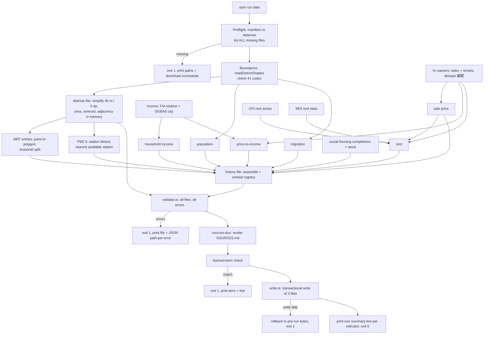

# Design Document: Data Pipeline

## Overview

The data pipeline is one Node command, `npm run data`, that turns the raw open data in `data/raw/` and a small set of committed tables into three outputs:

- `public/data/districts.json`: the 41 districts with city, romanized name, land area, centroid and simplified boundary geometry.
- `public/data/history.json`: the real quarterly baseline, 2015Q1 to 2025Q4, for 11 district indicators and 2 city indicators, with an estimate flag and a method id on every estimated value. It also embeds the source registry and method list it references, so the web app can show provenance without parsing Markdown.
- `data/SOURCES.md`: a generated document listing every source, every method, the reference-district table, the MRT station notes and the known data gaps.

The pipeline:

- reads only `data/raw/` and committed repository files, and never imports the HTTP helpers;
- builds and validates all three outputs in memory before writing anything;
- writes all outputs in one transaction that restores the previous files if any write fails;
- produces byte-identical output for identical input, in PowerShell and Git Bash, on any machine.

It reuses the existing code: `scripts/lib/` (CSV parser, district table, ROC time helpers, ZIP and ODS reader, paths), `scripts/geo/` (shapefile reader, shared-border simplifier, TWD97 converter) and the parsers already exported from `scripts/sources/` (`districtTotals`, `readDistrictShapes`, `mergeByName`, `rocSlashDateYear`, `parseIndex`). `scripts/build-boundaries.ts` is folded into the pipeline and retired (see Decision D1).

### Design principles

1. **Pure core, thin I/O shell.** Every parser takes text or bytes and returns records. Every indicator builder takes parsed records and returns value series. Only `raw-reader.ts` and `write.ts` touch the file system. Tests can therefore run on in-memory fixtures with an empty `data/raw/` (Requirement 18.8).
2. **Fail early, fail completely.** A preflight step lists every missing raw file before any parsing starts. Validation collects every error before stopping.
3. **One registry.** Sources, methods and indicator metadata are defined once in TypeScript and used to build the JSON files, the embedded registry and `SOURCES.md`.
4. **Every cell gets a number.** Each indicator's method chain always yields a finite number or stops the build with a named error. The validator still accepts `null` with a reason method (Requirement 4.8) so the schema stays honest, but the pipeline never emits one (Decision D11).

### Research findings that shape the design

- **Raw layouts checked on disk** (2026-11 download): the MOI district rent statistics ODS (`1140123全國行政區租金統計-修正.ods`) holds contract counts and the 25th, 50th and 75th percentile of monthly rent per contract, per district and housing type. It has **no mean**, so Requirement 9.4's "mean rent" is implemented as the 50th percentile of the `不分類` (all types) row (Decision D17).
- **District adjacency** computed from the existing simplified boundaries (shared vertices): Pinglin borders only Shiding, Pingxi, Wulai and Shuangxi. All four have fewer than 30 rental records in DATA-CHECK.md item 2b, so Requirement 9.7 cannot be met for Pinglin as written (Decision D7).
- **CPI rent series**: the Taipei DBAS CSV has the columns `統計期`, `基本分類`, `原始值[統計數值]`, `年增率[%]`, `縣市別代碼`; the DGBAS XML has `<Obs>` elements with `Item` `1.房租(指數基期：民國110年=100)`, `TIME_PERIOD` `YYYYMmm` and `TYPE` `原始值`.
- **MRT annual series** columns: `統計期` (`103年`), `捷運站別`, `進站人次`, `出站人次`.
- **DGBAS 9415** columns: `年`, `臺北市-元`, `新北市-元` (one row per year from 1998).
- **PM2.5 daily completeness**: a 24-hour average needs at least 18 of 24 hourly values (75 %) under US EPA 40 CFR Part 50, Appendix N, which is also the example in Requirement 12.1. The equivalent MOENV rule was not found in the Air Pollution Control Act text ([law.moj.gov.tw O0020001](https://law.moj.gov.tw/LawClass/LawAll.aspx?pcode=O0020001)); the design uses 18 and records the EPA citation in the method entry until an MOENV citation is found.
- **Node string sort is by UTF-16 code unit, and `localeCompare` depends on the ICU locale.** `scripts/build-boundaries.ts` uses `localeCompare` to sort features; the pipeline replaces it with an explicit code-point comparator.
- **`fs.renameSync` on Windows** replaces an existing destination (Node uses `MoveFileEx` with `MOVEFILE_REPLACE_EXISTING`), but fails if another process holds the file open. The writer treats a failed rename like a failed write and rolls back.
- **Git line endings**: with `core.autocrlf=true` (the Git for Windows default), LF files can be checked out as CRLF. A `.gitattributes` entry forces LF for the generated files.

## Architecture

### Module layout

```
scripts/
├── build-data.ts                 # entry point for `npm run data`; calls pipeline/run.ts
├── build-boundaries.ts           # retired (logic moves to pipeline/districts-file.ts)
└── pipeline/
    ├── run.ts                    # step runner: ordered steps, step names, exit codes, summary lines
    ├── context.ts                # BuildContext: RawReader, DISTRICTS, QUARTERS, logger
    ├── raw-reader.ts             # the only file-system reader: sorted listings, repo-relative paths, decoding
    ├── manifest.ts               # required raw files per step, with their download id (preflight)
    ├── errors.ts                 # PipelineError, ParseError, MissingInputsError, ValidationFailedError
    ├── numeric.ts                # median, stableSum, mean, roundTo, apportion, linearFit, codePointCompare
    ├── interpolate.ts            # annualToQuarterly (mean-preserving, slope-limited)
    ├── geo.ts                    # spherical area, centroid, haversine, district lookup, adjacency
    ├── serialize.ts              # canonical JSON writer and number formatter
    ├── write.ts                  # transactional multi-file writer with rollback
    ├── registry/
    │   ├── sources.ts            # SOURCE_REGISTRY: every SourceEntry, plus URL redaction
    │   ├── methods.ts            # METHOD_REGISTRY: every MethodEntry
    │   └── indicators.ts         # INDICATORS: id, level, unit, kind, decimals, description, sources
    ├── tables/
    │   ├── rent-reference.ts     # fixed reference-district assignments
    │   ├── cpi-series.ts         # city → CPI rent series assignment
    │   └── mrt-stations.ts       # annual-series aliases, section opening dates, comparable stations, address districts
    ├── parsers/                  # pure: text/bytes → typed rows; throw ParseError
    │   ├── household.ts          # population and migration CSV/JSON (MOI, ris.gov.tw)
    │   ├── migration-annual.ts   # Taipei a05002802, New Taipei 124872
    │   ├── income.ts             # FIA (wraps sources/income.ts districtTotals), DGBAS 9415
    │   ├── lvr.ts                # real-price registration sales and rentals
    │   ├── cpi.ts                # Taipei DBAS CSV, DGBAS XML
    │   ├── rent-stats.ts         # MOI district rent statistics ODS
    │   ├── mrt.ts                # annual series, daily Big5 files
    │   ├── air.ts                # station metadata, aqx_p_13 daily rows
    │   ├── social-housing.ts     # NLMA list and detail JSON
    │   └── reference-ratios.ts   # optional hand-entered MOI price-to-income table
    ├── indicators/               # pure builders: parsed rows → IndicatorSeries
    │   ├── population.ts
    │   ├── migration.ts
    │   ├── income.ts
    │   ├── sale-price.ts
    │   ├── rent.ts
    │   ├── price-to-income.ts
    │   ├── mrt.ts
    │   ├── pm25.ts
    │   └── social-housing.ts
    ├── districts-file.ts         # builds DistrictsFile from shapes
    ├── history-file.ts           # assembles HistoryFile from IndicatorSeries + registries
    ├── sources-doc.ts            # renders data/SOURCES.md from registries and build notes
    └── banned-terms.ts           # neutrality check on SOURCES.md text

src/
├── types/data-files.ts           # schema types and constants shared with the web app
└── data/validate.ts              # pure schema validator, used by the pipeline now and src/data later

data/config/
├── banned-terms.txt              # one term per line, seeded from neutrality.md
├── banned-terms-exempt.txt       # official policy or dataset titles that may contain a banned term
└── moi-price-to-income.csv       # optional hand-entered MOI ratios (Requirement 10.5)

.gitattributes                    # public/data/*.json and data/SOURCES.md: text eol=lf
```

Existing modules reused without change: `scripts/lib/csv.ts`, `districts.ts`, `time.ts`, `zip.ts`, `paths.ts`; `scripts/geo/shapefile.ts`, `simplify.ts`, `twd97.ts`. `scripts/sources/boundaries.ts` (`readDistrictShapes`) and `scripts/sources/stations.ts` (`mergeByName`) are reused; `assignDistricts` in `stations.ts` reads shapes from disk itself, so the pipeline calls a new pure `districtAt(point, shapes)` in `pipeline/geo.ts` instead. `scripts/lib/http.ts` and `scripts/lib/datagov.ts` are never imported by `scripts/pipeline/` (Requirement 2.1, enforced by a test).

### Build flow



### Step runner

`run.ts` runs a fixed list of named steps. Each step is `{ name: string; run(ctx, state): void }` and adds its results to a typed `BuildState`. The runner:

1. Deletes stale temp files left by an interrupted earlier run (`*.pipeline-tmp` next to the output paths).
2. Runs the steps in order. The first thrown error stops the run; the runner prints `step <name> failed: <message>` followed by the error's detail lines, and exits with code 1 (Requirement 1.5).
3. On success prints one line per indicator, `<id>: <n> values, <k> estimated` (Requirement 1.4), followed by the non-fatal notes (excluded records by reason, social housing exclusions, price-to-income comparison), and exits with code 0.

Steps run synchronously. Nothing in the pipeline needs concurrency, and synchronous code keeps the order of reads and log lines fixed.

### Raw reader

```ts
export interface RawReader {
  /** File names in a directory under data/raw/, sorted by Unicode code point. */
  list(dir: string): readonly string[];
  exists(relPath: string): boolean;
  readBytes(relPath: string): Buffer;
  /** Decodes UTF-8 (BOM stripped) or Big5. */
  readText(relPath: string, encoding?: 'utf-8' | 'big5'): string;
  /** Repository-relative path with forward slashes, used in every message. */
  display(relPath: string, zipEntry?: string): string;
}
```

`list` sorts with `codePointCompare`, never the file system order (Requirement 17.7). `display` produces paths such as `data/raw/lvr/104S1_a_lvr_land_a.csv` or `data/raw/boundaries/town-boundaries-1140318.zip!TOWN_MOI_1140318.dbf`, independent of the machine (Requirement 17.4).

### Preflight manifest

`manifest.ts` lists every required raw input as `{ path | pattern, downloadId, expected }`:

| Download id | Required files |
|---|---|
| `boundaries` | `boundaries/town-*/TOWN_MOI_*.shp` and `.dbf` (latest edition) |
| `population` | `ris/ODRP005-{10401..10612}.csv`; `ris/ODRP010-{yyymm}-{臺北市,新北市}.json` for 10701–10908; `ris/ODRP060-…json` for 10909–11412 except 11003 and 11308; `ris/ODRP060-11003.csv`, `ris/ODRP060-11308.csv`; `ris/ODRP002-{10412..10612}.csv`; `ris/ODRP011-…json` for 10701–11412 except 11308; `ris/ODRP011-11308.csv`; `taipei-a05002802-cycle4.csv`; `ntpc-124872.csv` |
| `income` | `income/{103..112}_165-9.csv`; `income/dgbas-9415-disposable-income-by-region.csv` |
| `lvr` | `lvr/{104S1..115S3}_{a,f}_lvr_land_{a,c}.csv` (188 files) |
| `rent` | `rent-stats/1140123全國行政區租金統計-修正.ods` |
| `macro` | `macro/taipei-A21000102-cpi-monthly.csv`; `macro/dgbas-pr0101a1m-cpi-basic.xml` |
| `mrt` | `mrt/taipei-133184-annual-station.csv`; `mrt/daily/taipei-entries-{2015-01..2016-12}.csv` |
| `stations` | `stations/tdx-station-TRTC.json`, `stations/tdx-station-NTMC.json` |
| `air` | `air/moenv-aqx_p_07.json`; one `air/aqx_p_13-PM25/{siteid}-{name}.json` per station in the two cities |
| `social-housing` | `social-housing/nlma-portal-GetScheduleData-{A,F}.json`; `social-housing/nlma-portal-dashboard/` |

Preflight checks all entries and throws one `MissingInputsError` listing each missing path and `node scripts/download.ts <downloadId>` (Requirement 2.3). Missing per-project detail files are not a preflight error; Requirement 13.5 handles them as exclusions.

## Components and Interfaces

### Shared numeric helpers (`numeric.ts`)

| Function | Contract |
|---|---|
| `codePointCompare(a, b)` | Orders strings by Unicode code point; used for every sort of strings. |
| `median(values)` | Copies and sorts numerically; odd count → middle value; even count → mean of the two middle values; empty → throws. Independent of input order. |
| `stableSum(values)` / `mean(values)` | Sorts a copy ascending, then sums. Result is independent of input order. |
| `roundTo(x, d)` | `sign(x) · round(|x| · 10^d) / 10^d`, then `-0 → 0`. `d` ∈ 0..6. |
| `apportion(total, weights)` | Largest-remainder split of a non-negative integer `total` into non-negative integers proportional to non-negative `weights`. See below. |
| `linearFit(xs, ys)` | Ordinary least squares slope and intercept. |

**`apportion(total, weights)`**:

1. If every weight is 0, use equal weights.
2. `W = stableSum(weights)`; exact share `e_i = total · w_i / W`; `b_i = floor(e_i)`.
3. `L = total − Σ b_i`. If `L > 0`, add 1 to the `L` entries with the largest fractional part `e_i − b_i`; ties go to the lower index. If floating-point error makes `L < 0`, subtract 1 from the `|L|` entries with the smallest fractional part among those with `b_i > 0`.
4. Return `b`. The result is integer, non-negative, sums exactly to `total`, and each entry differs from `e_i` by less than 1.

Migration (Requirement 6.3) and MRT quarterly entries (Requirement 11.7, 11.13) both use it.

### Annual-to-quarterly interpolation (`interpolate.ts`)

`annualToQuarterly(series: ReadonlyMap<number, number>): Map<Quarter, number>` takes values for consecutive years and returns 4 quarterly values per year. It is a piecewise-linear, slope-limited reconstruction (the "minmod" limiter from finite-volume methods):

```
Δ⁻(y) = A(y) − A(y−1)           Δ⁺(y) = A(y+1) − A(y)
s(y)  = 0                         if y is the first or last year, or Δ⁻·Δ⁺ ≤ 0
      = sign(Δ⁻) · min(|Δ⁻|, |Δ⁺|) otherwise
Q_k(y) = A(y) + s(y) · c_k        with c = (−3/8, −1/8, +1/8, +3/8), k = 1..4
```

`c_k` is the distance in years from mid-year to the centre of quarter `k`.

- **Mean preserving**: `Σ c_k = 0`, so the four quarters average exactly to `A(y)`.
- **Within range** (Requirement 7.6): `|s · 3/8| ≤ 3/8 · min(|Δ⁻|, |Δ⁺|)`, so Q1 lies between `A(y−1)` and `A(y)`, and Q4 lies between `A(y)` and `A(y+1)`. Turning points and end years are flat.
- **Trade-off**: quarterly values can jump at year boundaries. A smooth spline would remove the jumps but can overshoot the neighbouring annual values, which Requirement 7.6 forbids.

Inputs may include years outside 2015–2025 (FIA 2014) so that 2015 has a left neighbour. Output is then filtered to the 44 quarters. Rounding to the indicator's decimals happens only at assembly, so the mean property is tested on unrounded values.

### Geometry helpers (`geo.ts`)

| Function | Method |
|---|---|
| `ringAreaKm2(ring)` | Spherical polygon area on a sphere of radius 6,371.0072 km (the GRS80 authalic radius), using the same spherical-excess formula as `d3.geoArea`. A district's area is the sum over polygons of exterior area minus hole areas, computed on the **unsimplified** source rings. |
| `centroid(polygons)` | Area-weighted planar centroid in a local equirectangular frame (x scaled by cos of the mean latitude), converted back to degrees. It lies inside the convex hull of the region, so it lies inside its bounding box (Requirement 3.2). |
| `haversineKm(a, b)` | Great-circle distance, radius 6,371.0088 km. |
| `districtAt(point, shapes)` | Point-in-polygon over the 41 unsimplified districts (exterior minus holes), using `pointInRing` from `scripts/geo/shapefile.ts`. Returns at most one district; a point inside two polygons is an error. |
| `adjacency(shapes)` | Two districts share a border when at least one edge (two consecutive vertices) appears in rings of both, using the 7-decimal vertex key of `simplify.ts`. Used only to check the rent reference table (Requirement 9.7). Not written to output (Decision D3). |

### Canonical serializer (`serialize.ts`)

`JSON.stringify` cannot meet Requirement 17.3 alone (it writes `1e-7` and keeps no fixed decimals). `serializeJson(value)` writes:

- **Indentation**: 2 spaces. Containers whose members are all primitives are written on one line, for example `[121.52345, 25.03311]` and `{ "value": 1234, "estimated": false }`. Every other container has one member per line.
- **Key order**: the insertion order of the typed builder objects, which follows the fixed order in `src/types/data-files.ts` (Requirement 17.2). District-keyed objects are built in ascending code order. Every code is an 8-digit integer-like string, which JavaScript also enumerates in ascending numeric order, so parse → serialize keeps the order.
- **Numbers**: `formatNumber(x, d)` = `String(roundTo(x, d))`. After rounding to at most 6 decimals, any finite value with magnitude below 1e21 prints without an exponent and without trailing zeros. `-0` becomes `0`. The serializer throws on `NaN`, `±Infinity` and on any output containing `e` or `E` in a number token.
- **Strings**: `JSON.stringify(s)` for each string (non-ASCII characters are written as UTF-8, not escaped).
- **Line endings**: `\n` only, exactly one trailing `\n`, no BOM (Requirement 17.5).

Values are rounded once, at assembly in `history-file.ts` and `districts-file.ts`, using the indicator's `decimals`, so the in-memory object passed to the validator already holds the final numbers. The serializer then only formats them.

### Transactional writer (`write.ts`)

```ts
export interface PlannedWrite { readonly path: string; readonly text: string }
export interface WriteFs { exists; readBytes; writeFile; rename; remove } // injected; node:fs by default
export function writeAll(writes: readonly PlannedWrite[], fs?: WriteFs): void
```

1. **Snapshot**: for each target, record the current bytes, or record that it is absent.
2. **Stage**: write each text to `<target>.pipeline-tmp` in the same directory (same volume, so rename is a move, not a copy).
3. **Commit**: rename each temp file over its target, in the fixed order districts → history → sources.
4. **On any failure in stage or commit**: for every target already renamed, write back the snapshot bytes, or delete it if it was absent; delete all temp files; then throw `PipelineError` naming the failed file (Requirement 16.8, 2.5).
5. **On success**: no temp files remain.

Directories are created with `fs.mkdirSync(dir, { recursive: true })` before staging. A crash during commit can leave a mix of new and old files; the next run's first action deletes stale temp files, and since outputs are deterministic, a re-run converges. This limit is noted in SOURCES.md's format section.

### Schema module (`src/types/data-files.ts`, `src/data/validate.ts`)

The types and the validator live in `src/`, not `scripts/` (Decision D2):

- `structure.md` forbids `src/` from importing `scripts/`, but `scripts/` may import `src/`. Putting the schema in `src/` lets `src/data/` reuse it later without duplication.
- Both files use only erasable TypeScript and no DOM or Node APIs, so Node runs them by type stripping and Vite bundles them unchanged.
- The validator takes the expected district codes as an argument (`scripts/` passes the codes from `scripts/lib/districts.ts`; the web app will pass the codes from `districts.json`), so `src/` holds no copy of the district table.

```ts
export interface ValidationError {
  readonly file: 'districts.json' | 'history.json';
  readonly path: string;     // JSON path, e.g. $.indicators[2].series["65000200"][17].value
  readonly rule: string;     // e.g. "type", "required", "district-code", "quarter-span", "range", "method-ref"
  readonly message: string;
}
export interface ValidationContext {
  readonly districtCodes: readonly string[]; // exactly the 41 codes
  readonly quarters: readonly string[];      // exactly 2015Q1..2025Q4
}
export function validateDistrictsFile(x: unknown, ctx: ValidationContext): ValidationError[];
export function validateHistoryFile(x: unknown, ctx: ValidationContext): ValidationError[];
```

The validator is hand-written (Decision D2): small typed checkers (`isObject`, `expectString`, `expectFiniteNumber`, `expectBoolean`, `expectArray`) that append to an error list and keep going. It runs on the in-memory object before serialization (Requirement 16.2), and the round-trip tests also run it on parsed JSON.

Checks for `history.json`:

| Rule | Check |
|---|---|
| `required`, `type` | Every field in the interfaces below is present with the declared type; `null` only where declared. |
| `quarter-span` | `quarters` equals the 44 keys in order, no duplicates. Every series has exactly 44 records. |
| `district-code` | Every district series object has exactly the 41 codes, no others. City series have exactly `Taipei` and `New Taipei`. |
| `unique-id` | Indicator ids unique across district and city indicators; source ids and method ids unique. |
| `description` | 1–200 characters. |
| `finite` | Every non-null `value` is a finite number (`Number.isFinite`). |
| `estimate` | `estimated` is a boolean. `true` → exactly one `method`; `false` → non-null `value` and no `method`. `null` value → `estimated: true` and a method whose `kind` is `missing-reason`. |
| `method-ref`, `source-ref` | Every method id and source id referenced anywhere is defined in the embedded `methods` and `sources`. |
| `source-entry` | Each source has non-empty agency, dataset, license; absolute `http`/`https` URL; four-digit years with `first ≤ last`. |
| `credential` | No URL anywhere contains `api_key` (or another credential parameter) with a value other than `REDACTED`. |
| `range` | By indicator `kind`: `count` → integer ≥ 0; `positive` → > 0; `non-negative` → ≥ 0; `percent` and `index-0-100` → 0 ≤ v ≤ 100. |
| `decimals` | `roundTo(value, decimals) === value`. |

Checks for `districts.json`: required fields and types; exactly 41 entries in ascending code order with codes from the context; `city` ∈ {Taipei, New Taipei}; `areaKm2 > 0` with 2 decimals; centroid with 5 decimals inside the entry's geometry bounding box; geometry is `Polygon` or `MultiPolygon`; every ring closed with ≥ 4 positions; exterior rings clockwise and holes counterclockwise by the sign of the planar shoelace area (`signedArea` < 0 for clockwise, as in `scripts/geo/shapefile.ts`, reimplemented in `src/` because `src/` cannot import `scripts/`); coordinates with ≤ 5 decimals; every `sources` reference defined in the file's embedded `sources`.

## Data Models

### Shared types (`src/types/data-files.ts`)

```ts
export const SCHEMA_VERSION = 1;

export type QuarterKey = `${number}Q${1 | 2 | 3 | 4}`; // same shape as scripts/lib/time.ts Quarter
export type DistrictCode = string;                    // 8-digit official TOWNCODE
export type CityName = 'Taipei' | 'New Taipei';

/** One value for one district or city and one quarter. Aligned by index with HistoryFile.quarters. */
export type ValueRecord =
  | { readonly value: number; readonly estimated: false }
  | { readonly value: number; readonly estimated: true; readonly method: string }
  | { readonly value: null; readonly estimated: true; readonly method: string }; // allowed by schema (Req 4.8), never emitted

export type IndicatorKind = 'count' | 'positive' | 'non-negative' | 'percent' | 'index-0-100';

interface IndicatorBase {
  readonly id: string;            // camelCase, unique across all indicators
  readonly unit: string;          // e.g. "persons", "TWD per m² per month"
  readonly kind: IndicatorKind;   // drives the range check
  readonly decimals: number;      // 0..6
  readonly description: string;   // English, 1..200 characters, neutral wording
  readonly sources: readonly string[]; // Source_Ids, at least one
}
export interface DistrictIndicator extends IndicatorBase {
  readonly level: 'district';
  readonly series: Readonly<Record<DistrictCode, readonly ValueRecord[]>>; // 41 keys × 44 records
}
export interface CityIndicator extends IndicatorBase {
  readonly level: 'city';
  readonly series: Readonly<Record<CityName, readonly ValueRecord[]>>;     // 2 keys × 44 records
}
export type Indicator = DistrictIndicator | CityIndicator;

export interface SourceEntry {
  readonly id: string;            // "<download-id>/<dataset>", e.g. "income/fia-103066" (Decision D15)
  readonly agency: string;
  readonly dataset: string;       // dataset name as published (may be Chinese)
  readonly datasetEn?: string;    // English gloss for SOURCES.md
  readonly url: string;           // absolute http(s); credentials replaced by "REDACTED"
  readonly years: readonly [number, number]; // first ≤ last
  readonly license: string;       // as stated, or the literal "not stated"
  readonly wikipedia?: { readonly title: string }; // renders the CC BY-SA attribution (Req 15.7)
}

export type MethodKind = 'interpolation' | 'estimation' | 'missing-reason';
export interface MethodEntry {
  readonly id: string;            // kebab-case, e.g. "interp-annual-quarterly"
  readonly kind: MethodKind;
  readonly title: string;
  readonly inputs: readonly string[];     // Source_Ids
  readonly steps: readonly string[];      // calculation steps, plain English
  readonly appliesTo: readonly string[];  // indicator ids
  readonly quarters: string;              // e.g. "2015Q1–2025Q4" or "2024Q1–2025Q4"
  readonly setsEstimated: true;
  readonly citations?: readonly { readonly label: string; readonly url: string }[];
}

export interface HistoryFile {
  readonly schemaVersion: 1;
  readonly quarters: readonly QuarterKey[];     // the 44 keys
  readonly indicators: readonly Indicator[];    // fixed order, district indicators first
  readonly sources: readonly SourceEntry[];     // every source referenced in this file
  readonly methods: readonly MethodEntry[];     // every method referenced in this file
}

export type Ring = readonly (readonly [number, number])[];
export type Geometry =
  | { readonly type: 'Polygon'; readonly coordinates: readonly Ring[] }
  | { readonly type: 'MultiPolygon'; readonly coordinates: readonly (readonly Ring[])[] };

export interface DistrictEntry {
  readonly code: DistrictCode;
  readonly city: CityName;
  readonly name: string;                         // romanized display name
  readonly areaKm2: number;                      // 2 decimals
  readonly centroid: readonly [number, number];  // [lon, lat], 5 decimals
  readonly geometry: Geometry;                   // exterior clockwise (d3-geo convention)
}

export interface FieldProvenance {
  readonly sources: readonly string[];
  readonly method?: string;                      // e.g. "boundary-simplify", "district-area"
}

export interface DistrictsFile {
  readonly schemaVersion: 1;
  readonly provenance: {
    readonly code: FieldProvenance;
    readonly city: FieldProvenance;
    readonly name: FieldProvenance;
    readonly areaKm2: FieldProvenance;
    readonly centroid: FieldProvenance;
    readonly geometry: FieldProvenance;
  };
  readonly districts: readonly DistrictEntry[];  // 41, ascending code
  readonly sources: readonly SourceEntry[];
  readonly methods: readonly MethodEntry[];
}
```

`districts` is an array sorted by `code`, each entry carrying its `code`. This satisfies "keyed by District_Code" (Requirement 3.1) and keeps the order explicit (Requirement 3.6). History series use objects keyed by code because the engine looks values up by code.

### Indicator list (fixed order)

| # | id | Level | Unit | Kind | Decimals | Sources |
|---|---|---|---|---|---|---|
| 1 | `population` | district | persons | count | 0 | population/moi-32973, population/ris-odrp010, population/ris-odrp060, population/moi-131138 |
| 2 | `moveIn` | district | persons per quarter | count | 0 | population/moi-32975, population/ris-odrp011, population/moi-77144, population/taipei-dbas-a05002802, population/ntpc-124872 |
| 3 | `moveOut` | district | persons per quarter | count | 0 | same as `moveIn` |
| 4 | `relativeMedianIncome` | district | ratio to city median of district medians | positive | 4 | income/fia-103066 |
| 5 | `householdIncome` | district | TWD per household per year | positive | 0 | income/fia-103066, income/dgbas-9415 |
| 6 | `salePrice` | district | TWD per m² | positive | 0 | lvr/moi-25119 |
| 7 | `rent` | district | TWD per m² per month | positive | 1 | lvr/moi-25118, macro/taipei-dbas-131822, macro/dgbas-6019, rent/moi-rent-stats |
| 8 | `mrtEntries` | district | entries per quarter | count | 0 | mrt/trtc-133184, mrt/trtc-128683, stations/tdx-metro-station, boundaries/moi-7441 |
| 9 | `pm25` | district | µg/m³ | non-negative | 1 | air/moenv-6075, air/moenv-28178, boundaries/moi-7441 |
| 10 | `socialHousingCompletions` | district | units per quarter | count | 0 | social-housing/nlma-portal |
| 11 | `socialHousingStock` | district | units | count | 0 | social-housing/nlma-portal |
| 12 | `cityDisposableIncome` | city | TWD per household per year | positive | 0 | income/dgbas-9415 |
| 13 | `priceToIncomeRatio` | city | years of income | positive | 2 | lvr/moi-25119, income/dgbas-9415 |

### JSON layout examples

`public/data/history.json` (excerpt; real files have 41 district keys and 44 records per series):

```json
{
  "schemaVersion": 1,
  "quarters": ["2015Q1", "2015Q2", "2015Q3", "2015Q4", "…", "2025Q4"],
  "indicators": [
    {
      "id": "population",
      "level": "district",
      "unit": "persons",
      "kind": "count",
      "decimals": 0,
      "description": "Registered population at the end of the last month of the quarter.",
      "sources": ["population/moi-32973", "population/ris-odrp010", "population/ris-odrp060", "population/moi-131138"],
      "series": {
        "63000010": [
          { "value": 208932, "estimated": false },
          { "value": 208561, "estimated": false }
        ]
      }
    },
    {
      "id": "salePrice",
      "level": "district",
      "unit": "TWD per m²",
      "kind": "positive",
      "decimals": 0,
      "description": "Median unit price of residential building sales by transaction quarter.",
      "sources": ["lvr/moi-25119"],
      "series": {
        "65000200": [
          { "value": 61850, "estimated": true, "method": "sale-price-pooled-window" }
        ]
      }
    }
  ],
  "sources": [
    {
      "id": "lvr/moi-25119",
      "agency": "Department of Land Administration, Ministry of the Interior",
      "dataset": "不動產買賣實價登錄批次資料",
      "datasetEn": "Real-price registration, sales (batch files)",
      "url": "https://data.gov.tw/dataset/25119",
      "years": [2015, 2026],
      "license": "Open Government Data License, version 1.0"
    }
  ],
  "methods": [
    {
      "id": "sale-price-pooled-window",
      "kind": "estimation",
      "title": "Pooled quarter window for districts with few sales",
      "inputs": ["lvr/moi-25119"],
      "steps": ["Count qualifying sales in the district and quarter.", "…"],
      "appliesTo": ["salePrice"],
      "quarters": "2015Q1–2025Q4",
      "setsEstimated": true
    }
  ]
}
```

(The numbers above illustrate the format only.)

`public/data/districts.json` (excerpt):

```json
{
  "schemaVersion": 1,
  "provenance": {
    "code": { "sources": ["boundaries/moi-7441"] },
    "city": { "sources": ["boundaries/moi-7441"] },
    "name": { "sources": ["boundaries/moi-7441"] },
    "areaKm2": { "sources": ["boundaries/moi-7441"], "method": "district-area" },
    "centroid": { "sources": ["boundaries/moi-7441"], "method": "district-centroid" },
    "geometry": { "sources": ["boundaries/moi-7441"], "method": "boundary-simplify" }
  },
  "districts": [
    {
      "code": "63000010",
      "city": "Taipei",
      "name": "Songshan",
      "areaKm2": 9.29,
      "centroid": [121.5577, 25.05995],
      "geometry": {
        "type": "Polygon",
        "coordinates": [
          [
            [121.5416, 25.06312],
            [121.5502, 25.07188],
            [121.5416, 25.06312]
          ]
        ]
      }
    }
  ],
  "sources": [ { "id": "boundaries/moi-7441", "…": "…" } ],
  "methods": [ { "id": "boundary-simplify", "…": "…" } ]
}
```

### Source registry (`registry/sources.ts`)

One `SourceEntry` per dataset. The id prefix is the `scripts/download.ts` id that fetches it, so a missing-file message and a provenance link name the same command. URLs point to the data.gov.tw catalog page or the agency page, not to download endpoints with keys; `redactUrl(url)` still replaces the value of any query parameter whose name matches `/^(api_?key|key|token|access_token|client_secret|secret)$/i` with `REDACTED` (Requirement 14.6).

| Source_Id | Agency | Dataset | URL | Years | License |
|---|---|---|---|---|---|
| `boundaries/moi-7441` | MOI Department of Land Administration (distributed by NLSC via TGOS) | 鄉鎮市區界線(TWD97經緯度) | https://data.gov.tw/dataset/7441 | 2025–2025 | OGDL v1.0 |
| `population/moi-32973` | MOI Department of Household Registration | 村里戶數、單一年齡人口 | https://data.gov.tw/dataset/32973 | 2015–2017 | OGDL v1.0 |
| `population/ris-odrp010` | same | ODRP010 open API | https://www.ris.gov.tw/rs-opendata/api/v1/datastore/ODRP010 | 2018–2020 | OGDL v1.0 |
| `population/ris-odrp060` | same | ODRP060 open API | https://www.ris.gov.tw/rs-opendata/api/v1/datastore/ODRP060 | 2020–2025 | OGDL v1.0 |
| `population/moi-131138` | same | CSV months not in the API | https://data.gov.tw/dataset/131138 | 2021–2024 | OGDL v1.0 |
| `population/moi-32975` | same | 遷入遷出統計表 | https://data.gov.tw/dataset/32975 | 2015–2017 | OGDL v1.0 |
| `population/ris-odrp011` | same | ODRP011 open API | https://www.ris.gov.tw/rs-opendata/api/v1/datastore/ODRP011 | 2018–2025 | OGDL v1.0 |
| `population/moi-77144` | same | 77144 CSV (2024-08) | https://data.gov.tw/dataset/77144 | 2024–2024 | OGDL v1.0 |
| `population/taipei-dbas-a05002802` | Taipei City DBAS | 各區人口增加 (annual) | Taipei DBAS statistics database URL from DATA-CHECK 3b | 2015–2015 | OGDL v1.0 |
| `population/ntpc-124872` | New Taipei City DBAS | 戶籍動態 | https://data.gov.tw/dataset/124872 | 2015–2015 | OGDL v1.0 |
| `income/fia-103066` | Fiscal Information Agency, MOF | 綜稅綜合所得總額全國各縣市鄉鎮村里統計分析表 | https://data.gov.tw/dataset/103066 | 2014–2023 | OGDL v1.0 |
| `income/dgbas-9415` | DGBAS | 家庭收支調查 平均每戶可支配所得 (by county) | https://data.gov.tw/dataset/9415 | 2015–2025 | OGDL v1.0 |
| `lvr/moi-25119` | MOI Department of Land Administration | 實價登錄 sales | https://data.gov.tw/dataset/25119 | 2015–2026 | OGDL v1.0 |
| `lvr/moi-25118` | same | 實價登錄 rentals | https://data.gov.tw/dataset/25118 | 2015–2026 | OGDL v1.0 |
| `rent/moi-rent-stats` | MOI (Real Estate Information Platform) | 全國行政區租金統計 | https://pip.moi.gov.tw/Publicize/Info/E1080 | 2024–2024 | not stated |
| `macro/dgbas-6019` | DGBAS | 消費者物價基本分類指數 | https://data.gov.tw/dataset/6019 | 2015–2025 | OGDL v1.0 |
| `macro/taipei-dbas-131822` | Taipei City DBAS | 臺北市消費者物價基本分類指數 | https://data.gov.tw/dataset/131822 | 2015–2025 | OGDL v1.0 |
| `mrt/trtc-133184` | Taipei Rapid Transit Corporation (via Taipei DBAS) | 臺北捷運各站進出人次 | https://data.gov.tw/dataset/133184 | 2015–2025 | OGDL v1.0 |
| `mrt/trtc-128683` | Taipei Rapid Transit Corporation | 臺北捷運各站進出量統計 | https://data.gov.tw/dataset/128683 | 2015–2016 | OGDL v1.0 |
| `stations/tdx-metro-station` | MOTC Transport Data eXchange | Rail/Metro/Station TRTC, NTMC | https://tdx.transportdata.tw/ | 2025–2026 | not stated |
| `air/moenv-6075` | Ministry of Environment | 空氣品質監測站基本資料 | https://data.gov.tw/dataset/6075 | 2025–2026 | OGDL v1.0 |
| `air/moenv-28178` | Ministry of Environment | 空氣品質監測小時值 | https://data.gov.tw/dataset/28178 | 2015–2025 | OGDL v1.0 |
| `social-housing/nlma-portal` | National Land Management Agency, MOI | 社會住宅即時資訊平台 | https://socialhousing.nlma.gov.tw/CPA_SocialHousing_Portal/ | 1971–2026 | not stated |
| `affordability/moi-e1050` | MOI (Real Estate Information Platform) | 房價負擔能力統計 | https://pip.moi.gov.tw/Publicize/Info/E1050 | 2016–2025 | not stated |

TDX's terms of use were not verified (DATA-CHECK.md gap 8); "not stated" is recorded until they are. `affordability/moi-e1050` is cited only by the price-to-income validation note, not by an output value.

### Method list (`registry/methods.ts`)

| Method_Id | Kind | Applies to | Quarters |
|---|---|---|---|
| `interp-annual-quarterly` | interpolation | `cityDisposableIncome`, `relativeMedianIncome` | 2015Q1–2023Q4 (and all of `cityDisposableIncome`) |
| `income-relative-extrapolation` | estimation | `relativeMedianIncome` | 2024Q1–2025Q4 |
| `income-district-combination` | estimation | `householdIncome` | 2015Q1–2025Q4 |
| `migration-2015-seasonal-split` | estimation | `moveIn`, `moveOut` | 2015Q1–2015Q4 |
| `sale-price-pooled-window` | estimation | `salePrice` | thin cells only |
| `rent-relative-cpi` | estimation | `rent` | 2015Q1–2025Q4, districts with ≥ 30 records |
| `rent-reference-stats` | estimation | `rent` | reference districts covered by MOI rent statistics |
| `rent-reference-sale-ratio` | estimation | `rent` | reference districts not covered by MOI rent statistics |
| `price-to-income-computed` | estimation | `priceToIncomeRatio` | 2015Q1–2025Q4 |
| `mrt-seasonal-split` | estimation | `mrtEntries` | every quarter of a district with an Active_Station |
| `pm25-nearest-station` | estimation | `pm25` | district-quarters with no available station |
| `district-area`, `district-centroid`, `boundary-simplify` | estimation | districts.json fields | n/a |

`MethodEntry.steps` hold the formulas below in plain English. A method whose `kind` is `missing-reason` would document a `null` value; none is defined because none is emitted.

### Per-indicator algorithms

Notation: `d` district, `c` city of `d`, `q` quarter, `y` year. All counts and medians use records after deduplication and filtering. Sums and means use `stableSum`.

#### Population (Requirement 5)

```
population(d, q) = Σ people_total over village rows r with district(r) = d,
                   in the file of the last month of q (03, 06, 09, 12)
```

- Month → file: 2015-01..2017-12 `ODRP005-{yyymm}.csv`; 2018-01..2020-08 `ODRP010-{yyymm}-{county}.json`; 2020-09..2025-12 `ODRP060-…json`; 2021-03 and 2024-08 `ODRP060-{yyymm}.csv` (data.gov.tw 131138). Only last-of-quarter months are read.
- `district(r)` = `districtByZh(site_id or 區域別)` after the 台/臺 normalization already in `districtByZh`; for rows whose name ends in a village name, the parser strips the village part using the CSV's separate village column when present. Rows outside the two cities are skipped; rows inside them that match no district stop the build with file, row and value (Requirement 5.5).
- A month with no rows for a district, or a population value that is not a non-negative integer, stops the build (Requirement 5.6).
- `estimated: false` on all records.

#### Migration (Requirement 6)

Monthly counts for 2015-12..2025-12:

```
in(d, m)  = Σ (in_total_m + in_total_f)   over villages of d in month m
out(d, m) = Σ (out_total_m + out_total_f) over villages of d in month m
```

Villages are matched to districts by the first 8 digits of the village code where the file has one, otherwise by `site_id` as for population (the parser checks which layout each file has). Files: `ODRP002-{yyymm}.csv` for 2015-12..2017-12, `ODRP011-…json` for 2018-01..2025-12, `ODRP011-11308.csv` for 2024-08.

2015-01..2015-11 (per indicator, per district):

```
R(d)     = T2015(d) − in(d, 2015-12)                       (T2015 from Taipei a05002802 / New Taipei 124872 percent3, percent20)
w_m(d)   = in(d, 2016-m) for m = 1..11                      (same for out)
in(d, 2015-m) = apportion(R(d), w(d))[m]
```

`R(d) < 0` stops the build with the district, indicator, annual total and December count (Requirement 6.7). Quarterly values are sums of three months. 2015Q1–2015Q4 records are `estimated: true` with `migration-2015-seasonal-split`; 2016Q1 onward are `estimated: false`.

#### Income (Requirement 7)

```
cityIncomeAnnual(c, y) = DGBAS 9415 "<city>-元" for year y         (y = 2014..2025 when present)
cityDisposableIncome(c, q) = annualToQuarterly(cityIncomeAnnual(c, ·))(q)

rel(d, y) = FIAmedian(d, y) / median{ FIAmedian(d', y) : d' in city c }    y = 2014..2023, one file each
rel(d, 2024), rel(d, 2025) = a_d + b_d · y, with (a_d, b_d) = linearFit(2019..2023, rel(d, 2019..2023))
relativeMedianIncome(d, q) = annualToQuarterly(rel(d, 2014..2025))(q)

householdIncome(d, q) = cityDisposableIncome(c, q) · relativeMedianIncome(d, q)
```

- Each `rel` value uses one FIA file only, so multiplying all medians in one file by `k > 0` cancels (Requirement 7.4, 7.7). No FIA NT$ level is written.
- `extrapolate` reads only 2019–2023 values, so 2014–2018 inputs cannot affect 2024–2025 (Requirement 7.5).
- `relativeMedianIncome` and `householdIncome` are computed from unrounded intermediate values; only the stored values are rounded.
- Method ids: `cityDisposableIncome` all `interp-annual-quarterly`; `relativeMedianIncome` 2015–2023 `interp-annual-quarterly`, 2024–2025 `income-relative-extrapolation`; `householdIncome` all `income-district-combination`. Every record is `estimated: true`.
- Missing district total rows, non-positive medians (Requirement 7.8) and missing DGBAS years (Requirement 7.9) stop the build.

#### Real-price registration parsing (shared by sale price, rent, price-to-income)

`parsers/lvr.ts` reads each `{season}_{a|f}_lvr_land_{a|c}.csv`, skips the Chinese and English header rows, assigns the city from the file name, and returns typed records `{ id, districtCode | undefined, quarter | undefined, target, use, unitPrice, totalPrice, rent, area }`. A missing required column throws `ParseError` with row 1, the expected names and the found names (Requirement 2.4). Records are deduplicated by `編號` across all files of one kind, keeping the first in sorted file order (Requirement 8.6).

Qualifying filters:

| Filter | Sales | Rentals |
|---|---|---|
| Target | `交易標的` ∈ {房地(土地+建物), 房地(土地+建物)+車位, 建物} | (rental files are building leases; no target filter) |
| Use | `主要用途` contains 住家用 or 住宅 | same |
| Value | `單價元平方公尺` > 0 (sale price); `總價元` > 0 also required for price-to-income | `總額元` > 0 and `建物總面積平方公尺` > 0 |
| Date | `交易年月日` 7-digit ROC date in 2015Q1–2025Q4 | `租賃年月日` same |
| District | `鄉鎮市區` maps to one of the 41 | same |

Excluded records are counted by reason (`invalid-date`, `out-of-range`, `unknown-district`, `non-residential`, `non-building`, `zero-value`, `duplicate`) and printed (Requirement 8.5).

Requirement 8.4 asks for a "valid seven-digit ROC date". The existing `rocDateToQuarter` accepts 6 or 7 digits and does not check the day. The pipeline uses a stricter `rocDate7ToQuarter` that requires 7 digits and a valid month and day.

#### Sale price (Requirement 8)

```
n(d, q) = number of qualifying sales in d with transaction quarter q
salePrice(d, q) = median unit price of those sales                    if n(d, q) ≥ 10
                = median unit price over window W_r(q), estimated      otherwise

W_r(q) = quarters q−r .. q+r, clipped to 2015Q1..2025Q4
r      = smallest r ≥ 1 with count(W_r) ≥ 10, or the r at which W_r covers all 44 quarters
```

If the final window still holds zero sales, the build stops with the district and quarter (Requirement 8.9). That happens only for a district with no qualifying sale in 11 years, which DATA-CHECK.md does not show for any district.

Threshold and cap rationale (Decision D6):

- DATA-CHECK.md item 2a reports at least 12 sales in every quarter for the 34 non-rural districts. A threshold of 10 therefore changes no value outside the 7 rural districts listed there (Shiding, Pinglin, Shimen, Pingxi, Shuangxi, Gongliao, Wulai).
- A median of fewer than 10 prices moves by a large fraction of its value when one sale is added or removed.
- A symmetric window keeps the pooled median centred on the target quarter.
- No fixed cap: Pingxi has 9 sales in 44 quarters, so any cap below the full period would leave some Pingxi quarters with zero sales and stop the build. Without a cap, the worst case is that a district's thin quarters all share the full-period median, which is flat over time. SOURCES.md lists, per rural district, how many quarters used each window radius.

#### Rent (Requirement 9)

For districts with at least 30 qualifying rental records in 2015Q1–2025Q4:

```
p(r)        = 總額元 / 建物總面積平方公尺                                     per record
rel(d)      = median{ p(r) : r in d } / median{ p(r) : r in city c }          all 44 quarters pooled
base(c)     = median{ p(r) : r in city c, lease date in 2024 }
cpiQ(c, q)  = mean of the three monthly rent sub-index values of q, series S(c)
cpi2024(c)  = mean of cpiQ(c, 2024Q1..2024Q4)
rent(d, q)  = rel(d) · base(c) · cpiQ(c, q) / cpi2024(c)                      method rent-relative-cpi
```

`S(Taipei)` = Taipei DBAS 131822 rows with `基本分類` 房租 and `縣市別代碼` 63000; `S(New Taipei)` = DGBAS 6019 XML observations with `Item` 房租 and `TYPE` 原始值. `tables/cpi-series.ts` holds this mapping. The rent builder checks every district's resolved series against the required assignment and stops with the district code and the mapped series on a mismatch (Requirement 9.10). Any missing month in 2015-01..2025-12 stops the build with the series and month (Requirement 9.9).

All rent records are `estimated: true`, including districts with enough records, because each value combines a pooled district level with a city index rather than observing the district in that quarter (Decision D16).

For districts with fewer than 30 records, `tables/rent-reference.ts` gives the reference district `ref`:

```
ratioStats(d)  = P50(d) / P50(ref)       MOI rent statistics, edition 1140123 (contracts valid 2024-12-31), row 不分類
ratioSale(d)   = mean(salePrice(d, 2024Q1..Q4)) / mean(salePrice(ref, 2024Q1..Q4))   unrounded values
rent(d, q)     = rent(ref, q) · ratio(d)
```

`ratioStats` applies when both districts appear in the rent statistics (`rent-reference-stats`); otherwise `ratioSale` (`rent-reference-sale-ratio`). Six districts are absent from the statistics: Shiding, Pinglin, Shimen, Pingxi, Shuangxi, Wulai.

Proposed reference table (Decision D7). Record counts are from DATA-CHECK.md item 2b, which counted residential rentals with a looser filter; the build recounts with the qualifying filter and checks the table:

| District | Records 2015–2025 | Reference | Borders it | Reference records | Ratio method |
|---|---|---|---|---|---|
| Shiding | 4 | Shenkeng | yes | 179 | sale-price |
| Pinglin | 0 | Xindian | **no** (borders Shiding and Wulai, which both border Xindian) | > 1,000 | sale-price |
| Shimen | 12 | Sanzhi | yes | 1,015 | sale-price |
| Pingxi | 0 | Ruifang | yes | 208 | sale-price |
| Shuangxi | 4 | Ruifang | yes | 208 | sale-price |
| Gongliao | 8 | Ruifang | yes | 208 | rent-statistics |
| Wulai | 0 | Xindian | yes | > 1,000 | sale-price |

Neighbours were chosen for similar settlement type (rural or semi-rural New Taipei districts) among bordering same-city districts with at least 30 records. The build stops if a district below 30 has no entry, or its reference is in another city, does not border it, or has fewer than 30 records (Requirement 9.8). Entries for districts that turn out to have 30 or more records are not used and are printed as a note. SOURCES.md lists each used entry with its method, record count and ratio (Requirement 9.6).

#### House-price-to-income ratio (Requirement 10)

```
priceToIncomeRatio(c, q) = roundTo( median{ 總價元 of qualifying sales in c, quarter q } / cityDisposableIncome(c, q), 2 )
```

Qualifying sales use the sale filter above plus `總價元 > 0`. Fewer than 100 qualifying sales in a city-quarter stops the build (Requirement 10.4). Every record is `estimated: true` with `price-to-income-computed`; its method entry states the formula, the filter, the income source, and that the MOI ratio uses the same median-price and median-income definitions on its own sample.

Validation (Requirement 10.5–10.7): if `data/config/moi-price-to-income.csv` exists (columns `city,quarter,ratio,source_pdf`), each row is validated (city name, quarter in 2016Q3..2025Q4, positive ratio, no duplicate city and quarter; an invalid row stops the build). For each row the pipeline prints the computed ratio, the MOI ratio and the signed difference, then one line per city with the largest absolute difference. If the file is absent, it prints that the validation was skipped. The comparison never changes outputs or the exit code. The 2018Q3–Q4 combined release is entered as two rows with the same PDF.

#### MRT entries (Requirement 11)

Inputs: annual series rows `(year, name, entries)`; daily entry files 2015–2016 (Big5, one column per station); TDX station points merged by name with `mergeByName`.

`tables/mrt-stations.ts` holds, for each annual-series row name:

```ts
interface MrtRowEntry {
  readonly name: string;             // as in the annual series, e.g. "板橋Y", "南京復興BR"
  readonly station: string;          // merged TDX station name, e.g. "板橋"
  readonly dailyName?: string;       // column name in the 2015–2016 daily files, when present
  readonly opened: string;           // ISO date of the row's line section, or "before-2015"
  readonly comparable?: string;      // station whose shares are borrowed (Requirement 11.8)
}
```

plus `NON_STATION_ROWS = ['一日票', '團體票', '其他']` and `BORDER_STATIONS` (the 7 stations with their address districts, for SOURCES.md).

Activation is evaluated per annual-series row, because one physical station can have rows for different lines (Banqiao has a Bannan line row and a Circular Line row `板橋Y`). This refines Requirement 11.4 without changing it: a row is active in quarter `q` when it appears in the annual series and its `opened` date is on or before the last day of `q`. Rows that map to the same station are summed after the split (Requirement 11.2).

```
district(station)   = districtAt(TDX point, shapes)                       point-in-polygon (Requirement 11.1)
share(row, k)       = mean over full years y ∈ {2015, 2016} of  Σ daily entries in quarter k of y / Σ daily entries in y
                      (a year is full when opened is "before-2015" or ≤ Jan 1 of y)
                      or share(comparable, k) when no full year exists
check               | Σ_k share(row, k) − 1 | ≤ 1e-9, else stop

entries(row, y)     = annual entries of row in year y
active(row, y)      = quarters of y in which row is active
quarterly(row, y)   = apportion(entries(row, y), [share(row, k) if k ∈ active(row, y) else 0])
mrtEntries(d, q)    = Σ over rows r with district(station(r)) = d and r active in q of quarterly(r, year(q))[k]
```

`apportion` with zero weights for inactive quarters gives both the opening-year rescaling (Requirement 11.13) and full-year splitting (Requirement 11.7); its exact-sum guarantee meets Requirement 11.14 with a difference of 0. Districts with no active row in a quarter get `0, estimated: false`; all other district-quarters are `estimated: true` with `mrt-seasonal-split` (Requirement 11.9, 11.10). An unknown row name or an active row without a value for a year stops the build (Requirement 11.11). SOURCES.md carries the border-station list, the comparable stations and the note on Danhai LRT, Ankeng LRT and Sanying Line (Requirement 11.12).

#### PM2.5 (Requirement 12)

```
validHour(v)   = v is non-empty, has no flag (#, *, x, A) and parses as a number ≥ 0
dailyMean(s,t) = mean of valid hours of station s on date t     if ≥ 18 valid hours, else invalid
row selection  = when several rows exist for (s, t), take the row with the most valid hours;
                 ties go to the first in file order (files are read in sorted order)
quarterly(s,q) = mean of valid daily means of s in q             if ≥ ceil(0.75 · days in q) valid days, else unavailable
```

- Station district: `districtAt([twd97lon, twd97lat], shapes)`. This places Shilin and Yangming in Beitou, and Cailiao and Sanchong in Sanchong (Requirement 12.2).
- One available station in `d` → its value; two or more → equal-weight mean; both `estimated: false` (Requirement 12.3, 12.4).
- No available station in `d` → value of the nearest available station by `haversineKm(centroid(d), station)`; ties go to the lower station id; `estimated: true` with `pm25-nearest-station` (Requirement 12.6).
- No available station in either city in a quarter stops the build (Requirement 12.8).

Nearest station rather than inverse-distance weighting (Decision D9):

- **Explainable**: the "Why?" view can say "measured at station X, Y km away". IDW would need to list every station and its weight.
- **No cross-terrain mixing**: 25 of 41 districts have no station, and many are mountain districts. IDW would blend urban traffic stations into them across ridges. Nearest-station picks one real measurement.
- **Trade-off**: values jump when the nearest available station changes. This happens, for example, when Fuguijiao becomes available in late 2017. SOURCES.md lists the station used per district.

The minimum valid days per quarter (75 %, the same completeness ratio as the daily rule) is a design choice recorded in the method entry.

#### Social housing (Requirement 13)

```
projects        = list rows with status 已完工, deduplicated by setupplan_guid (first in sorted file order)
district(p)     = TownCode in nlma-portal-dashboard/{guid}.json
quarter(p)      = quarter of strEndDate (ROC yyy/mm/dd + 1911)
completions(d,q)= Σ household_num of projects with district d and quarter q
stock(d,q)      = Σ household_num of projects with district d and completion date ≤ last day of q
                = stockBefore2015(d) + Σ_{q' ≤ q} completions(d, q')
```

Projects with an empty or unparseable date, no detail file, or a TownCode outside the 41 are excluded and printed with guid, reason, units and per-city total (Requirement 13.5). A `household_num` that is not a non-negative integer string stops the build (Requirement 13.6). All records `estimated: false`.

#### Districts file (Requirement 3)

1. `readDistrictShapes()` gives the shapefile records. The step checks every TOWNCODE starting with 63 or 65 (Taipei or New Taipei): each of the 41 codes exactly once, no unlisted code (Requirement 3.7). `readDistrictShapes` filters to the 41 codes, so the check reads the unfiltered records from `readShapefile` instead.
2. Geometry = `simplifyTopology(polygons, { toleranceMeters: 40, decimals: 5 })`, the same call as `build-boundaries.ts`. The mismatched-edge count (moved from `build-boundaries.ts` into `geo.ts`) after simplification must be ≤ the count before, else the build stops (Requirement 3.8).
3. `areaKm2 = roundTo(Σ area, 2)`, `centroid = roundTo(centroid, 5)` from the unsimplified polygons; `name` and `city` from `scripts/lib/districts.ts`.
4. Entries sorted by `codePointCompare(code)`.

### Sources document (`sources-doc.ts`)

`renderSourcesDoc(state)` returns a string built from the registries and the build notes. It contains no date, path or environment value. Sections, in fixed order:

1. Generated-file notice: "This file is generated by `npm run data`. Do not edit it by hand." and the required disclosure sentence from `product.md`.
2. Output format: indentation (2 spaces), key and entry order, rounding per indicator, LF line endings, the crash-during-commit limitation.
3. Fields by output file: one table per file; each row lists the field or indicator, unit, decimals and every Source_Entry it depends on (id, agency, dataset, URL, years, license).
4. Sources: the full registry. Wikipedia entries render the page title, URL, "CC BY-SA" and "Cited as a reference; no text is copied." (Requirement 15.7).
5. Methods: for each method, its inputs, steps, indicators, quarters and "Sets `estimated: true`" (Requirement 15.4).
6. Rent reference districts: district, reference, method, record count, ratio (Requirement 9.6).
7. MRT notes: border stations with point district and address district; comparable stations; lines not included.
8. PM2.5 station use: stations per district and the nearest station used for districts without one.
9. Known data gaps: one row per DATA-CHECK.md gap that affects an output field (items 1, 2a, 2b, 3b, 4, 7, 8), with item number, affected fields, quarter range or districts, and Method_Id (Requirement 15.5).

### Banned-term check (`banned-terms.ts`)

`data/config/banned-terms.txt` holds one term per line (`#` comments allowed), seeded with "failed", "disastrous", "brilliant", "finally" and the names of political parties and politicians in English and Chinese. `checkBannedTerms(text, terms, exempt)`:

- Latin-script terms match case-insensitively on word boundaries (`\b` with the `iu` flags).
- CJK terms match as substrings, because `\b` does not apply to CJK text.
- Matches inside a phrase listed in `banned-terms-exempt.txt` (official policy or dataset titles) are ignored.
- Returns `{ term, line }[]`; any match stops the build before writing (Requirement 15.9).

## Correctness Properties

*A property is a characteristic or behavior that should hold true across all valid executions of a system-essentially, a formal statement about what the system should do. Properties serve as the bridge between human-readable specifications and machine-verifiable correctness guarantees.*

All properties below test pure functions with generated in-memory inputs. None reads `data/raw/`.

### Property 1: Interpolation preserves the annual mean and stays within neighbouring values

*For any* annual series of 1 to 11 consecutive years within 2015–2025 with finite values from 0 to 1,000,000,000, `annualToQuarterly` returns exactly 4 finite values per input year keyed by that year's Quarter_Keys; the mean of each year's 4 values equals the annual value within a relative tolerance of 1e-12; and each quarterly value lies within the closed range of the annual values of that year and its existing adjacent years.

**Validates: Requirements 7.1, 7.6, 18.5**

### Property 2: Apportionment yields non-negative integers that sum to the total

*For any* non-negative integer total up to 10,000,000 and any list of 1 to 12 non-negative finite weights (including all-zero lists), `apportion` returns non-negative integers whose sum equals the total exactly, each differing from its exact proportional share by less than 1, and zero for every zero weight unless all weights are zero.

**Validates: Requirements 6.3, 11.14**

### Property 3: Migration quarters are monthly sums with the correct flags

*For any* monthly move-in and move-out counts for 2015-12..2025-12 and any 2015 annual totals not smaller than the December 2015 counts, each quarterly value equals the sum of its three monthly values; the eleven estimated months of 2015 sum to the annual total minus December; 2015Q1–2015Q4 records are estimated with `migration-2015-seasonal-split`; and every later record is not estimated and has no method.

**Validates: Requirements 6.1, 6.2, 6.3, 6.4**

### Property 4: Population equals the sum of the district's village rows

*For any* set of village rows for the last month of a quarter (with names spelled with 台 or 臺, and rows from other cities mixed in), the population of each district equals the sum of the population column over the rows of that district, rows of other cities do not change any value, and every record is not estimated.

**Validates: Requirements 5.1, 5.3, 5.4**

### Property 5: Relative income is scale-invariant per income year and composes into household income

*For any* FIA median tables for income years 2014–2023 (41 positive medians per year), any city income series, any income year `y` and any factor `k > 0`, multiplying every median of year `y` by `k` changes no relative median income value by more than a relative 1e-12, and leaves the rounded outputs identical when `k` is a power of two; and for every district and quarter, household income equals city disposable income times relative median income before rounding.

**Validates: Requirements 7.2, 7.3, 7.4, 7.7**

### Property 6: Income extrapolation ignores income years before 2019

*For any* FIA median tables for 2014–2023 and any replacement of the values of income years 2014–2018, the relative median income values for income years 2024 and 2025 are unchanged, and they lie on the least-squares line through the district's 2019–2023 values.

**Validates: Requirements 7.5**

### Property 7: Sale-price medians, thin-cell flags and pooled windows

*For any* set of qualifying sales with random districts, quarters and positive unit prices (where each district has at least one sale), every district-quarter with at least 10 sales has the median of its own prices (mean of the two middle values for even counts) and is not estimated; every district-quarter with fewer than 10 sales is estimated with `sale-price-pooled-window` and has the median of the smallest symmetric window that holds at least 10 sales, or of all 44 quarters when no smaller window does.

**Validates: Requirements 8.1, 8.7, 8.8**

### Property 8: Sale and rental filters match their definitions and exclusions are counted

*For any* generated registration records with random `交易標的`, `主要用途`, price, area, date and district values, a record qualifies exactly when every condition of the filter holds, and the printed exclusion counts per reason sum to the number of non-qualifying records.

**Validates: Requirements 8.2, 8.5, 9.1**

### Property 9: Quarter bucketing ignores the publication season and duplicates

*For any* set of registration records with distinct `編號` values, distributing them across season files in any way and adding copies of any subset with the same `編號` to any season files produces the same per-quarter counts and medians as the original set.

**Validates: Requirements 8.4, 8.6**

### Property 10: Rent formula reproduces the base level in the base year

*For any* qualifying rental records and monthly CPI rent series with positive values, each city quarter index equals the mean of its three months; and for every district with at least 30 records, the mean of its rent over 2024Q1–2024Q4 equals its relative level times the city base rent level within a relative tolerance of 1e-12.

**Validates: Requirements 9.1, 9.2, 9.3**

### Property 11: Reference districts follow their reference by a constant ratio

*For any* reference district rent series and positive ratio inputs (rent statistics percentiles or 2024 sale prices), the rent of the borrowing district divided by the rent of its reference district equals the documented ratio in every one of the 44 quarters, and every record of the borrowing district is estimated with the method that matches the ratio type.

**Validates: Requirements 9.4, 9.5**

### Property 12: Price-to-income ratio is the median total price over income

*For any* city-quarter with at least 100 qualifying sales with positive total prices and any positive city income value, the ratio equals the median total price divided by the income, rounded to 2 decimals, and is estimated with `price-to-income-computed`.

**Validates: Requirements 10.2, 10.3**

### Property 13: Point-in-polygon district lookup

*For any* partition of a rectangle into a grid of rectangular districts (some with a hole that is itself another district) and any point strictly inside one cell and outside its holes, `districtAt` returns that cell's district.

**Validates: Requirements 11.1, 12.2**

### Property 14: Seasonal shares are non-negative and sum to one

*For any* daily entry counts for 2015–2016 (non-negative integers, at least one positive day per full year), the four seasonal shares of a station are non-negative and sum to 1 within an absolute tolerance of 1e-9.

**Validates: Requirements 11.6**

### Property 15: MRT quarterly entries respect opening dates and annual totals

*For any* annual-series rows with random opening dates (before 2015 or within 2015–2025), annual entries and seasonal shares, each row's quarterly entries are non-negative integers that are 0 in every quarter before its opening and sum exactly to its annual entries in every year it is active; each district's value equals the sum over its active rows; districts with no active row have 0 and are not estimated; and all other district-quarters are estimated with `mrt-seasonal-split`.

**Validates: Requirements 11.4, 11.5, 11.7, 11.9, 11.10, 11.13, 11.14**

### Property 16: Station PM2.5 means follow the validity rules

*For any* station rows with 24 hourly tokens drawn from numbers, empty strings and flagged values (`#`, `*`, `x`, `A`), and with duplicate rows for some dates, the station's quarterly value equals the reference computation: per date the row with the most valid hours (first in order on ties), daily means only for days with at least 18 valid hours, and a quarterly mean only when at least 75 % of the quarter's days are valid, otherwise the station is unavailable.

**Validates: Requirements 12.1, 12.5**

### Property 17: District PM2.5 assignment

*For any* set of stations with coordinates, district assignments and availability per quarter (at least one available), every district gets exactly one value per quarter; a district with available stations gets their equal-weight mean and is not estimated; and a district with none gets the value of an available station whose distance from the district centroid is no greater than any other available station's, estimated with `pm25-nearest-station`.

**Validates: Requirements 12.3, 12.4, 12.6, 12.7**

### Property 18: Social housing completions, stock and deduplication

*For any* set of projects with random status, district, completion date (from 1971 to 2025) and unit count, completions are non-negative and include only completed projects; stock is non-decreasing over quarters; stock(q) − stock(q−1) equals completions(q); stock(2015Q1) equals the units completed before 2015 plus completions(2015Q1); all records are not estimated; and adding duplicate copies of any projects (same `setupplan_guid`) changes no value.

**Validates: Requirements 13.1, 13.2, 13.3, 13.4, 13.7**

### Property 19: Area and centroid of district shapes

*For any* simple polygon with an optional hole, generated in the Taipei area, the computed area is greater than 0, and the centroid lies inside the polygon's bounding box after rounding to 5 decimals.

**Validates: Requirements 3.2**

### Property 20: The validator detects every injected defect

*For any* valid HistoryFile or DistrictsFile and any set of 1 to 5 defects injected at distinct locations (a removed required field, a wrong type, `NaN` or `±Infinity`, an unknown or duplicated district code, a quarter outside 2015Q1–2025Q4, a series of the wrong length, `estimated: true` without a method, `estimated: false` with a method, an unknown source or method id, a negative count, a percentage outside 0–100, a wrong ring winding, an unclosed ring, an unredacted `api_key`), the validator reports at least one error for each defect, each with the JSON path of that defect, and reports no error for the unmodified file.

**Validates: Requirements 3.1, 3.4, 3.5, 3.9, 4.1, 4.2, 4.3, 4.4, 4.5, 4.6, 4.7, 14.3, 14.4, 14.5, 14.7, 16.1, 16.2, 16.3, 16.4, 16.5**

### Property 21: Serialize, parse and validate round trip

*For any* valid HistoryFile or DistrictsFile whose numbers are already rounded to their declared decimals, `JSON.parse(serializeJson(x))` is deep-equal to `x` and validates with zero errors.

**Validates: Requirements 16.10, 16.11**

### Property 22: Number and text formatting

*For any* finite number and any decimals from 0 to 6, `formatNumber` returns a string matching `^-?(0|[1-9][0-9]*)(\.[0-9]*[1-9])?$` that is never `-0` and parses back to `roundTo(x, d)`; and *for any* serializable value, `serializeJson` returns text with no CR, no BOM, and exactly one trailing LF.

**Validates: Requirements 17.3, 17.5**

### Property 23: Output is independent of input order and does not mutate inputs

*For any* set of parsed input records for the build (a small fixture-scale generator covering every indicator builder and the districts builder), building twice from the same records, and building from a shuffled copy of the record lists and file lists, produce byte-identical serialized outputs, and the input records are deep-equal before and after each build.

**Validates: Requirements 2.6, 3.6, 4.10, 15.2, 17.1, 17.2, 17.6**

### Property 24: Directory listings are sorted by code point

*For any* list of distinct file names, including names with characters outside the Basic Multilingual Plane, `RawReader.list` returns them in the order of `codePointCompare`, whatever order the underlying file system returns.

**Validates: Requirements 17.7**

### Property 25: Transactional write restores the previous state on failure

*For any* set of 3 planned writes, any subset of targets that already exist with arbitrary content, and any failure point (any stage or commit operation), a failed `writeAll` leaves every pre-existing target with its previous bytes, leaves no target that did not exist before, leaves no temp file, and throws an error naming the failed file; a successful `writeAll` leaves exactly the planned texts.

**Validates: Requirements 2.5, 16.7, 16.8**

### Property 26: Preflight lists every missing raw file

*For any* subset of manifest files removed from a fake raw directory, preflight fails exactly when the subset is non-empty and lists every removed file once, each with the `node scripts/download.ts <download-id>` command of its manifest entry.

**Validates: Requirements 2.3**

### Property 27: Credential redaction

*For any* absolute URL with random query parameters, some named `api_key`, `key`, `token`, `access_token`, `client_secret` or `secret` with random values, `redactUrl` replaces each such value with `REDACTED`, keeps every other part of the URL unchanged, is idempotent, and its result passes the validator's credential check while the original URL fails it whenever a credential value was present.

**Validates: Requirements 14.6, 14.7**

### Property 28: SOURCES.md covers every referenced source and method

*For any* small generated registry and set of indicators referencing its sources and methods, the rendered SOURCES.md contains, under each indicator's row, the id, agency, dataset, URL, years and license of every source the indicator references, and a description section for every method referenced by any record.

**Validates: Requirements 15.3, 15.4**

### Property 29: Banned-term detection

*For any* generated English text with banned terms inserted at random lines and random letter case, and exempt phrases containing banned terms inserted at other lines, `checkBannedTerms` reports exactly the inserted banned terms outside exempt phrases, each with its correct 1-based line number, and does not match a banned term that only appears inside a longer word.

**Validates: Requirements 15.6, 15.9**

### Property 30: Summary counts match the file

*For any* valid HistoryFile, the summary printed on success has one line per indicator whose total and estimated counts equal the number of records and the number of records with `estimated: true` in that indicator.

**Validates: Requirements 1.4**

## Error Handling

### Error types (`errors.ts`)

| Class | Raised by | Message content |
|---|---|---|
| `MissingInputsError` | preflight | One line per missing file: repository-relative path and `node scripts/download.ts <download-id>` (Requirement 2.3). |
| `ParseError` | parsers | File path (plus `!entry` for ZIP members), 1-based row, expected columns, found columns (Requirement 2.4). |
| `DataError` | indicator builders | The rule that failed and its subject: district code, city, quarter, month, station, project guid, values involved. Examples: Requirement 5.5, 5.6, 6.6, 6.7, 7.8, 7.9, 8.9, 9.8–9.10, 10.4, 10.6, 11.11, 12.8, 13.6, 3.7, 3.8. |
| `ValidationFailedError` | validation step | All `ValidationError`s of all files, each as `<file> <JSON path>: <rule>: <message>` (Requirement 16.5). |
| `BannedTermError` | banned-term step | Each term and line number (Requirement 15.9). |
| `WriteError` | writer | The file whose write or rename failed, after rollback (Requirement 16.8). |

Classes use plain field declarations and constructor assignments, no parameter properties, so Node can strip their types.

### Behaviour

- **Stop at first failing step**, except validation, which collects every error in every file first.
- **No partial output**: nothing is written before the write step, and the write step rolls back on failure. A failed run leaves `public/data/` and `data/SOURCES.md` byte-identical to before (Requirement 1.5, 2.5, 16.7).
- **Exit codes**: 0 on success, 1 on any failure. The runner catches errors at the top level, prints them, and calls `process.exitCode = 1` rather than `process.exit`, so buffered output is flushed.
- **Unexpected exceptions** (bugs) are printed with the step name and the stack, and also exit 1.
- **Non-fatal notes** are printed only after a successful build: excluded registration records by reason, social housing projects excluded with guid, reason and units, unused reference-table entries, and the price-to-income comparison. They never change the exit code.
- **Messages** use repository-relative paths with forward slashes, never absolute paths, and never print environment values.
- **Neutral wording** in SOURCES.md and in indicator and method descriptions follows `neutrality.md`; the banned-term check enforces the listed terms. Console messages are developer-facing and may use words such as "failed".

## Testing Strategy

### Tools

- **Vitest 5.1**, run once with `npx vitest --run`. Tests live in `tests/scripts/pipeline/` (pipeline modules) and `tests/data/` (the validator in `src/data/validate.ts`), mirroring the source tree.
- **fast-check** for property-based tests. It is not installed. Adding it as a pinned exact devDependency needs the user's approval under `tech.md`'s dependency policy; the first testing task asks for that approval before running `npm install --save-dev --save-exact fast-check@<version>`. No property test is written against a hand-rolled generator in its place.
- **TypeScript 7 strict** via `npm run typecheck`. The `include` list in `tsconfig.json` gains `src` so the schema module is checked directly.

### Property-based tests

- One test per property above, 30 in total, each configured with `{ numRuns: 100 }` or more.
- Each test carries a comment tag in the form `// Feature: data-pipeline, Property <n>: <property title>`.
- Generators build in-memory records only. File-shaped generators (CSV text, JSON rows) are used where the property is about parsing, for example Property 9.
- Generators for file-level properties (20, 21, 23) produce full-size files: 41 codes and 44 quarters, 1 to 3 indicators. That is about 5,000 records per case, fast enough for 100 runs.
- On failure fast-check prints the shrunk counterexample, which Vitest reports as a failed test (Requirement 18.6).

### Example and edge-case unit tests

- **One fixture test per parser** (Requirement 18.1): at most 50 rows built in the test file, with literal expected values checked by hand. Parsers: household CSV and JSON, annual migration (Taipei and New Taipei), FIA and DGBAS income, lvr sales and rentals, Taipei CPI CSV, DGBAS CPI XML, MOI rent statistics ODS (built with the existing `makeOds` helper), MRT annual and Big5 daily files, air station metadata and daily rows, social housing list and detail, MOI reference table.
- **One missing-column test per parser** (Requirement 18.2), checking the row number and expected column names in the `ParseError`.
- **Validator examples** (Requirement 18.3, 18.4): one valid in-memory file of each type is accepted; malformed objects cover a missing field, a wrong type, an unknown district code and an out-of-range quarter for each file, plus a district count of 40 for `districts.json`; each test asserts the exact JSON path. Boundary cases: percentages of exactly 0 and 100 pass; a `null` value with a `missing-reason` method passes, and with an estimation method it fails.
- **Builder error cases**: each `DataError` listed under Error Handling has one example test (for example a district with zero sales in 11 years, a reference-table entry in another city, a CPI month missing, a misconfigured CPI mapping, an MRT row without an alias, no available PM2.5 station in a quarter, an invalid `household_num`).
- **Fixed tables**: the month → source table for population (2020-08, 2020-09, 2021-03, 2024-08); the CPI series mapping; the reference table checked against a fixture adjacency.
- **Runner**: a failing step stops later steps and prints its name; validation errors prevent any call to the injected `WriteFs`; the success summary is printed.
- **Rendering**: SOURCES.md contains the generated-file notice, the disclosure sentence, the reference-district rows, the MRT notes, the data-gap rows and the Wikipedia attribution format.
- **Static checks**: no file under `scripts/pipeline/` imports `scripts/lib/http.ts` or `scripts/lib/datagov.ts` or calls `fetch` (Requirement 2.1); the `data` npm script contains no `rm`, `cp`, `mkdir -p` or `VAR=value` syntax (Requirement 1.6); no test file reads from `data/raw/` (Requirement 18.8).

### Not unit-tested

- Byte-identical output across PowerShell and Git Bash (Requirement 1.2) and with the network disabled (Requirement 2.2) are checked once by hand: run `npm run data` in both shells and compare file hashes. Property 23 and the static import check cover the code paths that could break them.
- Rendering of the map from `districts.json` is part of the UI spec.

### Commands

```bash
npx vitest --run
npm run typecheck
npm run data        # after the tasks add the script
```

Compliance with Requirement 18.7 is shown only by running both commands and observing exit code 0.

## Decisions on open questions

Each open question from requirements.md uses its stated default unless noted. The user can override any of them; the affected sections are named.

| # | Open question | Decision | Affects |
|---|---|---|---|
| D1 | Boundaries in `districts.json` | (a) Embed the geometry in `districts.json`. Stop writing `public/data/boundaries.geojson`. `build-boundaries.ts` and the `data:boundaries` npm script are retired; its simplification call and mismatched-edge check move into the pipeline. Removing the existing `boundaries.geojson` from the repository is a separate task step that needs the user's confirmation. | Districts file |
| D2 | Schema validation library and location | Hand-written validator, no new dependency. Types in `src/types/data-files.ts`, validator in `src/data/validate.ts`, both pure and erasable, imported by the pipeline (scripts may import src; src may not import scripts). | Schema module |
| D3 | Commute matrix and adjacency | Both deferred to a later spec. Adjacency is computed in memory only to check the rent reference table. | Districts file |
| D4 | Indicator list | As drafted: 11 district and 2 city indicators (table above). | History file |
| D5 | Annual-to-quarterly interpolation | Mean-preserving, slope-limited piecewise-linear (minmod). | Interpolation |
| D6 | Thin-cell thresholds and pooling | Rent: 30 records over 2015–2025. Sales: fewer than 10 sales in a district-quarter → symmetric window expanded one quarter at a time until it holds 10 sales or covers all 44 quarters. | Sale price, rent |
| D7 | Reference districts | Fixed table above. **Conflict**: Pinglin has no bordering same-city district with 30 records, so Requirement 9.7 as written stops the build. Proposed amendment to 9.7: "shares a border with the district, or, when no bordering district qualifies, borders a district that borders it". With it, Pinglin → Xindian. The user should approve the amendment or choose another rule. | Rent |
| D8 | Price-to-income level | City level only. MOI PDFs are not parsed; validation uses the optional hand-entered table. | Price-to-income |
| D9 | PM2.5 without a station | Nearest available station (see rationale). | PM2.5 |
| D10 | Border stations | Point-in-polygon; SOURCES.md lists point and address districts. | MRT |
| D11 | Missing values | The pipeline never emits `null`; every method chain yields a number or stops with a named error. The validator keeps `null` support per Requirement 4.8. | History file |
| D12 | MRT unit | Entries only. | MRT |
| D13 | fast-check | Needed by Requirement 18.5 and listed in `tech.md`, but not installed. Adding it as a pinned exact devDependency (`npm install --save-dev --save-exact fast-check@<version>`) needs the user's approval; the tasks will ask before installing. | Testing |
| D14 | Rent base year | 2024. | Rent |

Further decisions made in this design:

| # | Topic | Decision |
|---|---|---|
| D15 | Source_Id format | `<download-id>/<dataset>`. Requirement 14.1 needs one agency per Source_Entry, but one download id (for example `population`) covers several agencies. The prefix keeps the link to `node scripts/download.ts <download-id>` that the glossary asks for. |
| D16 | Rent estimate flag | All rent values are `estimated: true` (see Rent). Requirement 9 does not state the flag for districts with enough records; the glossary's definition of the flag decides it. |
| D17 | "Mean rent" in Requirement 9.4 | The MOI rent statistics publish no mean. The design uses the 50th percentile of the `不分類` row, edition 1140123. Requirement 9.4's wording should change from "mean rent" to "median rent". |
| D18 | MRT activation | Per annual-series row, so a station that gains a line (Banqiao, Dapinglin and other Circular Line transfers) counts the new row only from its opening quarter. |
| D19 | Registry in outputs | `history.json` and `districts.json` each embed the Source_Entries and Method_Entries they reference, so the app can show provenance without SOURCES.md. |
| D20 | PM2.5 completeness | 18 of 24 valid hours per day (US EPA Appendix N ratio, pending an MOENV citation); 75 % valid days per quarter. |

D7 and D17 change requirement wording. If the user prefers, the requirements phase can be reopened to amend Requirements 9.4 and 9.7 before tasks are written.
