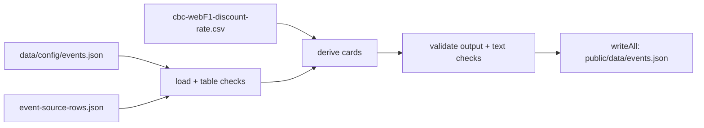

# Design Document: Event Library

## Overview

The event library turns a hand-written table of 35 real events into `public/data/events.json`. A Node script reads the table, checks it, derives the fields that must not be typed by hand (quarters, `verified`, `verificationNote`, `major`) and writes the file through the transactional writer of the data pipeline. The web app only reads the result.

### Design principles

- **Nothing in a card can move a number.** The schema has no field for an effect. Requirement 1.9 is enforced by a closed key list, so a stray `impact` key fails validation.
- **`verified` is derived, never typed.** The table holds the evidence of a comparison (or the fact that none was done). The builder turns evidence into `verified` and a standard `verificationNote`. A card cannot become `verified: true` without evidence that the validator can check.
- **The research notes are the list; the table is the content.** A second small file lists the 35 expected rows. A test counts the data rows of Section 1 of the research notes and compares them with that list, so a row cannot be dropped or added without a failing test.
- **Reuse the pipeline.** Serializer, transactional writer, banned-term checker, CSV parser and `paths.ts` come from `scripts/pipeline/` and `scripts/lib/`. The event build is a separate command because `events.json` is out of scope of `npm run data`.

### Findings that shape the design

1. **The Central Bank file disagrees with the notes in two rows.** `data/raw/macro/cbc-webF1-discount-rate.csv` has 2020/3/20 at 1.25% and 2022/3/18 at 1.375%. The notes say 1.125% and a 0.25 cut or hike. Both file changes are 0.125. The other nine rows match. The file is the Original_Source, so the cards use its values and record the notes values (requirement 5.5).
2. **The CSV has a garbled header** (a non-UTF-8 Chinese header). The parser skips row 1 and reads columns by position: date `YYYY/M/D` (no zero padding), discount rate, secured-loan rate, short-term rate.
3. **`src/data/validate.ts` types `ValidationError.file` as a closed union** of three file names. The union gets a fourth member, `'events.json'`.
4. **The simulation engine does not exist yet** (`src/` has only `data/` and `types/`). The round-trip test with the engine therefore waits for the engine; until then a shape test stands in (see Testing).

## Architecture

### Module layout

```
src/types/events-file.ts          # EventsFile, EventCard, EVENT_TYPES, EVENT_ROLES (types and constants only)
src/data/validate-events.ts       # validateEventsFile(x): ValidationError[]  (structure, ranges, forbidden keys)
scripts/build-events.ts           # entry point: npm run events
scripts/events/
  table.ts                        # types and loader of the curated table; table-level validation
  quarter.ts                      # dateToQuarter(date, precision), quarterOf end date
  discount-rate.ts                # parse cbc-webF1-discount-rate.csv; compare a rate card with it
  derive.ts                       # table row -> EventCard (quarters, verified, note, major)
  text-checks.ts                  # banned terms, length, character checks on title/description
  build.ts                        # orchestration: load, validate, derive, validate output, write
data/config/
  events.json                     # curated table (hand-written, committed)
  event-source-rows.json          # the 35 expected rows from the research notes (id, section, notesDate)
  event-banned-terms.txt          # extra neutrality terms for event text
public/data/events.json           # output
tests/scripts/events/*.test.ts
tests/data/events-file.test.ts
```

`src/types/` and `src/data/validate-events.ts` follow the existing split: the scripts and the web app share one schema. `scripts/` is never imported by `src/`. The engine imports nothing from here; the game layer passes `id`, `firstQuarter` and `lastQuarter` of each card to the engine as plain data.

### Build flow



Steps run in order and stop at the first failing step. All errors of one step are collected and printed together, each with card id and field (requirement 8.2). On any error the existing `events.json` stays unchanged, because `writeAll` is only reached after every check passes.

`npm run events` is added to `package.json` as `"events": "node scripts/build-events.ts"`. No new dependency.

## Components and Interfaces

### Curated table (`data/config/events.json`)

Hand-written input. Fields the builder derives are absent.

```ts
interface EventsTable {
  readonly schemaVersion: 1;
  readonly majorIds: readonly string[];            // requirement 7.1 and 7.3
  readonly events: readonly TableRow[];
}

interface TableRow {
  readonly id: string;
  readonly date: string;                           // YYYY-MM-DD | YYYY-MM | YYYY
  readonly endDate?: string;                       // same format; only for events with a documented end
  readonly type: EventType;
  readonly title: string;
  readonly description: string;
  readonly role: 'baseline' | 'narrative';
  readonly sources: readonly SourceLink[];         // label, publisher, url
  readonly verification: Verification;
}

type Verification =
  | { readonly kind: 'cbc-discount-rate'; readonly change: 'cut' | 'hike'; readonly rateAfter: number; readonly notesRateAfter?: number }
  | { readonly kind: 'notes-verified' }            // the notes row is marked verified and has these links
  | { readonly kind: 'compared'; readonly original: SourceLink; readonly comparedOn: string; readonly foundDate: string; readonly notesDate?: string }
  | { readonly kind: 'pending'; readonly against: string; readonly dayUnknown?: boolean };
```

`datePrecision` is not stored: the builder reads it from the length of `date` (10, 7 or 4 characters).

### Expected rows (`data/config/event-source-rows.json`)

```ts
interface SourceRow { readonly id: string; readonly section: '1a'|'1b'|'1c'|'1d'|'1e'; readonly notesDate: string }
```

Rules checked: same ids as the table; same order within a section; a card `date` that differs from `notesDate` is allowed only for `verification.kind === 'compared'` with `foundDate === date` and a `notesDate` equal to the row (requirement 2.4). The 35 ids are fixed in this file during the first task.

### Quarter helper (`quarter.ts`)

```ts
function dateToQuarter(date: string): QuarterKey   // month = 1 for year precision; q = ceil(month / 3)
function precisionOf(date: string): 'day' | 'month' | 'year'
```

`firstQuarter = dateToQuarter(date)`. `lastQuarter = endDate ? dateToQuarter(endDate) : firstQuarter`. Dates are parsed by hand with calendar checks (month 1 to 12, day within the month, leap years). `Date` objects are not used, so there is no time-zone behaviour.

### Discount-rate module (`discount-rate.ts`)

```ts
interface RateRow { readonly date: string /* ISO */; readonly rate: number }
function parseDiscountRateCsv(text: string): RateRow[]          // skips row 1, converts 2024/3/22 to 2024-03-22, sorted ascending
function checkRateCard(row: TableRow, rates: readonly RateRow[]): RateCheck

type RateCheck =
  | { readonly status: 'confirmed'; readonly fileRate: number; readonly previousRate: number }
  | { readonly status: 'no-row' }
  | { readonly status: 'mismatch'; readonly reason: string };   // rate differs, or direction differs from the previous row
```

`confirmed` needs the same date, `fileRate === rateAfter` and a previous rate that makes the stated direction true (`cut`: previous > file rate; `hike`: previous < file rate). The first row of the file has no previous row; it is not used by any card, and a card on it would return `mismatch` with the reason "no previous row". Rates are compared as numbers; the values in the file are exact binary fractions (multiples of 0.125), so `===` is safe.

### Derivation (`derive.ts`)

```ts
function deriveCard(row: TableRow, ctx: { rates: RateRow[]; majorIds: ReadonlySet<string> }): EventCard
```

| Verification kind | `verified` | `verificationNote` |
|---|---|---|
| `cbc-discount-rate`, `confirmed` | `true` | `Compared with the Central Bank discount-rate file cbc-webF1-discount-rate.csv (data.gov.tw dataset 6022): same date, rate X%.` plus `The research notes give Y%; the file value is used.` when `notesRateAfter` is set |
| `cbc-discount-rate`, `no-row` | `false` | `No row for this date in the Central Bank discount-rate file; to be compared.` |
| `cbc-discount-rate`, `mismatch` | build error | (error names the card, date and both values) |
| `notes-verified` | `true` | `The research notes mark this row verified with the linked sources (requirement 5.2).` |
| `compared` (`foundDate` equals `date`) | `true` | `Compared with <original.label> (<original.url>) on <comparedOn>: date matches.` plus the notes date when it differs |
| `pending` | `false` | `Not yet compared. To check against: <against>.` plus `The day is not known.` when `dayUnknown` |

Other derived fields: `datePrecision`, `firstQuarter`, `lastQuarter`, `major` (`majorIds.has(id)`). Output key order is fixed: `id, date, datePrecision, firstQuarter, lastQuarter, type, title, description, role, major, verified, verificationNote, sources`. Cards are sorted by `date`, then `id`, with plain string comparison (the three date formats sort correctly as strings when compared at the same prefix; a year-only or month-only date sorts before day dates in the same period, which is the intended order).

`verificationNote` is a closed set of templates; no free text. The `dayUnknown` flag is required for every row whose date has `datePrecision` other than `day` (requirement 1.11) and is checked by the table validator.

### Text checks (`text-checks.ts`)

- Lengths: title 1 to 80, description 1 to 300 characters.
- Banned terms: `checkBannedTerms()` from `scripts/pipeline/banned-terms.ts`, applied with `data/config/banned-terms.txt` and `data/config/event-banned-terms.txt`, and the exempt list `banned-terms-exempt.txt`. The new file holds the terms of requirement 4.3 that the shared file lacks (`soaring`, `crash`, `crackdown`, `relief`, `plunge`, `surge`, `slump`, `boom`, `bubble`). It is a separate file so that the SOURCES.md check does not start rejecting those words.
- English only: every character of title and description must be printable ASCII plus the characters `–`, `’` and `NT$`-style text; a CJK character fails. Official policy titles are written in English (for example "New Youth Housing Loan").
- Neutrality review (requirement 4.7) is a human step and cannot be automated. The final report asks for it.

### Output schema validator (`src/data/validate-events.ts`)

```ts
function validateEventsFile(x: unknown): ValidationError[]
```

Checks, in one pass over `$.events[i]`:

- the top-level keys are exactly `schemaVersion` and `events`; `schemaVersion === 1`;
- each card has exactly the 13 keys of requirement 1.2 (no more, no fewer; this is what rejects `modifier`, `magnitude`, `impact` and `affectedIndicators`);
- types of every field; `id` pattern `^[a-z0-9]+(-[a-z0-9]+)*$`, length at most 60, unique;
- `date` format matches `datePrecision`, calendar-valid, between 2015-01-01 and 2025-12-31;
- `firstQuarter` equals `dateToQuarter(date)`; both quarters are in `2015Q1` to `2025Q4`; `firstQuarter <= lastQuarter`;
- `type` and `role` in their closed sets;
- `sources` has at least one entry; each has non-empty `label` and `publisher` and a `url` that parses with `new URL()` and has protocol `https:`;
- `verified === true` implies a non-empty `verificationNote`; `datePrecision !== 'day'` implies a note containing "The day is not known";
- cards sorted by `date`, then `id`.

`dateToQuarter` lives in `src/` (a small pure helper next to the validator) and `scripts/events/quarter.ts` re-exports it, so both sides agree by construction. The script is allowed to import from `src/types` and pure helpers in `src/data`; `src/` never imports from `scripts/`.

## Data Models

```ts
// src/types/events-file.ts
export const EVENT_TYPES = ['interest-rate','credit-control','tax','housing-law','housing-program','transit','public-health','disaster'] as const;
export const EVENT_ROLES = ['baseline','narrative'] as const;
export type EventType = typeof EVENT_TYPES[number];
export type EventRole = typeof EVENT_ROLES[number];
export interface SourceLink { readonly label: string; readonly publisher: string; readonly url: string }
export interface EventCard {
  readonly id: string;
  readonly date: string;
  readonly datePrecision: 'day' | 'month' | 'year';
  readonly firstQuarter: QuarterKey;
  readonly lastQuarter: QuarterKey;
  readonly type: EventType;
  readonly title: string;
  readonly description: string;
  readonly role: EventRole;
  readonly major: boolean;
  readonly verified: boolean;
  readonly verificationNote: string;
  readonly sources: readonly SourceLink[];
}
export interface EventsFile { readonly schemaVersion: 1; readonly events: readonly EventCard[] }
```

Example card:

```json
{
  "id": "cbc-rate-cut-2020-03",
  "date": "2020-03-20",
  "datePrecision": "day",
  "firstQuarter": "2020Q1",
  "lastQuarter": "2020Q1",
  "type": "interest-rate",
  "title": "Central Bank lowers the discount rate",
  "description": "On 20 March 2020 the Central Bank of the Republic of China (Taiwan) lowered its discount rate by 0.125 percentage points, from 1.375% to 1.25%.",
  "role": "narrative",
  "major": true,
  "verified": true,
  "verificationNote": "Compared with the Central Bank discount-rate file cbc-webF1-discount-rate.csv (data.gov.tw dataset 6022): same date, rate 1.25%. The research notes give 1.125%; the file value is used.",
  "sources": [{ "label": "Discount rate history", "publisher": "Central Bank of the Republic of China (Taiwan)", "url": "https://data.gov.tw/dataset/6022" }]
}
```

The rate-card sources are the Central Bank dataset page on data.gov.tw (the notes name dataset 6022). The notes give no direct link for these 11 rows, so this is the Original_Source link of requirement 6.3.

### Role and type assignment

Kept in the table, one value per row, set from requirement 3.1 and 2.5. The table validator checks the role rule by id list: roles `baseline` for exactly the nine ids in requirement 3.1, `narrative` for all others. The id list lives in `event-source-rows.json` as a `role` column, so role is part of the expected row and is checked by the same comparison.

### Major events

`majorIds` in the table holds the 10 ids of requirement 7.1. The table validator checks that every id exists. The "first COVID-19 cases" card has a month-only date; requirement 7.4 applies to it, so its `verificationNote` must state why a month-precision, unverified card is a stop point (the stop quarter is 2020Q1 under any day of January).

## Error handling

| Situation | Behaviour |
|---|---|
| Table or rows file missing or not JSON | Error naming the file; exit 1 |
| Table id set differs from the rows file | One error per missing or extra id |
| CSV missing | Error with the path; rate cards cannot be checked, so the build fails (no silent `verified: false`) |
| Rate or direction mismatch | Error with card id, date, both values |
| Date missing in the CSV | Not an error; card is `verified: false` with the standard note |
| Banned term, length or non-English text | Error with card id, field and the term |
| Unknown key, bad URL, bad quarter, duplicate id | Error with card id and JSON path |
| Write failure | `writeAll` restores the previous file and throws `WriteError` |

Exit code 0 only after the file is written. The final report lines (requirement 8.7) are printed by the builder on success: card count, verified and unverified ids, `major` ids.

## Correctness Properties

### Property 1: No effect fields

For every card in the output, the key set equals the 13 keys of requirement 1.2. A card with any extra key (such as `modifier` or `impact`) is rejected.

**Validates: Requirements 1.9, 3.2**

### Property 2: Quarter consistency

For every valid date from 2015-01-01 to 2025-12-31, `firstQuarter` equals `ceil(month / 3)` of that date, and for any end date not before the start `lastQuarter >= firstQuarter`.

**Validates: Requirements 1.5, 1.6**

### Property 3: Verified implies evidence

For every card, `verified === true` implies a non-empty `verificationNote` produced from a `cbc-discount-rate` match, a `notes-verified` row or a `compared` record. No table row can set `verified` directly.

**Validates: Requirements 5.1, 5.7**

### Property 4: Deterministic build

Two builds on the same inputs give byte-identical `events.json`, and a failed build leaves the previous file unchanged.

**Validates: Requirements 8.1, 8.2**

### Property 5: List equality

The sorted ids of the output equal the sorted ids of `event-source-rows.json`, and the count of data rows in Section 1 of the research notes equals their number.

**Validates: Requirements 2.1, 2.2, 2.3**

## Testing Strategy

Run once with `npx vitest --run` and `npm run typecheck`.

| Test file | What it covers |
|---|---|
| `tests/scripts/events/quarter.test.ts` | `dateToQuarter` for all 12 months and the three precisions, leap day, invalid dates rejected. Property (fast-check): for every valid day in 2015 to 2025, the quarter equals `ceil(month / 3)` and `lastQuarter >= firstQuarter` for any `endDate` not before `date`. |
| `tests/scripts/events/discount-rate.test.ts` | CSV parsing (unpadded dates, header skip, ascending sort), `confirmed`, `no-row`, rate mismatch, direction mismatch, first-row case. |
| `tests/scripts/events/derive.test.ts` | One case per verification kind and the resulting `verified` and note; `major` from `majorIds`; key order; sorting. |
| `tests/scripts/events/text-checks.test.ts` | Banned word, over-length, CJK character, party-name term, exempt phrase. |
| `tests/scripts/events/table.test.ts` | Duplicate id, missing or extra id against the rows file, role mismatch, `dayUnknown` missing for a month-only date, unknown `majorIds` entry, a `notesDate` change without a `compared` record. |
| `tests/scripts/events/build.test.ts` | Whole build on in-memory input: writes once; on an error nothing is written (injected `WriteFs`); output is byte-identical on a second run. |
| `tests/data/events-file.test.ts` | The real `public/data/events.json`: `validateEventsFile` returns no errors; 35 cards; ids equal the rows file; the count of data rows in Section 1 of `RESEARCH-NOTES.md` (lines beginning `\| ` and a digit, between `## 1.` and `## 2.`) equals 35; every card has a source; each of the 10 `major` ids exists; every `verified: true` card has a note; forbidden keys are rejected on a mutated copy. |
| `tests/data/validate-events.test.ts` | Each rule of the output validator with a minimal bad input (one test per rule). |
| `tests/simulation/events-roundtrip.test.ts` | **Added when the engine exists.** The real file mapped to engine events (`id`, `firstQuarter`, `lastQuarter`) gives the same Sim_States as an empty list, with all tools at their real value. Until then the shape check of requirement 3.4 is covered in `events-file.test.ts` (known quarter keys, first not after last). |

No test is skipped, todo or `.only`.

## Requirement coverage

| Requirement | Where |
|---|---|
| 1 Schema | `validate-events.ts`, `events-file.ts`, output example |
| 2 Event list | `event-source-rows.json`, `table.ts`, notes row count test |
| 3 Role, no effect | closed key list, role column, engine round-trip test |
| 4 Neutral text | `text-checks.ts`, both banned-term files |
| 5 Verification | `Verification` union, `discount-rate.ts`, derivation table |
| 6 Sources | `SourceLink`, URL check, `sources` non-empty, no network at build time |
| 7 Major events | `majorIds` |
| 8 Build and tests | `build.ts`, `writeAll`, `npm run events`, test table |

Requirement 6.8: `data/SOURCES.md` is generated by `npm run data` from a registry that does not include event sources, so manual edits there would be overwritten. The Event_Builder therefore writes a separate committed file, `data/EVENT-SOURCES.md`, from the table (publisher, label, URL, year, license `not stated` unless known). It is written in the same `writeAll` call as `events.json`.

## Open points

1. **Dataset 6022 link.** The URL `https://data.gov.tw/dataset/6022` is taken from the notes; it is confirmed by opening the page during the first task.
2. **License column.** Event sources are news and agency pages with no stated license in most cases. The file records `not stated` and links the page; no text is copied (requirement 4.5).


