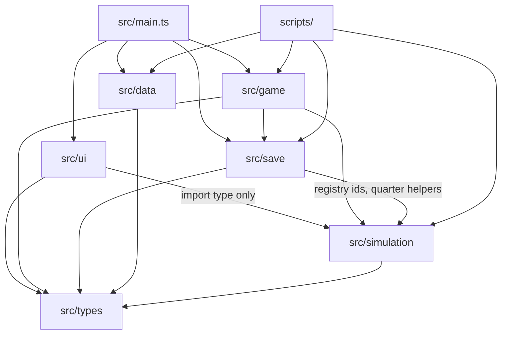
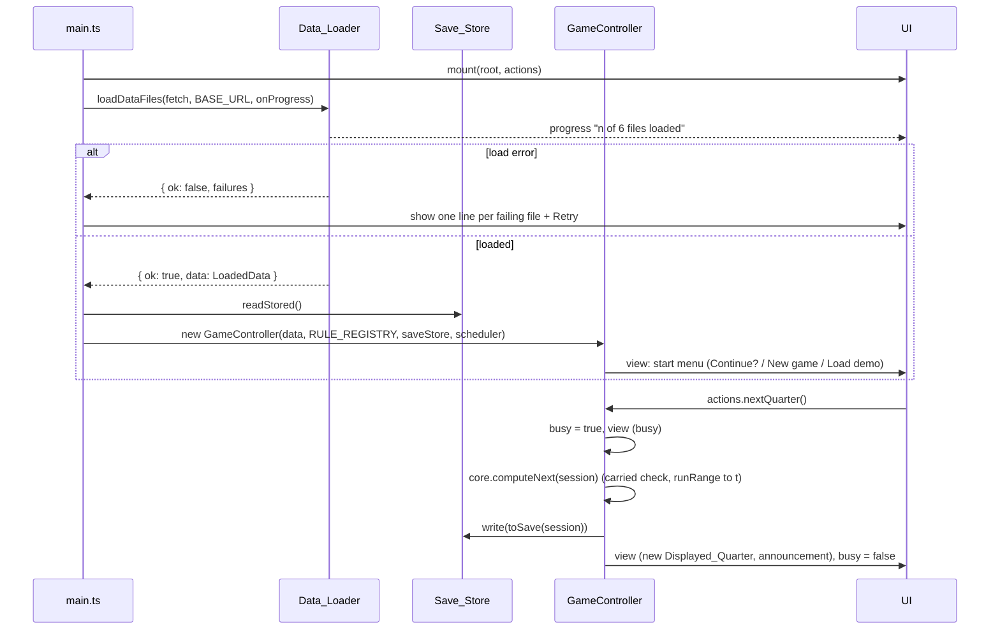

# Design Document: Game UI (Historical mode)

## Overview

This design covers the Butterfly City game screen for Historical mode (2015Q1 to 2025Q4): data loading, the turn controller, saves and save codes, the demo save, and the UI architecture of the map, District_Panel, Turn_Bar, Policy_Panel, Timeline_View and dialogs.

The design describes structure, state flow, interfaces and view-model types only. It contains **no visual style decision**. Palette, typography, spacing, layout per viewport, map styling, outline states, the "no value" pattern, the estimate marker, motion and the ghost placeholder all come from the Design_Proposal, which the user approves before any file in `src/ui/` or `src/styles/` is created (Requirement 1). Where this document names a visual element (for example "estimate marker"), it names the element and its meaning, not its look.

### Inputs this design builds on (read 2026-11-17)

| Item | State | Effect on this design |
|---|---|---|
| `src/simulation/engine.ts` | `step`, `run`, `runRange` exist; `run` recomputes from 2015Q1 to `target` and validates stage 0 on every call | The Game_Controller calls `runRange(policies, events, params, baseline, realTrack, commute, target, { registry })` once per computed quarter (Requirement 5.1) |
| `src/simulation/budget.ts` | `planBudget`, `emptyLedger`, `checkBudget(proposed, ledger, params, tools, ctx?)`, `checkLimit(tool, field, area, quarter, ledger, params, tools, ctx?)` | Edit checks and the carried-value check use these signatures exactly |
| `src/simulation/params.ts` | `scenarioTable(params, scenario, effectIds?)`, `SCENARIO_EFFECT_IDS` (6 ids) | Range_Source_View reads assumptions through `scenarioTable` |
| `src/simulation/registry.ts` | `RULE_REGISTRY` with tools `socialHousing`, `commuterPass`, `rentSubsidy` | Active_Tool detection at run time (Requirement 8.2) |
| `src/simulation/lag.ts` | `LagEntry { tool, area, committed, effect, value }`; the engine pushes an entry for every area, including value 0 | Construction_Entries filter `value !== 0` |
| `src/simulation/ghosts.ts`, `derived.ts` | `derivedGhostCount`, `derivedRentBurden`, `derivedMeanCommuteTime` | Derived_Baseline comparison values come from these functions |
| `src/simulation/constants.ts` | `FIRST_QUARTER`, `LAST_QUARTER`, `QUARTER_COUNT` = 44, `ENGINE_VERSION` = `'1.0.0'` | Saves record `ENGINE_VERSION` |
| `src/data/validate.ts` | `validateDistrictsFile`, `validateHistoryFile`, `validatePolicyTrackFile`, each `(x: unknown, ctx: ValidationContext) => ValidationError[]`, never throwing | Reused by the Data_Loader |
| `scripts/backtest/adapt.ts` | Converts data files into Engine inputs in Node (file reads mixed with pure conversion); commute matrix file name `commute-matrix.json` | The pure conversion is re-implemented in `src/data/convert.ts` (because `src/` must not import `scripts/`); a test asserts both give deep-equal Engine inputs |
| `public/data/` | `districts.json`, `history.json`, `policy-track.json` exist. `events.json`, `params.json`, `commute-matrix.json` do not | The full screen runs only once all 6 Data_Files exist (Open Question 1) |
| `history.json` | 10 district and 2 city indicators; **no `medianTotalPrice`** | Requirement 3.5 depends on data-pipeline Requirement 19 (tasks 16 to 21, not built). Until then the Data_Loader reports the indicator as missing (Requirement 2.5) |
| Event library | `src/types/events-file.ts` (`EventCard`) and `src/data/validate-events.ts` (`validateEventsFile(x)`) are designed, not built | The Data_Loader imports them; until they exist the events step is blocked |

### Pending items carried by this design

- **Demo_Save values are TODO.** The Demo_Base_List and the Demo_Enlarged_List, the Demo_Ghost_Threshold (default 1 Ghost) and the Demo_Rent_Burden_Threshold (default 0.1 percentage points) are set when the real `params.json` exists (Requirement 14, Open Question 15). The fixture-based draft in `requirements.md` is a reference only. The Demo_Script, its checks and its tests are designed here; the generated Demo_Save module is produced only by a successful run on the real files.
- **`medianTotalPrice`** is a data-pipeline deliverable (data-pipeline Requirement 19, tasks 16 to 21, not yet executed). Until it exists, the Data_Loader reports `history.json` as lacking `medianTotalPrice` (Requirement 2.5) and the App shows the load error. Phase A code and tests use a fixture `history.json` that includes the field.
- **File formats of `params.json` and `commute-matrix.json`** are not fixed by any built spec. This design fixes the shapes the Data_Loader accepts (Data Models, "Data_File shapes"). The producing task must emit them; `scripts/backtest/adapt.ts` already accepts both.

### Key design decisions

| Id | Decision | Rationale |
|---|---|---|
| G1 | The game session stores the Player_Policy_Timeline **as Policy_Differences** (one 44-slot array per tool, field and Area that has a non-zero difference). The absolute player value of a quarter is always computed as `real + diff` by one function. | Requirement 12.1 stores differences. Using the same representation in memory and in the Save makes a reloaded game compute bit-identical Engine inputs (Requirements 7.14, 12.12). A Real_Track_Adjustment becomes "set the slots to 0", which is exact. |
| G2 | A difference is stored exactly as `value − real` (no rounding). Only series with at least one non-zero slot are stored. The Timeline_Entry keeps the value as entered. | Rounding would clip an entered value silently, which `simulation.md` forbids. JSON number text round-trips every finite double exactly, so the stored difference reloads bit-identical. |
| G3 | The controller is split into a **pure core** (`src/game/core/*`, functions from session to session) and a thin **stateful controller** (`src/game/controller.ts`) that owns the current session, the busy flag, edit drafts and the save port. | Pure core functions make Requirements 7, 9, 10, 11 and 14 testable with fast-check in Node, without a DOM (Requirement 18.10). The Demo_Script reuses the same core (Requirement 14.5). |
| G4 | Each computed quarter calls `runRange` from 2015Q1 to that quarter and keeps the whole result. Earlier quarters are not merged from older calls. | Requirement 5.1. Fixed quarters never change their inputs, so the newest result agrees with older ones (determinism); keeping one result avoids a merge step. |
| G5 | The controller's limit verdict uses `checkLimit` plus the running-total rule of engine Decision D6 (upper limit on the running city-year total, lower limit only in Q4). A property test checks that it agrees with the Engine's own `limit-exceeded` result. | Gives the 9.2 message before any Engine run, and keeps one rule. |
| G6 | The Save_Code is `BC1.` + base64url (no padding) of the UTF-8 bytes of a canonical JSON text (object keys sorted at every level, no whitespace). No compression. | Deterministic (13.2) in every browser and in Node, needs no dependency, and uses only the allowed characters (13.1). `CompressionStream` output is implementation-dependent and asynchronous. |
| G7 | `localStorage` holds the Save_Code string itself under the key `butterflycity.save.v1`. | One codec and one validator for stored saves and imports (12.7, 13.5). "Export stored text" shows the stored string as is. |
| G8 | At most `MAX_TIMELINE_ENTRIES` = 500 Timeline_Entries per game (provisional). A further Policy_Adjustment is rejected with a message. A test builds a worst-case Save and checks that its code stays at or below 200,000 characters. | Requirement 13.1 bounds the code length; the timeline is otherwise unbounded. **This adds one rejection rule and one UI string that the requirements do not list; it needs user confirmation** (see "Open items"). |
| G9 | Display-only conversions live in `src/game/` (Price_To_Income, Population_Change; Requirement 18.4). Formatting, accessible names and Indicator_Class lookup live in `src/ui/` as pure functions. | Requirements 18.1 and 18.4. They are created only after the design approval (Requirement 1.6). |
| G10 | The Demo_Save is committed as a generated TypeScript module `src/save/demo-save.generated.ts` that exports the Save_Code and the Demo_Summary as string constants. | Bundled with the build, so the App makes no extra request (Requirements 2.1, 18.12). The test compares the file text with the Demo_Script output (14.7). |
| G11 | The UI never animates in JavaScript. Every transition uses CSS custom properties from the Token_File, and the Token_File sets every motion duration to `0ms` inside `@media (prefers-reduced-motion: reduce)`. | Requirements 17.9 and 17.10 follow from the media query, including a live setting change without reload. |
| G12 | UI components are created once and updated in place from a new view model (keyed by District_Code, tool id, field id and Area). No update re-creates a district shape, input field or focused control. | Keeps focus, selection and unapplied edits across indicator changes, quarter changes and resizes (Requirements 4.9, 16.9). |

## Architecture

### Module layout

```
src/
  main.ts                         # wires Data_Loader -> Game_Controller -> UI; only file that reads import.meta.env
  types/
    save.ts                       # Save, PolicyDiffSeries, TimelineEntry, MapIndicatorId (types + constants)
    view.ts                       # every view-model type passed from src/game to src/ui
  data/
    validate.ts                   # existing validators (unchanged except the file union, see below)
    validate-events.ts            # event-library spec (validateEventsFile)
    validate-params.ts            # validateParamsFile(x): ValidationError[]   (new)
    validate-commute.ts           # validateCommuteMatrixFile(x, codes): ValidationError[]   (new)
    expected.ts                   # EXPECTED_POLICY_SERIES_IDS, REQUIRED_HISTORY_INDICATORS, DATA_FILE_NAMES, TRACK_FIELDS
    convert.ts                    # pure: data files -> Engine inputs + display data (LoadedData)
    loader.ts                     # loadDataFiles(fetchPort, baseUrl, onProgress): Promise<LoadResult>
  game/
    core/
      policy.ts                   # diffs, player timeline, Value/Real_Track adjustments
      checks.ts                   # parse input text, limit verdict (D6), budget verdict, range verdict
      turns.ts                    # computeNext, fastForward, carried-value check, recompute
      session.ts                  # newSession, toSave, fromSave
      conversions.ts              # Price_To_Income, Population_Change
      range-sources.ts            # Scenario of min/max, Parameter_Assumptions
      construction.ts             # Construction_Entries, Completion_Items
      timeline.ts                 # Timeline_View items
      tools.ts                    # Active/Coming_Soon detection, tool domains, field metadata
      views.ts                    # buildGameView(session, uiState): GameView
    controller.ts                 # stateful GameController (busy flag, edit drafts, save port, subscribers)
    demo.ts                       # reads the generated Demo_Save module, builds the demo description view
  save/
    base64url.ts                  # encode/decode bytes <-> base64url, strict
    canonical-json.ts             # canonical stringify
    codec.ts                      # encodeSave(save), decodeSaveCode(text, ctx): DecodeResult
    validate-save.ts              # the 16 ordered steps of Requirement 13.5
    store.ts                      # SaveStore over a StoragePort (localStorage adapter in main.ts)
    demo-save.generated.ts        # GENERATED by npm run demo: DEMO_SAVE_CODE, DEMO_SUMMARY_TEXT
  ui/                             # created only after Design_Proposal approval (Requirement 1.6)
    strings.ts                    # UI_Strings_Module: every UI string, Parameter display names, effect texts
    format/                       # number, Range_Display, difference, quarter formatting (pure)
    a11y/                         # accessible-name builder (pure), live region, dialog manager, focus return
    app.ts                        # root: loading, load errors, start menu, Game_Screen regions
    turn-bar/                     # Turn_Bar, save controls, Disclosure_Text host
    map/                          # Map_View (d3-geo), legend, indicator switch, Ghost_Layer, indicator-classes.ts (pure)
    panels/                       # District_Panel, District_List, Policy_Panel, construction rows
    timeline/                     # Timeline_View
    explain/                      # Range_Source_View, "About this range"
    dialogs/                      # confirm, import, export, event cards, demo description, stored-text export
  styles/
    tokens.css                    # Token_File (values from the approved Design_Proposal)
    *.css                         # component styles, custom properties only
scripts/
  build-demo.ts                   # Demo_Script entry: npm run demo
  demo/
    inputs.ts                     # reads public/data and data/config/demo-adjustments.json (Node fs)
    run-demo.ts                   # pure: apply a list, run lookahead and Zero_Delta_Run, measure
    checks.ts                     # pure: Requirements 14.13 to 14.17, 14.20 to 14.24
    output.ts                     # renders demo-save.generated.ts text and the stdout report
data/config/
  demo-adjustments.json           # Demo_Base_List and Demo_Enlarged_List (TODO values) and the two thresholds
tests/
  data/ game/ save/ ui/ static/ scripts/demo/   # mirrors src/ and scripts/
```

`src/data/validate.ts` changes in one place: `ValidationError.file` gains `'params.json'` and `'commute-matrix.json'` (the event-library spec adds `'events.json'`).

`package.json` gains `vite`, `d3-geo` (runtime) and `@types/d3-geo` (dev), pinned exactly (Requirement 18.9), and the scripts `"dev": "vite"`, `"build": "vite build"`, `"preview": "vite preview"` and `"demo": "node scripts/build-demo.ts"`. `vite.config.ts` sets `base: '/butterflycity/'`. `tsconfig.json` adds `"types": ["vite/client"]` for `import.meta.env` in `main.ts` only.

### Dependency rules



- `src/ui/` imports `src/simulation/` with `import type` only, and nothing from `src/save/` or `src/data/` (Requirement 18.1). It receives a `GameView` and calls `UiActions`; both types live in `src/types/view.ts`.
- `src/save/` imports nothing from `src/ui/` (18.3). It may import quarter helpers and `RuleRegistry` types from `src/simulation/` for validation step (j).
- `src/simulation/` imports nothing from `src/ui/`, `src/game/`, `src/save/`, `src/data/` (18.6). Nothing in `src/` imports `scripts/` (18.7).
- `src/data/` is the only module that calls `fetch` (2.9). It receives the fetch function as a port, so `src/game/` and `src/ui/` never see it.
- The static boundary test (Requirement 18.2) parses every `import` and `export … from` statement in `src/**/*.ts` with a regular expression over the source text and checks these rules.

### Start-up and turn flow



The controller publishes a new `GameView` after every state change. The UI applies it in one synchronous pass. Requirement 6.12 holds because the controller clears the busy flag only in the same view that already carries the new values.

### Phase plan under the approval gate

| Phase | Allowed before approval? | Content |
|---|---|---|
| A | Yes (Requirement 1.6) | `src/data/` (loader, convert, new validators), `src/save/`, `src/game/`, `src/types/save.ts`, `src/types/view.ts`, their tests, `scripts/demo/` and its tests, the static boundary test, `package.json` and `vite.config.ts` |
| B | Gate | Design_Proposal artifact (SVG or HTML) with every item of Requirement 1.3; approval recorded in `KIRO-LOG.md` (1.5) |
| C | After approval | `src/styles/tokens.css`, `src/ui/**`, `src/main.ts`, `index.html`, the style test (1.9), the UI pure-function tests (format, accessible names, classes), the banned-term test of the UI_Strings_Module (15.4) |
| D | After the four inputs exist | Real-file tests (14.8, 14.28), the Demo_Script run and the generated Demo_Save, manual checks (19.11) |

`src/types/view.ts` is a type file outside `src/ui/`, so the view models can be fixed and tested in phase A.

### Erasable syntax in shared modules

The Demo_Script runs in Node with type stripping and imports `src/game/`, `src/save/`, `src/data/` and `src/simulation/`. These modules therefore use erasable syntax only (no `enum`, `namespace` or parameter properties), as `src/simulation/` already does. `src/ui/` and `src/main.ts` run only through Vite and are not restricted, but follow the same rule for consistency.

## Components and Interfaces

### 1. Data_Loader (`src/data/`)

#### `expected.ts`

```ts
export const DATA_FILE_NAMES = [
  'districts.json', 'history.json', 'policy-track.json',
  'events.json', 'params.json', 'commute-matrix.json',
] as const;                                   // Requirement 2.1; the matrix file name is fixed here
export type DataFileName = (typeof DATA_FILE_NAMES)[number];

/** Policy series ids policy-track.json must contain (same list as scripts' POLICY_SERIES_SPECS). */
export const EXPECTED_POLICY_SERIES_IDS: readonly string[];

/** District indicators this spec reads (Requirement 2.5). */
export const REQUIRED_HISTORY_INDICATORS = [
  'population', 'householdIncome', 'rent', 'mrtEntries', 'socialHousingStock', 'medianTotalPrice',
] as const;

/** Track series -> tool field, same mapping as scripts/backtest/adapt.ts TRACK_FIELDS. */
export const TRACK_FIELDS: Readonly<Record<string, { readonly tool: string; readonly field: string }>>;
export const PASS_PRICE_SERIES = 'commuterPassPrice';
```

A test asserts that `EXPECTED_POLICY_SERIES_IDS` equals `POLICY_SERIES_SPECS.map(s => s.id)` and that `TRACK_FIELDS` equals the backtest adapter's table (tests may import `scripts/`; `src/` may not).

#### `loader.ts`

```ts
export interface FetchResponse { readonly ok: boolean; readonly status: number; text(): Promise<string> }
export type FetchPort = (url: string, init: { readonly signal: AbortSignal }) => Promise<FetchResponse>;
export interface TimerPort { set(fn: () => void, ms: number): unknown; clear(handle: unknown): void }

export interface LoadFailure { readonly file: DataFileName; readonly message: string }
export type LoadResult =
  | { readonly ok: true; readonly data: LoadedData }
  | { readonly ok: false; readonly failures: readonly LoadFailure[] };   // one per failing file, file order

export function loadDataFiles(
  fetch: FetchPort,
  baseUrl: string,                         // '/butterflycity/' from import.meta.env.BASE_URL in main.ts
  onProgress: (loaded: number) => void,    // 0..6, "n of 6 files loaded" (Requirement 2.8)
  timer: TimerPort,
  timeoutMs?: number,                      // default 15_000 (Requirement 2.5)
): Promise<LoadResult>;
```

Behaviour:

1. Requests exactly `${baseUrl}data/<name>` for the 6 names, in parallel (Requirement 2.1). No other URL is built anywhere in `src/` (Requirement 18.12; tested with a recording `FetchPort`, Requirement 19.10).
2. Each request has its own `AbortController`; the timer aborts it after `timeoutMs` measured until `text()` resolves, so a stalled body also times out. `onProgress` is called after each complete response body.
3. Per file, the first failing check gives the file's one line: HTTP status (`HTTP 404`), timeout (`no complete response within 15 seconds`), JSON parse error, the first `ValidationError` (`<path>: <message>`), for `history.json` the first missing id of `REQUIRED_HISTORY_INDICATORS` (`lacks the indicator medianTotalPrice`).
4. Validation contexts: `districtCodes` are read from `districts.json` itself (`districts[].code`, when that file is an object with a `districts` array; otherwise `[]`, which makes the dependent files fail with the districts file). `quarters` are the 44 keys from `quarterAt(0..43)`. `indicatorIds` are the ids read from `history.json`. `policySeriesIds` is `EXPECTED_POLICY_SERIES_IDS`.
5. Only when all 6 files pass: the code-set check of Requirement 2.3. `history.json` series keys of every district indicator and `commute-matrix.json` `codes` must equal the set of `districts.json` codes; a mismatch fails the file that differs, naming the first missing or extra code.
6. Then `convert(files)` builds `LoadedData` (Requirement 2.4). `convert` is total for validated input; a defensive failure is reported as a load failure of the file it read.
7. The loader keeps no state, so "Retry" (Requirement 2.7) is a second call of `loadDataFiles`. `main.ts` writes nothing to `localStorage` before a successful load (Requirement 2.6): the Save_Store is created only after `ok: true`.

#### `validate-params.ts` and `validate-commute.ts`

Structural validators in the style of `validate.ts` (pure, never throw, return `ValidationError[]`):

- `validateParamsFile(x)`: `{ schemaVersion: 1, parameters: Record<string, ScalarParameter | ScheduleParameter> }`. Checks `kind`, the field types of each entry, finite numbers, non-empty `unit`, `source.citation` and `source.url` strings, `range` shape, `status` in the 4 values. Semantic checks (required ids, value bounds, limits) stay with the Engine's stage 0; an Engine `parameters-invalid` error from the first `runRange` is shown as an Engine_Error (Requirement 7.8).
- `validateCommuteMatrixFile(x, codes)`: `{ schemaVersion: 1, codes: string[41], minutes: number[41][41] }`, codes ascending, non-negative finite minutes, zero diagonal.

#### `convert.ts`

```ts
export interface LoadedFiles {
  readonly districts: DistrictsFile; readonly history: HistoryFile; readonly policyTrack: PolicyTrackFile;
  readonly events: EventsFile; readonly params: ParamsFile; readonly commute: CommuteMatrixFile;
}
export function convert(files: LoadedFiles): LoadedData;
```

- `engine.baseline`: the district indicators of `history.json` as `EngineBaseline` (same construction as `buildBaseline` in `adapt.ts`).
- `engine.realTrack`: 44 `PolicySetting`s from `TRACK_FIELDS`, including the track-only field `commuterPass.passesSold`.
- `engine.params`: `params.json` `parameters` merged with the `commuterPass.price.<city>.<quarter>` entries built from the `commuterPassPrice` series (same as `buildPassPrices` in `adapt.ts`). `paramsFileTable` keeps the `parameters` object alone (used by Requirement 14.28).
- `engine.events`: one `SimEvent` per Event_Card with `id`, `type`, `firstQuarter`, `lastQuarter`, `affectedIndicators: []`, `magnitude: { text: '' }`, `sources: []`, `modifiers: []`. The event-library schema has no effect field, so the Engine receives no modifier and events change no number (`simulation.md`, Events).
- Display data is passed through unchanged: the `DistrictEntry` list, the `HistoryFile` (records with estimate flags, `sources`, `methods`), the `PolicyTrackFile` and the `EventCard`s.

A test builds the Engine inputs from the same files with `convert` and with `adaptInputs` and checks deep equality.

### 2. Game core (`src/game/core/`, pure)

Every function takes and returns immutable values and never throws for inputs that passed the Data_Loader and the Save validation. The Engine is called only from `checks.ts` and `turns.ts`, always as `runRange(..., { registry: session.registry })`.

#### `policy.ts`: differences and adjustments

```ts
export interface FieldTarget { readonly tool: ToolId; readonly field: string; readonly area: AreaKey }

/** Real value of one target and quarter from the Real_Policy_Track, or null when none is recorded. */
export function realValue(track: PolicyTimeline, t: FieldTarget, q: QuarterKey): number | null;
/** real + diff (G1). null when the real value is null. */
export function playerValue(track: PolicyTimeline, diffs: PolicyDiffs, t: FieldTarget, q: QuarterKey): number | null;
/** 44 settings: the real track with every stored difference added; track-only fields copied from real. */
export function playerTimeline(track: PolicyTimeline, diffs: PolicyDiffs): PolicyTimeline;

/** Value_Adjustment: slot q := value − real(q) for every q from `from` to 2025Q4 (Requirement 9.6). */
export function withValue(diffs: PolicyDiffs, track: PolicyTimeline, t: FieldTarget, from: QuarterKey, value: number): PolicyDiffs;
/** Real_Track_Adjustment: slot q := 0 for every q from `from` to 2025Q4 (Requirement 9.14). */
export function withRealTrack(diffs: PolicyDiffs, t: FieldTarget, from: QuarterKey): PolicyDiffs;
/** True when every slot from `from` to 2025Q4 is 0: the Set_To_Real_Control is disabled (Requirement 8.10). */
export function followsRealTrack(diffs: PolicyDiffs, t: FieldTarget, from: QuarterKey): boolean;
```

`withValue` and `withRealTrack` leave slots before `from` untouched and drop a series whose slots are all 0, so equal timelines have equal `PolicyDiffs` (needed for identical Save_Codes, Requirement 13.2).

#### `checks.ts`: edit checks

```ts
export type ParsedInput =
  | { readonly ok: true; readonly value: number }
  | { readonly ok: false; readonly expected: 'integer' | 'number' };

/** Requirement 9.9 and 9.10: /^-?\d+(\.\d+)?$/, and /^-?\d+$/ for a Count_Field. No Engine call. */
export function parseInput(text: string, countField: boolean): ParsedInput;

export interface EditRequest {
  readonly target: FieldTarget;
  readonly kind: 'value' | 'real-track';
  readonly text: string;            // ignored for 'real-track'
}

export function checkEditSync(session: GameSession, req: EditRequest): EditCheck;      // phase 1
export function checkEditRange(session: GameSession, req: EditRequest): EditCheck;     // phase 2 (runRange)
```

Phase 1 runs on every edit and stays well inside the 200 ms of Requirement 9.1 (no Engine run):

1. `planning === 'complete'` or no Planning_Quarter: `fixed-quarter` (Requirement 9.7). The UI offers no edit after 2025Q4, so this also guards the Demo_Script and tests.
2. `parseInput` failure: `invalid-format` with the field and the expected format (9.11).
3. Timeline full (G8): `timeline-full`.
4. Value equal to the player's current value of the Planning_Quarter (for `value`), or `followsRealTrack` (for `real-track`): `unchanged` (Apply disabled with no message, 9.12).
5. The candidate diffs (`withValue` or `withRealTrack` from the Planning_Quarter).
6. Limit verdict (G5). For a `quarter` scope field: `checkLimit(tool, field, area, P, ledger, params, tools, ctx)` and compare the candidate player value of P. For `city-year` (`socialHousing.unitsStarted`): the running city total of the year through P from the candidate player timeline against `upper`, and, when P is a Q4, the full-year total against `lower`. A failure gives `limit` with side, limit value, unit, period, the Parameter id, its citation, URL, `status`, estimate method and `assumption` text (Requirements 9.2, 8.5).
7. Budget verdict: `checkBudget(candidateSetting(P), ledger, params, tools, ctx)`. A `false` result gives `budget` with `reason` (`annual-budget` or `tool-ceiling`), year, the budget amount and `over` (> 0 by construction, Requirement 9.3). An `ok` result gives the budget figures of 9.1: Annual_Budget, committed and remaining for the year of P.
8. Otherwise `pending-range`.

`ledger` is the central Sim_State ledger of the Displayed_Quarter, or `emptyLedger(planBudget(realTrack, params, tools, ctx))` before any quarter. `params` is the central table. `ctx` is `{ params, baseline, realTrack, commute }`.

Phase 2 runs only after phase 1 returned `pending-range`: `runRange(playerTimeline(track, candidate), events, params, baseline, realTrack, commute, P)`. An error in any Scenario gives `engine` with the Engine_Error (Requirement 9.4); the Scenario name is dropped before the view is built. Success gives `ok`.

```ts
export type EditCheck =
  | { readonly status: 'fixed-quarter'; readonly planning: QuarterKey | null }
  | { readonly status: 'invalid-format'; readonly expected: 'integer' | 'number' }
  | { readonly status: 'timeline-full' }
  | { readonly status: 'unchanged'; readonly budget: BudgetFigures | null }
  | { readonly status: 'limit'; readonly limit: LimitProblem; readonly budget: BudgetFigures | null }
  | { readonly status: 'budget'; readonly problem: BudgetProblem }
  | { readonly status: 'pending-range'; readonly budget: BudgetFigures }
  | { readonly status: 'engine'; readonly error: EngineError; readonly budget: BudgetFigures }
  | { readonly status: 'ok'; readonly budget: BudgetFigures };
```

`budget` on a `limit` result is computed when `checkBudget` can still run on the candidate, so the live budget display of 9.1 does not go blank while a limit message shows.

#### `turns.ts`: Next_Quarter_Action and Fast_Forward_Action

```ts
export type StopReason = 'one-quarter' | 'four-quarters' | 'complete' | 'major-event' | 'engine-error' | 'carried-check';

export interface TurnOutcome {
  readonly session: GameSession;
  readonly computed: readonly QuarterKey[];        // quarters computed in this Computation_Run
  readonly stop: StopReason;
  readonly majorEventIds: readonly string[];       // Major_Events whose firstQuarter is the last computed quarter
  readonly runEventIds: readonly string[];         // Major_Events of every computed quarter (Requirement 17.7)
  readonly engineError: { readonly quarter: QuarterKey; readonly error: EngineError } | null;
  readonly carried: CarriedProblem | null;
}

export function computeNext(session: GameSession): TurnOutcome;
export function fastForward(session: GameSession, afterQuarter?: (s: GameSession) => void): TurnOutcome;
export function carriedCheck(session: GameSession, q: QuarterKey): CarriedProblem | null;
export function recompute(session: GameSession): RecomputeResult;     // used by fromSave
```

`fastForward` loop (Requirements 7.5, 7.7, 7.8, 9.8):

```
computed = []
repeat
  if session.next = 'complete': stop 'complete'
  t = session.next
  problem = carriedCheck(session, t)                     -- 9.8, before the Engine run
  if problem: stop 'carried-check' (t stays the Planning_Quarter)
  r = runRange(playerTimeline(track, diffs), events, params, baseline, realTrack, commute, t)
  if not r.ok: stop 'engine-error' (failed t discarded, t stays the Planning_Quarter)
  session = session with computed := r, next := (t = 2025Q4 ? 'complete' : nextQuarter(t))
  computed.push(t); afterQuarter(session)                -- the controller writes the Save here (12.2)
  if t is the firstQuarter of a Major_Event: stop 'major-event'
  if t = 2025Q4: stop 'complete'
  if |computed| = 4: stop 'four-quarters'
```

`computeNext` is the same loop body run once (`one-quarter`, or `major-event`, `complete`, `engine-error`, `carried-check`). The Displayed_Quarter is always derived from `session.computed` (the last central state), so a stop leaves Displayed_Quarter = last success and Planning_Quarter = the failed or blocked quarter (Requirement 7.8).

`carriedCheck(session, t)` runs the phase-1 limit and budget verdicts on the player timeline as it is, at quarter `t`, for every target with a non-zero slot at `t`, and, for a `city-year` field, every city that has a non-zero slot in any quarter of the year through `t`. Targets are visited in registry, field and Area order (District_Code ascending, then Taipei, New Taipei). The first failure is returned as `CarriedProblem { target, quarter, problem: LimitProblem | BudgetProblem, value }`; the view shows the Set_To_Real_Control for that target (Requirement 9.8).

#### `session.ts`

```ts
export function newSession(data: LoadedData, registry: RuleRegistry, demo?: boolean): GameSession;
export function toSave(session: GameSession): Save;                  // no Sim_State (Requirement 12.1)
export type FromSaveResult =
  | { readonly ok: true; readonly session: GameSession; readonly versionNotice: { readonly saved: string; readonly current: string } | null }
  | { readonly ok: false; readonly quarter: QuarterKey; readonly error: EngineError };
export function fromSave(save: Save, data: LoadedData, registry: RuleRegistry): FromSaveResult;
```

`newSession` starts with `next: '2015Q1'`, empty diffs and timeline, `mapIndicator: 'rentBurden'`, `selectedDistrict: null`, `seed: 0` (Historical mode uses no randomness; a fixed seed keeps equal games equal). `fromSave` rebuilds `PolicyDiffs` from `save.policy` and calls `runRange` once to the quarter before `next` (or to 2025Q4 for `'complete'`; no call when `next` is 2015Q1) (Requirement 12.6). `toSave(fromSave(s).session)` deep-equals `s` for every valid Save whose recomputation succeeds.

#### `conversions.ts` (the only display conversions, Requirement 18.4)

```ts
export interface PriceToIncome { readonly value: number | null; readonly estimated: boolean; readonly methodIds: readonly string[] }
/** medianTotalPrice ÷ householdIncome of the district and quarter, rounded half up to 2 decimals (3.5, 3.6, 3.14). */
export function priceToIncome(history: HistoryFile, code: DistrictCode, q: QuarterKey): PriceToIncome;
/** (population − base) ÷ base × 100, base = history.json population of 2015Q1; not rounded. */
export function populationChange(population: number, base: number): number;
```

`priceToIncome` returns `value: null` when the price record is missing or `null`, or the income record is missing, `null` or 0. Every non-null value has `estimated: true` and the method ids of the income record and, when estimated, of the price record (Requirement 3.14). Population_Change maps each Scenario's population through the same increasing function, so its Result_Range is `{ min: f(min), central: f(central), max: f(max) }` and the Scenarios of the minimum and maximum are those of `population`.

#### `range-sources.ts` (Requirement 20.2)

```ts
export function scenarioOfMin(v: Readonly<Record<ScenarioName, number>>): ScenarioName;  // first of low, high, central equal to the minimum
export function scenarioOfMax(v: Readonly<Record<ScenarioName, number>>): ScenarioName;  // first of high, low, central equal to the maximum
export function assumptionsFor(params: ParameterTable, scenario: ScenarioName): readonly ParameterAssumptionView[];
```

`assumptionsFor` reads `scenarioTable(params, scenario)` and lists every id of `SCENARIO_EFFECT_IDS` that is a scalar in the table, in that order, with the table value, unit, citation and URL. The citation is `range.lowSource` for `low` and `range.highSource` for `high` when the Parameter has a `range`, otherwise `source`. An empty citation or URL becomes `null`, shown as "No source recorded" (20.5). The Scenario name is used internally to pick the table and is not part of the returned view (20.3, 5.3).

#### `construction.ts` (Requirement 10)

```ts
export function constructionEntries(displayed: SimState, names: ReadonlyMap<DistrictCode, string>): readonly ConstructionRowView[];
export function completionItems(states: readonly SimState[]): readonly CompletionItemView[];
```

- A Construction_Entry is a `LagEntry` of the central Displayed_Quarter state with `tool === 'socialHousing'` and `value !== 0`. `lag = quarterIndex(effect) − quarterIndex(committed)`, `progress = quarterIndex(displayed) − quarterIndex(committed)`. The entry is still in the pipeline, so `effect > displayed` and `0 ≤ progress ≤ lag − 1` (10.4). `afterEnd = quarterIndex(effect) > 43` (10.7). Rows are sorted by effect quarter, then romanized name (10.3). Entries of one district with different committed quarters are separate rows (10.2).
- A Completion_Item is an entry with `value !== 0` that appears in the pipeline of some computed central state and whose effect quarter is at or before the Displayed_Quarter, identified by `(area, committed)`, listed under its effect quarter (10.9).

#### `timeline.ts` (Requirement 11)

```ts
export function timelineItems(session: GameSession): readonly TimelineQuarterView[];
```

Quarter headings run from 2015Q1 to the Planning_Quarter (or 2025Q4 when complete) and appear only for quarters with items (11.1). Item order per quarter: Event_Cards with `firstQuarter` equal to the quarter when it is a Computed_Quarter, in `events.json` order; Completion_Items by district name; Timeline_Entries in applied order (11.2). Every Timeline_Entry appears once (11.4). Only Major_Event items carry `major: true` (11.5).

#### `tools.ts`

```ts
export const TOOL_DOMAINS: Readonly<Record<PolicyToolId, 'housing' | 'transit'>>;   // all 5 POLICY_TOOL_IDS
export function toolStatus(registry: RuleRegistry, id: PolicyToolId): 'active' | 'coming-soon';
export function unitCostParameterId(rule: ToolRule): string | null;   // the spec with role 'cost'
```

Order of the Policy_Panel comes from `POLICY_TOOL_IDS` filtered by domain, which gives exactly the order of Requirement 8.1. `toolStatus` checks `registry.tools.some(r => r.id === id)`; nothing in `src/ui/` lists coming-soon ids (8.2). Coming_Soon_Tool real values are the `policy-track.json` series whose `tool` equals the id, so `sublease` shows `subleaseUnitsMatched` and `holdingTax` shows its three series (8.3).

#### `views.ts`

```ts
export function buildGameView(session: GameSession | null, ui: ControllerUiState, data: LoadedData): GameView;
```

Pure. All formatting-independent values (numbers, ranges, flags, ids, citations) go into the view; the UI formats them. The view contains no Scenario id anywhere (5.3, tested by a deep scan, Requirement 19.13).

### 3. Game_Controller (`src/game/controller.ts`, stateful)

```ts
export interface SaveStorePort {
  write(save: Save): { readonly ok: boolean };
  readStored(): StoredRead;
}
export interface Scheduler { defer(fn: () => void): void }        // setTimeout(fn, 0) in main.ts, synchronous in tests

export class GameController {
  constructor(deps: {
    readonly data: LoadedData;
    readonly registry: RuleRegistry;
    readonly store: SaveStorePort;
    readonly scheduler: Scheduler;
    readonly demo: DemoSource;                // decoded Demo_Save or the reason it is unavailable
  });
  subscribe(listener: (view: GameView) => void): () => void;
  readonly actions: UiActions;
  view(): GameView;
}
```

The controller holds: the current `GameSession | null`, `busy`, edit drafts (`Map<FieldKey, { text, generation, check }>`), the pending confirmation, open dialog data (event cards, Range_Source_View, import result, export text), the storage warning flag, the version notice and the latest announcement.

Rules:

- **Busy guard.** `nextQuarter`, `fastForward`, `applyField` and `setToReal` return immediately while `busy` is set (Requirement 7.11). The view shows a text busy state and disables these controls (7.10).
- **Ordering.** A computation runs as `busy = true; publish; scheduler.defer(compute)`, so the busy view paints before the Engine runs. The deferred step runs the core, writes the Save (after each fast-forward quarter through `afterQuarter`), then publishes the final view with `busy = false` (Requirements 6.12, 12.2).
- **Saves.** The controller writes after every computed quarter, applied Policy_Adjustment, Map_Indicator change and Selected_District change (12.2). A failed write sets the storage warning, which stays until the next successful write (12.9). Writes start only after the player picked "New game", "Continue" or "Load demo".
- **Edits.** `editField(key, text)` stores the text unchanged (9.5), increments the generation, runs `checkEditSync` and publishes. On `pending-range` it defers `checkEditRange` and stores the result only if the generation is still current (9.13). `applyField` re-runs both phases synchronously on the stored text before it writes, so a stale verdict can never apply.
- **Confirmations.** "New game", "Load demo" and "Import" ask for confirmation under Requirements 12.10, 13.12 and 14.11. Declining, or Escape, leaves session and storage unchanged (12.11, 17.14).
- **Determinism.** The controller passes only the session (diffs, next, timeline, registry) and `LoadedData` to the core (7.14). It reads no clock and no random source.

`UiActions` (in `src/types/view.ts`):

```ts
export interface UiActions {
  startNew(): void; continueStored(): void; openDemo(): void; confirmDemo(): void;
  confirm(answer: boolean): void;
  nextQuarter(): void; fastForward(): void; dismissEventCards(): void;
  selectDistrict(code: DistrictCode): void; setMapIndicator(id: MapIndicatorId): void;
  editField(key: FieldKey, text: string): void; applyField(key: FieldKey): void; setToReal(key: FieldKey): void;
  selectTimelineEntry(index: number): void;
  openRangeSource(ref: ValueRef): void; closeDialog(): void;
  exportSaveCode(): void; importSaveCode(text: string): void;
  exportStoredText(): void; reportCopyFailed(): void;
}
```

`selectTimelineEntry` makes the entry's Area the Selected_District when the field is a district field, and sets a one-shot `focusRequest` for the field's input (Requirement 11.6). It never changes diffs or timeline (11.7).

### 4. Save_Store (`src/save/`)

#### Codec

```ts
export const SAVE_CODE_PREFIX = 'BC1.';
export const MAX_SAVE_CODE_LENGTH = 200_000;

export function encodeSave(save: Save): string;   // 'BC1.' + base64url(utf8(canonicalJson(save)))
export function decodeSaveCode(text: string, ctx: SaveValidationContext): DecodeResult;   // never throws

export interface SaveValidationContext {
  readonly registry: RuleRegistry;                                   // tool ids and editable fields
  readonly districts: readonly { readonly code: DistrictCode; readonly city: CityName }[];
}
export type DecodeResult =
  | { readonly ok: true; readonly save: Save }
  | { readonly ok: false; readonly error: SaveCodeError };
export interface SaveCodeError {
  readonly step: SaveValidationStep;   // which step of Requirement 13.5 failed
  readonly path: string;               // e.g. 'timeline[3].quarter', '$' for the whole text
  readonly reason: string;             // English, shown next to the import field (13.6)
}
```

- `canonicalJson` writes object keys sorted by UTF-16 code unit order at every level, arrays in order, no whitespace, numbers with `JSON.stringify`. Equal Saves give identical text (13.2).
- `base64url` uses the alphabet `A–Z a–z 0–9 - _`, no padding. Decoding is strict: only alphabet characters, length mod 4 ≠ 1, unused trailing bits 0 (so every byte string has exactly one code). Bytes are decoded with `new TextDecoder('utf-8', { fatal: true })`.
- `decodeSaveCode` wraps every step in one `try`/`catch` that turns an unexpected exception into `{ step: 'structure', path: '$', reason: 'unreadable save code' }`, so Requirement 13.9 holds even for a defect.

#### Validation steps (Requirement 13.5, in this order; the first failure is returned)

| Step | Id | Check | Example path |
|---|---|---|---|
| a | `prefix` | the trimmed text starts with `BC1.` | `$` |
| b | `length` | total length ≤ 200,000 and ≥ 1 character after the prefix | `$` |
| c | `encoding` | strict base64url and valid UTF-8 | `$` |
| d | `json` | `JSON.parse` succeeds | `$` |
| e | `schema-version` | `schemaVersion === 1`; any other value gives "This save code was made by a different version of Butterfly City." (13.7) | `schemaVersion` |
| f | `structure` | exact key set at every level (no missing, no unknown key), arrays where arrays are expected, `diffs` has 44 elements | `policy[2].diffs` |
| g | `types` | JSON type of every field: strings, numbers, `null` where allowed; `demo` is left to step n | `timeline[0].before` |
| h | `quarters` | every Quarter_Key is `2015Q1`–`2025Q4`; `next` is a Quarter_Key or `'complete'` | `next` |
| i | `timeline-order` | no Timeline_Entry quarter after `next` | `timeline[3].quarter` |
| j | `registry` | every `tool` is a Rule_Registry tool id and every `field` one of its editable `fields`; Count_Field values (diffs, before, after) are integers; no duplicate (tool, field, area) series; `after` is `null` exactly for `kind: 'real-track'` | `policy[1].field` |
| k | `districts` | `area` is a District_Code of a district field, or `Taipei`/`New Taipei` for a city field | `timeline[5].area` |
| l | `map-indicator` | one of the 4 Map_Indicator ids | `mapIndicator` |
| m | `selected-district` | a District_Code or `null` | `selectedDistrict` |
| n | `demo-flag` | boolean | `demo` |
| o | `seed` | integer | `seed` |
| p | `finite` | every number is finite (catches `1e999`, which `JSON.parse` turns into `Infinity`) | `policy[0].diffs[7]` |

Paths use dotted keys and `[i]` indices, with no leading `$.` except for the whole text (`$`), matching the example of Requirement 13.6.

#### Store

```ts
export const SAVE_KEY = 'butterflycity.save.v1';
export interface StoragePort { getItem(key: string): string | null; setItem(key: string, value: string): void }
export type StoredRead =
  | { readonly kind: 'none' }
  | { readonly kind: 'unavailable' }
  | { readonly kind: 'text'; readonly text: string };          // raw stored text, not yet validated

export class SaveStore implements SaveStorePort {
  constructor(port: StoragePort | null);                        // null when window.localStorage throws on access
  readStored(): StoredRead;
  write(save: Save): { readonly ok: boolean };                  // setItem in try/catch; one key only (12.3)
}
```

The store never removes or rewrites the stored text on its own. Invalid stored text stays until the player confirms "New game" or "Load demo" (Requirement 12.7), at which point the next `write` replaces it. A test with a throwing `StoragePort` covers the unavailable and failed-write cases (19.9).

### 5. Demo_Save at run time (`src/game/demo.ts`)

```ts
export type DemoSource =
  | { readonly ok: true; readonly save: Save; readonly summary: DemoSummary }
  | { readonly ok: false; readonly reason: string };
export function readDemo(ctx: SaveValidationContext): DemoSource;   // decodes DEMO_SAVE_CODE, parses DEMO_SUMMARY_TEXT
```

`openDemo` builds `DemoDescriptionView`: every Timeline_Entry of the Demo_Save (tool, field, Area, quarter, value, or "real track" for a Real_Track_Adjustment), the two effect lines in the order of Requirement 14.26 or 14.27 depending on `summary.fallbackStep`, both stated "for 2021Q1 after one Next quarter", and the sentence "These adjustments are examples, not recommendations." (14.10). A decode or recompute failure shows the reason and leaves game and storage unchanged (14.12). A loaded demo has `demo: true`, so the Turn_Bar shows "Demo game" until "New game" or an import replaces the game (14.9).

### 6. UI (`src/ui/`, after approval)

#### Component pattern

```ts
export interface Component<V> { readonly root: Element; update(view: V): void }
export type ComponentFactory<V> = (doc: Document, actions: UiActions) => Component<V>;
```

- Each region is one component created once by `app.ts`: `TurnBar`, `MapView`, `DistrictList`, `DistrictPanel`, `PolicyPanel`, `TimelineView`, `LiveRegion`, `DialogHost`.
- `update` diffs by key and changes text, attributes and classes in place (G12). Inputs are never rewritten while focused; their text comes from the controller's draft, which equals what the player typed.
- Every string comes from `strings.ts` or from Data_File fields (Requirement 15.3). Every number is formatted by `format/` from view values.
- Visual states are classes and attributes (`is-selected`, `aria-pressed`, `aria-disabled`, `data-class-index`, `data-estimated`). Their appearance is defined in CSS from the Token_File.

#### Regions and their view models

| Component | View model (`src/types/view.ts`) | Requirements |
|---|---|---|
| `TurnBar` | `TurnBarView`: planning, displayed, turn number, complete flag, busy, demo label, storage warning, version notice, Disclosure_Text host, save controls state | 7.3, 7.4, 7.7, 7.10, 7.12, 12.9, 13.8, 14.9, 15.1 |
| `MapView` | `MapViewModel`: indicator id, label mode ("Real data, 2015Q1" or quarter), one `MapDistrictView` per district (code, name, city, central value or null, range, estimated, class index), legend | 3, 4 |
| `DistrictList` | `DistrictListView`: 2 city groups, names sorted, selected code | 4.6 |
| `DistrictPanel` | `DistrictPanelView`: prompt or 9 `PanelRowView`s | 6 |
| `PolicyPanel` | `PolicyPanelView`: 2 domains, 5 `ToolView`s, budget, construction rows, carried problem | 8, 9, 10 |
| `TimelineView` | `TimelineQuarterView[]` or empty | 11 |
| `DialogHost` | `DialogView \| null`: confirm, import, export, stored-text export, event cards, Range_Source_View, demo description | 5.4–5.6, 7.6, 12.7, 12.8, 13, 14.10, 17.12–17.15, 20 |
| `LiveRegion` | `Announcement \| null` with id, politeness, text | 17.7, 17.8 |

The Disclosure_Text is DOM text inside the Turn_Bar header, the first element of the page, so it is inside the initial viewport at every width (15.1, 15.2). How it fits each width is a Design_Proposal decision.

#### Map_View

- Imports `geoMercator` and `geoPath` from `d3-geo` only. The projection is fitted with `fitExtent` to the container's content box minus a padding token, over a `FeatureCollection` built once from `districts.json` (3.1, 16.5).
- One `<path>` per district in ascending District_Code order inside `<g data-layer="districts">`, each with `tabindex="0"`, `role="button"`, `aria-pressed`, and `aria-label` from the accessible-name builder (3.15, 4.1, 4.2). DOM order gives the Tab order of 4.1.
- `<g data-layer="labels" aria-hidden="true">` with one `<text>` per district at the projected centroid. After each layout the label's `getBBox()` is compared with the shape's `getBBox()`; a label that is wider or taller is hidden (3.16, 3.17).
- `<g data-layer="estimate" aria-hidden="true">` holds the non-colour estimate markers (3.13).
- `<g data-layer="ghosts" aria-hidden="true" pointer-events="none">` is the last child, above the shapes, and stays empty (3.19).
- A `<pattern>` in `<defs>` is the "no value" fill (3.11); the legend shows a swatch with the same pattern (3.10).
- Click and pointer tap call `selectDistrict`. `keydown` for Enter and Space calls `selectDistrict` and `preventDefault()`, so the page does not scroll (4.4, 4.5).
- A `ResizeObserver` on the container triggers a trailing redraw 150 ms after the last size change (under the 500 ms of 3.2). The redraw updates `d`, label positions and label visibility on the existing elements, so focus, selection and indicator survive (4.9).
- The indicator switch is a group of radio inputs (one per Map_Indicator) with visible labels. A change calls `setMapIndicator`; the next view updates fills, legend and the indicator text in one pass (3.4, 3.18).

#### Pure UI functions (tested in Node)

```ts
// format/number.ts
export function formatNumber(x: number, decimals: number): string;            // en-US grouping, U+2212 minus, never "−0"
// format/range.ts
export type RangeText =
  | { readonly kind: 'range'; readonly central: string; readonly min: string; readonly max: string; readonly text: string }
  | { readonly kind: 'same'; readonly value: string; readonly text: string };
export function formatRange(r: ResultRange, decimals: number, unit: string): RangeText;
//   'range': "<central> <unit> (possible range <min>–<max> <unit>)"; 'same' when the three formatted strings are equal:
//   "<value> <unit>, same in all scenarios"
// format/difference.ts
export function formatDifference(central: number, comparison: number, decimals: number, unit: string): string;
//   "+x <unit>" / "−x <unit>", "0 <unit>" when the formatted difference is zero; percent rows pass unit "percentage points"
// a11y/accessible-name.ts
export function districtAccessibleName(input: {
  readonly name: string; readonly city: CityName; readonly indicator: string; readonly unit: string;
  readonly range: ResultRange | null; readonly decimals: number; readonly estimated: boolean;
}): string;
// map/indicator-classes.ts
export const INDICATOR_CLASSES: Readonly<Record<MapIndicatorId, IndicatorClassSpec>>;
export function classIndexOf(value: number, bounds: readonly number[]): number;  // number of bounds <= value
```

`formatNumber` uses `Intl.NumberFormat('en-US', { minimumFractionDigits: d, maximumFractionDigits: d, useGrouping: true })` and replaces the leading `-` with U+2212; a value that formats to zero (for example `-0.04` at 1 decimal) gives the unsigned zero.

Decimals (Requirement 6.10): `history.json` decimals for rent (1), population (0), MRT entries (0), social housing stock (0); one decimal for Rent_Burden, Commute_Time and Population_Change; 0 for the Ghost count; 2 for Price_To_Income (3.5). The table lives in `src/game/core/views.ts` as `DISPLAY_DECIMALS` and is copied into each row view, so the UI does not need its own copy.

`INDICATOR_CLASSES` holds, per Map_Indicator, between 3 and 6 ascending inner bounds (4 to 7 classes), the unit and the decimals for the legend. Class `i` covers `[bounds[i−1], bounds[i])`, class 0 is open below and the last class is open above, so a value on a bound belongs to the higher class (3.9). The bounds are constants: they do not depend on the quarter or the Player_Policy_Timeline. Provisional bounds, to be fixed with the Design_Proposal legend mock after a look at the real 2015Q1–2025Q4 values:

| Map_Indicator | Unit | Provisional inner bounds |
|---|---|---|
| Rent_Burden | percent of household income | 10, 15, 20, 25, 30 |
| Price_To_Income | years of income | 8, 10, 12, 14, 16 |
| Commute_Time | minutes | 30, 40, 50, 60 |
| Population_Change | percent since 2015Q1 | −10, −5, −2, 0, 2, 5 |

#### Dialogs, focus and live regions

- `DialogHost` uses one `<dialog>` element opened with `showModal()`, `aria-labelledby` pointing at its visible title (17.12). On open, focus moves to the first focusable element. A `keydown` handler wraps Tab and Shift+Tab inside the dialog (17.13). The `cancel` event (Escape) closes the dialog and calls `closeDialog`, which cancels the pending action (17.14). On close, focus returns to the opener if `opener.isConnected`, else to the Next_Quarter_Action button (17.15).
- The "About this range" text is a disclosure (button with `aria-expanded` and a region), not a dialog. Escape inside it hides the text and focuses its button (5.4–5.6).
- `LiveRegion` holds a polite and an assertive element. It writes an announcement only when its id changes: one polite message per finished Computation_Run with the Displayed_Quarter and the Major_Event titles of `runEventIds` (17.7), one assertive message per Engine_Error (17.8).
- Copy uses `navigator.clipboard.writeText`. On rejection the UI selects the text field and calls `reportCopyFailed`, and the view shows the hand-copy message (13.13).
- External links (Event_Card sources, Parameter URLs, Wikipedia attribution) are `<a href target="_blank" rel="noopener noreferrer">`; nothing opens a URL without player activation (18.13). A source whose host ends in `wikipedia.org` gets the CC BY-SA attribution line with a link to the page (15.9).

#### Motion

`src/ui/` contains no `setTimeout`-based animation and no `requestAnimationFrame` loop. Transitions are CSS only, with durations from tokens such as `--motion-fast`. The Token_File ends with:

```css
@media (prefers-reduced-motion: reduce) {
  :root { /* every --motion-* token */ --motion-fast: 0ms; /* … */ }
}
```

The browser applies a changed setting without reload (17.9, 17.10). The style test (1.9) keeps time literals out of every other file. No effect in this spec flashes (17.11); risk-escalation visuals are out of scope.

### 7. Demo_Script (`scripts/build-demo.ts`, `npm run demo`)

```ts
// scripts/demo/run-demo.ts (pure; reads nothing from disk)
export interface DemoInputs {
  readonly data: LoadedData;                     // built with src/data/convert.ts from the real public/data files
  readonly paramsFileTable: ParameterTable;      // params.json `parameters` exactly as read
  readonly lists: DemoLists;                     // data/config/demo-adjustments.json
}
export type DemoRun =
  | { readonly ok: true; readonly step: 0 | 1 | 2; readonly save: Save; readonly summary: DemoSummary;
      readonly fileText: string; readonly report: readonly string[] }
  | { readonly ok: false; readonly report: readonly string[]; readonly failure: string };
export function runDemo(inputs: DemoInputs): DemoRun;
```

`build-demo.ts` reads and validates the 6 files with the same validators as the Data_Loader. A missing or invalid `params.json` exits with code 1 and the message "The real public/data/params.json is required." (14.19). It calls `runDemo`, prints `report` to standard output, and on success writes `src/save/demo-save.generated.ts`; on failure it prints `failure`, writes nothing and exits with code 1 (14.6, 14.23).

`runDemo` steps:

1. Check the lists (Requirement 14.24): same length, and per index the same quarter, tool, field, Area and kind; each Value_Adjustment's absolute Policy_Difference in the enlarged list is at least the base one; at least one is larger.
2. `play(list)`: start `newSession(data, RULE_REGISTRY, true)`. For each adjustment in list order (quarters non-decreasing), call `computeNext` until `next` equals its quarter, then apply it through the same `checkEditSync` and `checkEditRange` as the controller (Requirements 9.6, 9.14). Then `computeNext` until `next` is 2021Q1. A rejected adjustment, a `carried-check` or `engine-error` stop fails with the list name and the adjustment or quarter (14.6).
3. Measure: the Demo_Lookahead_State is `computeNext(session)` at 2021Q1, all three Scenarios; the Zero_Delta_Run is `runRange(realTrack, …, '2021Q1')`. Per Scenario, the Demo_Ghost_Difference is the 41-district Ghost total difference; the central value decides the Fallback_Step, and min and max go into the summary. The Demo_Rent_Burden_Difference is per district, central.
4. Fallback order (14.20–14.22): step 0 on the base list; step 1 on the enlarged list; step 2 reuses the step-1 run with the Rent_Burden condition. Each tried step adds its values to `report` (14.25).
5. On the reached step: check 14.13–14.17 (below). Any failure, or no step met, fails with the last step tried and each failed condition with its value and threshold (14.23).
6. Set `mapIndicator: 'rentBurden'` and `selectedDistrict` by Requirement 14.26 (steps 0, 1: largest absolute central Ghost difference) or 14.27 (step 2: largest absolute Demo_Rent_Burden_Difference), lowest District_Code on a tie. Encode the Save and render `fileText`.

Checks in `scripts/demo/checks.ts` (pure, reused by the tests of Requirement 14.29):

| Requirement | Check |
|---|---|
| 14.13 | a `rentSubsidy` Value_Adjustment with quarter 2015Q1–2016Q4 and `after` below the real value of its quarter |
| 14.14 | Σ `socialHousing.unitsStarted` over 41 districts and 2015Q1–2016Q4: player > real |
| 14.15 | per year 2015, 2016 from the central 2020Q4 ledgers: `0 < SH(demo) − SH(real) ≤ RS(real) − RS(demo)`, where SH and RS are the `committed` slot sums of the year for `socialHousing` and `rentSubsidy` and "real" is the Zero_Delta_Run |
| 14.16 | every target changed by a 2015–2016 Value_Adjustment has a later Real_Track_Adjustment with quarter ≤ 2017Q1 |
| 14.17 | a Completion_Item with committed quarter 2015Q1–2016Q4 and effect quarter ≤ 2020Q4 |
| 14.3, 14.4 | a Timeline_Entry per Active_Tool; a Construction_Entry at 2020Q4 (its effect is 2021Q1 or later by construction) |

`data/config/demo-adjustments.json`:

```json
{
  "schemaVersion": 1,
  "status": "TODO: set with the real params.json (Open Question 15)",
  "ghostThreshold": 1,
  "rentBurdenThreshold": 0.1,
  "base": [ { "quarter": "2015Q1", "tool": "rentSubsidy", "field": "amount", "area": "Taipei", "kind": "value", "value": 0 } ],
  "enlarged": [ ]
}
```

The values above are placeholders. The real lists are written when `params.json` exists; the fixture draft in `requirements.md` is a reference only, and with fixture values it fails at Fallback_Steps 0 and 2. The Demo_Script reads no Parameter from any file other than `params.json` and changes none (14.18).

`src/save/demo-save.generated.ts` (output, committed):

```ts
// GENERATED by `npm run demo` (scripts/build-demo.ts). Do not edit by hand.
export const DEMO_SAVE_CODE = 'BC1.…';
export const DEMO_SUMMARY_TEXT = '{"comparisonQuarter":"2021Q1","fallbackStep":0,…}';
```

### 8. Static tests (`tests/static/`)

- **Style test (1.9).** Reads every `.css` file in `src/styles/` except `tokens.css` and every `.ts` file under `src/ui/`. Regular expressions: hex colours `#([0-9a-fA-F]{3,4}|[0-9a-fA-F]{6}|[0-9a-fA-F]{8})\b`, `\b(rgba?|hsla?)\(`, time values `\b\d+(\.\d+)?m?s\b` outside comments. Fails with file and line of each match.
- **Boundary test (18.2).** Parses `import … from '…'`, `import type … from '…'`, `export … from '…'` and dynamic `import('…')` in `src/**/*.ts`, resolves relative paths and checks 18.1, 18.3, 18.6 and 18.7. Fails with file and import path.
- **Banned-term test (15.4).** Flattens every string of `strings.ts` with its key, applies `checkBannedTerms` from `scripts/pipeline/banned-terms.ts` with `banned-terms.txt` and `banned-terms-exempt.txt`, and fails with key and term. A second test checks that no string contains "Strong response", "Weak response" or "Central" (19.13).

## Data Models

### Save (`src/types/save.ts`)

```ts
export const SAVE_SCHEMA_VERSION = 1;
export const MAX_TIMELINE_ENTRIES = 500;                       // G8, provisional

export const MAP_INDICATOR_IDS = ['rentBurden', 'priceToIncome', 'commuteTime', 'populationChange'] as const;
export type MapIndicatorId = (typeof MAP_INDICATOR_IDS)[number];

/** Policy_Differences of one tool field and Area, one slot per quarter 2015Q1..2025Q4. */
export interface PolicyDiffSeries {
  readonly tool: ToolId;
  readonly field: string;
  readonly area: AreaKey;
  readonly diffs: readonly number[];                          // length 44
}

export type TimelineEntry =
  | { readonly kind: 'value'; readonly quarter: QuarterKey; readonly tool: ToolId; readonly field: string;
      readonly area: AreaKey; readonly before: number; readonly after: number }
  | { readonly kind: 'real-track'; readonly quarter: QuarterKey; readonly tool: ToolId; readonly field: string;
      readonly area: AreaKey; readonly before: number; readonly after: null };

export interface Save {
  readonly schemaVersion: 1;
  readonly engineVersion: string;                             // ENGINE_VERSION at write time
  readonly next: QuarterKey | 'complete';                     // Planning_Quarter or the Completed_Marker
  readonly policy: readonly PolicyDiffSeries[];               // sorted by tool, field, area; no all-zero series
  readonly timeline: readonly TimelineEntry[];                // applied order (11.8)
  readonly mapIndicator: MapIndicatorId;
  readonly selectedDistrict: DistrictCode | null;
  readonly demo: boolean;                                     // Demo_Flag
  readonly seed: number;                                      // integer; 0 in Historical mode
}
```

Example (canonical JSON before encoding, keys sorted):

```json
{"demo":false,"engineVersion":"1.0.0","mapIndicator":"rentBurden","next":"2015Q3",
 "policy":[{"area":"Taipei","diffs":[0,-2000,-2000,"… 44 numbers …"],"field":"amount","tool":"rentSubsidy"}],
 "schemaVersion":1,"seed":0,"selectedDistrict":"63000060",
 "timeline":[{"after":2699,"area":"Taipei","before":4699,"field":"amount","kind":"value","quarter":"2015Q2","tool":"rentSubsidy"}]}
```

Size bound (G8): at most 47 series (41 district series and 6 city series: 2 cities × 3 city fields) × 44 numbers × at most 24 characters ≈ 50,000 characters, plus 500 entries × at most 180 characters = 90,000 characters, plus fixed fields. That is below 150,000 bytes of JSON and therefore at most 200,000 base64url characters with the prefix. A test builds this worst case (longest numbers, longest ids) and checks the length.

### Game session (`src/game/core/session.ts`)

```ts
/** tool -> field -> area -> 44 slots. Only non-zero series are present. */
export type PolicyDiffs = Readonly<Record<ToolId, Readonly<Record<string, Readonly<Record<AreaKey, readonly number[]>>>>>>;

export interface ComputedRun {
  readonly result: Extract<RangeResult, { ok: true }>;          // states 2015Q1..Displayed_Quarter
}

export interface GameSession {
  readonly data: LoadedData;
  readonly registry: RuleRegistry;
  readonly diffs: PolicyDiffs;
  readonly timeline: readonly TimelineEntry[];
  readonly next: QuarterKey | 'complete';
  readonly computed: ComputedRun | null;                        // null before any quarter
  readonly mapIndicator: MapIndicatorId;
  readonly selectedDistrict: DistrictCode | null;
  readonly demo: boolean;
  readonly seed: number;
}
```

Invariants (checked by properties 3 and 4):

- `computed === null` exactly when `next === '2015Q1'`.
- Otherwise the last central state's quarter is the Displayed_Quarter, and `next` is the quarter after it, or `'complete'` when it is 2025Q4.
- `computed.result.central.length === quarterIndex(Displayed_Quarter) + 1`, and the same for `low`, `high` and `ranges`.

### LoadedData (`src/data/convert.ts`)

```ts
export interface EngineInputs {
  readonly baseline: EngineBaseline;
  readonly realTrack: PolicyTimeline;
  readonly params: ParameterTable;              // params.json parameters + commuter pass price parameters
  readonly commute: CommuteMatrix;
  readonly events: readonly SimEvent[];
}
export interface LoadedData {
  readonly engine: EngineInputs;
  readonly paramsFileTable: ParameterTable;     // params.json `parameters` only
  readonly districts: readonly DistrictEntry[]; // 41, ascending code
  readonly history: HistoryFile;
  readonly policyTrack: PolicyTrackFile;
  readonly events: readonly EventCard[];
}
```

### Data_File shapes fixed by this design

```ts
export interface ParamsFile { readonly schemaVersion: 1; readonly parameters: ParameterTable }
export interface CommuteMatrixFile {
  readonly schemaVersion: 1;
  readonly codes: readonly DistrictCode[];               // 41, ascending
  readonly minutes: readonly (readonly number[])[];      // 41 × 41, row = origin
}
```

Other top-level keys (for example `sources`, `methods`) are allowed and ignored, so the producing task can add provenance.

### View models (`src/types/view.ts`, excerpt)

```ts
export type ScreenView =
  | { readonly kind: 'loading'; readonly loaded: number; readonly total: 6 }
  | { readonly kind: 'load-error'; readonly failures: readonly { readonly file: string; readonly message: string }[] }
  | { readonly kind: 'start'; readonly options: readonly ('continue' | 'new' | 'demo')[]; readonly storedProblem: StoredProblemView | null }
  | { readonly kind: 'game'; readonly game: GameView };

export interface ValueRange { readonly min: number; readonly central: number; readonly max: number }

export interface SimulatedValueView {
  readonly ref: ValueRef;                      // indicator id, district, quarter: opens the Range_Source_View
  readonly range: ValueRange;
  readonly unit: string;
  readonly decimals: number;
  readonly comparison: { readonly value: number | null; readonly label: 'real' | 'derived-baseline' };
  readonly estimated: { readonly methods: readonly MethodRefView[] } | null;
}

export interface PanelRowView {
  readonly id: 'rentBurden' | 'priceToIncome' | 'commuteTime' | 'populationChange'
    | 'rent' | 'population' | 'socialHousingStock' | 'mrtEntries' | 'ghostCount';
  readonly unit: string;
  readonly decimals: number;
  readonly simulated: SimulatedValueView | null;             // null for Price_To_Income and before any quarter
  readonly realOnly: { readonly value: number | null; readonly label: 'real' | 'derived-baseline' } | null;
  readonly percentRow: boolean;                              // differences in percentage points (6.4)
  readonly sourceNames: readonly string[];                   // empty: "source not listed" (6.8)
  readonly modelEstimate: boolean;                           // Commute_Time (Open Question 10)
}

export interface DistrictPanelView {
  readonly mode: 'prompt' | 'real-2015Q1' | 'quarter';
  readonly district: { readonly code: DistrictCode; readonly name: string; readonly city: CityName } | null;
  readonly quarter: QuarterKey | null;
  readonly rows: readonly PanelRowView[];                    // 9 rows in the order of 6.1, empty for 'prompt'
  readonly ghostSize: number;                                // "1 ghost = <Ghost_Size> residents" (6.7)
}

export interface ParameterRefView {
  readonly parameterId: string;
  readonly value: number;
  readonly unit: string;
  readonly citation: string | null;                          // null: "No source recorded" (8.6)
  readonly url: string | null;
  readonly status: ParameterStatus;
  readonly estimatedMethod: string | null;
  readonly assumption: string | null;
}

export interface FieldView {
  readonly key: FieldKey;                                    // `${tool}|${field}|${area}`
  readonly tool: ToolId; readonly field: string; readonly area: AreaKey;
  readonly countField: boolean;
  readonly editable: 'yes' | 'select-district' | 'no-pass-product';   // 8.7, 8.8, 8.9
  readonly real: { readonly value: number; readonly estimated: boolean } | null;   // null: "No real value recorded" (8.11)
  readonly player: number | null;
  readonly unit: string;
  readonly unitCost: ParameterRefView | null;
  readonly lag: ParameterRefView;
  readonly limits: { readonly lower: number; readonly upper: number; readonly scope: 'quarter' | 'city-year';
                     readonly lowerRef: ParameterRefView | null; readonly upperRef: ParameterRefView | null };
  readonly cityYearTotal: number | null;                     // 8.7: city total over the 4 quarters of the year
  readonly remainingCeiling: number;                         // 8.4
  readonly draft: { readonly text: string; readonly check: EditCheckView } | null;
  readonly applyEnabled: boolean;                            // 9.12, 9.13
  readonly setToRealEnabled: boolean;                        // 8.10, 8.11
}

export type ToolView =
  | { readonly kind: 'coming-soon'; readonly id: PolicyToolId;
      readonly realValues: readonly { readonly seriesId: string; readonly area: AreaKey; readonly value: number;
                                      readonly unit: string; readonly decimals: number; readonly estimated: boolean }[] }
  | { readonly kind: 'active'; readonly id: PolicyToolId; readonly fields: readonly FieldView[] };

export interface ConstructionRowView {
  readonly district: DistrictCode; readonly districtName: string;
  readonly committed: QuarterKey; readonly effect: QuarterKey;
  readonly difference: number;                               // > 0: "more units than real", < 0: "fewer units than real"
  readonly lag: number; readonly progress: number;           // 0 <= progress <= lag - 1
  readonly afterEnd: boolean;                                // "completes after 2025Q4"
}

export interface RangeSourceView {
  readonly value: SimulatedValueView;
  readonly same: boolean;                                    // 20.4
  readonly lowest: { readonly value: number; readonly assumptions: readonly ParameterAssumptionView[] } | null;
  readonly highest: { readonly value: number; readonly assumptions: readonly ParameterAssumptionView[] } | null;
}
export interface ParameterAssumptionView {
  readonly parameterId: string;                              // display name from strings.ts by id
  readonly value: number; readonly unit: string;
  readonly citation: string | null; readonly url: string | null;
}
```

`RangeSourceView.same` is decided in `src/game/` with the same rounding rule as the formatter (`roundTo(x, decimals)` on min, central and max), so the dialog and the Range_Display agree (Requirements 5.7, 20.4). `lowest` and `highest` are `null` when `same` is true.

The remaining view types (`TurnBarView`, `MapViewModel`, `MapDistrictView`, `LegendView`, `TimelineQuarterView`, `TimelineItemView`, `EditCheckView`, `DialogView`, `Announcement`, `DemoDescriptionView`, `StoredProblemView`) follow the same pattern: numbers, ids, flags and Data_File text, no formatted strings and no Scenario id.

### Estimate provenance

A displayed value is "estimated" when a `history.json` record it is computed from has `estimated: true` for that district and quarter (Requirement 3.13). The table `ESTIMATE_INPUTS` in `src/game/core/views.ts` lists those records per row:

| Row | Records read |
|---|---|
| Rent_Burden | `rent`, `householdIncome` |
| Price_To_Income | `medianTotalPrice`, `householdIncome` (always estimated, 3.14) |
| Commute_Time | none from `history.json`; labelled "model estimate" (Open Question 10) |
| Population_Change, population | `population` |
| rent | `rent` |
| social housing stock | `socialHousingStock` |
| MRT entries | `mrtEntries` |
| Ghost count | `population`, `rent`, `householdIncome` |

The method ids come from the records, and their titles and steps from `history.methods`. Because every district `householdIncome` record is estimated, Rent_Burden and the Ghost count are always marked estimated.

### Demo summary (`DEMO_SUMMARY_TEXT`)

```ts
export interface DemoSummary {
  readonly comparisonQuarter: '2021Q1';
  readonly fallbackStep: 0 | 1 | 2;
  readonly ghostDifference: { readonly central: number; readonly min: number; readonly max: number };
  readonly ghostThreshold: number;
  readonly rentBurden: { readonly district: DistrictCode; readonly difference: number };  // largest absolute, central
  readonly rentBurdenThreshold: number;
}
```

## Correctness Properties

*A property is a characteristic or behavior that should hold true across all valid executions of a system-essentially, a formal statement about what the system should do. Properties serve as the bridge between human-readable specifications and machine-verifiable correctness guarantees.*

Merged criteria: the Save round trip covers timeline order (11.8); the reload property covers recomputation on load (12.6), timeline equality after load (11.9) and determinism (7.14); the fast-forward property covers completion (7.7), Engine_Error handling (7.8) and the carried-value stop (9.8); the rejection property covers every rejection path (9.2, 9.3, 9.5, 9.7, 9.11, 9.15); the Range_Display property covers number formatting (6.10) and the "same" decision of the Range_Source_View (20.4).

Generators shared by the properties (in `tests/game/arbitraries.ts` and `tests/save/arbitraries.ts`): a valid `Save` over the fixture registry and districts; a `GameSession` reached from `newSession` by a random sequence of `computeNext`, `fastForward`, Value_Adjustments, Real_Track_Adjustments, `selectDistrict` and `setMapIndicator` on the engine test fixtures (`tests/simulation/fixtures/`), with horizons kept short (at most 8 quarters) so 100 runs stay fast.

### Property 1: Save_Code format

*For any* valid Save, `encodeSave(save)` starts with `BC1.`, contains only the characters `A–Z`, `a–z`, `0–9`, `-`, `_` and `.`, and has at most 200,000 characters.

**Validates: Requirements 13.1**

### Property 2: Save_Code round trip

*For any* valid Save, `decodeSaveCode(encodeSave(save), ctx)` returns `ok: true` with a Save deep-equal to the original, including the Timeline_Entries in their original order.

**Validates: Requirements 13.3, 13.4, 11.8**

### Property 3: Equal Saves encode identically

*For any* valid Save and any Save built from it by reordering the keys of its objects, `encodeSave` returns the identical string for both.

**Validates: Requirements 13.2**

### Property 4: Decode never throws

*For any* string (size-limited), *for any* string `BC1.` followed by arbitrary characters, and *for any* JSON value encoded with a valid prefix, `decodeSaveCode` returns a `DecodeResult` without throwing; every such input that is not a valid Save gives `ok: false`.

**Validates: Requirements 13.9**

### Property 5: Validation order

*For any* valid Save and any validation step k of Requirement 13.5, applying a corruption built for step k (one that keeps every earlier step valid) makes `decodeSaveCode` return `ok: false` with `step` equal to k and a `path` that names the corrupted field.

**Validates: Requirements 13.5, 13.6**

### Property 6: Reload round trip and determinism

*For any* GameSession reached by a random action sequence, loading `decodeSaveCode(encodeSave(toSave(session)))` with `fromSave` gives a session whose `GameView` is deep-equal to the view of the original session (Displayed_Quarter, Planning_Quarter, every displayed value, Timeline_View items, Map_Indicator and Selected_District), and loading the same Save twice gives deep-equal views.

**Validates: Requirements 7.14, 11.9, 12.6, 12.12**

### Property 7: Next quarter advances exactly one quarter

*For any* GameSession with a Planning_Quarter P, `computeNext` either computes exactly P (the new Displayed_Quarter is P, the Planning_Quarter is the quarter after P or the Completed_Marker after 2025Q4, and the turn number is the 1-based index of the new Planning_Quarter, 44 when complete) or stops with `carried-check` or `engine-error` and leaves the Displayed_Quarter and Planning_Quarter unchanged.

**Validates: Requirements 7.1, 7.3**

### Property 8: Fast-forward stop conditions

*For any* GameSession and any event list with randomly placed Major_Events, and with an optional injected failure (a timeline that breaks a limit or makes the Engine fail at a chosen quarter), `fastForward` computes consecutive quarters starting at the Planning_Quarter and stops after the first of: 4 computed quarters, 2025Q4, a computed quarter that is the `firstQuarter` of a Major_Event (including the first quarter of the run), an Engine_Error, or before a quarter whose carried value breaks a limit or the budget. After an Engine_Error or a carried-value stop, the Displayed_Quarter is the last successfully computed quarter, the Planning_Quarter is the failed or blocked quarter, and earlier quarters of the run are kept; after 2025Q4 the session is complete.

**Validates: Requirements 7.5, 7.7, 7.8, 9.8**

### Property 9: Only turn actions move time

*For any* GameSession and any sequence of edits, applies, Set_To_Real actions, district selections, Map_Indicator changes, Timeline_Entry selections and dialog actions, the Displayed_Quarter and Planning_Quarter stay unchanged, and no action other than `selectDistrict` or `selectTimelineEntry` changes the Selected_District.

**Validates: Requirements 7.2, 4.9**

### Property 10: Rejected adjustments change nothing

*For any* GameSession and any edit that is rejected (wrong input format, value outside the `checkLimit` limits, rejected by `checkBudget`, failing `runRange` in some Scenario, targeting a Fixed_Quarter, or a rejected Real_Track_Adjustment), applying it leaves the Policy_Differences and the Timeline_Entries deep-equal to before, the stored draft text equals the entered text, and the check reports the correct reason: for a limit, the broken side and the limit value; for the budget, an amount over greater than 0.

**Validates: Requirements 9.2, 9.3, 9.5, 9.7, 9.11, 9.15**

### Property 11: Value_Adjustment semantics

*For any* GameSession with Planning_Quarter P, any target and any accepted value v, applying the Value_Adjustment gives player value v for that target in every quarter from P to 2025Q4, leaves every quarter before P and every other target unchanged, and adds exactly one Timeline_Entry of kind `value` with quarter P, the previous player value as `before` and v as `after`.

**Validates: Requirements 9.6, 11.4**

### Property 12: Real_Track_Adjustment semantics

*For any* GameSession with Planning_Quarter P and any target whose Set_To_Real_Control is enabled, applying an accepted Real_Track_Adjustment makes the player value equal to the Real_Policy_Track value in every quarter from P to 2025Q4, leaves every quarter before P and every other target unchanged, adds exactly one Timeline_Entry of kind `real-track`, and afterwards the Set_To_Real_Control of that target is disabled. *For any* target, the control is enabled exactly when some Policy_Difference slot from P to 2025Q4 is non-zero.

**Validates: Requirements 9.14, 8.10, 11.4**

### Property 13: Apply is enabled only by a finished, passing check

*For any* sequence of edits with interleaved deferred check completions, the Apply_Control of a field is enabled exactly when the check of the latest draft generation has finished with status `ok` and the drafted value differs from the player's current value.

**Validates: Requirements 9.12, 9.13**

### Property 14: Controller limit verdict agrees with the Engine

*For any* fixture Player_Policy_Timeline and quarter t, the limit verdict of `checks.ts` at t (running city-year total for the upper limit, full year in Q4 for the lower limit, per quarter otherwise) rejects exactly when `run` to t returns a `limit-exceeded` Engine_Error whose quarter or year is t's, with the same side and limit value.

**Validates: Requirements 9.2, 9.8**

### Property 15: Input format

*For any* string, `parseInput(text, countField)` accepts it exactly when it matches `^-?\d+(\.\d+)?$` (or `^-?\d+$` for a Count_Field), and an accepted text gives `Number(text)`.

**Validates: Requirements 9.9, 9.10**

### Property 16: Every state change is saved

*For any* random action sequence on a GameController with a recording Save_Store port and a synchronous scheduler, after each action that computed a quarter (each quarter of a fast-forward), applied a Policy_Adjustment, changed the Map_Indicator or changed the Selected_District, the last written Save is deep-equal to `toSave` of the controller's session, and no write happens before the player chose "New game", "Continue" or "Load demo".

**Validates: Requirements 12.2**

### Property 17: Price_To_Income conversion

*For any* `medianTotalPrice` record and `householdIncome` record of one district and quarter, `priceToIncome` returns the price divided by the income rounded half up to 2 decimals when the price is a number and the income is a number other than 0, and "no value" otherwise; every value that is not "no value" is marked estimated and carries the method id of the income record.

**Validates: Requirements 3.5, 3.6, 3.14**

### Property 18: Indicator_Class contiguity

*For any* Map_Indicator, its bounds are 3 to 6 strictly ascending finite numbers (4 to 7 classes); *for any* finite value, `classIndexOf` returns exactly one class index in `0..bounds.length`, the index is non-decreasing in the value, and a value equal to a bound belongs to the class above it. The map view's class index of every district equals `classIndexOf` of its central value.

**Validates: Requirements 3.8, 3.9**

### Property 19: Range_Display formatting

*For any* Result_Range with min ≤ central ≤ max, any decimals 0 to 4 and any unit, `formatRange` gives the "same in all scenarios" form exactly when the three values format to the same string, and otherwise the form "<central> <unit> (possible range <min>–<max> <unit>)"; the three formatted numbers have the same number of fraction digits, use `en-US` grouping, and parse back to the values rounded to that many decimals. `RangeSourceView.same` equals the formatter's decision for the same range and decimals.

**Validates: Requirements 5.2, 5.7, 5.8, 6.10, 20.4**

### Property 20: Difference formatting

*For any* central value, comparison value and decimals, `formatDifference` starts with "+" when the rounded difference is positive, with "−" when it is negative, and is "0" followed by the unit with no sign when the rounded difference is zero.

**Validates: Requirements 6.4**

### Property 21: Accessible names

*For any* district name, city, indicator label, unit, decimals, estimate flag and Result_Range or "no value", `districtAccessibleName` returns "<name>, <city>: <indicator> <central> <unit>, possible range <min> to <max>" when the formatted values differ, "<name>, <city>: <indicator> <value> <unit>, same in all scenarios" when they are equal, "<name>, <city>: <indicator> no value" for "no value", and appends ", estimated" exactly when the value is estimated.

**Validates: Requirements 4.2, 4.3, 3.11**

### Property 22: No Scenario names in view data

*For any* GameSession reached by a random action sequence, including open Range_Source_Views and rejected edits, no string anywhere in the `GameView` equals or contains `central`, `low` or `high` as a Scenario label, and no key of a display-text field holds a Scenario id.

**Validates: Requirements 5.3, 20.3**

### Property 23: Displayed values equal the Engine output

*For any* fixture GameSession with at least one Computed_Quarter, every simulated value the view gives for a district and a Computed_Quarter equals the `runRange` Result_Range for the same Player_Policy_Timeline, indicator, district and quarter (Population_Change through its conversion), and every Parameter_Assumption equals the `scenarioTable` entry it names.

**Validates: Requirements 5.1, 18.5**

### Property 24: Range source Scenarios and assumptions

*For any* three Scenario values and any Parameter_Table whose `SCENARIO_EFFECT_IDS` entries have random ranges and random (possibly empty) citations, `scenarioOfMin` returns a Scenario whose value is the minimum and `scenarioOfMax` one whose value is the maximum, and `assumptionsFor(params, s)` lists each scalar id of `SCENARIO_EFFECT_IDS` with the value of `scenarioTable(params, s)`, its unit, the `range.lowSource` citation and URL for `low` and `range.highSource` for `high` when the Parameter has a range and `source` otherwise, and `null` for an empty citation or URL.

**Validates: Requirements 20.2, 20.5**

### Property 25: Construction rows and Completion_Items partition the non-zero entries

*For any* run of the fixture Engine with random social housing differences, the Construction rows of the Displayed_Quarter are exactly the non-zero `socialHousing` Lag_Pipeline entries of its central state, one row per (district, committed quarter), sorted by effect quarter then district name; every non-zero entry with an effect quarter at or before the Displayed_Quarter is a Completion_Item under its effect quarter and is not a row.

**Validates: Requirements 10.1, 10.2, 10.3, 10.9**

### Property 26: Construction progress

*For any* Construction_Entry with committed quarter c, Lag L ≥ 1 and Displayed_Quarter d with c ≤ d < c + L, the progress is n = d − c with 0 ≤ n ≤ L − 1, the bar fraction is n ÷ L, and `afterEnd` is true exactly when c + L is after 2025Q4.

**Validates: Requirements 10.4, 10.7**

### Property 27: Timeline_View order and content

*For any* GameSession, the Timeline_View has headings only for quarters from 2015Q1 to the Planning_Quarter (2025Q4 when complete) that have items, in ascending order; within a quarter the items are the Event_Cards of that quarter if it is a Computed_Quarter, then its Completion_Items, then its Timeline_Entries in applied order; each Timeline_Entry appears once; Event_Card title, date, description and source links equal the card's own fields; and only Major_Event items carry the major marker.

**Validates: Requirements 7.9, 11.1, 11.2, 11.4, 11.5, 15.8**

### Property 28: Active tool detection

*For any* registry copy whose tool list is a subset of the real tool rules plus optional stub rules with ids from `POLICY_TOOL_IDS`, `toolStatus` returns `active` exactly for the ids in the registry and `coming-soon` for the others, and the Policy_Panel view lists all 5 tools in the order of Requirement 8.1.

**Validates: Requirements 8.2**

### Property 29: Demo fallback decision

*For any* measured Demo_Ghost_Differences of the base and enlarged runs, any per-district Demo_Rent_Burden_Differences and any thresholds, the fallback decision returns step 0 when the base Ghost condition holds, else step 1 when the enlarged Ghost condition holds, else step 2 when the enlarged Rent_Burden condition holds, else a failure naming step 2; the chosen Selected_District is the district with the largest absolute difference of the step's main measure, with the lowest District_Code on a tie.

**Validates: Requirements 14.20, 14.21, 14.22, 14.23, 14.26, 14.27**

## Error Handling

| Situation | Where detected | Player sees | State effect |
|---|---|---|---|
| Data_File HTTP error, 15 s timeout, bad JSON, validation error, missing indicator, code mismatch | Data_Loader | One line per failing file with its first error, "Retry" (2.5, 2.7) | No game, no storage access (2.6) |
| `params.json` semantic problem (`parameters-invalid`) or other Engine stage-0 error | First `runRange` | Engine_Error message with code and details (7.8), assertive announcement (17.8) | Quarter not computed |
| Invalid input text | `parseInput` | Field name and expected format (9.11) | No Engine call, draft kept |
| Limit, budget or Scenario failure of an edit | `checkEditSync`, `checkEditRange` | 9.2, 9.3 or 9.4 message; Scenario name never shown | Draft kept, Apply disabled (9.5) |
| Fixed-quarter target | `checkEditSync` | "Computed quarters are fixed. Changes apply from <Planning_Quarter>." (9.7) | None |
| Timeline full (G8) | `checkEditSync` | Message naming the 500-entry limit (pending confirmation) | None |
| Carried value breaks a limit or the budget | `carriedCheck` before a quarter | Field, limit or budget, value, Set_To_Real_Control (9.8) | Run stops before the quarter |
| Engine_Error during a run | `computeNext` / `fastForward` | Error code and details, controls re-enabled (7.8) | Failed quarter discarded |
| Stored text invalid or recompute fails | `continueStored` | Reason; "Export stored text", "New game", "Load demo" (12.7) | Stored text untouched until a confirmed replacement |
| `localStorage` unavailable or write fails | `SaveStore.write` | "This browser did not store the game. Export a save code to keep it." until the next successful write (12.9) | Game continues in memory |
| Save_Code invalid | `decodeSaveCode` | Path and reason next to the import field (13.6); schema message (13.7) | Current game and stored Save unchanged |
| Engine version differs | `fromSave` | Notice with both versions (13.8) | Load continues |
| Imported Save fails recomputation | `fromSave` | Reason and failing quarter (13.11) | Current game and stored Save unchanged |
| Clipboard write rejected | UI copy handler | Text selected, hand-copy message (13.13) | None |
| Demo_Save unavailable or fails to load | `readDemo`, `fromSave` | Reason (14.12) | Current game and stored Save unchanged |
| Demo_Script input missing, adjustment rejected, stop, no Fallback_Step met | `scripts/build-demo.ts` | Non-zero exit; message names list, adjustment or quarter, or the last step and each failed condition with value and threshold (14.6, 14.19, 14.23) | No output file written |

Principles:

- No function in `src/data/`, `src/save/` or `src/game/core/` throws for any input. Errors are values. Unexpected exceptions in `decodeSaveCode` are caught and turned into a rejection (Property 4).
- Engine_Error messages are developer-facing English. The player-facing message is built in `strings.ts` from `code` and `details`, following `neutrality.md`, and never names a Scenario (Requirement 9.4).
- A failed action never leaves a partial state: core functions return a new session only on success.

## Testing Strategy

### Tools and rules

- Vitest, run once: `npx vitest --run`. Type check: `npm run typecheck`. Both must exit 0 with no skipped, todo or `.only` test (Requirement 19.12).
- Property-based tests use **fast-check** (already a pinned dev dependency, 4.10.2). Each correctness property is implemented by **one** property test with at least 100 runs (`{ numRuns: 100 }` or more), tagged with a comment:
  `// Feature: game-ui, Property <n>: <property title>`
- No DOM test package (Requirement 18.10). UI logic is tested through pure functions in Node; DOM behaviour is checked by hand (Requirement 19.11).
- Fixtures: the engine fixtures in `tests/simulation/fixtures/` (baseline, params, districts, events, commute matrix) and a small fixture `history.json` that includes `medianTotalPrice`, so phase A runs before the real inputs exist.

### Property tests (Properties 1 to 29)

| File | Properties |
|---|---|
| `tests/save/codec.property.test.ts` | 1, 2, 3, 4 (three generators of at least 100 cases: size-limited arbitrary strings, `BC1.` plus arbitrary characters, arbitrary JSON values encoded with a valid prefix; plus one fixed example longer than 200,000 characters, Requirement 19.4), 5 |
| `tests/game/session.property.test.ts` | 6, 16, 22 |
| `tests/game/turns.property.test.ts` | 7, 8, 9 |
| `tests/game/policy.property.test.ts` | 10, 11, 12, 13, 15 |
| `tests/game/checks.property.test.ts` | 14 |
| `tests/game/views.property.test.ts` | 17, 23, 24, 27, 28 |
| `tests/game/construction.property.test.ts` | 25, 26 |
| `tests/ui/format.property.test.ts` | 18, 19, 20, 21 (phase C, after approval) |
| `tests/scripts/demo/fallback.property.test.ts` | 29 |

Generator notes: Property 8 places Major_Events with `fc.subarray` of the 44 quarters and injects a failure by setting a difference that breaks the upper limit at a chosen later quarter, or by a Parameter_Table override that makes one Scenario fail. Property 10 draws values on both sides of the `checkLimit` bounds and values large enough to exceed the Annual_Budget. Property 14 compares against `run` on the same timeline. Engine-heavy properties keep horizons at most 8 quarters.

### Example and edge-case tests

- **Game_Controller (19.1):** one Next_Quarter_Action; Fast_Forward_Action stops after 4 quarters, at a Major_Event quarter, at 2025Q4, at an Engine_Error and before a carried-value break, each checking Displayed_Quarter and Planning_Quarter; Fixed_Quarter rejection; Real_Track_Adjustment; same Save twice.
- **Rejections (19.2):** below the lower limit, above the upper limit, over the budget; each checks diffs and Timeline_Entries unchanged.
- **Validation steps (19.5):** one example per step a to p, the path example `timeline[3].quarter`, the schema message of 13.7, each checking that the current game is unchanged.
- **Coming_Soon_Tool (19.6):** the real registry (`sublease`, `holdingTax` coming soon); a registry copy with a stub `sublease` rule; a copy without one tool id.
- **Pure UI functions (19.8, 19.13, 19.14):** accessible names (estimated, "same in all scenarios", "no value"); Indicator_Classes with a value exactly on each bound; Price_To_Income against a hand-computed value, missing price, zero income, estimate flag; construction progress at n = 0, n = Lag − 1 and an effect after 2025Q4; the Range_Display formatter with three different values, three values equal after formatting, and values that differ only before formatting; Range_Source_View for a minimum from `low` and from `high`, and the equal-range text.
- **Save_Store (19.9):** `localStorage` unavailable (`null` port), a throwing `setItem`, invalid stored text kept until a confirmed replacement.
- **Data_Loader (19.10):** missing file (404), unparsable file, invalid file, `history.json` without `medianTotalPrice`, a timeout with a fake `TimerPort`, the code-set mismatch, a Retry that succeeds, and a recording `FetchPort` that sees exactly the 6 URLs.
- **Conversion parity:** `convert` versus `scripts/backtest/adapt.ts` on the same fixture files; `EXPECTED_POLICY_SERIES_IDS` and `TRACK_FIELDS` versus the scripts' tables.
- **Save size:** the worst-case Save of G8 encodes to at most 200,000 characters.
- **Strings:** banned terms (15.4), forbidden labels (19.13), equal benefit and cost statements per Active_Tool (8.12), a display name for every id of `SCENARIO_EFFECT_IDS`.
- **Static tests (19.7):** style test (1.9), boundary test (18.2).

### Integration tests on real files (phase D)

These read `public/data/` and run only once all 6 Data_Files exist; they are added in the task that produces the Demo_Save, so no test is skipped before then (Requirement 19.12).

- 14.7: `runDemo` on the real files gives `fileText` equal, character for character, to the committed `src/save/demo-save.generated.ts`.
- 14.8: recomputing the Demo_Save to 2020Q4 and the Demo_Lookahead_State in all three Scenarios returns no Engine_Error.
- 14.28: the Fallback_Step condition of the committed summary holds; 14.17, 14.26 and 14.27 hold; the Parameter_Table used equals the committed `params.json` `parameters` deep-equal, and the merged Engine table is that table plus only the `commuterPass.price.*` entries from `policy-track.json`.
- 14.29: checks 14.13, 14.14, 14.15, 14.16 and 14.24 on the committed Demo_Save and lists.
- 18.5 on real data: the view values equal `runRange` for one district per city and two quarters.

### Manual checks (Requirement 19.11)

Requirements 3.1, 3.2, 16 and 17 are checked by hand at 360, 768, 1280 and 1920 CSS pixels in current Chrome, Firefox and Safari, with keyboard only and with a screen reader, and recorded in `KIRO-LOG.md` with date, width, browser and version, screen reader and version, criterion, result and failure description. The timing of Requirement 7.13 is measured on a production build (`npm run build`, then `npm run preview`, both run by the user). If a Fast_Forward_Action exceeds 4,000 ms, the fallback is to run the Engine in a module Web Worker (built into Vite, no new package); this is not part of the initial build.

## Open items

1. **Timeline cap (G8).** A limit of 500 Timeline_Entries per game, with a rejection message, keeps every Save_Code within 200,000 characters. The requirements have no such rule. Needs user confirmation, or an alternative (for example a compact entry encoding with a higher cap).
2. **Limit "reason given in its source" (9.2).** The Parameter_Table has no reason field. The design shows the Parameter's `assumption` text, then its estimate method, then its citation. Confirm, or add a `reason` field to limit Parameters in the `params.json` task.
3. **File shapes of `params.json` and `commute-matrix.json`.** Fixed in "Data_File shapes" above; the task that produces them must emit these shapes.
4. **Indicator_Class bounds.** Provisional values above; fixed with the Design_Proposal legend mock.
5. **Demo_Save values (TODO).** The Demo_Base_List, the Demo_Enlarged_List and both thresholds are set when the real `params.json` exists (Requirement 14, Open Question 15). Until then `data/config/demo-adjustments.json` holds placeholders and no Demo_Save module is generated.
6. **`medianTotalPrice`.** Depends on data-pipeline Requirement 19 (tasks 16 to 21). The App shows a load error for `history.json` until it exists.
