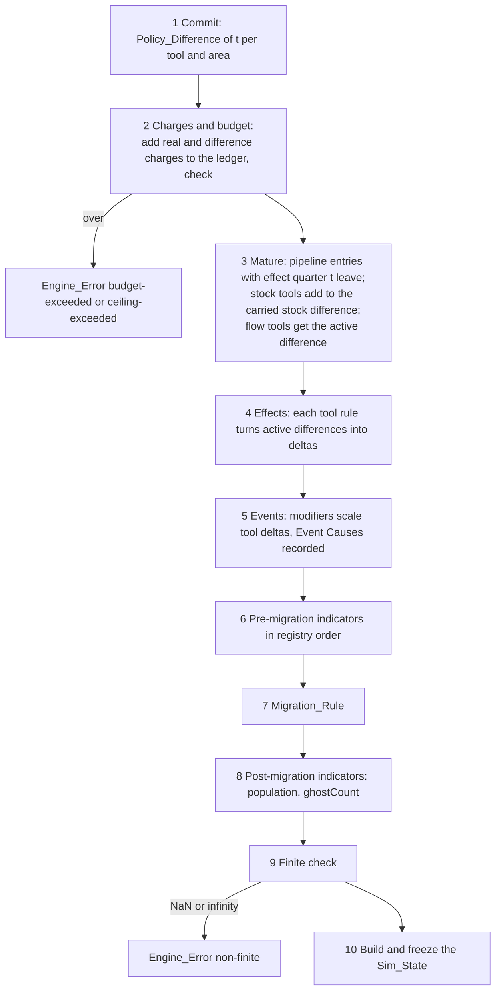
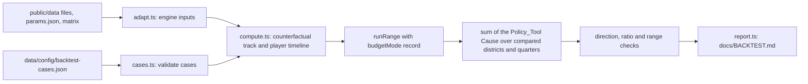

# Design Document: Simulation Engine

## Overview

The simulation engine is a set of pure TypeScript functions in `src/simulation/`. From the real baseline, the parameter table, the real policy track, the player's policy timeline, the event list and the 41×41 commute-time matrix, it computes every Output_Indicator for the 41 districts and every quarter from 2015Q1 up to a requested quarter. It also computes a Cause_Breakdown for every value, for the "Why?" view.

For every indicator, district and quarter:

```
reported = bound( start + Σ tool deltas (after Lag) + Σ event causes + migration )
start    = Baseline value          if the indicator is in history.json
         = Derived_Baseline value  otherwise (rent burden, mean commute time, Ghost count)
bound    = limit to the allowed range and round counts (the Bound_Adjustment Cause records the difference)
```

Every tool delta is computed from a **Policy_Difference** (player value minus real value), never from the player's absolute value. When every difference is 0, every delta is `0` or `-0`, and `start + 0 === start`, so the zero-delta identity (Requirement 3) holds exactly and not only within a tolerance.

### Public functions

| Function | Module | Purpose | Requirement |
|---|---|---|---|
| `step(state, policies, events, params, baseline, realTrack, commute, options?)` | `engine.ts` | Advance a Sim_State by one quarter | 1.1 |
| `run(policies, events, params, baseline, realTrack, commute, target, options?)` | `engine.ts` | All Sim_States from 2015Q1 to `target` | 1.2 |
| `runRange(…same as run…)` | `engine.ts` | The `central`, `low` and `high` runs and a Result_Range per value | 19 |
| `checkBudget(proposed, ledger, params)` | `budget.ts` | Budget check without side effects | 8.3 |
| `checkLimit(tool, field, area, quarter, ledger, params)` | `budget.ts` | Policy_Limit and ceiling lookup | 18.7 |

`options` is an optional last argument with `registry` (default `RULE_REGISTRY`, used by the stub-tool test of Requirement 16.4), `seed` (accepted and unused in this spec) and `budgetMode` (see Requirement conflict C1).

The engine implements 3 of the 5 tools: social housing construction, commuter pass subsidy and rent subsidy. The other two are added later as a new rule file plus a registry entry (Requirement 16).

### Design principles

1. **Differences in, deltas out.** A tool rule receives Policy_Differences and returns deltas.
2. **One fixed pass per quarter.** Every quarter runs the same ordered stages. All iteration is over arrays in a fixed order (the Rule_Registry, districts in ascending code, the event list), never over the key order of caller-supplied objects.
3. **Validate first, then compute.** All preconditions that need only inputs are checked before the first quarter. Checks that need computed values (budget, negative stock, non-finite numbers) run inside the quarter.
4. **Errors are values.** Every public function returns a result object. Nothing throws for inputs that match the declared types (Requirement 15.3).
5. **Numbers come from inputs.** Rule files contain only the literals allowed by Requirement 2.6: 0, 1, 100, 3, 4 and 12. Tolerances and the quarter range are named constants in `constants.ts`.

### Research findings that shape the design

- **Input shapes.** `history.json` holds district series of records `{ value, estimated, method? }` aligned with 44 quarter keys (`src/types/data-files.ts`). Its indicators include `population`, `householdIncome` (TWD per household per **year**), `rent` (TWD per m² per month), `mrtEntries` and `socialHousingStock`. Rent burden, mean commute time, household counts and renter counts are not in it, so the engine derives them. `policy-track.json` has `socialHousingUnitsStarted` (district), `rentSubsidyHouseholds`, `rentSubsidyAmountPerHousehold`, `commuterPassSubsidy`, `commuterPassPrice` and `commuterPassesSold` (city). The real city commuter subsidy is 0 and the pass price is 0 before 2018-04-16, so the Commuter_Pass_Tool is inactive in those quarters (Requirement 5.10).
- **The engine has its own input types.** Converting the JSON files into them belongs to `src/data/` (out of scope). The backtest script has its own small adapter in `scripts/backtest/`.
- **`Math.round` rounds halves toward +∞**, which is "halves rounded up" for both signs (Requirements 8.2 and 12.4).
- **Signed zero.** `x + (-0) === x` and `0 === -0`. A delta of `negativeElasticity × 0` is `-0`, which passes `=== 0` and leaves `baseline + delta === baseline`.
- **Key order.** JavaScript enumerates integer-like keys in ascending order and other keys in insertion order. The engine does not rely on either for caller-supplied objects (Requirement 16.5).
- **fast-check 4.10.2** (already installed, pinned) prints the failing property, the shrunk counterexample, the seed and the path in its failure message, which satisfies Requirement 17.9 without extra code ([fast-check runners](https://fast-check.dev/docs/core-blocks/runners/)).
- **Tooling.** `tsconfig.json` has `erasableSyntaxOnly` (no `enum`, `namespace` or parameter properties), `noUncheckedIndexedAccess`, and already includes `src`. `package.json` has `typecheck` and `test` but no `backtest` script; this spec adds one (Requirement 20.7).

## Requirement conflicts

The design follows `requirements.md` as written. Three places cannot be followed completely, and the choice made here needs the user's decision.

### C1. Backtest of the TPASS case (Requirement 20.3) against budget rejection (Requirements 8.6 and 18.6)

Requirement 20.3 passes the counterfactual track (pass price NT$ 1,280, subsidy 0) as the Real_Policy_Track and the actual track as the Player_Policy_Timeline (subsidy NT$ 80). The Annual_Budget comes from the counterfactual track (Requirement 8.1), and the player equals it in every other tool, so the extra commuter pass spending is over budget in every quarter of the change. Requirement 8.6 then returns `budget-exceeded`, and the case could never be computed. This is infeasible with the default behaviour, whatever the data.

- **Chosen in this design (option A):** the backtest passes `options.budgetMode = 'record'`. The engine still records the charges in the ledger and still enforces every Policy_Limit, but it does not return `budget-exceeded` or `ceiling-exceeded`. The default mode `'enforce'` follows Requirements 8.6 and 18.6 exactly, and every test other than the backtest uses it. Requirement 20.3 is then followed as written.
- **Option B:** keep the engine strict and change Requirement 20.3 so the counterfactual track carries the NT$ 80 as a real subsidy and the player subsidy is 0. The simulated effect is then minus the Policy_Tool Cause sum.

### C2. Migration Cause on population (Requirement 9.8) against carried-over migration

Requirement 9.8 sets the migration Cause of population to persons moved in minus persons moved out. Requirement 13.3 requires the Causes to sum to the reported value, and Requirement 13.4 fixes the Baseline Cause at the Baseline value. Both hold only if the reported population is `Baseline(t) + in(t) − out(t)`, so migration cannot carry over from one quarter to the next. If it did, the migration Cause would have to be the cumulative net movement, which differs from 9.8.

- **Chosen in this design:** migration is a within-quarter displacement. The start-of-quarter population in Requirement 9.1 is the Baseline population of that quarter. Total population in a quarter is the Baseline total minus that quarter's metro exits (Requirement 9.5; the policy-caused change in population from the three tools is 0).
- **Consequence:** displaced residents are counted again from the Baseline in the next quarter, so a persistent rent excess displaces the same share every quarter and the population gap does not grow.
- **Alternative:** a carried-over population needs a change to Requirement 9.8 (the Cause is the cumulative net movement) and a carried population in Sim_State.

### C3. Annual_Budget equality in a partly computed year (Requirement 8.9)

Requirement 8.9 asks for committed spending equal to the Annual_Budget "for every year from 2015 to the last computed year". In a year whose quarters are not all computed yet, the real charges of the later quarters are not committed, so the equality cannot hold. This design satisfies 8.9 for every year whose quarters (up to 2025Q4 or the last quarter of the track) are all computed. For the last, partly computed year it guarantees `committed ≤ Annual_Budget`. The Annual_Budget itself does not depend on the target quarter, because it is computed from every quarter present in the Real_Policy_Track.

## Architecture

### Module layout

```
src/
├── types/
│   ├── data-files.ts            # (data-pipeline) QuarterKey, DistrictCode, CityName
│   └── simulation.ts            # engine input and output types (Data Models below)
└── simulation/
    ├── engine.ts                # step, run, runRange; the per-quarter stage runner
    ├── constants.ts             # first and last quarter, district count, MAX_LAG, tolerances
    ├── errors.ts                # EngineError constructors and codes
    ├── quarter.ts               # parse, index, next, offset, year of a QuarterKey
    ├── numeric.ts               # roundHalfUp, clamp, apportion, splitBySchedule
    ├── params.ts                # parameter access, ParameterSpec checks, scenarioTable
    ├── validate.ts              # stage-0 checks; returns the first error
    ├── registry.ts              # RULE_REGISTRY: 3 tool rules and 7 indicator rules
    ├── derived.ts               # Derived_Baseline: households, renter shares, rent burden, commute time
    ├── lag.ts                   # Lag_Pipeline: commit, mature
    ├── budget.ts                # charges, plan, ledger, checkBudget, checkLimit
    ├── events.ts                # event modifiers and Event Causes
    ├── migration.ts             # Migration_Rule
    ├── ghosts.ts                # Ghost groups and count
    ├── explain.ts               # Cause, Cause_Breakdown, Bound_Adjustment
    └── rules/
        ├── social-housing.ts        # tool rule
        ├── commuter-pass.ts         # tool rule
        ├── rent-subsidy.ts          # tool rule
        ├── social-housing-stock.ts  # indicator rule
        ├── rent.ts                  # indicator rule
        ├── mrt-entries.ts           # indicator rule
        ├── mean-commute-time.ts     # indicator rule
        ├── rent-burden.ts           # indicator rule
        ├── population.ts            # indicator rule
        └── ghost-count.ts           # indicator rule

tests/simulation/                    # mirrors src/simulation/ (see Testing Strategy)
scripts/backtest.ts                  # `npm run backtest`
scripts/backtest/{adapt,cases,compute,report}.ts
data/config/backtest-cases.json      # Backtest_Cases
docs/BACKTEST.md                     # generated
```

The Rule_Registry has 10 rules (3 tool rules, 7 indicator rules), inside the 10–15 of `simulation.md`. `migration.ts`, `ghosts.ts`, `lag.ts`, `budget.ts` and `explain.ts` are shared machinery, as in `structure.md`.

No module imports from `src/ui/`, `src/game/`, `src/save/` or `src/data/` (Requirement 1.7). `src/types/simulation.ts` may import from `src/types/data-files.ts`.

### Per-quarter pipeline

`computeQuarter(prev, t, inputs)` is shared by `step` and `run`. `prev` is `null` for 2015Q1.



- A stock tool's carried difference is the sum of its matured differences. It is the only state besides the Lag_Pipeline and the ledger that crosses quarters.
- Stage 6 checks `stock-negative` when the social housing stock would be below 0 (Requirement 4.9).
- `run` validates once (stage 0), then calls `computeQuarter` for each quarter up to the target and returns the first error with its quarter and no Sim_States. `step` validates the inputs for the quarters up to the next quarter, then calls `computeQuarter` once.

### Stage 0: validation order

The order is fixed so the same inputs always give the same error (Requirements 1.11 and 14.6):

1. Target Quarter_Key form and range (1.3), or `state.quarter !== 2025Q4` for `step` (1.4).
2. Duplicate Rule_Registry ids (16.6).
3. Parameter_Table: every parameter that the registry rules, the Migration_Rule, the Ghost rule, the limits and the budget require. All issues are collected and sorted by parameter id, then problem. A non-empty list returns one `parameters-invalid` error (7.8, 7.9, 8.8, 9.9, 10.4, 14.2–14.6, 18.8).
4. Commute_Matrix (9.10).
5. Baseline coverage and values, earliest quarter first, then lowest District_Code (2.7, 15.2).
6. Real_Policy_Track and Player_Policy_Timeline entries for every rule field (15.2, 16.7).
7. Events and their references (11.3, 11.5, 13.8).
8. Policy values: type checks of both tracks (15.1), tool checks (4.2, 5.2, 5.4, 5.10, 6.9, 6.10, 6.11), then the Policy_Limits of the player timeline (18.4).

## Components and Interfaces

### Quarter and numeric helpers

```ts
// quarter.ts
parseQuarter(s: string): QuarterKey | null;   // /^(\d{4})Q([1-4])$/
quarterIndex(q: QuarterKey): number;          // 2015Q1 → 0; any integer, also < 0 or > 43
quarterAt(i: number): QuarterKey;
nextQuarter(q: QuarterKey): QuarterKey;
quarterYear(q: QuarterKey): number;
```

| Function (`numeric.ts`) | Contract |
|---|---|
| `roundHalfUp(x)` | `Math.round(x)` with `-0` turned into `0`. Used for money and count rounding. |
| `clamp(x, lo, hi)` | Returns `x` itself when it is inside, so no new float is created. |
| `apportion(total, weights)` | Largest-remainder split of a non-negative integer into non-negative integers. Ties go to the lower index. |
| `splitBySchedule(total, schedule)` | Whole-TWD charges `roundHalfUp(total × share)` for every offset but the last. The last charge is `total − Σ others` (Requirement 4.8). |

### Parameters (`params.ts`)

Each rule declares the parameters it uses as `ParameterSpec` values. `validate.ts` checks the specs, and rules read values only through `scalar(params, id)`, so a rule cannot read a parameter it did not declare.

```ts
type ParameterRole = 'effect' | 'derivation' | 'lag' | 'cost' | 'schedule' | 'limit' | 'ceiling' | 'ghost-size';
type ParameterCheck =
  | { kind: 'finite' } | { kind: 'non-negative' } | { kind: 'positive' } | { kind: 'share' }
  | { kind: 'integer'; min: number; max: number } | { kind: 'schedule' };
interface ParameterSpec { id: string; role: ParameterRole; check: ParameterCheck; optional?: boolean }
```

`scenarioTable(params, 'central' | 'low' | 'high')` returns a new table. Every `effect` parameter that has a `range` takes `range.low` or `range.high`. Every other role keeps `value` (Requirement 19.2). The input table is never changed.

#### Required parameters

Ids containing `<city>`, `<code>`, `<quarter>` or `<year>` expand to one scalar parameter each, so every value has its own unit, source and `estimated` marker.

| Id | Role | Check | Used for | Req |
|---|---|---|---|---|
| `socialHousing.lag` | lag | integer 12–20 | Lag | 7.2, 7.9 |
| `socialHousing.unitCost` | cost | positive | charges | 4.8 |
| `socialHousing.costSchedule` | schedule | schedule | charge spread | 4.8, 7.7 |
| `socialHousing.rentPerUnit` | effect | finite | rent per unit of stock difference | 4.6 |
| `commuterPass.lag`, `rentSubsidy.lag` | lag | integer 0–43 | Lag | 7.1 |
| `commuterPass.unitCost`, `rentSubsidy.unitCost` | cost | positive | charges | 8.2, 8.8 |
| `commuterPass.price.<city>.<quarter>` | derivation | non-negative | pass price, upper limit | 5.1 |
| `commuterPass.elasticity` | effect | finite | MRT entries, passes sold | 5.3, 5.6 |
| `rentSubsidy.passThrough` | effect | share, optional | rent effect of the subsidy | 6.6, 6.7 |
| `<tool>.costSchedule` for the two subsidy tools | schedule | schedule, optional | charge spread when present | 7.7 |
| `housing.dwellingSize` | derivation | positive | rent burden, pass-through | 2.6 |
| `housing.householdSize.<city>` | derivation | positive | household count | 6.4, 6.11 |
| `housing.renterRate.<city>` | derivation | share | renter households and shares | 6.3 |
| `commute.jobShare.<code>` | derivation | share, the 41 sum to 1 ± 1e-9 | mean commute time | 2.5 |
| `migration.threshold` | effect | non-negative | out-movement test | 9.1 |
| `migration.share`, `migration.exitShare` | effect | share | out-movement, exits | 9.1, 9.4 |
| `migration.weightTime`, `migration.weightBurden`, `migration.weightCost` | effect | non-negative, the first two positive | allocation weights | 9.3 |
| `migration.commuteCostPerMinute` | derivation | non-negative | monthly commute cost of a district pair | 5.5 |
| `ghost.size` | ghost-size | integer ≥ 1 | Ghost_Size | 10.2 |
| `ghost.rentThreshold`, `ghost.commuteThreshold` | derivation | non-negative | cited definition of the base shares | 10.2 |
| `ghost.shareRent`, `ghost.shareCommute`, `ghost.shareBoth` | derivation | share, `shareBoth ≤ min(other two)` | base shares above the thresholds | 10.2 |
| `ghost.sensitivityRent`, `ghost.sensitivityCommute` | effect | non-negative | change of the share per percentage point and per minute | 10.1 |
| `limit.<tool>.<field>.lowerFactor`, `.upperFactor` | limit | non-negative ≤ 1; finite ≥ 1 | Policy_Limit | 18.1, 18.8 |
| `limit.<tool>.<field>.upperMin`, `.min`, `.max` | limit | non-negative, optional; an absolute limit must include every real value | Policy_Limit | 18.1, 18.8 |
| `budget.ceiling.<tool>.<year>` | ceiling | non-negative integer, optional | Budget_Ceiling | 18.5 |
| each Event modifier `parameterId` | effect | non-negative | Event modifier | 11.2, 11.5 |

Fields with limits are `socialHousing.unitsStarted`, `commuterPass.subsidy` (only `lowerFactor` is required, because the upper limit is the pass price, Requirement 18.2), `rentSubsidy.households` and `rentSubsidy.amount`. The factor parameters are required, and `params.json` carries the default values 0 and 2 with the source "game default, `simulation.md`", so no default literal appears in `src/simulation/` (Requirement 14.1).

For the two subsidy tools the setting is already in TWD, so the unit cost is TWD of budget per TWD of subsidy. Its cited value is 1 unless a sourced administration overhead exists. No supported tool has a legitimate zero unit cost (Requirement 8.8).

### Rule_Registry and rule interfaces (`registry.ts`)

```ts
interface RuleRegistry {
  readonly tools: readonly ToolRule[];           // socialHousing, commuterPass, rentSubsidy
  readonly indicators: readonly IndicatorRule[]; // see order below
}
export const RULE_REGISTRY: RuleRegistry;        // frozen
```

Indicator order, which is also the order in every Sim_State and Cause list: `socialHousingStock`, `rent`, `mrtEntries`, `meanCommuteTime`, `rentBurden` (stage `pre-migration`), then `population`, `ghostCount` (stage `post-migration`).

The step function applies rules only by iterating the registry (Requirement 16.3). The stub-tool test passes `{ tools: [...RULE_REGISTRY.tools, stub], indicators }` through `options.registry`.

```ts
interface ToolRule {
  readonly id: ToolId;
  readonly level: 'district' | 'city';
  readonly effect: 'stock' | 'flow';
  readonly fields: readonly ToolField[];        // player-editable: id, area, integer?, limitScope
  readonly trackOnlyFields: readonly string[];  // read from the Real_Policy_Track only (passesSold)
  readonly lagParameterId: string;
  readonly modifiable: readonly IndicatorId[];  // indicators an Event modifier may scale
  parameters(): readonly ParameterSpec[];
  checkSetting(player, real, quarter, ctx): EngineError | null;
  difference(player, real, quarter, ctx): Record<AreaKey, number>;   // exactly 0 when equal
  charge(player, real, quarter, ctx): { real: number; difference: number };   // whole TWD, before the schedule
  effects(active: Record<AreaKey, number>, t: QuarterKey, ctx): ToolEffects;
}
interface ToolEffects {
  deltas: Record<IndicatorId, Record<DistrictCode, number>>;
  links: Record<IndicatorId, CauseLinks>;
  commuteCostDelta?: Record<DistrictCode, number>;   // TWD per month, by origin district (Requirement 5.5)
}

interface IndicatorRule {
  readonly id: IndicatorId;
  readonly unit: string;
  readonly valueKind: 'count' | 'bounded' | 'non-negative';
  readonly stage: 'pre-migration' | 'post-migration';
  parameters(): readonly ParameterSpec[];
  draft(d: DistrictCode, work: QuarterWork): CauseDraft;   // start value, tool deltas, migration, links
}
```

`QuarterWork` holds everything computed earlier in the quarter: the effects after events, the reported values of earlier indicators and the migration result. Every indicator rule returns a `CauseDraft`, and `explain.ts` turns it into the reported value and the Cause_Breakdown, so all indicators are handled the same way.

### The three tool rules

Notation for quarter `t`: `L` is the tool's Lag, `real(·)` and `player(·)` the settings, `city(d)` the city of district `d`. `R`, `I_d`, `P_d` are the Baseline rent, household income (per year) and population. `S` is the dwelling size, and `k_d = S ÷ (I_d ÷ 12) × 100` converts a rent change in TWD per m² per month into percentage points of income.

#### Social housing construction (`rules/social-housing.ts`, Requirement 4)

- District level, stock effect, field `unitsStarted` (integer, limit scope city-year).
- Difference: `Δ_d(q) = player.unitsStarted_d(q) − real.unitsStarted_d(q)`, recorded for every district, including 0 and negative values (4.3).
- A difference committed in `q` matures in `q + L`. From then, the carried stock difference `X_d` includes it in every later quarter (4.4). Entries with `q + L` after 2025Q4 stay in the pipeline (4.5).
- Effects in `t`:
  - `socialHousingStock`: `+X_d`.
  - `rent`: `rentPerUnit × X_d`, linked to `socialHousing.rentPerUnit` and `socialHousing.lag` (4.6).
  - `rentBurden`: `rent delta × k_d` (a rent change changes the burden, Decision D3).
- Charge in `q`: `real = roundHalfUp(Σ_d real.unitsStarted × unitCost)` and `difference = roundHalfUp(Σ_d Δ_d × unitCost)`. Both are spread by `socialHousing.costSchedule`. A charge falling after 2025Q4 is recorded in 2025Q4 (4.8).
- A Baseline stock plus `X_d` below 0 returns `stock-negative` (4.9). A rent below 0 is limited to 0 with a Bound_Adjustment (4.7).

#### Commuter pass subsidy (`rules/commuter-pass.ts`, Requirement 5)

- City level, flow effect, field `subsidy` (finite, upper limit = pass price of that city and quarter), track-only field `passesSold`.
- Inactive when the real pass price is 0: the only accepted subsidy is 0, and the difference, the Cause and the charge are 0 (5.10).
- Difference: `Δ_c(q) = player.subsidy − real.subsidy`.
- Real net price `N = price − real.subsidy`. A price above 0 with `N = 0` returns `real-net-price-zero` (5.4).
- Relative change of the net price: `ρ = −Δ_c(q) ÷ N`, which equals (player net − real net) ÷ real net and is exactly 0 when `Δ = 0`.
- Effects in `t`, with `q = t − L` (nothing if `q` is before 2015Q1):
  - `mrtEntries_d` for each district of the city: `Baseline MRT_d(t) × elasticity × ρ(q)` (5.3). It is 0 when the Baseline entries are 0 or absent (5.9).
  - `commuteCostDelta_d = Δ_c(q)` for each district `d` in the city, used by the Migration_Rule as a cost reduction of every pair whose origin is `d` (5.5).
- Charge in `q`, independent of the Lag: adjusted passes `A = max(0, passesSold × (1 + elasticity × ρ))`. `real = roundHalfUp(real.subsidy × passesSold × 3 × unitCost)` and `difference = roundHalfUp(Δ × A × 3 × unitCost)` (5.6).

#### Rent subsidy (`rules/rent-subsidy.ts`, Requirement 6)

- City level, flow effect, fields `households` (integer) and `amount`.
- Difference in total monthly subsidy: `Δ_c(q) = player.households × player.amount − real.households × real.amount` (6.2).
- Derived counts from `derived.ts`, all from the Baseline and fixed parameters:
  - households `H_d = P_d ÷ householdSize_city`
  - renter households `Hr_d = H_d × renterRate_city`
  - renter share `s_d = Hr_d ÷ Σ_{e in city} Hr_e`, which sums to 1 per city (6.3)
- Effects in `t`, with `q = t − L`: the allocated difference is `a_d = Δ_c(q) × s_d`.
  - direct `rentBurden`: `−a_d ÷ (H_d × I_d ÷ 12) × 100` (6.4)
  - `rent`: `passThrough × a_d ÷ (Hr_d × S)` (6.6), exactly 0 without the parameter (6.7)
  - `rentBurden`: the rent effect also adds `rent effect × k_d` to the same delta (Decision D3)
- Charge in `q`: `real = roundHalfUp(real.households × real.amount × 3 × unitCost)` and `difference = roundHalfUp(Δ × 3 × unitCost)` (6.8).
- Subsidized households above the city's renter households return `households-exceed-renters` (6.9). A missing or non-positive divisor returns `derived-input-invalid` (6.11).

### Indicators (`derived.ts` and `rules/`)

| Indicator | Kind | Start value | Tool Causes |
|---|---|---|---|
| `socialHousingStock` | count | Baseline `socialHousingStock` | socialHousing |
| `rent` | non-negative | Baseline `rent` | socialHousing, rentSubsidy |
| `mrtEntries` | count | Baseline `mrtEntries` | commuterPass |
| `meanCommuteTime` | non-negative | `T_d = Σ_j jobShare_j × matrix[d][j]` | none in this spec (each Cause is 0) |
| `rentBurden` | bounded | `clamp(rent × S ÷ (I_d ÷ 12) × 100, 0, 100)` | socialHousing, rentSubsidy |
| `population` | count | Baseline `population` | none in this spec (each Cause is 0); migration Cause |
| `ghostCount` | count | Derived Ghost count | Ghost group Causes (10.6) |

The Derived_Baseline rent burden is limited to 0–100 as part of its definition, so a district whose raw ratio is above 100 starts at 100 with a Bound_Adjustment of 0. Its Baseline Cause links `housing.dwellingSize` and the Source_Ids of `rent` and `householdIncome`.

### Lag pipeline (`lag.ts`, Requirement 7)

```ts
interface LagEntry { tool: ToolId; area: AreaKey; committed: QuarterKey; effect: QuarterKey; value: number }
commit(pipeline, entries): readonly LagEntry[];                     // appends, keeps the sort order
mature(pipeline, t): { matured: readonly LagEntry[]; rest: readonly LagEntry[] };
```

- Lag 0: no entry. The difference is active in its own quarter (2.2, 7.3).
- Lag ≥ 1: one entry per tool, area and committed quarter, including zero differences, which satisfies both 4.3 (zero differences are recorded) and 7.4 (non-zero ones are present). Entries are never merged or changed (7.5).
- An entry leaves the pipeline in the Sim_State of its effect quarter (7.4). Entries with an effect quarter after 2025Q4 stay through 2025Q4 (7.6).
- Stock tool: the matured values are added to the carried stock difference. Flow tool: the matured value is the active difference of `t`.
- The pipeline is sorted by effect quarter, tool registry index, area code and committed quarter, so its order does not depend on insertion order.

### Budget (`budget.ts`, Requirements 8 and 18)

#### Plan and ledger

`planBudget(realTrack, params)` runs once in stage 0 and returns an immutable **plan** from the Real_Policy_Track and the parameters. All money values are integer TWD (8.11).

```ts
interface BudgetPlan {
  real: PolicyTimeline;                                     // the real settings, by quarter
  realCharges: Record<ToolId, readonly (readonly number[])[]>; // per tool and quarter: the 44-slot increments of the real charge after the Cost_Schedule
  annualBudget: readonly number[];                         // 11 years: Σ real charges of the 3 tools falling into the year (8.1)
  ceilings: Record<ToolId, readonly number[]>;             // 11 years: budget.ceiling parameter, else the Annual_Budget (18.5)
}
interface BudgetLedger {
  plan: BudgetPlan;
  through: QuarterKey | null;                              // last quarter whose charges are in `committed`
  committed: Record<ToolId, readonly number[]>;            // 44 slots, real plus difference charges
  year: number;                                            // year of the Sim_State quarter
  remaining: number;                                       // annualBudget[year] − Σ committed in that year
}
```

The Annual_Budget of a year uses every quarter present in the Real_Policy_Track, so it does not depend on the target quarter (see C3). Because the plan lives in the ledger, `checkBudget` and `checkLimit` need only the arguments named in Requirements 8.3 and 18.7 and can still read the real values.

#### Charges in a quarter

For quarter `q` and each tool, the increments are `realCharges[tool][q]` plus `splitBySchedule(charge.difference, schedule)`, where the schedule is the tool's `costSchedule` parameter, or one offset 0 with share 1 when the tool has none (7.7). A slot after 2025Q4 is recorded in 2025Q4 (4.8). A negative difference produces negative charges.

With all differences 0, the difference increments are 0 and `committed` equals the real charges exactly (3.6, 8.9).

#### Checks

After adding the increments, the engine checks every calendar year that an increment touched, in ascending order. For each year it checks the tool ceilings first (`ceiling-exceeded`, 18.6) and then the Annual_Budget of the year (`budget-exceeded`, 8.6). Both are integer comparisons, and an overrun of 1 TWD or more is an error. With `budgetMode = 'record'` (conflict C1) both checks are skipped and the ledger is still updated.

`remaining` is recomputed for the year of each Sim_State, so entering a Q1 gives the new year's Annual_Budget minus the schedule charges already recorded in it, and nothing is carried over (8.7).

#### `checkBudget(proposed, ledger, params)` (8.3–8.5)

`proposed` is a Policy_Setting for the next quarter after `ledger.through`. The function computes the same increments as the step function (it shares the code) and returns:

```ts
type BudgetCheck =
  | { ok: true; year: number; annualBudget: number; committed: number; remaining: number }
  | { ok: false; reason: 'annual-budget'; year: number; annualBudget: number; committed: number; over: number }
  | { ok: false; reason: 'tool-ceiling'; tool: ToolId; year: number; ceiling: number; committed: number; over: number }
  | { ok: false; reason: 'wrong-quarter'; expected: QuarterKey; received: QuarterKey };
```

The acceptance reports the year of the proposed quarter. A rejection reports the earliest year that is over (8.5). It has no side effects.

#### `checkLimit(tool, field, area, quarter, ledger, params)` (18.7)

Returns `{ lower, upper, lowerParameterId, upperParameterId, lowerSource, upperSource, scope, ceiling, remainingCeiling }`. It reads the real value from `ledger.plan.real` and the remaining ceiling from `ledger.committed`. The formulas (18.1–18.3):

```
v     = real value of (area, quarter)                   scope 'quarter'
      = Σ real unitsStarted of the city in the year     scope 'city-year'
lower = min ?? lowerFactor × v
upper = upperLimit(field) ?? max ?? max(upperFactor × v, upperMin ?? 0)
```

`upperLimit(field)` is the pass price for the commuter pass subsidy and is 0 when the price is 0. For the city-year scope, the upper limit is checked on the running total of the year, and the lower limit once all quarters of the year are in the timeline (Decision D6). A value outside a limit returns `limit-exceeded` with the side, the limit and its parameter id. The value is never clipped, and the Real_Policy_Track is not checked against the limits (18.4).

### Events (`events.ts`, Requirement 11)

An Event modifier scales the deltas of a tool on that tool's `modifiable` indicators (social housing: `rent`, `rentBurden`; commuter pass: `mrtEntries`; rent subsidy: `rent`, `rentBurden`). It never scales the social housing stock, which is the player's own difference, or the commute cost used by migration (Decision D4).

For a tool, indicator and district with unmodified delta `u` in quarter `t`, and the Events `e₁ … eₙ` that cover `t` and have a modifier for the tool, in event-list order:

```
v₀ = u
v_j = v_{j−1} × m_{e_j}               (m is the value of the modifier's parameter)
EventCause(e_j) = v_j − v_{j−1}
```

The tool Cause keeps `u`. The Event Causes hold the changes, so `u + Σ Event Causes = v_n` (11.4). An Event Cause is listed only when its absolute value is above the tolerance of 13.3 (13.2), so with zero deltas no Event Cause appears. An Event's affected indicators, cited magnitude and type are never read by any computation (11.7).

### Migration_Rule (`migration.ts`, Requirement 9)

Inputs for quarter `t`: Baseline populations `P_d` (the start-of-quarter populations, see C2), the reported rent burdens `B_d` (after the quarter's deltas), the Derived_Baseline burdens `B0_d`, the active commute cost reductions `K_d` from the Commuter_Pass_Tool, the Commute_Matrix `M` and the migration parameters.

1. **Out-movement** (9.1, 9.2): `out_d = floor(share × P_d)` if `B_d − B0_d > threshold`, else 0. With zero deltas the difference is 0, which is not above a non-negative threshold, so migration is exactly zero (2.4).
2. **Exit** (9.4): `exit_d = floor(exitShare × out_d)` and `movers_d = out_d − exit_d`.
3. **Weights** (9.3), for an origin `o` and a destination `j ≠ o`: `cost_oj = max(0, commuteCostPerMinute × M[o][j] − K_o)` and `x_oj = −weightTime × M[o][j] − weightBurden × B_j − weightCost × cost_oj`. The weight is `w_oj = exp(x_oj − max_j x_oj)`, so the largest weight is 1 and the weights cannot all underflow to 0. Weights strictly decrease as the commute time or the destination burden increases, because `weightTime` and `weightBurden` are positive.
4. **Allocation**: `in_oj = apportion(movers_o, w_o·)` over the other 40 districts in ascending code order, giving whole non-negative numbers that sum to `movers_o`.
5. **Result**: `in_d = Σ_o in_od`, `net_d = in_d − out_d`, `displaced_d = out_d` (9.7), and `exits = Σ exit_d`.

All origins use the same start-of-quarter snapshot, and per-origin results are summed in ascending code order, so processing order cannot change the counts (9.6). `Σ out = Σ in + Σ exits` holds by construction (9.4). The population Cause is `net_d`, moved in minus moved out, with links to the threshold, share, weight and exit-share parameters (9.8).

The subtraction of `K_o` is the same for every destination of one origin, so apart from the floor at 0 it does not change the relative weights. This follows Requirement 5.5 as written (origin scope, Open Question 15). A destination or either-end scope would change the allocation more and needs a change of Requirement 5.5.

### Ghosts (`ghosts.ts`, Requirement 10)

For a district with population `P` (after migration), reported rent burden `B`, mean commute time `T` and displaced `D`, and the Derived_Baseline values `P0`, `B0`, `T0`. With base shares `bR`, `bC`, `bO` and Ghost_Size `G`:

```
sR = clamp(bR + sensitivityRent    × (B − B0), 0, 1)
sC = clamp(bC + sensitivityCommute × (T − T0), 0, 1)
sO = clamp(bO + (sR − bR) × bC + (sC − bC) × bR, 0, min(sR, sC))
R = P × sR      C = P × sC      O = P × sO
ghost = P === 0 ? 0 : floor((R + C − O + D) ÷ G)
```

The Derived_Baseline Ghost count is the same function at `(P0, B0, T0, D = 0)`. Both calls use one function, so with zero deltas they evaluate the same expression on the same numbers (3.3).

Cause_Breakdown (10.6): the Baseline Cause is the derived count. Four group Causes follow: the rent-burden group `(R − R0) ÷ G`, the commute-time group `(C − C0) ÷ G`, the overlap `−(O − O0) ÷ G` and the displacement `D ÷ G`, each linked to the parameter ids it uses. The Bound_Adjustment is the reported count minus the sum of the other Causes, which covers the floor and the zero-population rule.

### Cause breakdowns (`explain.ts`, Requirement 13)

```ts
interface CauseDraft {
  kind: ValueKind; start: Contribution;                  // the Baseline or Derived_Baseline value and its links
  tools: readonly (Contribution & { tool: ToolId })[];   // one per registry tool, in registry order
  events: readonly (Contribution & { eventId: string })[];
  migration: Contribution;
  groups?: readonly Contribution[];                      // Ghost groups, replace tools, events and migration
}
function finish(draft): { value: number; breakdown: CauseBreakdown }
```

`finish` sums the contributions left to right in Cause order to get `pre`, then:

```
bounded:      value = clamp(pre, 0, 100)
non-negative: value = pre < 0 ? 0 : pre
count:        value = max(roundHalfUp(pre), 0)         (Ghost count: floor, set by its own rule)
bound         = value − pre
```

When `pre` is already valid, `value` is the same number as `pre` and `bound` is exactly 0 (12.5).

Order of Causes: Baseline, one Cause per registry tool (always present, 13.2), Event Causes above tolerance in event-list order, migration, Bound_Adjustment. Ghost count: Baseline, the four groups, Bound_Adjustment.

Each Cause except the Bound_Adjustment carries `parameterIds`, `sourceIds` and `ranges` (the `low` and `high` values and sources of every ranged parameter it used, 14.8). Every id must exist in the Parameter_Table or the Baseline source registry (13.7). A rule or Event that names a missing id fails stage 0 (13.8).

### Scenario range (`runRange`, Requirement 19)

`runRange` runs `central`, `low` and `high` on three tables from `scenarioTable`, in that order, with no shared mutable state. It returns the three state lists and, for each quarter, indicator and district, a Result_Range `{ min, central, max }` where `min` and `max` are `Math.min` and `Math.max` of the three values, so `min ≤ central ≤ max` holds whichever Scenario gives the lowest value (19.3, 19.6). The Cause_Breakdowns returned are those of the `central` run (19.4). On failure it returns the first Engine_Error with the Scenario name and the quarter (19.1).

Lag, unit costs, schedules, limits, ceilings, Annual_Budgets and Ghost_Size are identical in the three runs. The charge for a commuter pass difference uses the elasticity (Requirement 5.6), which is an effect parameter, so a difference charge can differ between Scenarios and one Scenario can fail the budget check while the others pass. This is the behaviour of Requirements 5.6 and 19.2 as written, and `runRange` reports it as an error with the Scenario name.

### Backtest (`scripts/backtest.ts`, Requirement 20)



- **Case file** fields: `id`, `tool`, `change` (`field`, `cities`, `firstQuarter`, `before`, `after`), `indicator`, `areas`, `evaluationQuarters`, `observed` (`value`, `source`, `method`, `period`, `comparisonPeriod`, `confounders`), `tolerances` (`ratioLow` 0.5, `ratioHigh` 2) and `parametersChangedAfterOutcome` (empty means "validation", otherwise "calibration", 20.6). The observed TPASS value is calculated from `history.json` by the formula of Requirement 20.2 and written into the case file before the simulated effect is computed. The evaluation quarters are also fixed in the file.
- **Computation (20.3).** The counterfactual track holds the changed field at its value before the change from the first quarter of the change (for TPASS: pass price NT$ 1,280, subsidy 0). It is passed as the Real_Policy_Track, and the adapter writes the NT$ 1,280 price into the `commuterPass.price.<city>.<quarter>` parameters. The actual real track is passed as the Player_Policy_Timeline (subsidy NT$ 80). The simulated effect is the sum of the commuter pass Cause contributions in the `mrtEntries` breakdowns over the compared districts and quarters, as a Result_Range from `runRange`. The engine is called with `budgetMode: 'record'` (conflict C1) and an empty event list, so the sum is the full effect of the change. All Policy_Limits apply relative to the counterfactual track.
- **Checks (20.4).** Direction (central effect has the sign of the observed effect), magnitude ratio (central ÷ observed within `ratioLow` to `ratioHigh`) and range (observed lies between the minimum and maximum).
- **Report (20.5).** One section per case with the fields of 20.5, neutral wording, fixed decimals, LF line endings, the engine version (`ENGINE_VERSION` in `engine.ts`) and a SHA-256 of `params.json` as the Parameter_Table version (Node `crypto`, in the script only). The output is byte-identical for identical inputs (20.7).
- **Exit codes.** 0 when every case was computed, whether "met" or "not met" (20.7). A case that cannot be computed is written as "not computed" with its reason, and the exit code is non-zero (20.9). Until `params.json` and the matrix exist (Open Question 2), the TPASS case is "not computed: missing input".

## Data Models

All types are in `src/types/simulation.ts`. They use only erasable syntax and are `readonly` at every level and for every array (Requirement 1.9).

### Inputs

```ts
type ToolId = string;                        // 'socialHousing' | 'commuterPass' | 'rentSubsidy' in this spec
type IndicatorId = string;
type AreaKey = DistrictCode | CityName;

interface Citation { readonly citation: string; readonly url: string }
interface ParameterRange { readonly low: number; readonly high: number; readonly lowSource: Citation; readonly highSource: Citation }
interface ScalarParameter {
  readonly kind: 'scalar'; readonly value: number; readonly unit: string; readonly source: Citation;
  readonly range?: ParameterRange; readonly estimated?: { readonly method: string };
}
interface ScheduleParameter {
  readonly kind: 'schedule'; readonly offsets: readonly number[]; readonly shares: readonly number[];
  readonly unit: string; readonly source: Citation;
}
type ParameterTable = Readonly<Record<string, ScalarParameter | ScheduleParameter>>;

interface EngineBaseline {
  readonly quarters: readonly QuarterKey[];                    // consecutive from 2015Q1, 1 to 44
  readonly districts: readonly { readonly code: DistrictCode; readonly city: CityName }[];   // 41, ascending code
  readonly indicators: Readonly<Record<string, Readonly<Record<DistrictCode, readonly (number | null)[]>>>>;
  readonly indicatorSources: Readonly<Record<string, readonly string[]>>;
  readonly sourceIds: readonly string[];                       // the Baseline source registry
}
// required indicators: population, householdIncome, rent, mrtEntries, socialHousingStock

type ToolSetting = Readonly<Record<string, Readonly<Record<AreaKey, number>>>>;   // field → area → value
interface PolicySetting { readonly quarter: QuarterKey; readonly tools: Readonly<Record<ToolId, ToolSetting>> }
type PolicyTimeline = readonly PolicySetting[];                // looked up by quarter, any order

interface CommuteMatrix { readonly codes: readonly DistrictCode[]; readonly minutes: readonly (readonly number[])[] }   // 41 × 41

interface SimEvent {
  readonly id: string; readonly type: string;
  readonly firstQuarter: QuarterKey; readonly lastQuarter: QuarterKey;
  readonly affectedIndicators: readonly string[];              // display only (11.7)
  readonly magnitude: { readonly text: string; readonly value?: number; readonly unit?: string };   // display only
  readonly sources: readonly string[];
  readonly modifiers: readonly { readonly tool: ToolId; readonly parameterId: string }[];
}

interface EngineOptions {
  readonly registry?: RuleRegistry;
  readonly seed?: number;
  readonly budgetMode?: 'enforce' | 'record';                  // default 'enforce'; 'record' only for the backtest (C1)
}
```

Track fields in this spec:

| Tool | Field | Area | Player-editable | Source series in `policy-track.json` |
|---|---|---|---|---|
| socialHousing | `unitsStarted` | district | yes | `socialHousingUnitsStarted` |
| commuterPass | `subsidy` | city | yes | `commuterPassSubsidy` |
| commuterPass | `passesSold` | city | no | `commuterPassesSold` |
| rentSubsidy | `households` | city | yes | `rentSubsidyHouseholds` |
| rentSubsidy | `amount` | city | yes | `rentSubsidyAmountPerHousehold` |

The pass price (`commuterPassPrice`) becomes the parameters `commuterPass.price.<city>.<quarter>`, because Requirement 5.1 reads it from the Parameter_Table.

### Outputs

```ts
type ValueKind = 'count' | 'bounded' | 'non-negative';
interface Cause {
  readonly kind: 'baseline' | 'tool' | 'event' | 'migration' | 'ghost-group' | 'bound';
  readonly id: string;                              // 'baseline', tool id, event id, 'migration', group id, 'bound'
  readonly contribution: number;
  readonly parameterIds: readonly string[];         // sorted
  readonly sourceIds: readonly string[];            // sorted
  readonly ranges: readonly { readonly parameterId: string; readonly range: ParameterRange }[];
}
interface CauseBreakdown {
  readonly indicator: IndicatorId; readonly district: DistrictCode; readonly quarter: QuarterKey;
  readonly value: number; readonly causes: readonly Cause[];
}
interface SimState {
  readonly quarter: QuarterKey;
  readonly indicators: readonly { readonly id: IndicatorId; readonly unit: string; readonly kind: ValueKind }[];
  readonly values: Readonly<Record<IndicatorId, Readonly<Record<DistrictCode, number>>>>;
  readonly causes: Readonly<Record<IndicatorId, Readonly<Record<DistrictCode, CauseBreakdown>>>>;
  readonly lagPipeline: readonly LagEntry[];
  readonly ledger: BudgetLedger;
  readonly migration: { readonly displaced: Readonly<Record<DistrictCode, number>>;
                        readonly movedIn: Readonly<Record<DistrictCode, number>>; readonly exits: number };
  readonly carry: { readonly stock: Readonly<Record<ToolId, Readonly<Record<AreaKey, number>>>> };
}
```

Records keyed by District_Code are built in ascending code order, and records keyed by indicator follow the registry order. Every returned object is built fresh and deep-frozen in `engine.ts`.

### Errors

```ts
type EngineErrorCode =
  | 'quarter-invalid' | 'no-later-quarter' | 'registry-duplicate' | 'rule-reference-missing'
  | 'parameters-invalid' | 'commute-matrix-invalid' | 'baseline-missing' | 'baseline-invalid'
  | 'track-missing' | 'policy-value-invalid' | 'limit-exceeded' | 'real-net-price-zero'
  | 'households-exceed-renters' | 'derived-input-invalid' | 'event-invalid' | 'event-reference-unknown'
  | 'budget-exceeded' | 'ceiling-exceeded' | 'stock-negative' | 'non-finite';

interface EngineError {
  readonly code: EngineErrorCode;
  readonly message: string;                                   // English, developer-facing, names every offending value
  readonly details: Readonly<Record<string, string | number | boolean | null>>;
  readonly issues?: readonly { readonly parameterId: string; readonly problem: string }[];  // parameters-invalid only, sorted
}
type StepResult  = { ok: true; state: SimState } | { ok: false; error: EngineError };
type RunResult   = { ok: true; states: readonly SimState[] } | { ok: false; error: EngineError; quarter: QuarterKey | null };
type RangeResult = { ok: true; central: readonly SimState[]; low: readonly SimState[]; high: readonly SimState[];
                     ranges: readonly QuarterRanges[] }
                 | { ok: false; scenario: 'central' | 'low' | 'high'; quarter: QuarterKey | null; error: EngineError };
```

## Correctness Properties

*A property is a characteristic or behavior that should hold true across all valid executions of a system-essentially, a formal statement about what the system should do. Properties serve as the bridge between human-readable specifications and machine-verifiable correctness guarantees.*

Reflection on redundancy: the zero-delta criteria (2.3, 2.4, 3.2–3.6, 8.9, 13.10) are one property. The bound, rounding and breakdown criteria (12.3–12.5, 12.7, 13.1–13.6) are one property, with the cause-sum property of Requirement 17.1 as its core. The individual lag criteria (2.2, 4.3–4.5, 7.3–7.6) are one property. The per-input error criteria are one invalid-input property and one parameter-validation property. Properties that Requirement 17 names as separate tests stay separate even where they overlap.

"Valid inputs" means inputs from the generators of the Testing Strategy. An "accepted run" is a run that returned Sim_States.

### Property 1: Zero-delta identity

*For any* valid Baseline, Parameter_Table, event list, seed and Real_Policy_Track, running to the last generated quarter with a Player_Policy_Timeline equal to the Real_Policy_Track returns one Sim_State per quarter and no Engine_Error. In every Sim_State, every indicator that has a Baseline value is `===` that value, and every other indicator is `===` its Derived_Baseline value. The Baseline Cause is `===` the reported value, and every other Cause (tool, Event, migration, Ghost group, Bound_Adjustment) is `=== 0`. Every Lag_Pipeline value is 0. For every year whose quarters are all computed, the committed spending of every tool equals its real spending and the total equals the Annual_Budget.

**Validates: Requirements 2.3, 2.4, 3.2, 3.3, 3.4, 3.5, 3.6, 3.8, 8.9, 13.10**

### Property 2: Determinism

*For any* valid inputs, calling `run` and `runRange` twice, the second time on a `structuredClone` of every argument, returns deep-equal results, including every Cause_Breakdown and any Engine_Error.

**Validates: Requirements 1.11, 19.7**

### Property 3: No input mutation

*For any* inputs, valid or with one injected defect, every argument of `step`, `run`, `runRange`, `checkBudget` and `checkLimit` is deep-equal to a `structuredClone` taken before the call, whatever the result, and no call throws.

**Validates: Requirements 1.10, 8.3, 15.3, 18.7**

### Property 4: Budget never overspent

*For any* Player_Policy_Timeline and event list, `run` either returns `budget-exceeded` or `ceiling-exceeded`, or returns Sim_States in which the committed spending of every calendar year, including Cost_Schedule charges recorded into it, is at most that year's Annual_Budget, and every ledger value is an integer. For any proposed setting, `checkBudget` accepts exactly when `step` accepts that quarter's budget, and reports the same year, budget, committed amount and overrun.

**Validates: Requirements 8.4, 8.5, 8.6, 8.10, 8.11, 18.6**

### Property 5: Tool limits and ceilings

*For any* Player_Policy_Timeline and Parameter_Table within their ranges, `run` either returns `limit-exceeded`, `budget-exceeded` or `ceiling-exceeded`, or returns Sim_States in which every player tool value lies within the limits from `checkLimit`, each tool's yearly committed spending is at most its Budget_Ceiling, and each year's total is at most the Annual_Budget. `checkLimit` matches the reference formula (factor times real value, `upperMin`, absolute `min` and `max`, the pass price, city-year totals). A value one step outside a limit is rejected and never clipped.

**Validates: Requirements 18.1, 18.2, 18.3, 18.4, 18.5, 18.7, 18.9**

### Property 6: Bounded indicators stay in 0–100

*For any* accepted run, every Bounded_Indicator value of every district and quarter lies in [0, 100].

**Validates: Requirements 12.1, 12.8**

### Property 7: Counts are non-negative integers and all numbers are finite

*For any* accepted run, every Count_Indicator value (population, social housing stock, MRT entries, Ghost count) is a non-negative integer, every unbounded non-negative indicator is at least 0, and every indicator value, Cause contribution and ledger entry is finite.

**Validates: Requirements 10.3, 12.2, 12.6, 12.8, 12.9, 13.9**

### Property 8: Cause breakdowns are complete and sum to the value

*For any* accepted run, each Sim_State has exactly one Cause_Breakdown per registry indicator and district. Each breakdown other than Ghost count has one Baseline Cause equal to the Baseline or Derived_Baseline value, one Cause per registry tool, Event Causes only above the tolerance, one migration Cause and one Bound_Adjustment. The contributions sum to the reported value within `1e-9 × max(1, |value|)`, the non-baseline contributions sum to the reported value minus the Baseline value, and the Bound_Adjustment equals the reported value minus the pre-bound value (0 when nothing was limited or rounded, negative at the upper bound, positive at the lower bound).

**Validates: Requirements 2.1, 12.3, 12.4, 12.5, 12.7, 13.1, 13.2, 13.3, 13.4, 13.5, 13.6, 13.11**

### Property 9: Every Cause links to known parameters and sources

*For any* accepted run, every Cause other than the Bound_Adjustment links at least one Parameter id or Source_Id. Every linked Parameter id exists in the Parameter_Table, every linked Source_Id exists in the Baseline source registry, and every ranged parameter a Cause uses appears in its `ranges` with the table's `low`, `high` and sources.

**Validates: Requirements 5.8, 13.7, 14.8, 14.9**

### Property 10: Migration conserves population

*For any* accepted run, in every quarter the persons moved out equal the persons moved in plus the metro exits, the migration Cause of every district equals persons moved in minus persons moved out, and the total population over the 41 districts equals the Baseline total minus that quarter's exits.

**Validates: Requirements 9.4, 9.5, 9.8**

### Property 11: Migration is independent of processing order

*For any* migration input and any permutation of the order in which districts are presented, `migrate` returns identical per-district out, in, exit and displaced counts.

**Validates: Requirements 9.6**

### Property 12: Migration rule behaviour

*For any* migration input, each district's out-movement is `floor(share × population)` when its burden excess is strictly above the threshold, and 0 otherwise. Exits are `floor(exitShare × out)`. Every destination receives a non-negative integer, no origin receives anything from itself, and the allocations of an origin sum to its movers. Displaced equals out-movement. The weight strictly decreases when the commute time to a destination or the destination's rent burden increases.

**Validates: Requirements 9.1, 9.2, 9.3, 9.7**

### Property 13: Lag timing

*For any* tool, Lag `L` in its allowed range, commit quarter `q` and non-zero difference `x` committed only in `q`: no Sim_State before `q + L` has a non-zero Cause for that tool. For a stock tool the Cause equals the effect of `x` in `q + L` and every later quarter. For a flow tool it is non-zero only in `q + L`. A Lag_Pipeline entry with value `x` and effect quarter `q + L` is present in every Sim_State from `q` up to the one before `q + L` (up to 2025Q4 when `q + L` is later) and absent from `q + L` on. The cost of `x` is charged from `q` whatever `L` is. With several commits, each has its own entry and timing.

**Validates: Requirements 2.2, 4.3, 4.4, 4.5, 7.3, 7.4, 7.5, 7.6, 7.7**

### Property 14: Tool effects follow their formulas

*For any* Baseline district values, parameters and active differences, the unmodified tool deltas equal reference formulas written independently in the test. These are the social housing rent delta `rentPerUnit × stock difference`, the commuter pass MRT delta `Baseline MRT × elasticity × (−Δ ÷ N)`, rent subsidy allocations that sum over a city to the city difference within 1e-9 relative tolerance, the rent burden delta `−a ÷ (H × I ÷ 12) × 100`, and the pass-through rent delta `passThrough × a ÷ (Hr × S)`, which is 0 without the parameter.

**Validates: Requirements 4.6, 5.3, 5.9, 6.3, 6.4, 6.6, 6.7**

### Property 15: Charges follow the reference cost model

*For any* accepted run, each tool's committed spending per quarter equals the reference model: real plus difference charges, each rounded once to whole TWD with halves up, the Cost_Schedule spread with the remainder in the last charge, slots after 2025Q4 recorded in 2025Q4, and commuter pass and rent subsidy charges in the quarter of the setting. The Annual_Budget of each year equals the sum of the real charges falling into it. *For any* integer total and valid Cost_Schedule, `splitBySchedule` returns integers that sum exactly to the total.

**Validates: Requirements 4.8, 5.6, 6.8, 7.7, 8.1, 8.2**

### Property 16: Ghost counts follow their formula

*For any* district values (population at least 0, burdens, commute times, displaced count) and valid Ghost parameters, the Ghost count is a non-negative integer equal to the reference formula, is 0 when the population is 0, and its Causes (Baseline, four groups and Bound_Adjustment) sum to the Ghost count within the tolerance of Requirement 13.3.

**Validates: Requirements 10.1, 10.3, 10.5, 10.6**

### Property 17: Event modifiers decompose exactly

*For any* unmodified tool delta and any sequence of 0 to 10 Events covering the quarter with modifiers for that tool, the final delta equals the unmodified delta times the product of the modifiers in event-list order, and the unmodified delta plus all Event Causes equals the final delta within 1e-9 relative tolerance. An Event without a modifier for the tool changes nothing.

**Validates: Requirements 11.2, 11.4, 11.6**

### Property 18: Events never move indicators on their own

*For any* event list of 0 to 10 Events, including Events with modifiers, running with a Player_Policy_Timeline equal to the Real_Policy_Track returns Sim_States deep-equal to the same run with an empty event list. *For any* valid inputs, changing an Event's affected indicators, cited magnitude or type, or removing an Event that has no modifier, returns a deep-equal result.

**Validates: Requirements 11.1, 11.7, 11.8**

### Property 19: Invalid inputs return the first matching Engine_Error without throwing

*For any* valid input set and any single injected defect (a malformed or out-of-range target, a missing, `null`, negative or non-finite Baseline cell, a missing track entry, a negative, fractional or non-finite tool value, a commuter subsidy above the pass price, an unknown event reference, a Commute_Matrix entry that is negative, non-finite or on the diagonal and non-zero, a wrong matrix size), `run` does not throw, returns no Sim_State, and returns an Engine_Error whose code matches the defect and whose details name the offending value, District_Code or city, and Quarter_Key. When several defects are injected, the error names the first one in the validation order.

**Validates: Requirements 1.3, 1.5, 2.7, 4.2, 5.2, 5.10, 6.10, 9.10, 11.3, 11.5, 15.1, 15.2, 15.3**

### Property 20: Parameter validation lists every issue in a fixed order

*For any* valid Parameter_Table and any non-empty set of required parameters corrupted with defects (removed, non-finite value, blank unit or source, `low > high`, `value` outside its range, a Lag outside 0–43 or a social housing Lag outside 12–20, a unit cost at or below 0, a share outside 0–1, a Ghost_Size below 1, a Cost_Schedule that does not sum to 1, a limit factor on the wrong side of 1, an absolute limit that excludes a real value), `run` returns exactly one `parameters-invalid` error whose issue list contains exactly the corrupted ids, sorted by id and then problem, and the same list for a permuted table.

**Validates: Requirements 2.8, 7.8, 7.9, 8.8, 9.9, 10.4, 14.2, 14.3, 14.4, 14.5, 14.6, 18.8**

### Property 21: Input order and unused parameters do not change results

*For any* valid inputs, rebuilding every input object with its keys in a random permutation (Baseline records, Parameter_Table entries, Policy_Setting fields and areas, timeline entry order) and adding parameters that no rule requires returns a result deep-equal to the original, with identical Cause order.

**Validates: Requirements 14.7, 16.5**

### Property 22: Run prefix and step agreement

*For any* valid inputs and any two targets `a ≤ b`, `run(…, a)` returns exactly `index(a) + 1` Sim_States in chronological order, deep-equal to the first `index(a) + 1` Sim_States of `run(…, b)`. For `a < b`, `step` on the last state of the first run returns a state deep-equal to the next state of the second run.

**Validates: Requirements 1.1, 1.2, 3.7**

### Property 23: Scenario tables vary only ranged effect parameters

*For any* valid Parameter_Table, `scenarioTable(p, 'low')` and `scenarioTable(p, 'high')` differ from `p` only in `effect` parameters that have a `range`, which take `low` and `high`. Every Lag, cost, schedule, limit, ceiling, Ghost_Size and derivation parameter keeps its `value`, and `low ≤ value ≤ high` holds for every ranged parameter of an accepted table.

**Validates: Requirements 7.1, 19.2, 19.5**

### Property 24: The Result_Range contains the central result

*For any* valid inputs for which `runRange` succeeds, every Result_Range has `min ≤ central ≤ max`, `central` equals the value of the `central` run, `min` and `max` are the minimum and maximum of the three Scenario values, and the returned Cause_Breakdowns are those of the `central` run. When the Player_Policy_Timeline equals the Real_Policy_Track, all three Scenarios return values `===` the Baseline or Derived_Baseline values, so `min === central === max` everywhere.

**Validates: Requirements 19.1, 19.3, 19.4, 19.5, 19.6**

## Error Handling

### Principles

- **No throw.** Public functions return `StepResult`, `RunResult`, `RangeResult`, `BudgetCheck` or `LimitInfo`. Indexed access goes through checked helpers because of `noUncheckedIndexedAccess`, and every missing index is caught in stage 0. There is no top-level `try/catch`, because it would hide bugs that property tests should find.
- **First error wins, in a fixed order.** Only parameter validation collects every issue (14.6). Every other check returns the first failure by quarter index, then District_Code ascending, then city order (Taipei, New Taipei), then registry order, then field order.
- **No partial results.** `run` and `runRange` return all Sim_States or none. `step` never changes its input state.
- **Messages name the value.** Each message is English and includes the offending id, area, quarter or year, and value, for example `limit-exceeded: socialHousing.unitsStarted New Taipei 2019 total 4120 is above the upper limit 3800 (limit.socialHousing.unitsStarted.upperFactor)`. Player-facing text is built by the interface from `details`, following `neutrality.md`.

### Error catalogue

| Code | Raised when | Details | Req |
|---|---|---|---|
| `quarter-invalid` | target not `YYYYQn` or outside 2015Q1–2025Q4 | `received`, `first`, `last` | 1.3, 15.4 |
| `no-later-quarter` | `step` on 2025Q4 | `quarter` | 1.4 |
| `registry-duplicate` | two rules share an id | `id` | 16.6 |
| `rule-reference-missing` | a rule names an absent field or id | `rule`, `missing` | 13.8, 16.7 |
| `parameters-invalid` | any parameter check fails | `issues[]` | 7.8, 7.9, 8.8, 9.9, 10.4, 14.2–14.6, 15.6, 18.8 |
| `commute-matrix-invalid` | size, code order, negative, non-finite, diagonal | `rows`, `columns` or `origin`, `destination`, `reason` | 9.10, 15.5 |
| `baseline-missing`, `baseline-invalid` | absent, or `null`, non-finite or negative cell | `indicator`, `district`, `quarter` | 2.7, 15.2 |
| `track-missing` | absent entry in a track | `input`, `district` or `city`, `quarter` | 15.2 |
| `policy-value-invalid` | negative, fractional count, non-finite, unknown district, subsidy above price | `tool`, `field`, `area`, `quarter`, `value` | 4.2, 5.2, 5.10, 6.10, 15.1 |
| `limit-exceeded` | player value outside its Policy_Limit | `tool`, `field`, `area`, `period`, `value`, `side`, `limit`, `parameterId` | 18.4 |
| `real-net-price-zero` | real price above 0 and real net price 0 | `city`, `quarter` | 5.4 |
| `households-exceed-renters` | subsidized households above renter households | `city`, `quarter`, `households`, `renters` | 6.9 |
| `derived-input-invalid` | missing or non-positive divisor | `id`, `district`, `quarter` | 6.11 |
| `event-reference-unknown` | unknown indicator, tool, quarter or parameter | `event`, `value` | 11.3, 13.8 |
| `event-invalid` | modifier non-finite, below 0, outside range; first quarter after last | `event`, `value` | 11.5 |
| `budget-exceeded` | year total above Annual_Budget | `year`, `annualBudget`, `committed`, `over` | 8.6 |
| `ceiling-exceeded` | tool-year above Budget_Ceiling | `tool`, `year`, `ceiling`, `committed`, `over` | 18.6 |
| `stock-negative` | social housing stock below 0 | `district`, `quarter` | 4.9 |
| `non-finite` | NaN or ±∞ in a value, Cause or ledger entry | `quantity`, `district`, `quarter` | 12.10 |

### Backtest errors

`scripts/backtest.ts` catches I/O errors itself, since it is not engine code. It prints `case <id>: not computed: <reason>`, writes the case into the report as "not computed" with the reason, and exits with code 1 (20.9). A case file that fails validation (missing observed value, tolerances or confounders) is also "not computed".

## Testing Strategy

### Tools and configuration

- **Vitest 5.1.0** and **fast-check 4.10.2**, both already in `package.json`. No new dependency.
- Each correctness property above is one fast-check test with `{ numRuns: 100 }` or more and a comment `// Feature: simulation-engine, Property <n>: <title>`. fast-check's failure message prints the shrunk counterexample, the seed and the path (17.9).
- Tests run once with `npx vitest --run`, never in watch mode. No test is `.skip`, `.todo` or `.only`. Completion is confirmed by running `npx vitest --run` and `npm run typecheck` and reporting both exit codes (17.11).
- `package.json` gains `"backtest": "node scripts/backtest.ts"`. `tsconfig.json` already includes `src`.
- Engine tests use in-memory fixtures from `tests/simulation/fixtures/` and read no file outside `src/` and `tests/` (17.6). Only `backtest-report.test.ts` reads `public/data/`, `params.json` and `docs/BACKTEST.md`.

### Generators (`tests/simulation/arbitraries.ts`)

| Generator | Shape |
|---|---|
| `arbBaseline` | The 41 District_Codes with cities. 1–8 consecutive quarters from 2015Q1. Population 0–500,000, household income 300,000–3,000,000, rent 100–2,000, MRT entries 0–20,000,000 (some 0), stock 0–20,000. |
| `arbParams` | Every required parameter. A parameter with a `range` is drawn from `[low, high]`, others use `value` (17.4). Lags within their allowed ranges, including 0 for the flow tools and 12 and 20 for social housing. Cost_Schedules with 1–8 offsets. |
| `arbCommuteMatrix` | 41×41 finite non-negative minutes with a zero diagonal. |
| `arbRealTrack` | Real tool values per quarter, including pass price 0 and positive. |
| `arbPlayerTimeline` | Per quarter one of: all zero, equal to real, the largest accepted value, or a value inside the limits, each with non-zero probability (17.5). A "reallocation" mode lowers one tool to pay for another, so the budget is met often. |
| `arbEvents` | 0–10 Events with known ids and quarters, 0–3 modifiers each, modifier values inside their ranges. |
| `arbDefect` | One injected defect from Property 19 or 20 at a random position. |

Properties 4 and 5 accept the listed error codes as valid outcomes. A counter in each test asserts that at least 20 of the 100 cases were accepted runs, so the in-run checks are exercised.

### Property test files (`tests/simulation/properties/`)

| File | Property | Required by |
|---|---|---|
| `zero-delta` | 1 | 17.1 (3.8) |
| `determinism` | 2 | 17.1 |
| `no-mutation` | 3 | 17.2 |
| `budget` | 4 | 17.1 (8.10) |
| `limits` | 5 | 17.10 (18.9) |
| `bounded` | 6 | 17.1 (12.8 for 12.1) |
| `counts` | 7 | 17.2 (12.8 for 12.2) |
| `cause-sums` | 8 | 17.1 (13.11) |
| `cause-links` | 9 | 13.7 |
| `migration-conservation` | 10 | 17.2 (9.5) |
| `migration-order` | 11 | 17.2 (9.6) |
| `migration-rule` | 12 | 9 |
| `lag` | 13 | 7 |
| `tool-formulas` | 14 | 4–6 |
| `charges` | 15 | 8.1, 8.2 |
| `ghosts` | 16 | 10 |
| `event-modifiers` | 17 | 11.4 |
| `events-neutral` | 18 | 17.10 (11.8) |
| `invalid-inputs` | 19 | 15 |
| `parameter-validation` | 20 | 14.6 |
| `input-order` | 21 | 16.5 |
| `run-prefix` | 22 | 3.7 |
| `scenario-table` | 23 | 17.10 (19.5) |
| `range-contains-central` | 24 | 17.10 (19.6) |

### Example-based tests

Each asserts values written as literals and worked out by hand from small inputs. Counts match exactly, and other values match within an absolute difference of 1e-9 (17.8).

- **One test per rule file** in `tests/simulation/rules/`. For example, social housing commits +100 units in 2015Q1 with Lag 12 and `rentPerUnit = −0.002`, and expects stock +100 and rent −0.2 in 2018Q1 and nothing in 2017Q4. Commuter pass uses price 1,280, real subsidy 0, player subsidy 80, elasticity −0.3, Baseline entries 1,000,000 and Lag 0, and expects `1,000,000 × −0.3 × (−80 ÷ 1,280) = 18,750`. The indicator rule tests check start values and derived formulas.
- **Migration**: one origin above the threshold, three destinations, exact allocation by largest remainder, the exit count, and the commute cost term.
- **Lag, budget, ghosts, events and validation**: Q1 rollover (8.7), a schedule charge after 2025Q4, the city-year lower limit checked only for complete years, an inactive commuter pass (5.10), `real-net-price-zero`, `households-exceed-renters`, `stock-negative`, `non-finite` from an overflowing coefficient, unknown event references, `no-later-quarter`, a duplicate registry id, a missing rule reference, and a Ghost count for zero population.
- **44-quarter zero-delta** (`zero-delta-44.test.ts`, 3.1): a fixed synthetic 44-quarter Baseline, `run` to 2025Q4 returns 44 Sim_States equal to the Baseline.
- **Extensibility** (`extensibility.test.ts`, 16.4): a stub tool added through `options.registry` appears as a Cause in the breakdowns it affects, and the zero-delta property still holds with it.
- **Static purity scan** (`purity.test.ts`; 1.6–1.8, 2.6, 14.1, 16.1): reads the files of `src/simulation/` and fails on forbidden imports, on `document`, `window`, `fetch`, `localStorage`, `Date`, `performance` and `Math.random`, on a top-level `let` or `var`, and on numeric literals in `rules/` other than 0, 1, 3, 4, 12 and 100. It also checks that each `rules/` file exports exactly one rule.
- **Readonly types** (`readonly.typecheck.ts`, 1.9): `@ts-expect-error` assignments to every input type. `npm run typecheck` fails if one compiles.

### Backtest tests

- `backtest-report.test.ts` (20.8) recomputes every case and compares the numbers with `docs/BACKTEST.md`. When `public/data/` or `params.json` is missing, the recomputation gives "not computed: missing input" and the test compares that text, so it passes and still detects a stale report.
- Unit tests for `scripts/backtest/report.ts` check byte-identical output and LF line endings. Unit tests for `compute.ts` use fixture inputs to check the counterfactual track, the `budgetMode: 'record'` call and the three checks.

### Why property tests fit

The engine is a pure function of structured inputs with universal invariants (exact identity, conservation, bounds, sums, determinism), and one case takes a few milliseconds. The surrounding I/O (file loading, the backtest report) is covered by example and integration tests.

## Decisions

Each open question in `requirements.md` uses its stated default or the decision recorded there on 2026-11-11, so none is repeated here. These decisions were made in this design.

| # | Topic | Decision |
|---|---|---|
| D1 | Function arguments | `step`, `run` and `runRange` take the inputs of Requirement 1.1 as separate arguments, plus an optional `options` object. |
| D2 | Parameter ids | Per-city, per-district, per-quarter and per-year values use expanded ids, so each has its own source and `estimated` marker. |
| D3 | Rent burden follows rent | A rent change from social housing or rent subsidy pass-through also changes rent burden by `rent change × k_d`, under the same tool's Cause. Requirement 4.6 only names rent, but without this the migration test on rent burden (9.1) could not see a social housing effect. |
| D4 | Event modifier scope | A modifier scales a tool's deltas on rent, rent burden and MRT entries. It does not scale the social housing stock or the migration commute cost. |
| D5 | Ledger holds the plan | The ledger carries the real settings, the real charges, the Annual_Budgets and the ceilings, so `checkBudget` and `checkLimit` work with the arguments of Requirements 8.3 and 18.7. |
| D6 | City-year social housing limit | The upper limit is checked on the running total of the year. The lower limit is checked only once all quarters of the year are in the timeline. |
| D7 | Limit factors required | `lowerFactor` and `upperFactor` are required parameters, with the defaults 0 and 2 carried in `params.json`, so no default appears as a literal in `src/simulation/`. |
| D8 | Commute cost | `migration.commuteCostPerMinute` gives the monthly cost of a district pair, so the commuter pass reduction of Requirement 5.5 has a cost to reduce. |
| D9 | Backtest events | The backtest uses an empty event list, so the simulated effect is the full tool effect and the Policy_Tool Cause sum of 20.3 is the whole change. |
| D10 | Package script | `npm run backtest` is added as `node scripts/backtest.ts` (Requirement 20.7). |
