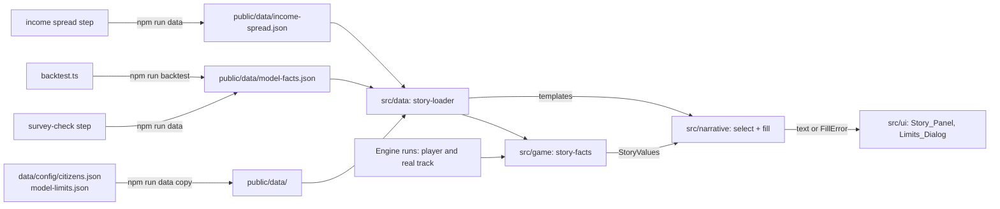

# Design Document

## Overview

The story layer loads two committed content files, fills their placeholders with computed values and shows the result. Content stays in `data/config/`; code only loads, fills and displays. It runs after game-ui and reuses its Data_Loader, Game_Controller, dialogs, UI_Strings_Module and banned-term test setup.

Decisions:

1. **Content files are copied to `public/data/`** by `npm run data` (a copy step, no transformation). The app fetches them through `src/data/` like other data files. They are a separate group (Story_Files) from the 6 Data_Files of game-ui Requirement 2, so a story load error never blocks the game.
2. **Build values go through generated JSON, not Markdown.** `public/data/model-facts.json`: `npm run data` writes the commute values, `npm run backtest` writes the backtest value, each by read-merge-write of its own keys. `public/data/income-spread.json`: `npm run data` writes the district sigmas. Alternative considered for sigma: a `params.json` entry. Rejected because the Engine does not use sigma and the parameter id-set check would flag it as extra. Alternative for model facts: two files (one per script). Rejected because the page then needs two loads for three numbers.
3. **The filler is pure and strict.** It receives formatted strings and throws on a missing value. State selection (which template applies) lives next to it in `src/narrative/`; numbers come from `src/game/`.
4. **The followed Persona is stored under its own `localStorage` key**, so the game-ui Save schema and Save_Code do not change. The Persona choice is therefore not carried in an exported Save_Code.
5. **The banned-term test imports `checkBannedTerms` and `parseTermList` from `scripts/pipeline/banned-terms.ts`.** Tests may import `scripts/`; `src/` may not.
6. **Persona numbers are a pure function in `src/simulation/persona.ts`**, called by the Game_Controller. `src/game/` holds no formulas (structure rules), and the function reads no file.

## Architecture



## Components and Interfaces

### Data: `src/data/story-loader.ts`

```ts
export interface Persona {
  id: string; name: string; homeCode: string; workCode: string | null;
  dwellingSize: number; incomePercentile: number; // 0 < p < 100
  intro: string; picker: string;
}
export interface CitizenFile {
  schemaVersion: 1;
  personas: Persona[];
  thresholds: { rentRisk: { value: number } };       // display line, percent of income
  templates: Record<string, Record<string, string>>; // group -> state -> text
}
export interface LimitsFile {
  schemaVersion: 1;
  page: { title: string; intro: string; disclosure: string; sourcesLink: string };
  sections: { id: string; title: string; items: { id: string; title: string; text: string }[] }[];
}
export interface ModelFacts {
  schemaVersion: 1;
  commuteModelled: number;  // minutes
  commuteSurvey: number;    // minutes
  backtestResult: string;
}
export interface IncomeSpread {
  schemaVersion: 1;
  incomeYear: 2023;
  source: { citation: string; dataset: '103066'; license: string };
  method: string;                       // text of the sigma formula and its limits
  sigma: Record<string, number>;        // District_Code -> sigma (> 0), 41 entries
}
export function loadStoryFiles(fetchJson: FetchJson, districtCodes: ReadonlySet<string>):
  Promise<Result<{ citizens: CitizenFile; limits: LimitsFile; facts: ModelFacts; spread: IncomeSpread }, StoryLoadError[]>>;
export function validateModelFacts(x: unknown): Result<ModelFacts, string>;
export function validateIncomeSpread(x: unknown, districtCodes: ReadonlySet<string>): Result<IncomeSpread, string>;
```

Validation follows Requirements 1.3, 1.6, 2.7 and 2.10. Unknown extra fields (`notes`, `household`, `age`, `templates` of `model-limits.json`, etc.) are ignored. Template ids are the dotted paths: `rent.atRisk`, `limits.survey-check` (section item id).

### Model facts writers (scripts)

- `scripts/lib/model-facts.ts`: `updateModelFacts(path, patch: Partial<Omit<ModelFacts,'schemaVersion'>>)` reads the file (or starts empty), merges the patch, writes with the project's stable JSON serializer. `serializeModelFacts` / `validateModelFacts` form the round-trip pair (Requirement 2.6). Uses only erasable syntax.
- The survey-check step (`scripts/pipeline/commute/step.ts`) already has the `SurveyCheckResult` and `SURVEY_MINUTES`; it calls `updateModelFacts({ commuteModelled, commuteSurvey })`. `commuteModelled` is stored unrounded.
- `scripts/backtest.ts` calls `updateModelFacts({ backtestResult })` after computing the `tpass-2023` case. It reads `templates.backtestResult` from `data/config/model-limits.json` and, for each of the three checks of the main result of `docs/BACKTEST.md`, picks the `met` or `notMet` sentence by the computed outcome (`direction`, `ratio`, `range`). It fills `{ratio}` (simulated central ÷ observed), `{toleranceLow}` and `{toleranceHigh}` at 3 decimals from the same fields that `docs/BACKTEST.md` prints, then joins the three sentences with the template's `join` string (`{direction} {ratio} {range}`). The `templates` block is read only by this script; the app ignores it. A missing sentence, a missing computed value or a leftover `{...}` in the result stops the script (Requirement 2.5).
- **Income spread step** (`scripts/pipeline/income/spread.ts`, called by `scripts/build-data.ts`): reuses the FIA quartile reader and `QUARTILE_Z` that `scripts/pipeline/params/ghost.ts` uses, computes `sigma = (ln Q3 - ln Q1) / (2 × 0.6745)` for the 41 districts and writes `public/data/income-spread.json` (`serializeIncomeSpread` / `validateIncomeSpread` form a round-trip pair). `source.citation` is the FIA comprehensive income tax statistics by village, income year 2023 (dataset 103066, Open Government Data License 1.0); `method` repeats the formula and the limits written in the `ghost.ts` header (FIA income is per tax unit, excludes transfers, log-normal is an approximation). If `ghost.ts` has no exported quartile reader, the step reads the file through the same parser function and does not copy the parsing code.

### Narrative: `src/narrative/`

```ts
// fill.ts
export class FillError extends Error {
  constructor(readonly templateId: string, readonly placeholder: string) { super(`${templateId}: no value for {${placeholder}}`); }
}
export function placeholdersOf(template: string): string[];
export function fillTemplate(templateId: string, template: string, values: Readonly<Record<string, string>>): string;

// registry.ts
export type Producer = 'storyFacts' | 'modelFacts';
export const PLACEHOLDER_REGISTRY: Readonly<Record<string, Producer>>;
// 22 storyFacts names + commuteModelled, commuteSurvey, backtestResult (modelFacts)

// select.ts
export interface StoryState {
  rent: 'below' | 'atRisk' | 'ghost';
  commute: 'none' | 'below' | 'atRisk' | 'ghost';
  comparison: 'same' | 'lower' | 'higher';
  showRange: boolean;
  stateChange: 'becameGhost' | 'leftGhost' | null;
  showBecameGhostReal: boolean;
}
export function storyLines(
  templates: CitizenFile['templates'], state: StoryState, values: Record<string, string>,
): { id: string; text: string }[]; // each line is a filled template or a FillError result
```

`fillTemplate` matches `\{([A-Za-z0-9_.]+)\}`. A line whose fill fails is returned as `{ id, error: FillError }`; the UI shows "no value" for it (Requirement 3.6). `ending` lines are produced by a second function `endingLines(templates, values)`.

### Simulation: `src/simulation/persona.ts`

```ts
export function normalQuantile(p: number): number;          // 0 < p < 1; reuse an existing quantile if the repo has one
export function personaRentBurden(i: {
  rentPerM2: number; dwellingSize: number;                   // TWD per m2 per month, m2
  householdIncome: number; sigma: number; incomePercentile: number; // TWD per year, 0 < p < 100
}): number;                                                  // percent of monthly income
```

`income = householdIncome × exp(sigma × normalQuantile(incomePercentile / 100))`; `burden = rentPerM2 × dwellingSize / (income / 12) × 100`. The same form as the ghost rule's burden `1200 × R / income`, so a Persona at the median (percentile 50) has the burden of the district median household. Commute minutes are a lookup in `commute-matrix.json` (home → work) done by the Game_Controller.

### Game: `src/game/story-facts.ts`

```ts
export interface StoryFacts {
  state: StoryState;
  values: Record<string, string>;     // formatted, absent key = no value
  endingValues: Record<string, string> | null; // only when the Completed_Marker is set
}
export function buildStoryFacts(input: {
  persona: Persona;
  params: ParamTable;                 // thresholds and ghostSize
  rentRiskThreshold: number;          // citizens.json thresholds.rentRisk.value
  spread: IncomeSpread;
  commuteMatrix: CommuteMatrix;
  householdIncome: (code: string, q: QuarterKey) => number;  // history.json
  playerRun: RentSeries;              // home-district rent per quarter, with Result_Range
  realRun: RentSeries;
  displayed: QuarterKey;
  districtNames: ReadonlyMap<string, string>;
  format: NumberFormatter;            // game-ui Requirement 6.10
}): StoryFacts;
```

Threshold mapping: `rentGhostThreshold` = `ghost.rentThreshold.value`; `commuteGhostThreshold` = `ghost.commuteThreshold.value`; `commuteRiskThreshold` = `ghost.commuteThreshold.range.low`; `rentRiskThreshold` = `thresholds.rentRisk.value`.

The rent series comes from the Engine through existing Game_Controller read models. The commute is the matrix value, so it is the same in the player run and the real run. A missing rent, income, sigma or matrix value means the key is absent from `values` (Requirement 4.8).

Derived Placeholders: `rentBurdenDiff` = absolute difference in percentage points; `commuteHoursMonth` = `commuteMinutes × 2 × 22 / 60` using the commute parameters of `params.json` (trips per day, days per month), not constants in code; `quartersAtRisk`, `quartersGhost` (and their `Real` forms) are counts over the 44 quarters; `realQuarter` is the first real-run ghost quarter; `commuteAvg` is the mean over the 44 quarters.

### UI: `src/ui/story/` (after design approval)

- `story-panel.ts`: renders the picker or the followed Persona's `intro` and the lines of `storyLines`; announces updates through the existing live region (game-ui 17.7).
- `limits-dialog.ts`: builds the dialog with the dialog component of game-ui; fills each item with `fillTemplate('limits.<id>', text, modelFactsValues)`.
- `story-store.ts` (`src/ui/` or `src/save/`): reads and writes `{ schemaVersion: 1, personaId }` under key `butterflycity.story.v1`; invalid content returns `null`.
- Chrome text goes to the UI_Strings_Module. Styles use tokens only.

Model facts → values: `commuteModelled` and `commuteSurvey` formatted as whole minutes; `backtestResult` as is.

## Data Models

| File | Written by | Read by |
|---|---|---|
| `public/data/citizens.json` | `npm run data` (copy) | `src/data/story-loader.ts` |
| `public/data/model-limits.json` | `npm run data` (copy) | `src/data/story-loader.ts` |
| `public/data/model-facts.json` | `npm run data` (commute keys), `npm run backtest` (`backtestResult`) | `src/data/story-loader.ts`, tests |
| `public/data/income-spread.json` | `npm run data` (income spread step) | `src/data/story-loader.ts`, tests |
| `localStorage` `butterflycity.story.v1` | Story_Panel | Story_Panel |

`model-facts.json` and `income-spread.json` are committed so the placeholder test can run without raw data. `data/SOURCES.md` gets one line per `model-facts.json` key naming its source step and one entry for `income-spread.json` (agency, dataset 103066, income year 2023, license, method); `data/DOWNLOAD.md` is unchanged.

## Error Handling

| Condition | Result |
|---|---|
| Story file fetch, parse or validation error | One line naming file and first error in the affected panel; game continues (Req 1.4) |
| Missing Placeholder value at runtime | `FillError`; line shows "no value" (Req 3.6) |
| Missing Placeholder value in a test | Test fails with Template_Id and Placeholder (Req 8.3) |
| Unknown Placeholder name in content | Test fails (Req 3.5) |
| Missing computed value in a writer script | Script stops, names the value, writes nothing (Req 2.5) |
| Invalid stored Persona id | Picker shown again (Req 5.3) |

## Correctness Properties

*A property is a statement that must hold for all valid inputs.*

### Property 1: Fill replaces every placeholder

*For any* template and Story_Values that contain every placeholder of the template, the output of `fillTemplate` contains no `{name}` placeholder, and equals the template with each placeholder replaced by its value.

**Validates: Requirements 3.1, 3.3**

### Property 2: Missing value is reported with its location

*For any* template with at least one placeholder and Story_Values that lack one of them, `fillTemplate` throws a `FillError` whose `templateId` and `placeholder` equal the ones given and missing.

**Validates: Requirements 3.2, 8.3**

### Property 3: Model facts round trip

*For any* valid Model_Facts object, `validateModelFacts(parse(serializeModelFacts(x)))` equals `x`. A merge patch changes only the patched keys.

**Validates: Requirements 2.3, 2.6**

### Property 4: Content is complete and neutral

Every Template of the two content files is fillable from the registry and a complete fixture, and neither the raw nor the filled text contains a banned term.

**Validates: Requirements 7.1, 7.2, 7.3, 7.4, 8.3, 8.4**

## Testing Strategy

Only the two tests required by the product owner are specified (no optional tests):

1. `tests/narrative/placeholders.test.ts`: reads the committed `data/config/citizens.json`, `data/config/model-limits.json`, `public/data/model-facts.json` and `public/data/income-spread.json`; builds a complete fixture from `PLACEHOLDER_REGISTRY` (a sample string per storyFacts name, the real `model-facts.json` values for modelFacts names); calls `fillTemplate` for every Template (not the `templates.backtestResult` block); collects every `FillError` and fails once with a list `templateId: {placeholder}`. Also fails for a placeholder name not in the registry. It adds one schema check, the only test beyond the two required kinds: `validateIncomeSpread` on the committed file (41 finite positive sigmas, the codes of `districts.json`). It includes Properties 1 to 3 as small fast-check cases only if they cost no extra task.
2. `tests/narrative/banned-terms.test.ts`: runs `checkBannedTerms` with the lists read by `parseTermList` from `data/config/banned-terms.txt` and `banned-terms-exempt.txt` over raw Templates, persona and page fields, the `templates.backtestResult` sentences, and the filled text of the first test's fixture.

Implementation of the writers, the loader and `persona.ts` is checked by the two tests and by the type check; the budget rules forbid extra test tasks.
